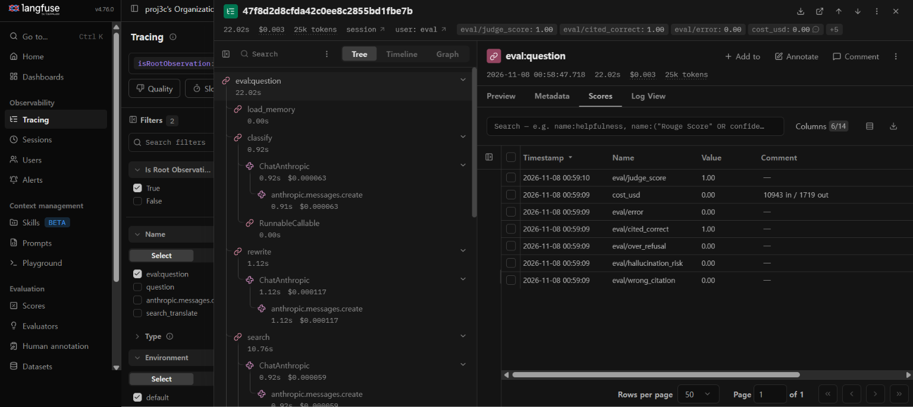
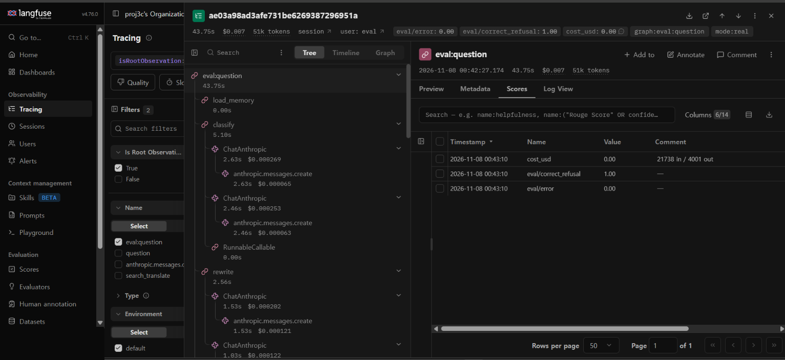

# 평가 리포트

> 제출물입니다. 최종 제출(11/17 24:00)까지 작성합니다. 숫자가 나빠도 괜찮습니다. **재고, 원인을 알고, 무엇을 시도했는지**가 평가 대상입니다. 버린 시도도 적으세요.
>
> 이 문서의 숫자는 `evals/results/`의 원시 결과와 Langfuse 트레이스에서 나온 것만 씁니다.

## 1. 코퍼스와 인덱스 (G3)

| 항목 | 내용 |
|---|---|
| 산업과 문서 종류 | IT·플랫폼. 실제 IT 회사인 GitLab의 공개 핸드북(CC BY-SA 4.0)에서 개발·운영 조직의 정책과 런북 절을 골랐다. Markdown 문서이고 권한표가 포함된다. 커밋 `129243bc`로 고정. 코퍼스는 영어이고 평가셋 질문은 한국어다 |
| 서로 다른 문서 수 / 서로 다른 청크 수 | 문서 1,565건(청크가 있는 문서 1,512건, 53건은 본문이 없어 청크가 없다) / 청크 23,095개, 그중 서로 다른 청크 22,378개(본문 sha256 기준). 53건은 청킹 결과 청크가 하나도 나오지 않은 쪽 50건(`data/manifest.jsonl`의 `skipped`가 `no_body`)과 다른 쪽으로 넘기는 쪽 3건(`skipped`가 `redirect`)이다. 이 53건의 원문 길이는 모두 1,117자 이하다 |
| 문서 파싱 방식 (PDF, 표, 스캔 중) | 표. 핸드북 Markdown(`markdown-it-py`, 표 켬) + Hugo 단축코드 정리 + HTML 표·2023 권한표 CSS grid(`beautifulsoup4` + `lxml`). 1,561쪽 → 요소 85,388개(원본 줄 되찾기 실패 0), 권한표 363칸(역할 주석 대조 불일치 0). 재현: `python -m backend.rag.ingest.parse` |
| 청킹 방식과 크기, 겹침 | 제목 경로 단위, 최대 800자, 겹침 120자. 500자와 1200자 비교는 [임베딩 측정 기록](docs/embedding_measurement.md) 2장 |
| 임베딩 모델과 선택 근거 | `voyage-4`(1024차원, 문서와 질문 모두 Voyage API), 영어 문장 벡터. 2026-11-03 팀 확정. 기준선은 `bge-m3`이다. 비교 값과 이유는 3-2절과 [임베딩 측정 기록](docs/embedding_measurement.md) 10장, 11장에 있다. 후보를 좁힌 과정은 [decisions.md](docs/decisions.md)에 있다 |
| 벡터DB와 선택 이유, 한계 | Supabase pgvector, 가이드 권고를 따름. `voyage-4` 23,095청크를 적재했다. 한계: 무료 등급 Nano에서 전수 비교 벡터 질의가 SPEC 검색 p95 3초를 넘는다 |
| manifest 위치 | `data/manifest.jsonl` |

**원문 대조 3건 이상**: 파싱 결과를 원문과 나란히 놓고 틀어진 곳을 적습니다.

| # | 문서 | 원문에서 본 것 | 파싱 결과 | 틀어진 곳 |
|---|---|---|---|---|
| 1 | Incident Management (`engineering/infrastructure-platforms/incident-management/_index.md`, 커밋 129243bc) | 단축코드·경고 상자가 많은 쪽, 요소 15개를 같은 판 원본 줄 링크로 봄 | 15개 모두 같은 내용(단축코드·`**`·링크 주소만 지워짐) | 없음 (박진형 판정) |
| 2 | Test Environments Catalog (`engineering/testing/test-environments-catalog.md`) | Markdown 표가 많은 쪽, 요소 15개 | 15개 모두 같은 내용, 표 행은 머리 이름과 칸이 짝지어짐 | 없음 (박진형 판정) |
| 3 | 2023 승인 권한표 (`www-gitlab-com` 커밋 0a3de83375) | 글자 있는 칸 71개의 값·업무·금액 구간·역할 | 71칸 모두 일치. 363칸 전부 칸마다 붙은 역할 주석과 열 이름을 코드로 대조해 불일치 0 | 파서 오류 없음. 원문 자체의 'Non Billable Expenses' 금액 구간 겹침은 문제 기록 I-004 (박진형 판정) |
| 4 | Trust and Safety (`security/security-operations/trustandsafety/_index.md`) | HTML 표 팀원 5명. 원문 HTML이 깨짐(46줄 `</tr>` 자리에 `<tr>`) | `lxml` 엔진: 5명 5행. 처음 쓴 Python 기본 엔진(`html.parser`)은 4명을 한 행으로 뭉쳤음 → PRD 9장대로 `lxml` 로 바꿈 | 바꾼 뒤 없음 (Claude Code 확인, 사람 대조 전. 이 쪽 말고 바뀐 요소 0) |

## 2. 평가셋 (G5)

| 항목 | v1 | v2 |
|---|---|---|
| 동결일 | 2026-11-01 (기한 11/3) | 2026-11-02 (기한 11/6) |
| 건수 (관련 / 비관련) | 30 (15 / 15) | 50 (25 / 25) |
| 비관련 4종 건수 (도메인 밖 / 없는 대상 / 없는 항목 / 기간 다름) | 4 / 4 / 4 / 3 | 6 / 7 / 6 / 6 |
| sha256 | `174996b9b499da38f739f700854e919bf7f122c3bbffb6c73021d31a1e9f4332` | `c0d55f99677bc3dd86f99ee6c2845c3afb58b06a82516b448b6f7e6d36338c76` |
| 코퍼스 버전과 정답 기준일 | 커밋 `129243bc`, 29문항 2026-10-27, 15번 2023-05 | 커밋 `129243bc`, 48문항 2026-10-27, 15번과 40번 2023-05 |
| 정답을 정한 사람과 기준 | 박진형, 강경희가 따로 판정하고 30건 모두 Y. 위치가 갈린 1, 6, 7, 11, 14번은 합의. 정답은 섹션 위치로 적음(`docs/specs/eval-retrieval.md`) || 앞 30건은 v1과 같음. 새 20건은 박진형, 강경희가 따로 판정하고 모두 Y. 위치가 갈린 31, 38번은 최종 위치를 `evals/judge_sheet_v2.csv`에 적음. 36번은 합의로 위치를 추가해 같은 파일에 적었고, 33, 37, 39번은 표기만 달랐음. 정답은 섹션 위치로 적음 |
| 질문을 쓴 사람과 정답 청크를 찾은 사람이 다른가 | 다르다. 질문 초안은 김승욱이 요청해 AI 도구로 코퍼스를 열어 작성했다. 정답 칸을 비운 뒤 박진형이 코퍼스와 대조해 채웠고, 박진형과 강경희가 판정했다. 판정 시트에 초안 정답이 함께 보였고, 판정자에게 검색 결과는 보여 주지 않았다. 질문을 정답을 보지 않고 썼다는 기록은 없다 || 다르다. 새 20건의 질문 초안도 같은 방식으로 작성했고, 정답 칸을 비우는 단계 없이 박진형과 강경희가 판정했다. 판정 시트에 초안 정답이 함께 보였고, 판정자에게 검색 결과는 보여 주지 않았다. 질문을 정답을 보지 않고 썼다는 기록은 없다 |
| 동결 뒤 지표에서 뺀 문항 수와 사유 (`evals/exclusions.json`) | 0건 | 0건 |

**측정 축** (아래 5개를 나눠 보고하고 하나의 정확도로 합치지 않습니다. 필요하면 Recall@k, MRR을 더합니다)

| 지표 | 뜻 | 관련/비관련 |
|---|---|---|
| 정답 근거 인용률 | 답하고, 인용한 근거가 정답 근거와 일치 | 관련 |
| 오답 근거 | 답했지만 인용한 근거가 틀림 | 관련 |
| 과잉 거절 | 답이 있는데 거절 | 관련 |
| 올바른 거절 | 답이 없어서 거절 | 비관련 |
| 환각 위험 | 답이 없는데 답함 | 비관련 |

**판정 방식과 한계**: 지표 5개와 인용 정확도는 규칙 기반이다. 사람이 정한 정답 위치(위 표의 판정)와 답이 인용한 청크를 코드가 맞춰 센다(`evals/agent/run_eval.py`의 `_row`, `compute_metrics`). 관련 문항은 인용한 청크가 정답 위치에 맞는 비율로 정답 근거 인용률(정답 위치가 둘이면 맞힌 수를 2로 나눈다)을 세고, 정답 위치 밖 청크를 하나라도 인용한 답의 비율을 오답 근거로 센다. 비관련 문항은 그래프가 답을 냈는지로 올바른 거절을 세고, 환각 위험은 답 초안이 나온 문항 중 가짜 인용을 냈거나 비관련 문항에 답한 비율로 센다. 이 지표에는 LLM 판정자가 들어가지 않으므로 판정 모델이 생성 모델과 같아지는 문제가 없다. 정답 위치는 질문을 쓴 사람과 다른 박진형, 강경희가 따로 판정하고 갈린 위치는 합의했다. LLM 채점기(`evals/agent/judge.py`의 `judge_answer`, `run_eval.py --judge`)는 선택 기능이며 3장과 4장에 실은 측정은 이 옵션 없이 돌려 `judge_score`가 비어 있다. 이 옵션은 그래프와 같은 모델(`get_chat_model()`)을 쓰므로 생성 모델과 달라야 한다는 조건을 충족하지 않아 점수로 보고하지 않았다. 측정 도구는 `tests/test_agent_eval.py`로 확인했다(손으로 계산한 값과 일치하는지, 분모가 0이면 값이 없는지, 한 문항이 실패해도 측정이 이어지는지, 채점 응답이 깨져도 점수를 지어내지 않는지, 정답 위치에 맞는 인용만 세는지).

한계: ① 위치로만 맞추므로 정답 위치와 같은 내용이 다른 페이지 청크에도 있으면 그 청크를 인용해도 오답 근거로 세어 오답 근거가 실제보다 높게 나올 수 있다. ② 인용한 위치가 맞아도 답의 문장이 정답 문장과 같은지는 이 지표가 보지 않는다(3-0-1절에서 인용이 맞아도 내용이 빠진 사례를 확인했다). ③ 정답은 사람이 섹션 위치로 정했으므로 정답을 정한 기준과 판정자 사이의 불일치(위 표)가 그대로 점수에 들어간다.

## 3. 검색 개선 전후 (사전 등록, 한 번에 하나만)

> **한 번 재고 끝내면 G5는 미충족입니다.** 바꾸기 전에 `evals/PREREGISTER.md`에 기대를 적고, 같은 평가셋으로 다시 재서 **어느 문항이 회귀했는지** 보여야 합니다.
>
> 전후 차이가 1~4문항이면 "개선"이라 쓰지 마세요. 달라진 문항 목록과 부호 검정(또는 문항 수가 적어 구별할 수 없다는 한계)을 같이 적습니다. 개선이 없거나 악화여도 사전 등록과 원인 분석이 있으면 불이익이 없습니다.

| # | 바꾼 것 (하나) | 사전 등록한 기대 | 지표 (전 → 후) | 달라진 문항 수 (좋아짐 / 나빠짐) | 회귀한 문항 | 판단 |
|---|---|---|---|---|---|---|
| 0 | 베이스라인 (v1, 2026-11-02 측정): `bge-m3`, 한국어 질문 벡터 검색, 리랭커 없음 | 해당 없음(기준값) | Recall@5 0.700 (95% 구간 0.467~0.900), MRR 0.602, nDCG@5 0.601, 쪽 적중 0.800 | 해당 없음 | 해당 없음 | 기준값 |
| 1 | 검색 1차 비교 418조합(후보를 추리는 탐색). 세부는 3-0절 | 사전 등록 #1 | 3-0절 표 | 3-0절 표 | 없음 | 후보 6개로 좁힘. 전후 판단 대상이 아님 |
| 2 | 검색 2차 비교 65조합과 기준선. 기준선 대 전체 1위(arctic-l-v2, 하이브리드, 리랭커 bge) | 기준선 0.55~0.75, 1위 0.78~0.92, 기준선보다 +0.10~+0.25, 1위 방식 하이브리드 | Recall@5 0.753 → 0.893, MRR 0.721 → 0.836 | 5 / 0 (부호 검정 p 0.0625) | 없음 | 전체 1위는 CPU p95 추정 7.2초로 5초 규칙을 넘어 추천에서 뺌. 결과는 `evals/results/retrieval_v2_round2/`, 측정 문서 10장. 2026-11-03 리랭커 bge int8 13조합을 점수 저장 값 없이 다시 쟀다(`backend/rag/retrieve/retrieve.md` I-013, `evals/results/retrieval_v2_round2_clean/`). 기준선과 전체 1위는 int8이 아니어서 값이 같다. 처음 측정 값은 `evals/results/retrieval_v2_round2/`에 그대로 있다 |
| 2-1 | 하이브리드만. `voyage-4`, 리랭커 없음, 한국어 벡터에 영어 검색어 BM25를 더함. 평가셋 v2 관련 25건 | 사전 등록 #2, #5의 격자. 이 전후만의 기대는 없음 | Recall@5 0.837 → 0.790, MRR 0.828 → 0.755 | 1 / 2 (p 1.0) | 11, 36번 | 쓰지 않음. 올리지 못했다. 3문항 차이라 나빠졌다고 단정하지 않는다 |
| 2-2 | 리랭커만(bge, 후보 10). `voyage-4` 영어 문장 벡터. 평가셋 v2 관련 25건 | 위와 같음 | Recall@5 0.843 → 0.837, MRR 0.838 → 0.833 | 1 / 1 (p 1.0) | 1번 | 쓰지 않음. 올리지 못했고 CPU p95 추정이 0.7초에서 7.7초로 늘었다 |
| 2-3 | 리랭커만(bge, 후보 10). `arctic-l-v2` 하이브리드. 평가셋 v2 관련 25건 | 위와 같음 | Recall@5 0.773 → 0.893, MRR 0.733 → 0.836 | 4 / 0 (p 0.125) | 없음 | 쓰지 않음. 72조합 중 Recall@5 1위지만 CPU p95 추정 7.2초로 SPEC 3초와 사전 규칙 5초를 넘는다. 4문항 차이라 개선이라 쓰지 않는다 |
| 3 | 메타데이터 필터 `as_of`, `as_of`와 `org`(정답 절을 넣은 상한). 7개 조합, 벡터만, 리랭커 없음 | `as_of` 변화 0, `org`는 Recall@5 +0.00~+0.13, MRR +0.00~+0.15 | `as_of`는 7개 조합 모두 변화 없음. `org`는 Recall@5 +0.000~+0.133, MRR +0.004~+0.095 | Recall@5 기준 조합별 0~2문항이 좋아지고 나빠진 문항 없음 | 없음 | `org` 값은 상한이라 개선으로 쓰지 않음. 결과는 `evals/results/retrieval_v1_filter/` |
| 4 | 청크 크기 500자와 1200자(800자 대비). 후보 6개, 벡터만, 리랭커 없음 | Recall@5는 500자 -0.10~+0.07, 1200자 -0.13~+0.07. MRR은 -0.10~+0.10 | Recall@5 변화 -0.067~+0.033, MRR 변화 -0.133~+0.024 | 문항과 구성 쌍 기준 500자 2 / 4, 1200자 4 / 6 | 구성별 목록은 `docs/embedding_measurement.md` 2장 | KEEP 800자와 겹침 120자. 한 방향의 개선이 없음. 결과는 `evals/results/retrieval_v1_chunk_size/` |
| 5 | 임베딩과 리랭커 추천 규칙 적용. 기준선 대 추천(voyage-4, 영어 문장 벡터, 리랭커 없음). 2026-11-03 bge int8 재측정으로 추천이 바뀜 | 추천 Recall@5 0.75~0.90, MRR 0.60~0.85, 그래프 정답 근거 0.55~0.85, 올바른 거절 0.85~1.00, 환각 위험 0.00~0.15 | Recall@5 0.753 → 0.843, MRR 0.721 → 0.838. 그래프 정답 근거 0.693 → 0.890, 올바른 거절 0.960 → 1.000, 환각 위험 0.043 → 0.000 | 4 / 1 (부호 검정 p 0.375, 문항 수가 적어 구별할 수 없음) | 39번 1문항 | 추천, 확정 전. CPU p95 추정 0.7초로 SPEC 3초 통과. 2026-11-03 재측정 전 추천은 문서 voyage-4, 질문 nano, 영어 문장 벡터, 리랭커 bge int8(Recall@5 0.837, MRR 0.850, 그래프 정답 근거 0.817)이었다. int8 점수를 조합끼리 저장해 쓴 영향으로 재측정 뒤 MRR이 0.830이 되어 두 번째가 됐고, 두 조합의 차이는 25건에서 구별되지 않는다. 그래프 정답 근거 0.890은 사전 등록 기대 상한 0.85를 넘어 그 기대는 틀림 |
| 6 | 청크 크기·겹침 12칸(500, 800, 1000, 1200자 × 겹침 75, 120, 180자). 기준은 800/120. 후보 두 개: `voyage-4` 영어 문장 벡터 리랭커 없음, `arctic-l-v2` 하이브리드 + bge int8 후보 10. 사후 등록(#6) | 기대 없음(결과를 본 뒤 등록) | `voyage-4` Recall@5 0.833 → 0.800(500자 3칸), 0.833(나머지 8칸). MRR 0.833 → 0.756~0.833. `arctic-l-v2` Recall@5 0.833 → 0.700~0.900, MRR 0.724 → 0.606~0.786 | `voyage-4` 500자 3칸은 0 / 1. `arctic-l-v2`는 칸마다 좋아짐 0~2 / 나빠짐 0~3 (1200/75는 2 / 0, 500/75는 1 / 3). 부호 검정 p는 모두 0.5 이상 | `voyage-4` 500자 칸의 2번(1 → 0.5). `arctic-l-v2` 500자 칸의 2, 7, 9번, 800/75와 1000/120과 1200/180 칸의 7번 | 한 방향의 개선이 없다. `voyage-4`는 500자만 낮고 나머지 같다. `arctic-l-v2` 1200/75의 0.900은 1번과 3번이 부분 정답으로 바뀐 2문항 차이(p 0.5)이고, 12칸 중 최고를 같은 15건으로 골라 낙관적이다. 구별할 수 없다. 800/120 유지. 결과는 `evals/results/retrieval_chunk_grid_v1/`, 측정 문서 11.7 |
| 7 | 질문 분해만. 평가셋 v1 30건 동결본(관련 15, 비관련 15), k=5. 기준은 `voyage-4`, 영어 문장 벡터, 청크 800/120, 리랭커 없음. 서로 다른 사실을 둘 이상 묻는 질문만 Haiku 5.5가 하위 질문으로 나누고 순위를 번갈아 합친다. 사후 등록(#7) | 기대 없음(결과를 본 뒤 등록) | Recall@5 0.833 → 0.900, hit@5 0.867 → 0.933, MRR 0.833 → 0.867, nDCG@5 0.803 → 0.854. Haiku 정답 위치 인용 13/15(3, 7번 못 함) → 14/15(7번 못 함), 비관련 거절 15/15 → 14/15(22번) | 2 / 0 (3번 0 → 0.5, 6번 0.5 → 1.0, 부호 검정 p 0.5) | Recall@5 기준 없음. nDCG@5 기준 2번 0.920 → 0.877 | 2문항 차이라 개선이라 쓰지 않는다. 사후 규칙이고 새 문항 검증이 없다. 22번 거절 차이는 분해만과 L1x2만과 둘 다의 상위 5가 같아 규칙의 효과가 아니라 Haiku 실행 차이다. 30건 중 11건이 나뉘었다(관련 9, 비관련 2). 결과는 `evals/results/retrieval_fix_v1/decompose/`, 측정 문서 11.2 |
| 8 | 링크 확장 L1x2만. 평가셋 v1 30건 동결본(관련 15, 비관련 15), k=5. 기준은 `voyage-4`, 영어 문장 벡터, 청크 800/120, 리랭커 없음. 상위 5개 청크의 링크 대상 페이지에서 질문과 가장 가까운 2개로 4, 5위를 바꾼다. 사후 등록(#8) | 기대 없음(결과를 본 뒤 등록) | Recall@5 0.833 → 0.900, hit@5 0.867 → 0.933, MRR 0.833 → 0.847, nDCG@5 0.803 → 0.829. Haiku 정답 위치 인용 13/15 → 14/15(3번 못 함), 비관련 거절 15/15 | 1 / 0 (7번 0 → 1, p 1.0) | 없음 | 1문항 차이라 개선이라 쓰지 않는다. 근거가 7번 1문항이고 사후 규칙이며 새 문항 검증이 없다. `arctic-l-v2`에서는 같은 규칙이 7번을 잃어 Recall@5가 0.833 → 0.767로 낮아졌다(0 / 1). 링크로 가져온 청크는 `org`와 `as_of` 필터를 거치지 않는다. 결과는 `evals/results/retrieval_fix_v1/voyage/L1x2.json`, 측정 문서 11.2 |
| 9 | 질문 분해 + L1x2 둘 다. 평가셋 v1 30건 동결본(관련 15, 비관련 15), k=5. 기준은 `voyage-4`, 영어 문장 벡터, 청크 800/120, 리랭커 없음. 팀이 2026-11-03 확정. 사후 등록(#9) | 기대 없음(결과를 본 뒤 등록) | Recall@5 0.833 → 0.967, hit@5 0.867 → 1.000, MRR 0.833 → 0.880, nDCG@5 0.803 → 0.880. Haiku 정답 위치 인용 13/15(3, 7번 못 함) → 15/15를 3회, 비관련 거절 15/15 → 15/15를 3회. 관련 15건 × 3회 = 45건 답 판정(AI 판정, 사람 판정 전) 맞음 45 | 3 / 0 (3번 0 → 0.5, 6번 0.5 → 1.0, 7번 0 → 1, p 0.25) | Recall@5 기준 없음. nDCG@5 기준 2번 0.920 → 0.877 | 3문항 차이라 개선이라 쓰지 않는다. 두 규칙 모두 실패 문항을 본 뒤 추가한 사후 규칙이고 같은 30건으로 확인했으며 새 문항 검증이 없다. L1x2의 근거는 7번 1문항이다. 3번 정답 위치 `Release Day (Third Thursday)`는 여전히 찾지 못해 Recall@5가 0.5다. 맞음 45는 AI가 기대 답과 대조한 값이고 사람 판정 전이다. 3회는 같은 검색 저장값으로 답변만 반복했다. 결과는 `evals/results/retrieval_fix_v1/decompose/voyage/dec+L1x2.json`, 측정 문서 11장 |
| 10 | 링크 자리 보장 `link_keep_per_sub` 0 → 2(현재 코드 기본값)만. 나뉜 질문은 하위 질문마다 2자리를 지키고 남은 자리만 링크로 바꾼다(하위 질문 2개면 1자리, 3개면 0자리). 평가셋 v1 30건 동결본(관련 15, 비관련 15), k=5. 기준은 `voyage-4` 영어 문장 벡터, 청크 800/120, 리랭커 없음, 저장된 분해(11건), L1x2. 서비스 `Searcher`에 저장 벡터를 넣고 로컬 pgvector `PgStore` 전수 비교로 쟀다(운영 DB·LLM·Voyage 호출 없음). 필터(`as_of`, `org`) 없음. 사전 등록(#26) | 돌려준 청크 집합이 달라지는 문항은 정확히 5개(3, 4, 6, 13, 25번). Recall@5 0.933~1.000, 가장 그럴듯한 값 0.967(변화 없음) | Recall@5 0.967 → 0.967. 청크 집합이 달라진 문항은 3, 4, 6, 13, 25번 5개이고 나머지 25개는 같다. 링크로 바꾼 자리는 30문항 합계 28개 → 22개 | 0 / 0 (집합이 달라진 관련 문항 3, 4, 6, 13번의 Recall@5가 모두 그대로, 3번 0.5와 나머지 1.0) | 없음 | 기대가 맞았다. 점수가 그대로이므로 개선 근거가 아니라 떨어지지 않았다는 근거다. 이 30건으로는 효과를 점수로 구분할 수 없다. 필터(`as_of`, `org`)를 건 경우는 재지 않았다. 결과는 `evals/results/linkkeep_v1/` |
| 11 | 저장소의 벡터 검색만 전수 → HNSW(`SEARCH_HNSW=1`, 색인 `chunks_emb_hnsw_half`, `hnsw.ef_search=200`, `iterative_scan=strict_order`). 링크 후보 질의는 코드상 항상 전수다. keep=0과 keep=2 두 경우에서 각각 비교. 나머지는 10행과 같다(같은 로컬 DB, 같은 저장 벡터, v1 30건, k=5, 필터 없음). 사전 등록(#27) | 최종 상위 5 집합이 전수와 같은 문항 30건 중 28~30, 벡터 질의 42개 중 40~42 일치, Recall@5 차이 -0.033~0 | Recall@5 0.967 → 0.967(keep=0, keep=2 모두). 최종 상위 5 집합 30/30 일치(두 경우 모두), 벡터 질의 42/42 일치, `EXPLAIN`에 `Index Scan using chunks_emb_hnsw_half` 있음(pgvector 0.8.7) | 0 / 0 (달라진 문항 없음) | 없음 | 기대가 맞았다. 점수가 그대로이므로 개선 근거가 아니라 떨어지지 않았다는 근거다. 검색 시간은 8장에 참고값으로 적었다. 색인은 한 번 만든 것으로 쟀고, 필터(`as_of`, `org`)를 건 경우는 재지 않았다. 결과는 `evals/results/linkkeep_v1/` |

6~9행은 모두 결과를 본 뒤 등록한 행이라 사전 등록 기대가 없다. 값은 `docs/embedding_measurement.md` 11장과 `evals/results/retrieval_fix_v1/`, `evals/results/retrieval_chunk_grid_v1/`의 원시 결과에서 옮겼고, 달라진 문항과 부호 검정은 문항별 Recall@5로 직접 센 값이다. 1~4문항 차이는 개선이라 쓰지 않으며, 관련 15건에서 1문항은 Recall@5 0.067이다. 팀은 9행의 조합으로 검색을 확정했다. v2 50건 재측정은 아직 하지 않았다. 10~11행은 사전 등록(#26, #27)을 먼저 커밋한 뒤 저장 벡터로 쟀고, 값은 `evals/results/linkkeep_v1/`(`linkkeep_v1.md`, `summary.json`)에서 옮겼다.

2-1~2-3행은 65조합과 72조합 격자에서 한 가지만 다른 값을 뽑은 전후이며, 하나씩 따로 다시 잰 것이 아니다. 3-2절의 하이브리드 행은 채택 기본형인 영어 벡터와 비교한 값이라 문항이 다르다. 분해와 L1x2 위에서는 재지 않았다. 세부는 측정 문서 5장, 6장, 10장에 있다. 확정 조합은 둘 다 쓰지 않으며, 이유와 값은 3-2절에 적었다.

**베이스라인 조건** (`evals/results/baseline_v1/`, 동결본 sha256 `174996b9…`, 관련 15건, k=5)
- 조합은 1차 비교 전에 PRD·SDD에 적어 둔 기본값 `bge-m3`를 쓴다. 다만 점수는 1차 비교 결과를 본 뒤 기록했다.
- 실행기는 평가 전용 `evals/retrieval/experiment_v1.py`이며 서비스 `search()`가 아니다. `search()`가 나오면 같은 평가셋으로 다시 잰다.
- 문항별 Recall@5: 1·3·7·11번은 0(정답 섹션 없음), 6번은 0.5, 나머지 10문항은 1. 1·7·11번은 정답 쪽도 상위 5개에 없다.
- 문서·질문 벡터는 1차 비교 때 만든 캐시를 썼고 질문 문장은 동결 뒤에도 같다. 평가셋 동결 전 같은 조합 값은 0.689로, 달라진 문항은 판정으로 정답 위치가 바뀐 6번(0.333에서 0.5)이다.
- 비관련 15건은 거절 0건이다. 검색 단계에 거절 기준이 없고, 거절은 답 생성 단계에서 잰다.
- 지연 칸은 캐시한 벡터의 내적 시간이라 응답 시간으로 쓸 수 없다. 응답 시간은 8장에서 따로 잰다.

### 3-0. 검색 1차 비교 (평가셋 v1 관련 15건, 2026-10-31)

사전 등록 #1의 418조합(임베딩 9 × 방식 4 + BM25만 2, 리랭커 11)을 PR #23 청크(23,095개)와 동결 전 `evals/dataset_v1.jsonl`로 쟀다. 지표는 k=5, 섹션 위치 단위 Recall@5와 MRR이다. 원시 결과는 `evals/results/retrieval_v1_round1/results.tar.gz`(조합별 JSON 418개)이고 전체 표는 그 폴더의 `compare.md`, 실행기는 `evals/retrieval/experiment_v1.py`다. 영어 질의(문장·검색어)는 Claude Haiku로 한 번 만들어 `translations.json`에 고정했다. 전체 표는 `matrix.md`(임베딩 × 방식 × 리랭커, 로컬 조합 순위)다.

> **이 비교는 후보를 추리는 1차 탐색이다.** 판정·동결 전 v1 초안 정답으로 쟀으므로 공식 점수로 쓰지 않는다. 공식 베이스라인은 11/3 v1 동결 뒤 기준선 조합으로 다시 재고, 최종 선택과 개선 전후는 11/6 동결 v2(50건)로 2차 측정을 해서 정한다. 판정자 두 사람에게는 이 결과를 보여 주지 않는다(결과를 보고 정답을 고치지 않기 위해).

**상위 조합** (기준: 벡터만·한국어·리랭커 없음 bge-m3, Recall@5 0.689)

| 순위 | 임베딩 | 방식 | 리랭커(후보) | Recall@5 (95% 구간 하한) | MRR | 기준보다 좋아진 문항 / 나빠진 문항 | 부호 검정 p | 못 찾은 문항 |
|---|---|---|---|---|---|---|---|---|
| 1 | snowflake-arctic-embed-l-v2.0 | 하이브리드(한국어 벡터 + 영어 검색어 BM25) | bge(10) | 0.922 (0.80) | 0.771 | 1, 3, 7, 11 / 없음 | 0.125 | 없음 |
| 2 | 문서 voyage-4 + 질문 voyage-4-nano | 같음 | bge int8 CPU(10) | 0.889 (0.71) | 0.743 | 1, 7, 11 / 없음 | 0.250 | 3 |
| 3 | Qwen3-Embedding-0.6B | 같음 | Qwen3(10) | 0.856 (0.69) | 0.758 | 1, 3, 11 / 없음 | 0.250 | 7 |
| 참고 | voyage-4 (API) | 벡터만·영어 문장 | 없음 | 0.822 (0.62) | 0.833 | 1, 11 / 없음 | 0.500 | 3, 7 |
| 참고 | bge-m3 | 하이브리드(한국어 벡터 + 영어 검색어 BM25) | bge(10) | 0.756 (0.53) | 0.733 | 11 / 없음 | 1.000 | 1, 3, 7 |

**묶음별 평균** (같은 조건끼리 평균 낸 Recall@5)

| 묶음 | 결과 |
|---|---|
| 리랭커 (임베딩 × 방식 38개 평균) | 없음 0.716 / bge 10·15·30·50: 0.765·0.768·0.770·0.778 / Qwen3 10·15·30·50: 0.739·0.746·0.763·0.772 / bge int8 10: 0.758 / mMiniLM 10: 0.752. MRR은 없음 0.627, bge·Qwen3·int8 0.725~0.739, mMiniLM 0.689 |
| 검색 방식 (리랭커 없음, 임베딩 9종 평균) | 하이브리드 한국어 벡터 + 영어 검색어 0.752, 벡터만 영어 문장 0.754, 벡터만 한국어 0.705, 하이브리드 영어 문장 0.685 |
| BM25만 (리랭커 없음) | 영어 검색어 0.622, 영어 문장 0.522 |

**문항별로 본 것**

| 문항 | 418조합 중 섹션을 찾은 비율 | 같은 쪽을 찾은 비율 | 내용 |
|---|---|---|---|
| 7 (DB·마이크로서비스 도입 승인) | 0.03 | 0.97 | 답(CEO와 Fellow Engineer 1명 승인)은 `Approval Process` 섹션에 있고, 대부분 조합은 같은 쪽의 `Proposing a separate database`·`Proposing the creation of microservices` 섹션을 올린다. 질문과 단어가 겹치는 섹션이 답이 있는 섹션을 밀어낸다 |
| 3 (정기·패치 릴리스 주기) | 0.33 | 1.00 | `GitLab Releases > Overview`가 "3번째 목요일"을 담고 있어 앞 절반에 답한다. 정답 위치에는 없다 |
| 1 (온콜 확인 시간) | 0.40 | 0.64 | 정답 위치가 세 쪽에 걸친 묶음 |

**판단과 한계**
- 상위 조합과 기준의 차이는 1~4문항이고, 부호 검정 p는 모두 0.125 이상이다. 문항 15개로는 임베딩 사이 순위를 구별할 수 없다. 1위의 구간 하한(0.80)은 3위 이하의 점 추정과 겹친다.
- 묶음 평균에서는 두 가지가 반복된다. 리랭커는 Recall@5를 평균 0.02~0.06, MRR을 0.06~0.11 올린다. 한국어 질문을 영어로 바꿔 쓰는 방식(영어 검색어 BM25 하이브리드, 영어 문장 벡터)이 한국어 질문 그대로보다 높다.
- 리랭커 후보 수를 10에서 50으로 늘려도 평균 Recall@5는 0.013(bge)~0.033(Qwen3)만 오른다. 상위 3개 조합은 모두 후보 10이다.
- 비관련 15건은 모든 조합이 거절 0건이다. 검색에는 거절 기준이 없고, 거절은 답 생성 단계의 근거 충분 판정에서 잰다.
- 지연시간 칸은 리랭커 점수를 조합 사이에 재사용해 비교에 쓸 수 없다. 응답 시간은 8장에서 따로 잰다.
- 11/6 평가셋 v2(50건)로 같은 비교를 다시 해 순위가 유지되는지 확인한다.

**1차 후보 선정 규칙** (숫자는 `compare.md`, `matrix.md`, 속도는 아래 100건 실측)

1. 필수 조건: 로컬에서 키 없이 실행, `HF_HUB_OFFLINE=1`로 로드, 라이선스 Apache-2.0 또는 MIT(G2, SDD 445, 데모 모드 p.19). API 조합은 여기서 빠진다. 이 규칙은 2026-11-02에 바꿨다(아래 "후보 추가").
2. 통과선: Recall@5 0.822 이상. 1위 0.922와 1.5문항(관련 15문항 기준) 안이라 15문항으로는 1위와 구별할 수 없는 범위다. 로컬 330조합 중 20조합이 통과했다.
3. 통과 조합이 1개 이상인 임베딩을 후보로 둔다. 같은 계열이 둘 다 통과하면 조합 평균이 높은 쪽 하나만 둔다.
4. 리랭커는 4종뿐이고 CPU 응답 시간이 서로 크게 달라 점수로 줄이지 않고 모두 2차에 넣는다.

| 임베딩 | 통과 조합 수 (조합 44개 중) | 최고 Recall@5 | 조합 평균 Recall@5 | 조합 평균 MRR | CPU 질문 1개 p50 | 가중치 | 결과 | 이유 |
|---|---|---|---|---|---|---|---|---|
| snowflake-arctic-embed-l-v2.0 | 5 | **0.922** | 0.769 | 0.722 | 117ms | 2.2GB | 후보 | 1위 조합, 관련 15문항을 모두 찾은 유일한 조합 |
| voyage-4-nano | **6** | 0.856 | **0.783** | **0.733** | 92ms | **0.66GB** | 후보 | 통과 조합 수, 조합 평균 Recall@5·MRR 모두 1위. 가장 작다 |
| Qwen3-Embedding-0.6B | 4 | 0.856 | 0.769 | 0.729 | 215ms | 1.2GB | 후보 | 조합 평균 MRR 2위. CPU 질문이 가장 느리지만 0.33초 안 |
| multilingual-e5-large | 1 | 0.822 | 0.745 | 0.716 | 88ms | 2.1GB | 후보 | 규칙 3 통과(1조합). 통과 조합은 리랭커 없는 벡터만(영어)이고 리랭커를 붙이면 0.789 이하. 조합 평균은 기준선 bge-m3(0.747)보다 낮지만 1위와 차이가 1~4문항이라 2차에서 다시 본다(2026-11-01 결정) |
| multilingual-e5-large-instruct | 1 | 0.822 | 0.741 | 0.715 | 140ms | 1.1GB | 제외 | 규칙 3: 같은 계열 e5-large보다 조합 평균이 낮다(0.741 < 0.745) |
| bge-m3 | 0 | 0.789 | 0.747 | 0.719 | 86ms | 2.2GB | 기준선 | 통과 0조합. PRD 기본값이라 2차 전후 비교 기준으로만 둔다 |
| KURE-v1 | 0 | 0.789 | 0.738 | 0.718 | 89ms | 2.2GB | 제외 | 통과 0조합, 조합 평균도 가장 낮다 |
| 없음(BM25만) | 3 (조합 22개 중) | 0.856 | 0.675 | 0.604 | 0 | 없음 | 비교용 | 임베딩 없이 리랭커만으로 공동 2위. 모델 없는 구성이 어디까지 되는지 보는 기준 |
| voyage-4 (API), 문서 voyage-4 + 질문 voyage-4-nano | - | 0.822, 0.889 | - | - | 351ms(네트워크) | API | 후보(2026-11-02 추가) | 처음에는 규칙 1로 제외했다. 가이드 p.12 4-3은 API를 허용하고 문서 벡터는 오프라인으로 적재하므로 조건을 바꿨다(아래 "후보 추가") |

**418조합 밖의 비교: `multilingual-e5-small`** (박진형, 384차원, 벡터만·한국어 질문·리랭커 없음, 초안 정답 25문항). 평가셋과 정답이 다르므로 위 표와 직접 비교하지 않는다.

| 모델 | 채점 단위 | Recall@5 | MRR | Recall@50 |
|---|---|---|---|---|
| `multilingual-e5-small` | 섹션 | 0.80 | 0.596 | 0.84 |
| `multilingual-e5-small` | 페이지(URL) | 0.84 | 0.702 | |
| `bge-m3` (같은 조건) | | 0.84 | 0.769 | 0.92 |

| 리랭커 (후보 10) | 통과 조합 수 | 조합 평균 Recall@5 / MRR | CPU 질문당 p50 / p95 | 가중치 | 결과 | 이유 |
|---|---|---|---|---|---|---|
| bge-reranker-v2-m3 | 8 | 0.766 / 0.730 (후보 10~50 전체) | 5.3 / 7.0초 | 2.2GB | 후보 | 점수 1위, 1위 조합 포함. CPU에서는 SPEC 3초를 넘어 GPU 전제 |
| bge-reranker-v2-m3 int8 (CPU) | 5 | 0.758 / 0.721 | 2.3 / 3.1초 | 같은 파일 | 후보 | bge와 점수가 비슷하고 CPU p95 3.1초로 경계 |
| Qwen3-Reranker-0.6B | 5 | 0.750 / 0.729 (후보 10~50 전체) | 12.2 / 14.2초 | 1.2GB | 후보 | 2위 조합 포함. CPU 12초라 GPU 전제 |
| mmarco-mMiniLMv2 | 0 | 0.742 / 0.681 | **0.42 / 0.59초** | 0.45GB | 후보 | 점수는 가장 낮지만 CPU에서 SPEC 3초를 지키는 유일한 리랭커 |
| 없음 | 2 | 0.700 / 0.610 | 0 | 없음 | 비교용 | 리랭커 효과를 재는 기준 |

**동결본 재채점** (2026-11-02, `evals/results/retrieval_v1_round1_frozen/`, 조합별 JSON은 `results.tar.gz`, 표는 `compare.md`, 동결본 sha256 `174996b9…`)

위 표는 동결 전 정답 기준이다. 같은 418조합을 벡터·번역·리랭커 점수 캐시로 동결본에 다시 채점했다. 값이 달라진 문항은 판정으로 정답 위치가 바뀐 1번과 6번이다.

| 임베딩 | 조합 평균 Recall@5 | 최고 Recall@5 (동결 전) | 0.822 이상 조합 (동결 전) | 결과 |
|---|---|---|---|---|
| snowflake-arctic-embed-l-v2.0 | 0.775 | 0.900 (0.922) | 1 (5) | 후보 유지 |
| voyage-4-nano | 0.789 | 0.833 (0.856) | 2 (6) | 후보 유지 |
| Qwen3-Embedding-0.6B | 0.776 | 0.833 (0.856) | 1 (4) | 후보 유지 |
| multilingual-e5-large | 0.756 | 0.833 (0.822) | 1 (1) | 후보 유지 |
| multilingual-e5-large-instruct | 0.752 | 0.833 (0.822) | 1 (1) | 제외 유지 |
| bge-m3 | 0.758 | 0.800 (0.789) | 0 (0) | 기준선 유지 |
| KURE-v1 | 0.748 | 0.800 (0.789) | 0 (0) | 제외 유지 |
| 없음(BM25만) | 0.667 | 0.833 (0.856) | 1 (3) | 비교용 유지 |

- 1위 조합은 그대로 arctic + 하이브리드(한국어 벡터 + 영어 검색어 BM25) + bge 후보 10이다.
- 통과선은 동결 전에 정한 0.822를 유지한다. 로컬 통과 조합은 20개에서 7개로 줄었고 후보 임베딩 4개는 같다.
- 규칙 2의 "1위와 1.5문항 안"을 동결본 1위 0.900으로 다시 계산하면 0.800이고, 그러면 KURE-v1이 2조합으로 규칙 3을 통과한다. 결과를 본 뒤 선을 낮추지 않기 위해 후보에 넣지 않았다. KURE-v1의 조합 평균은 임베딩 가운데 가장 낮다.
- 후보의 공식 비교는 그대로 11/6 v2로 한다.

**후보 추가** (2026-11-02, 규칙 1 변경)

처음 규칙 1은 임베딩 전체를 로컬로 제한했다. 가이드 p.12 4-3은 임베딩에 API를 허용하고 인덱스를 오프라인에서 만들어 적재하라고 하므로, 문서 벡터는 `docker compose up` 때 키가 필요 없다. 그래서 규칙 1을 "키 없는 데모 모드에서 기동과 기록된 시나리오가 돌고, 라이선스와 약관이 제출을 막지 않을 것"으로 바꾸고 두 구성을 후보에 더했다. 숫자는 동결본 재채점 값이다.

| 임베딩 | 조합 평균 Recall@5 | 최고 Recall@5 (동결 전) | 0.822 이상 조합 (동결 전) | 실행할 때 키 |
|---|---|---|---|---|
| 문서 voyage-4 + 질문 voyage-4-nano | 0.794 | 0.867 (0.889) | 6 (6) | 필요 없음. 재색인할 때만 필요 |
| voyage-4 (API) | 0.789 | 0.833 (0.822) | 2 (3) | 질문마다 필요 |

- 결과를 본 뒤 바꾼 규칙이다. 변경 이유는 가이드 재확인이지만 두 구성이 조합 평균 상위이므로 이 사실을 함께 적는다. 관련 15문항으로는 우열을 구별할 수 없고, 공식 비교는 11/6 v2로 한다.
- 규칙 3(같은 계열은 하나만)은 이 세 구성(voyage-4-nano, voyage-4, 섞은 구성)에 적용하지 않았다. 실행할 때 필요한 키, 가중치, 차원이 달라 하나로 묶으면 비교할 구성이 없어진다.
- voyage-4는 키 없는 데모에서 기록에 없는 질문의 벡터를 만들 수 없다. 뽑히면 그 질문에 안내를 돌려주는 처리를 만든다.
- Voyage 약관(2026-10-29 갱신본, 2026-11-02 확인): 임베딩 결과의 저장과 공유를 금지하는 문구는 없고, 허용한다는 문구도 없다. 기본 설정에서 API 입력을 서비스 개선에 쓰며 거부할 수 있다. voyage-4는 사용자 질문이 전달되므로 뽑히면 먼저 거부 설정을 한다. 섞은 구성은 질문을 보내지 않는다.
- voyage-4-nano 모델 카드(Apache-2.0)는 voyage-4 계열 임베딩을 서로 바꿔 쓸 수 있다고 적는다. 섞은 구성은 nano 벡터 앞 1024칸을 다시 정규화해 쓴다.
- 가격(2026-09-29 갱신본): voyage-4는 100만 토큰당 0.06달러, 계정당 처음 2억 토큰 무료. 전체 재색인은 약 257만 토큰으로 추산한다(1만 청크 약 111만 토큰 기준). 2차 비교의 voyage 질문 벡터에는 키가 필요하다.

**2차 계획** (11/6, 동결 v2 50건): 후보 임베딩 6개(arctic, voyage-4-nano, Qwen3, e5-large, voyage-4, 문서 voyage-4 + 질문 voyage-4-nano) × 방식 2(하이브리드 한국어 벡터 + 영어 검색어, 벡터만 영어 문장)와 BM25만(영어 검색어)에 리랭커 5가지(없음, bge, bge int8, Qwen3, mMiniLM, 후보 10)를 붙인 65조합과 기준선(bge-m3, 벡터만·한국어, 리랭커 없음)을 잰다. 측정은 `search()` 개발이 끝난 뒤 그 경로로 한다. 번역은 로컬 Claude CLI로 만들어 저장한 값을 다시 쓰고, 최종 1~2조합은 저장된 번역을 비우고 OpenRouter로 새로 번역해 다시 재서 운영 경로의 점수를 확인한다. 최종 선택은 필수 조건(바꾼 규칙 1) → 정확도(1문항 차이 안은 동점) → CPU 응답 시간(SPEC 검색+리랭킹 p95 3초) → 크기·설치 시간(G2 10분) → 색인 속도 순으로 본다. 50건 안의 v1 30건은 이미 본 문항이므로 새 20건만의 결과를 따로 보고해 순위가 유지되는지 본다. 조합마다 이미지 크기와 새 clone 기준 `docker compose up` 시간을 같이 재서 최종 선택 기준에 넣는다(모델을 넣은 이미지가 10분을 넘길 위험). RAGAS는 65조합 측정과 분리해 같은 50건으로 따로 잰다: 검색 결과와 평가셋의 기대 답(`expected`)으로 context precision·context recall을 재고, 답 생성까지 붙는 조합에는 faithfulness·answer relevancy를 더한다. 대상 조합은 65조합 결과를 본 뒤 정한다. 채점 LLM은 답 생성 모델과 다른 모델을 쓰고, RAGAS는 Recall@5·MRR과 가이드 5지표를 대신하지 않는 보조 지표로 나란히 적는다(`ragas` 0.4.3 설치 문제는 PRD 319). 기대는 측정 전에 `evals/PREREGISTER.md` #2에 적는다.

**속도: 문서 100건 실측** (2026-11-01, 가이드 p.12 4-3·체크포인트 Before D1. 코퍼스에서 고르게 뽑은 100청크(평균 548자)와 v1 질문 30개, 1차 비교와 같은 설정(최대 512토큰, 묶음 16). `HF_HUB_OFFLINE=1`을 강제해 모든 로컬 모델이 오프라인으로 로드됨을 함께 확인했다. 모델을 하나씩 올려 예열한 뒤 재고, 로드 시간은 따로 적었다. 노트북 GPU RTX 4050 6GB, CPU 14코어 값이라 Cloud Run vCPU에서는 다시 잰다)

| 임베딩 | 1만 청크 색인 GPU / CPU | 질문 1개 GPU p50 | 질문 1개 CPU p50 / p95 | 가중치 | 라이선스 |
|---|---|---|---|---|---|
| snowflake-arctic-embed-l-v2.0 | 17.8분 / 67.9분 | 44ms | 117 / 183ms | 2.2GB | Apache-2.0 |
| voyage-4-nano | 3.4분 / 37.6분 | 21ms | 92 / 164ms | 0.66GB | Apache-2.0 |
| Qwen3-Embedding-0.6B | 7.6분 / 81.7분 | 31ms | 215 / 327ms | 1.2GB | Apache-2.0 |
| bge-m3 | 18.1분 / 60.8분 | 39ms | 86 / 139ms | 2.2GB | MIT |
| multilingual-e5-large | 17.7분 / 61.4분 | 43ms | 88 / 151ms | 2.1GB | MIT |
| multilingual-e5-large-instruct | 4.0분 / 65.0분 | 14ms | 140 / 205ms | 1.1GB | MIT |
| KURE-v1 | 19.1분 / 64.8분 | 44ms | 89 / 192ms | 2.2GB | MIT |
| voyage-4 (API) | 2.3분(1만 청크 약 111만 토큰) | - | 351 / 708ms(네트워크 포함) | 없음 | 상용 API |

| 리랭커 (질문 1개당 후보 10개) | GPU p50 / p95 | CPU p50 / p95 | 가중치 | 라이선스 |
|---|---|---|---|---|
| bge-reranker-v2-m3 | 1,406 / 1,861ms | 5,345 / 7,039ms | 2.2GB | Apache-2.0 |
| bge-reranker-v2-m3 int8 (CPU) | - | 2,252 / 3,124ms | 같은 파일 | Apache-2.0 |
| Qwen3-Reranker-0.6B | 1,004 / 1,187ms | 12,212 / 14,170ms | 1.2GB | Apache-2.0 |
| mmarco-mMiniLMv2-L12-H384 | 150 / 196ms | 416 / 587ms | 0.45GB | Apache-2.0 |

- 질문 1개 임베딩은 CPU에서도 모든 로컬 모델이 0.33초 이하라 응답 시간을 좌우하지 않는다. 응답 시간을 좌우하는 것은 리랭커다. SPEC의 검색+리랭킹 p95 3초를 CPU에서 지키는 것은 mMiniLM뿐이고, int8은 경계(p95 3.1초), bge와 Qwen3는 넘는다.
- e5-large-instruct와 voyage-4-nano는 가중치가 16비트(fp16·bf16)로 저장돼 GPU에서 빠르고 CPU에서는 이점이 없다. 1차 비교 때 전체 색인 시간이 e5-large보다 4배 짧았던 것도 이 때문이다.
- 1차 비교 때 기록한 전체 색인 시간(23,095청크)은 여러 모델을 연달아 돌리고 메모리 부족이 겹친 조건이라 이 표로 대신한다.

### 3-0-1. 후보 조합의 답변 확인 (평가셋 v1 30건, Haiku 5.5, 2026-11-02)

후보 조합으로 검색한 상위 5개를 Haiku 5.5에 넘겨 답이 어떻게 나오는지 확인했다. 최종 선택은 3-0의 2차 계획대로 11/6 v2 50건과 RAGAS로 정하며, 이 결과로 후보, 통과선, 평가셋을 바꾸지 않는다.

**측정 조건**

- 질문: 동결본 v1 30건(관련 15건, 비관련 15건).
- 모델: `claude-haiku-5-5`, 로컬 Claude CLI(`LLM_PROVIDER=claude_cli`). 호출 360번 모두 응답했고 JSON 해석 실패는 없다.
- 조합: 임베딩 6개마다 기본 조합(`hybrid_ko_kw` + mMiniLM 후보 10)과 65조합 안의 1위(Recall@5, 다음 MRR, 다음 nDCG@5 순) 하나씩, 12개. 기준선과 나머지 조합의 검색 수치는 3-0의 동결본 결과와 `answers.md`의 표를 본다.
- 검색: `search.py`의 `Searcher`에 메모리 저장소, 저장된 질문 벡터와 번역을 넣었다. DB는 쓰지 않았다. voyage 두 후보는 서비스 코드가 아직 지원하지 않아 같은 방식으로만 돌렸다.
- 답변 프롬프트: 그래프의 답변 단계가 구현되기 전이라 측정용 프롬프트를 썼다. 자료 안의 내용으로만 답하고, 모르면 모른다고 하고, 근거의 `chunk_id`를 인용하고, 대개 5문장 이내로 쓰고, 끝에 기준일을 밝히고, JSON으로 출력하게 했다.
- RAGAS와 별도 판정 모델은 쓰지 않았다. RAGAS는 11/6 50건에서 잰다.

| 묶음 | 임베딩 | 방식 | 리랭커 | Recall@5 | MRR | 정답 위치를 인용 | 정답 위치를 놓친 문항 | 비관련 거절(첫 문장 기준) | 거절하지 않은 비관련 문항 | 입력 토큰 | 출력 토큰 | 비용(30건, 달러) | 응답 p50/p95(초) |
|---|---|---|---|---|---|---|---|---|---|---|---|---|---|
| 기본 | arctic-l-v2 | hybrid_ko_kw | mminilm | 0.800 | 0.697 | 13/15 | [1, 7] | 15/15 | 없음 | 2784 | 649 | 0.0264 | 4.77 / 7.2 |
| 기본 | voyage-4-nano | hybrid_ko_kw | mminilm | 0.800 | 0.697 | 13/15 | [1, 7] | 15/15 | 없음 | 2771 | 640 | 0.0222 | 4.78 / 6.39 |
| 기본 | qwen3-0.6b | hybrid_ko_kw | mminilm | 0.767 | 0.689 | 12/15 | [1, 3, 7] | 14/15 | [22] | 2773 | 662 | 0.0212 | 4.66 / 6.76 |
| 기본 | e5-large | hybrid_ko_kw | mminilm | 0.767 | 0.689 | 12/15 | [1, 3, 7] | 14/15 | [22] | 2805 | 662 | 0.0231 | 4.61 / 7.02 |
| 기본 | voyage-4 | hybrid_ko_kw | mminilm | 0.767 | 0.689 | 12/15 | [1, 3, 7] | 15/15 | 없음 | 2740 | 677 | 0.019 | 5.02 / 6.95 |
| 기본 | voyage4-doc+nano-query | hybrid_ko_kw | mminilm | 0.867 | 0.719 | 14/15 | [1] | 14/15 | [22] | 2731 | 661 | 0.0199 | 5.03 / 6.39 |
| 1위 | arctic-l-v2 | hybrid_ko_kw | bge | 0.900 | 0.771 | 15/15 | 없음 | 14/15 | [22] | 2798 | 665 | 0.0264 | 4.81 / 6.48 |
| 1위 | voyage-4-nano | hybrid_ko_kw | bge | 0.833 | 0.752 | 14/15 | [7] | 14/15 | [22] | 2767 | 692 | 0.0225 | 5.03 / 6.45 |
| 1위 | qwen3-0.6b | hybrid_ko_kw | qwen3 | 0.833 | 0.769 | 14/15 | [7] | 15/15 | 없음 | 2675 | 737 | 0.0271 | 5.27 / 6.65 |
| 1위 | e5-large | dense_en | none | 0.833 | 0.719 | 13/15 | [1, 3] | 15/15 | 없음 | 2619 | 687 | 0.026 | 4.91 / 7.01 |
| 1위 | voyage-4 | dense_en | none | 0.833 | 0.833 | 13/15 | [3, 7] | 14/15 | [22] | 2643 | 718 | 0.0266 | 4.81 / 6.93 |
| 1위 | voyage4-doc+nano-query | hybrid_ko_kw | bge | 0.867 | 0.752 | 14/15 | [1] | 15/15 | 없음 | 2735 | 713 | 0.0212 | 4.89 / 6.9 |

**읽는 법과 한계**

- "정답 위치를 인용"은 답이 인용한 청크가 평가셋 정답 위치와 맞는지만 본다. 답의 내용이 맞는지를 잰 값이 아니다.
- "비관련 거절"은 답의 첫 문장에 근거가 없다는 표현이 있는지로 센 근사치다.
- 비용은 CLI가 보고한 값이고 조 예산을 쓰지 않았다. 호출 360번 합계는 약 0.28달러다. 응답 시간은 CLI 실행 시간을 포함하므로 운영 경로의 값이 아니다.
- 검색 수치는 12개 중 11개가 동결본과 같다. Qwen3 1위 조합의 MRR만 0.769로 동결본 0.758과 다르고(Recall@5는 같음) 원인은 확인하지 못했다.
- 문항 차이가 1~2개라 조합의 우열을 가르는 근거로 쓰지 않는다.

**확인한 내용**

- 1번, 3번, 7번은 정답 위치를 놓친 조합이 가장 많다. 1번은 같은 arctic이라도 mMiniLM 조합은 Gitaly 팀 자료로만 답했고, bge 조합은 기대 답과 같은 내용으로 답했다.
- 22번(비관련)은 조합 6개가 거절하지 않은 것으로 집계된 유일한 문항이다. arctic + bge는 브랜드 가이드라인 사이트를 안내했다.
- 6번은 arctic + bge가 24시간, S3 격상, 격리 3개월은 맞게 답했으나 빠른 격리 3일을 빠뜨렸다. 인용이 맞아도 내용이 빠질 수 있다.
- 답 끝의 기준일 표기가 답마다 다르다. 측정용 프롬프트에 기준일 값을 주지 않았기 때문으로 보이며, 답변 단계를 만들 때 정한다.

**문항별 결과** (관련 문항의 O는 답이 정답 위치를 인용, 비관련 문항의 O는 첫 문장에서 근거 없음을 밝힘. 섞음은 문서 voyage-4 + 질문 voyage-4-nano)

| 문항 | 종류 | 기본 arctic | 기본 nano | 기본 Qwen3 | 기본 e5 | 기본 voyage-4 | 기본 섞음 | 1위 arctic | 1위 nano | 1위 Qwen3 | 1위 e5 | 1위 voyage-4 | 1위 섞음 |
|---|---|---|---|---|---|---|---|---|---|---|---|---|---|
| 1 | 관련 | X | X | X | X | X | X | O | O | O | X | O | X |
| 2 | 관련 | O | O | O | O | O | O | O | O | O | O | O | O |
| 3 | 관련 | O | O | X | X | X | O | O | O | O | X | X | O |
| 4 | 관련 | O | O | O | O | O | O | O | O | O | O | O | O |
| 5 | 관련 | O | O | O | O | O | O | O | O | O | O | O | O |
| 6 | 관련 | O | O | O | O | O | O | O | O | O | O | O | O |
| 7 | 관련 | X | X | X | X | X | O | O | X | X | O | X | O |
| 8 | 관련 | O | O | O | O | O | O | O | O | O | O | O | O |
| 9 | 관련 | O | O | O | O | O | O | O | O | O | O | O | O |
| 10 | 관련 | O | O | O | O | O | O | O | O | O | O | O | O |
| 11 | 관련 | O | O | O | O | O | O | O | O | O | O | O | O |
| 12 | 관련 | O | O | O | O | O | O | O | O | O | O | O | O |
| 13 | 관련 | O | O | O | O | O | O | O | O | O | O | O | O |
| 14 | 관련 | O | O | O | O | O | O | O | O | O | O | O | O |
| 15 | 관련 | O | O | O | O | O | O | O | O | O | O | O | O |
| 16 | 비관련 | O | O | O | O | O | O | O | O | O | O | O | O |
| 17 | 비관련 | O | O | O | O | O | O | O | O | O | O | O | O |
| 18 | 비관련 | O | O | O | O | O | O | O | O | O | O | O | O |
| 19 | 비관련 | O | O | O | O | O | O | O | O | O | O | O | O |
| 20 | 비관련 | O | O | O | O | O | O | O | O | O | O | O | O |
| 21 | 비관련 | O | O | O | O | O | O | O | O | O | O | O | O |
| 22 | 비관련 | O | O | X | X | O | X | X | X | O | O | X | O |
| 23 | 비관련 | O | O | O | O | O | O | O | O | O | O | O | O |
| 24 | 비관련 | O | O | O | O | O | O | O | O | O | O | O | O |
| 25 | 비관련 | O | O | O | O | O | O | O | O | O | O | O | O |
| 26 | 비관련 | O | O | O | O | O | O | O | O | O | O | O | O |
| 27 | 비관련 | O | O | O | O | O | O | O | O | O | O | O | O |
| 28 | 비관련 | O | O | O | O | O | O | O | O | O | O | O | O |
| 29 | 비관련 | O | O | O | O | O | O | O | O | O | O | O | O |
| 30 | 비관련 | O | O | O | O | O | O | O | O | O | O | O | O |

**Haiku 5.5의 실제 답** (검색 수치 1위인 `arctic-l-v2` + `hybrid_ko_kw` + bge, 30건 전문)

| 문항 | 질문 | 기대 답 | Haiku 5.5 답 | 인용 chunk_id | 입력/출력 토큰 | 비용(달러) | 시간(초) |
|---|---|---|---|---|---|---|---|
| 1 | 온콜 중에 호출(page)이 오면 얼마 안에 확인(acknowledge)해야 해? 슬랙에서 온콜 담당자를 @멘션하면 응답 기한이 따로 있어? | 호출(page)이 오면 15분 안에 확인(acknowledge)해야 함 / 슬랙 @멘션은 일반 메시지와 같게 취급되어 별도 응답 기한(SLA) 없음 | 온콜 페이지(incident.io page)는 온콜 중 15분 이내에 응답해야 합니다. 다만 '응답'은 즉시 작업을 뜻하지 않고, 15분 안에 조사를 시작할 수 있도록 연락 가능한 상태여야 한다는 뜻입니다. Slack에서 온콜을 @멘션하는 경우에는 일반 메시지로 취급되며 응답 기한(SLA)이 없습니다. Gitaly 팀 자료에서도 15분 기준은 incident.io 페이지에만 적용되고, @tier2-oncall-gitaly 핸들 호출에는 적용되지 않으며 긴급 상황에 쓰지 말라고 되어 있습니다. (기준일: 2026-11-02, 자료 판: 2026-08-19 및 2026-09-07) | e85e8eb4b40ee9ca, 9959baf3c8f4f4dd | 2768/763 | 0.0009 | 5.43 |
| 2 | EOC가 호출에 응답하지 않으면 어떻게 에스컬레이션돼? IMOC도 응답이 없으면? | EOC가 호출에 응답하지 않으면 Incident Manager(IM)로 에스컬레이션됨 / IMOC도 15분 안에 응답하지 않으면 Infrastructure Leadership이 호출됨. | EOC가 페이지에 응답하지 않으면 페이지는 Incident Manager(IM)에게 에스컬레이션됩니다. IM은 해당 인시던트 공지 Slack 채널에서 EOC에게 지원이 필요한지 확인합니다. EOC가 부재 상태라 응답하지 못하면 IM이 incident.io로 에스컬레이션하고, 이때 Infrastructure Engineering 리더십에 알림이 갑니다. IMOC가 15분 안에 페이지에 응답하지 못하면 Infrastructure Leadership이 페이지를 받습니다. 자료에는 IMOC 무응답 시 그 이후 단계의 세부 절차는 없습니다. 기준일: 2026-11-02 (참고 자료 판 날짜 2026-08-18). | 3069923da5795b3f, 1bcdf8557f4f92c2, 7cd641d28bcdfeb5 | 2557/913 | 0.0010 | 6.11 |
| 3 | GitLab 정기(monthly) 릴리스는 언제 나가고, 패치 릴리스는 한 달에 몇 번 나가? | 정기 릴리스는 매월 세번째 목요일 / 패치 릴리스는 한달에 두번 | 정기(monthly) 릴리스는 매달 셋째 목요일에 나가며, 버전은 XX.YY.0 형식입니다. 패치 릴리스는 한 달에 두 번 나가며, 월간 릴리스 주의 전후 수요일을 목표로 합니다(정확한 날짜는 매달 달라질 수 있습니다). 기준일: 2026-11-02(자료 판 날짜 기준 최신 2026-10-21). | b7e39e2296351289, 984967e06e6236f6 | 2374/923 | 0.0006 | 6.19 |
| 4 | 자동 배포(auto-deploy) 패키지가 프로덕션 카나리에 올라간 뒤 본 프로덕션으로 가려면 얼마나 기다려야 해? 승격은 자동이야 수동이야? | 카나리에 올라간 뒤 30분 관찰 후 아무 문제 없으면 / 수동 승격 | 프로덕션 카나리(gprd-cny)에서 30분 대기하며, 그동안 새 예외나 알림이 없어야 합니다. 이후 패키지는 gitlab.com과 staging.gitlab.com 배포 대상이 됩니다. 이 승격(gstg/gprd 배포)은 자동이 아니라 릴리스 매니저가 수동으로 트리거합니다. 'blocks deployments' 라벨이 붙은 진행 중 인시던트나 변경 요청이 있으면 승격이 막힙니다. 다만 프로덕션 상태 점검에서 정상으로 판단되면 파이프라인은 자동으로 이어집니다. 기준일: 2026-11-02 (자료 판 날짜 2026-10-22 기준). | 92e2f9bdabc17e20, c8367415ba48ad91, e5068fd933fbbb2d | 2818/921 | 0.0010 | 5.67 |
| 5 | 기본 브랜치가 깨져서 CI Health 인시던트가 열렸을 때 원인 MR은 기본적으로 어떻게 처리해? revert MR 승인은 몇 명 필요해? | 문제가 된 변경 되돌려 정상 상태로 복구 / maintainer 1명 | 기본 처리는 원인 MR을 revert하는 것입니다. revert MR은 메인테이너 리뷰로 바로 가며, 메인테이너 1명의 승인이 필요합니다. 복잡한 revert라면 메인테이너가 추가 리뷰를 요청할 수 있습니다. 원인 MR이 데이터베이스 마이그레이션을 포함하면 revert 전에 Deployment blockers 절차를 따라야 합니다. 기준일: 자료 판 날짜 2026-10-23. | c7816d5decaeecba, be9b291af45f9d5b | 3013/564 | 0.0009 | 4.41 |
| 6 | flaky 테스트 파일이 식별되면 얼마 안에 고쳐야 해? 못 고치면 어떻게 되고, 격리(quarantine)한 테스트는 최대 얼마나 둘 수 있어? | 24시간 안에 고쳐야 하고, 못 하면 Severity 3(S3) 프로덕션 인시던트로 격상되어 사후 검토 절차를 밟음. 격리는 빠른 격리(fast) 최대 3일, 장기 격리(long-term) 최대 3개월. | flaky 테스트 파일이 식별되면 수정 배포는 식별 후 24시간 안에 해야 합니다. 넘기면 Severity 3 프로덕션 인시던트로 에스컬레이션되어 사후 검토(post-incident review) 절차를 거쳐야 합니다. 고치지 못하면 격리(quarantine)하며, 격리 후에는 3개월 안에 원인을 해결하거나 제거해야 합니다. 자료에는 Severity 2로 올라가는 시간(X시간, TBD)이 아직 확정되지 않았다고 되어 있습니다. 기준일: 2026-11-02 (참고 자료 판: 2026-10-05, 2026-10-15, 2026-10-21) | 377c9fd1edb06d26, 9dd4348116a6d6e1 | 2803/721 | 0.0009 | 4.93 |
| 7 | 별도 데이터베이스나 마이크로서비스를 새로 도입하자고 제안하려면 누구 승인을 받아야 해? | CEO와 Fellow Engineer 1명에게 모두 | 자료에 따르면 마이크로서비스 도입 제안은 개발 승인 절차 대상이며, 승인자는 CEO 1명과 Fellow Engineer 1명입니다. 먼저 설계 제안을 이슈로 등록하고 CEO와 모든 Fellow Engineer가 볼 수 있도록 ~"CEO Interest" 라벨을 붙인 뒤, 그 이슈로 승인을 받습니다. 승인이 필요한 조건은 고려사항(SaaS 개선 효과와 측정 방법, 셀프 매니지드 고객 영향, 모놀리스로 해결 가능한지, 배포 고려사항 포함 여부)에 모두 '예'라고 답하는 경우입니다. 별도 데이터베이스 도입 자체에 대한 승인 규정은 자료에 없으므로, 제안 내용이 마이크로서비스 기준에 해당하는지 확인이 필요합니다. (기준일: 2026-11-02, 승인 절차 자료 판 날짜 2025-11-19) | 78621d46c7424c88, 273b8283122bad03 | 2746/933 | 0.0010 | 6.48 |
| 8 | 코드 리뷰 요청을 받으면 며칠 안에 리뷰해줘야 해? | 영업일 기준 2일 이내 (GitLab 팀원 대상 Review-response SLO) | 자료에 따르면 기본 기준은 영업일 2일입니다. GitLab 팀원이 작성한 MR은 리뷰 응답 SLO가 2영업일 미만이고, Release & Deploy 그룹도 일반 리뷰를 영업일 2일로 봅니다. Trials/CustomersDot 변경은 Fulfillment/Monetization 팀이 표준 변경에 대해 영업일 2일 이내 리뷰를 약속합니다. 단, Release & Deploy의 ~Delivery::P1 항목은 이 기준이 적용되지 않고 우선 처리해야 합니다. 2일 안에 리뷰가 어렵다면 GitLab 기준으로 늦어도 요청을 받은 후 36시간 이내에 작성자에게 알려야 합니다. 기준일: 2026-11-02 (자료 판 날짜 2026-07-27~2026-10-13 기준). | 1e96e77a038841f2, a28e2bc1ab86d482, a9fbd6de2f398bc9, d4c5cf36084d4726 | 2474/781 | 0.0009 | 5.2 |
| 9 | CVSS 9.0 이상 크리티컬 취약점은 얼마 안에 완화(mitigate)하고 얼마 안에 수정(remediate)해야 해? | 24시간 안에 완화하고 30일 안에 수정 | CVSS 9.0 이상(Critical) 취약점은 완화(mitigate)를 24시간 이내에, 수정(remediate)을 30일 이내에 해야 합니다. 이 기준은 severity::1, priority::1 라벨에 대응합니다. 기준일: 2026-11-02 (자료 판 날짜 기준 적용). | c3b5296636ea8c06 | 2871/159 | 0.0007 | 2.81 |
| 10 | Red 데이터 시스템과 SOX 대상 애플리케이션은 사용자 접근 권한 리뷰를 각각 얼마나 자주 해? | Red 데이터 시스템은 연 1회 / SOX 대상 애플리케이션은 분기별로 1회로 연 4회 | Red 데이터 시스템의 사용자 접근 권한 리뷰는 연 1회(Annual)이고, SOX 대상 애플리케이션은 분기별(Quarterly)입니다. 두 항목 모두 Access Review Cadence 표에 있습니다. 기준일: 자료 판 날짜 2026-09-29. | b8f138d76e58138e | 2606/392 | 0.0007 | 3.78 |
| 11 | 보안 쪽에서 Critical로 분류된 건은 언제까지 해결해야 해? | 최대 30일 | 보안 Critical(Priority 1, 라벨 priority::1)의 목표 해결 기간은 최대 30일입니다. 심각도 Severity 2(Critical)의 Critical 취약점 수정 기한도 30일입니다. Priority 1은 팀 여력과 무관하게 즉시 조치가 필요한 긴급 위협이므로 보안 리더십에 즉시 에스컬레이션합니다. 자료에는 30일을 어느 시점부터 세는지 나와 있지 않아 그 기준은 확인할 수 없습니다. 기준일: 2026-07-23 (USRM 절차서, 판 8dc9355c2122). | afbf8346bd662039, 38dfa77bfa492a78 | 2841/1050 | 0.0011 | 6.31 |
| 12 | 재무 시스템(NetSuite 등) 접근 요청이 '완료(Done)'로 인정되려면 무엇이 갖춰져야 해? | 어떤 권한이 필요한지 명확하게 작성하고 Manager와 Business Owner 모두의 승인이 필요하며, 사용자 기록의 스크린샷이 필요함 | NetSuite 접근 요청이 FinSys 관점에서 완료(Done)로 인정되려면 세 가지가 갖춰져야 합니다. 첫째, 요청한 시스템별 역할과 권한이 명확해야 합니다. NetSuite는 비즈니스 오너가 승인하기 전에 정확한 NetSuite 역할을 명시해야 합니다. 둘째, 매니저와 비즈니스 오너 승인자가 모두 승인해야 합니다. 셋째, 프로비저닝된 사용자 레코드의 타임스탬프가 찍힌 스크린샷이 있어야 합니다. 기준일: 2026-10-16 판(6ded52ed9274) 기준이며, 오늘(2026-11-02) 이후 변경 여부는 자료로 확인할 수 없습니다. | 9096a5b57bfdd026, abd0ca2438f05946, 06a4dad7b678a0b7 | 2713/971 | 0.0010 | 5.78 |
| 13 | 영업팀이 잠재 고객(prospect)에게 무상 지원을 해주려면 기간 제한과 연장 한도는? 동시에 몇 곳까지 가능해? | 무상 지원 기간은 30일 최대 2회 연장 가능하며 동시에 30곳까지 가능함 | 잠재 고객 무상 지원은 요청당 30일이며, 연장 요청은 최대 2회까지(총 90일) 가능합니다. 동시에 무상 지원을 받을 수 있는 대상은 잠재 고객과 고객을 합해 최대 30곳입니다. 모든 요청은 지역 영업 관리자(area sales manager)의 사전 승인이 필요하고, 연장은 만료일 1주일 전에 신청해야 합니다. 기준일: 자료 판 날짜 2026-09-24 (질문일 2026-11-02 기준). | 0cbc62bd8d22eda8, ca7585539bda659e | 2360/552 | 0.0007 | 4.42 |
| 14 | 데이터팀 인시던트 심각도가 Sev1과 Sev2 사이에서 애매하면 어떻게 정해? | 더 높은 등급을 선택 | Sev1과 Sev2 사이에서 애매하면 더 높은 등급(Sev1)을 우선 적용합니다. 이후 정보가 쌓여 이해가 깊어지면 등급을 낮추거나 재분류할 수 있습니다. 등급은 업무 중단과 영향, 데이터 중요도와 영향, 하류 의존성 세 가지 기준으로 판단합니다. 기준일: 2026-11-02 (자료 판 2026-01-23 기준) | 297784a4d33c8839, a52b92e341c32575 | 3058/596 | 0.0009 | 4.45 |
| 15 | 클라우드 호스팅 업체와 약정 사용 할인(CUD) 계약은 누가 승인해? | VP Infrastructure와 VP Finance | 클라우드 호스팅 업체의 약정 사용 할인(CUD) 계약은 VP Infrastructure와 VP Finance가 승인합니다. 이 승인은 권한 매트릭스(2023-05-11 판)의 위임 규정에 따른 것입니다. 기준일: 2026-11-02 (근거 자료 판 날짜 2023-05-11). | fa4c75698c139086 | 2500/382 | 0.0007 | 3.7 |
| 16 | 한국에서 야근시키면 법적으로 주 몇 시간까지 일하게 할 수 있어? | 근거가 없다고 거절하거나 되묻는다 | 제공된 자료에는 한국 근로기준법의 야근·근로시간 상한에 대한 내용이 없어서 주 몇 시간까지 가능한지 답할 수 없습니다. 자료는 온콜(on-call) 근무 시간대 배정에 관한 내용뿐입니다. 정확한 기준은 근로기준법 원문이나 노무 전문가에게 확인하세요. (기준일: 2026-11-02) | 없음 | 2938/367 | 0.0008 | 4.01 |
| 17 | 프리랜서로 받은 수입 종합소득세 신고는 어떻게 해? | 근거가 없다고 거절하거나 되묻는다 | 제공된 자료에는 프리랜서 수입의 종합소득세 신고 방법이 없어 답할 수 없습니다. 자료는 GitLab 회사의 세무 조직과 재무 처리 절차만 다루며, 개인의 종합소득세 신고 절차는 포함하지 않습니다. 신고 절차는 국세청이나 세무 전문가에게 확인해 주세요. 기준일: 2026-11-02 | b2afcda18ca95890 | 2668/549 | 0.0008 | 4.66 |
| 18 | 파이썬에서 리스트 중복 제거하는 제일 빠른 방법 뭐야? | 근거가 없다고 거절하거나 되묻는다 | 제공된 자료에는 리스트 중복 제거 방법이나 그 속도에 대한 내용이 없어서, 가장 빠른 방법은 자료로 확인할 수 없습니다. 자료에는 리스트 컴프리헨션으로 조건에 맞는 값만 거르는 방법과, 순회 중 리스트에서 remove하지 않는 방법만 나와 있습니다. 기준일: 자료 판 날짜 2025-04-02. | 54e8d1cbfa8c51ea | 3232/770 | 0.0010 | 5.63 |
| 19 | React에서 useEffect 의존성 배열에 뭘 넣어야 해? | 근거가 없다고 거절하거나 되묻는다 | 제공된 자료에는 React useEffect 의존성 배열에 대한 내용이 없어서 어떤 값을 넣어야 하는지 답할 수 없습니다. 자료는 의존성 그래프, 취약점 그룹화, 개발 의존성 필터링 등 Dependencies Information 데이터 모델을 다룹니다. 기준일: 자료 판 날짜 2026-08-13. | 없음 | 2920/356 | 0.0008 | 3.73 |
| 20 | 육아휴직은 최대 몇 개월까지 쓸 수 있어? | 근거가 없다고 거절하거나 되묻는다 | 제공된 자료에는 육아휴직 기간에 관한 내용이 없어서 최대 몇 개월까지 쓸 수 있는지 답할 수 없습니다. 자료는 계약직(Contingent Worker)의 근무 기간, 임시 정책 등 다른 주제를 다룹니다. 육아휴직 기준은 인사 규정이나 관련 법령을 직접 확인해 주세요. 기준일: 2026-11-02 | 없음 | 2692/308 | 0.0007 | 3.6 |
| 21 | 시니어 개발자 연봉 밴드가 어떻게 돼? | 근거가 없다고 거절하거나 되묻는다 | 제공된 자료에는 시니어 개발자 연봉 밴드(급여 범위) 정보가 없어서 답할 수 없습니다. 자료에는 시니어 직급의 생산성 기준치, 보안 직군의 승진 경로, 유지관리자(maintainer) 전환 기한 등만 있습니다. 연봉 밴드는 인사/보상 담당 부서나 사내 보상 정책 문서에서 확인하시기 바랍니다. 기준일: 2026-11-02 (제공된 자료 기준). | 없음 | 2969/440 | 0.0008 | 4.5 |
| 22 | 회사 문서에 회사 로고 넣을 때 브랜드 가이드라인 어떻게 돼? | 근거가 없다고 거절하거나 되묻는다 | 자료에 따르면 회사 로고 사용법은 GitLab 브랜딩 리소스 사이트의 상세 브랜드 가이드라인에 나와 있습니다. 로고 사용법은 Core logo, Logomark, Branded lockups 항목에서 확인할 수 있습니다. 같은 사이트에는 차트용 색상 팔레트(hex 코드)도 있습니다. 다만 제공된 자료에는 로고 크기, 여백, 색상 변형 같은 구체적 규칙은 없으니 해당 링크에서 직접 확인해야 합니다. 기준일: 자료 판 날짜 2025-01-04 (오늘 2026-11-02 기준으로는 최신 여부를 확인하지 못함). | 1118bd30efe63fea | 2701/599 | 0.0008 | 4.78 |
| 23 | EU DORA 규정에서 요구하는 ICT 제3자 계약 필수 조항이 뭐야? | 근거가 없다고 거절하거나 되묻는다 | 제공된 자료에는 EU DORA 규정의 ICT 제3자 계약 필수 조항에 대한 내용이 없어서 필수 조항을 답할 수 없습니다. 자료에는 GitLab의 구매 약관, 제3자 위험 관리 절차, 벤더 보안 설문(SIG) 등이 있지만 DORA 요건과 직접 연결되지 않습니다. 정확한 조항은 DORA 원문이나 법무·컴플라이언스 팀 자료를 확인해야 합니다. (기준일: 2026-11-02) | 없음 | 3039/554 | 0.0009 | 4.82 |
| 24 | 인시던트 심각도 S0(전사 장애) 등급은 어떤 기준으로 선언해? | 근거가 없다고 거절하거나 되묻는다 | 제공된 자료에는 S0(전사 장애) 선언 기준이 없습니다. infra 문서에는 심각도를 인시던트 초기에 판단하고, 파악된 정보에 따라 조정하며, 최대 영향 수준을 유지한다는 원칙과 '고객 영향' 또는 'GitLab 영향' 기준 중 하나라도 충족하면 해당 행의 심각도를 부여한다는 내용만 있고, 실제 등급표는 포함되어 있지 않습니다. Data Team 문서의 Sev1/Sev2 정의는 있지만 S0 기준으로 대체할 수 없습니다. S0 기준은 원본 등급표를 확인해야 합니다. (기준일: 2026-11-02) | bd4e490272285823, a52b92e341c32575 | 2415/1136 | 0.0011 | 6.82 |
| 25 | Hard PCL보다 더 강한 Critical PCL은 언제 선언하고 누가 승인해? | 근거가 없다고 거절하거나 되묻는다 | 제공된 자료에는 Critical PCL의 정의, 선언 조건, 승인자가 없어 답할 수 없습니다. 자료에 있는 유형은 Advisory, Soft, Hard이며, GitLab Dedicated에서는 Hard PCL만 고려합니다. Hard PCL 중 활성 S1/S2 인시던트 대응 변경은 EOC와 Incident Manager On Call의 승인이 필요하다고 나오지만, Dedicated 문서는 인시던트 중 조치를 EOC 재량으로 두고 인시던트와 무관한 변경은 GitLab Dedicated engineering Leadership의 예외 승인을 받으라고 하여 두 문서의 승인 주체가 다릅니다. PCL 일정 등록 MR은 Infrastructure Platforms Engineering Director 승인이 필요합니다. 기준일: 자료 판 날짜 2026-09-29 (질문일 2026-11-02 기준 최신 여부는 확인되지 않음). | e1a0f9c68aec5857, e8b3379abe97448d, c0a4237e384cd1f0, 3822f527b7e99b40 | 2967/1531 | 0.0014 | 7.98 |
| 26 | 데이터 분류에서 BLACK 등급 데이터는 어떻게 다뤄야 해? | 근거가 없다고 거절하거나 되묻는다 | 제공된 자료에는 BLACK 등급의 정의와 취급 기준이 없어서, BLACK 데이터를 어떻게 다뤄야 하는지는 답할 수 없습니다. 자료에는 RED와 ORANGE 등급만 나옵니다. 분류가 불확실하면 데이터를 RED로 취급하고, 등급을 알 수 없으면 Slack @security-risk에 문의하라고 되어 있습니다. 또한 데이터를 더 낮은 등급의 시스템으로 옮기지 말아야 하며, 한 시스템에 여러 등급의 데이터가 있으면 가장 높은 등급으로 분류합니다. 기준일: 2026-11-02 | 5363e2a127331958, 6c6210aa96b845be, d1433e0a6da1c856, f74b0fd1606ae25c | 2676/720 | 0.0009 | 4.81 |
| 27 | 변경 심의 위원회(CAB)는 얼마나 자주 열려? | 근거가 없다고 거절하거나 되묻는다 | 제공된 자료에는 변경 심의 위원회(CAB)의 개최 주기에 대한 내용이 없어서 얼마나 자주 열리는지 확인할 수 없습니다. 참고로 Production Change Lock의 Advisory Change Control 항목에는 팀이 자체적으로 변경을 관리한다는 내용만 있고 CAB 회의 일정은 언급되지 않습니다. 기준일: 2026-11-02 | 없음 | 2732/433 | 0.0008 | 4.18 |
| 28 | 2026년 9월 GitLab.com 서비스 가용률은 몇 퍼센트였어? | 근거가 없다고 거절하거나 되묻는다 | 제공된 자료에는 2026년 9월 GitLab.com 가용률이 없습니다. 이 자료의 가장 최근 월별 데이터는 2026년 8월(99.74%)입니다. 9월 수치는 확인할 수 없습니다. (기준일: 자료 판 날짜 2026-09-08) | 7bfaf6b32f37c8e1 | 3230/297 | 0.0008 | 3.32 |
| 29 | 2020년 3월 GitLab.com 가용률은 얼마였어? | 근거가 없다고 거절하거나 되묻는다 | 제공된 자료에는 2020년 3월 GitLab.com 가용률이 없습니다. 첫 번째 자료는 2020년 5월부터 2021년 8월까지를, 나머지 자료는 2021년 이후를 다루고 있어 2020년 3월 수치는 확인할 수 없습니다. 기준일: 2026-11-02 (자료 판 날짜 2026-09-08). | ad0c93ebe6ebfb70 | 3479/476 | 0.0009 | 4.05 |
| 30 | 보안팀(ProdSec) 멘토십 프로그램 두 번째 기수는 언제 신청받고 언제 시작해? | 근거가 없다고 거절하거나 되묻는다 | 자료에는 두 번째 기수의 신청 시작일과 시작일이 없습니다. 현재 자료는 2026년 11월 2일부터 2027년 1월 31일까지의 파일럿(Q4 FY27)만 다룹니다. 파일럿이 끝나기 2주 전쯤(2027년 1월 18일 주 무렵) 다음 기수에 대한 관심도를 조사하고, 다음 기수 여부는 파일럿 종료 후 결정합니다. 다음 기수 일정은 관심도를 바탕으로 프로그램 팀이 별도로 공지할 예정이라, 현재 자료로는 확인할 수 없습니다. (기준일: 자료 판 날짜 2026-10-23) | 9106fce4b8654278, 29ffe097a7a9db7b, f67f2050021ac27a | 2788/796 | 0.0010 | 5.25 |

전체 66조합 검색 표와 나머지 11개 조합의 답은 같은 형식으로 `evals/results/retrieval_v1_answers_haiku/answers.md`에 있다. 호출 360번의 원본(답 JSON, 검색 상위 5개, 인용, 토큰, 비용, 시간)은 같은 폴더의 `raw_default_combo.jsonl`, `raw_best_combo.jsonl`에, 조합별 합계는 `summary.json`에 있다. 재현 스크립트는 아직 저장소에 없다.

### 3-1. 회귀한 문항 분석

기준(`voyage-4`, 영어 문장 벡터, 800/120, 리랭커 없음)과 비교해 나빠진 문항만 적는다. 평가셋 v1 30건 동결본이며, 값은 문항별 결과를 직접 비교한 것이다.

| 비교 | 나빠진 문항 | 무엇이 어떻게 | 원인으로 확인한 것과 확인하지 못한 것 |
|---|---|---|---|
| 질문 분해만, L1x2만, 둘 다 | Recall@5 기준 없음. nDCG@5 기준 2번(분해를 쓴 두 변형), 0.920 → 0.877 | 찾은 정답 수와 첫 정답 순위(MRR)는 같고 nDCG@5만 낮아졌다 | 2번은 분해가 적용된 질문이다. 하위 질문별 상위 5를 번갈아 합치는 과정에서 순위가 바뀐 것으로 보이나 원인은 따로 분석하지 않았다 |
| 분해만의 Haiku 답변 | 22번 비관련 거절 한 번(14/15) | 같은 질문의 상위 5가 L1x2만, 둘 다와 같은데 이 실행에서만 거절 표현을 쓰지 않았다 | 검색 차이가 아니라 Haiku 실행 차이다. 거절 15/15가 다른 실행에서도 항상 유지된다고 말할 수 없다 |
| 청크 500자(`voyage-4` 3칸) | 2번 1 → 0.5 | 정답 위치 둘 중 하나를 상위 5에서 놓쳤다 | 원인은 확인하지 않았다. 800자 이상 칸에서는 같다 |
| 청크 12칸(`arctic-l-v2`) | 500/75와 500/120은 2, 7, 9번, 500/180은 7, 9번, 800/75, 1000/120, 1200/180은 7번 | 7번과 9번은 정답 위치를 하나도 찾지 못했고 2번은 하나만 찾았다 | 원인은 문항별로 확인하지 않았다 |
| 채택하지 않은 L1x2 변형 | `arctic-l-v2`의 L1x2, L1, L2에서 7번(1 → 0), L2x2에서 `voyage-4` 1번(1 → 0.5) | 링크나 같은 페이지의 청크가 정답 청크를 밀어냈다 | 밀려난 순위는 `evals/results/retrieval_fix_v1/`에 있고 원인 분석은 하지 않았다 |

위 비교로 확정 조합(분해 + L1x2)에서 Recall@5와 MRR이 나빠진 문항은 없다. 다만 평가셋 v2 50건의 새 문항으로는 이 조합을 재지 않아, 새 문항에서의 회귀는 알 수 없다. 5장 실패 유형 분석은 이 표를 근거로 하되 이번 보강에서 고치지 않았다.

### 3-2. 하이브리드와 리랭커를 쓰지 않은 이유 (평가셋 v2 관련 25건, 청크 800/120, k=5)

확정 조합은 하이브리드 검색도 리랭커도 쓰지 않는다. 쓰지 않은 이유는 아래 값이다. 값은 측정 문서 10장 "전체 72조합" 표에서 옮겼고, 좋아진 문항과 나빠진 문항은 `evals/results/retrieval_v2_round2/`와 `retrieval_v2_round2_clean/`의 문항별 결과로 직접 센 값이다. 시간은 노트북 CPU 부품 합 추정이며 SPEC 기준은 3초다.

| 설정 | Recall@5 (95% 구간) | MRR | CPU p95 추정 | v1 15건 Recall@5 | 비교 대상 대비 좋아진 / 나빠진 문항 (부호 검정 p) | 쓰지 않은 이유 |
|---|---|---|---|---|---|---|
| `voyage-4` 영어 문장 벡터, 리랭커 없음 (기준) | 0.843 (0.707~0.960) | 0.838 | 0.7초 | 0.833 | 기준 | 채택한 기본형 |
| `voyage-4` 하이브리드, 리랭커 없음 | 0.790 (0.650~0.917) | 0.755 | 0.7초 | 0.767 | 2 / 3 (3, 39번 / 1, 11, 36번), p 1.0 | 올리지 못했다 |
| `voyage-4` 영어 벡터 + bge | 0.837 (0.707~0.947) | 0.833 | 7.7초 | 0.800 | 1 / 1 (39번 / 1번), p 1.0 | 올리지 못하고 시간만 늘었다 |
| `voyage-4` 영어 벡터 + bge int8 | 0.837 (0.707~0.947) | 0.828 | 3.8초 | 0.800 | 1 / 1 (39번 / 1번), p 1.0 | 올리지 못하고 3초를 넘는다 |
| `voyage-4` 영어 벡터 + mMiniLM | 0.837 (0.707~0.947) | 0.803 | 1.3초 | 0.800 | 1 / 1 (39번 / 1번), p 1.0 | 올리지 못했고 MRR이 낮다 |
| `voyage-4` 영어 벡터 + Qwen3 | 0.817 (0.687~0.930) | 0.773 | 14.9초 | 0.767 | 1 / 2 (39번 / 1, 2번), p 1.0 | 올리지 못하고 시간이 가장 길다 |
| `arctic-l-v2` 하이브리드, 리랭커 없음 (arctic 기준) | 0.773 (0.633~0.900) | 0.733 | 0.2초 | 0.733 | 기준 | 비교용 |
| `arctic-l-v2` 하이브리드 + bge | 0.893 (0.813~0.967) | 0.836 | 7.2초 | 0.900 | 4 / 0 (3, 7, 11, 33번), p 0.125 | 72조합 중 Recall@5 1위지만 3초와 5초 기준을 넘어 채택하지 않았다 |
| `arctic-l-v2` 하이브리드 + bge int8 | 0.853 (0.733~0.960) | 0.808 | 3.3초 | 0.833(재측정). 동결 비교표는 0.800 | 3 / 1 (7, 11, 33번 / 1번), p 0.625 | 3초를 넘는다 |

- `voyage-4`에서는 하이브리드도 리랭커도 Recall@5를 올리지 못했고, 리랭커는 CPU p95 추정을 0.7초에서 1.3~14.9초로 늘렸다. 그래서 쓰지 않았다. 차이는 0~3문항이고 95% 구간이 모두 겹치므로 "나빠졌다"고 단정하지 않는다. 같은 방향이 v1 15건(0.833에서 0.767~0.800)에서도 나왔다.
- `arctic-l-v2`에서는 bge가 Recall@5를 0.773에서 0.893으로 올렸고 72조합 전체 1위다. 이것을 숨기지 않는다. 4문항 차이(p 0.125)라 개선이라 쓰지 않으며, CPU p95 추정 7.2초가 SPEC 3초 기준과 사전 규칙의 5초 기준을 모두 넘어 채택하지 않았다. 확정 조합은 `voyage-4`다.
- 한계: 이 전후는 분해와 L1x2가 없는 기본형 위에서 잰 것이다. 확정한 분해 + L1x2 위에 하이브리드나 리랭커를 얹은 조합은 재지 않았다. 평가셋 v2의 관련 25건이라 구간이 넓고, 시간은 부품 합 추정이다. bge int8 값은 점수 저장 값 공유(I-013) 때문에 v2는 재측정했으나 v1의 int8 값은 다시 재지 않아 같은 영향이 있을 수 있다.

### 3-3. 단일 에이전트 그래프 수정 전후 (평가셋 v1 30건, 사전 등록 #10~#24)

같은 평가셋(`evals/dataset_v1.jsonl`, sha256 `174996b9…1f4332`), 같은 조합(`voyage-4`, 영어 문장 벡터, 청크 800/120, 리랭커 없음, 질문 분해 + L1x2, k=5), 같은 모델(Haiku 5.5, Claude CLI)로 버전마다 3회 잰 값이다. 점수는 3회 평균이고 괄호는 3회의 범위다. 통과선은 인용 정확도 0.85, 정답 근거 인용률 0.85, 비관련 거절 0.90이며 셋을 모두 넘어야 통과다(사전 등록 #15).

측정 전용 검색기(`evals/agent/exp_confirmed_v1.py`)는 저장된 질문 분해, 하위 질문 벡터, 질문 벡터를 읽는 검색기다. 서비스 경로의 `search()`가 아니다.

| 버전 (등록 #) | 인용 정확도 | 정답 근거 인용률 | 비관련 거절 | 과잉 거절 | 환각 위험 | 오답 근거 | 3회 회차별 정답 근거 | 비용(회당, 달러) | 응답 시간 p95(초) |
|---|---|---|---|---|---|---|---|---|---|
| 측정 시작(#10, #11) | 0.546 (0.522~0.561) | 0.878 (0.800~0.933) | 1.000 (1.000~1.000) | 0.067 (0.000~0.133) | 0.000 | 0.906 | 0.800, 0.900, 0.933 | 0.087, 0.066, 0.068 | 29.7, 31.6, 38.2 |
| 출발 버전 (#14, #16): 재검색 합치기, 되묻기 제한, 라우팅 | 0.575 (0.521~0.620) | 0.844 (0.767~0.900) | 0.867 (0.867~0.867) | 0.133 (0.067~0.200) | 0.118 (0.118~0.118) | 0.875 | 0.900, 0.767, 0.867 | 0.066, 0.062, 0.064 | 35.3, 34.3, 34.7 |
| 수정 1: 인용 범위 (#17) | 0.715 (0.683~0.744) | 0.878 (0.833~0.967) | 1.000 (1.000~1.000) | 0.089 (0.000~0.133) | 0.000 | 0.559 | 0.833, 0.967, 0.833 | 0.062, 0.060, 0.061 | 35.5, 32.7, 33.4 |
| 수정 2: 근거 판정의 부분 제거 (#18) | 0.713 (0.696~0.726) | 0.933 (0.900~0.967) | 0.933 (0.867~1.000) | 0.044 (0.000~0.067) | 0.061 (0.000~0.118) | 0.605 | 0.967, 0.933, 0.900 | 0.059, 0.058, 0.065 | 27.8, 32.7, 42.0 |
| 수정 3: 요청 기간 자료 없음은 거절 (#19) | 0.759 (0.744~0.778) | 0.967 (0.967~0.967) | 1.000 (1.000~1.000) | 0.000 (0.000~0.000) | 0.000 | 0.511 | 0.967, 0.967, 0.967 | 0.070, 0.059, 0.058 | 33.5, 26.9, 29.9 |
| 수정 4: 기준일 (#20) | 0.714 (0.700~0.733) | 0.944 (0.933~0.967) | 1.000 (1.000~1.000) | 0.022 (0.000~0.067) | 0.000 | 0.568 | 0.967, 0.933, 0.933 | 0.055, 0.055, 0.058 | 32.9, 31.1, 35.8 |
| 추가 수정 묶음 1 (#23, 운영 DB `PgStore`): 답 범위와 근거 선택, 나뉜 질문 자리 지키기, `GitLab` 제거, 도메인 밖 재확인, 일부 삭제 안내 | 0.951 (0.923~1.000) | 0.900 (0.867~0.933) | 1.000 (1.000~1.000) | 0.089 (0.067~0.133) | 0.000 | 0.099 | 0.867, 0.900, 0.933 | 0.070, 0.060, 0.058 | 55.9, 53.0, 59.9 |
| 추가 수정 묶음 2 (#24, 운영 DB `PgStore`): 근거 판정에 같은 페이지 참고, 받쳐지지 않는 답 한 번 다시 쓰기, 일부 근거만 있으면 있는 부분만 답, 답과 판정 JSON의 순서 | 0.989 (0.967~1.000) | 0.989 (0.967~1.000) | 1.000 (1.000~1.000) | 0.000 (0.000~0.000) | 0.000 | 0.022 | 1.000, 1.000, 0.967 | 0.066, 0.060, 0.066 | 47.0, 52.5, 63.9 |

추가 수정 묶음 두 행(#23, #24)은 위 행들과 검색기가 다르다. 위 행은 측정 전용 검색기 값이고, 이 두 행은 3-3-2와 같은 운영 DB(`PgStore`) 경로 값이다. 비교 대상은 같은 경로의 #22(3-3-2: 인용 정확도 0.753, 정답 근거 0.911, 비관련 거절 1.000)이다. 두 묶음은 한 번에 하나만 바꾸는 원칙에서 벗어난 묶음이라 값의 변화를 수정별로 나눌 수 없다. 달라진 문항은 3회의 정답 위치 인용 비율 합으로 비교했다. #22에서 #23으로 오른 문항은 3, 6번, 내린 문항은 1, 2, 7, 8, 14번이다(#23의 과잉 거절은 1회 7, 8번, 2회 14번, 3회 2번). #23에서 #24로 오른 문항은 2, 7, 8, 14번이고 내린 문항은 없다. 비관련 문항의 답함 횟수는 두 전환 모두 달라지지 않았다. 사전 등록 #23의 기대 중 과잉 거절 0.00~0.07은 0.089로 틀렸고, #24의 기대는 모두 범위 안이었다. 두 값 모두 같은 30건을 보고 고친 것이므로 일반화 근거로 쓰지 않는다.

수정 4까지 넣은 버전(사전 등록 #20 시점, 측정 전용 검색기, v1 30건)은 정답 근거 인용률(0.944)과 비관련 거절(1.000)이 통과선을 3회 모두 넘었다. 인용 정확도는 0.714(0.700~0.733)로 통과선 0.85에 못 미쳤다. 이 수정 4건으로는 인용 정확도의 통과를 이루지 못했고, 그 뒤 추가 수정 묶음(#23, #24)을 넣은 값은 위 표의 마지막 두 행과 같다. 이 표의 값은 모두 v1 30건 기준이며, 4장의 v2 50건 값과는 평가셋과 코드가 달라 직접 비교하지 않는다.

버전 사이의 판정은 3회 평균과 범위로 했다. 수정 1과 출발 버전의 3회 평균 차이는 인용 정확도 +0.140, 비관련 거절 +0.133, 환각 위험 -0.118이다. 비관련 거절의 차이는 2문항이다. 28번과 29번이 출발 버전에서 3회 모두 답했고 수정 1에서 3회 모두 거절했다. 정답 근거 인용률의 차이는 +0.033(15문항 환산 약 0.5문항)이며, 3회 합이 오른 문항은 1, 2, 3, 4, 10번, 내린 문항은 8, 11, 13번이다(한 회씩 답하지 않은 문항은 출발 버전에서 1, 2, 3, 4, 6, 10번, 수정 1에서 6, 8, 11, 13번). 인용 정확도의 차이는 답당 평균 인용 수가 0.5개 이상 줄어든 1, 2, 5, 7, 8, 9, 11, 13번이 함께 낸 값이고, 늘어난 문항은 6번이다. 관련 15문항, 비관련 15문항에서 이 정도 문항 수의 차이는 우연과 구별되지 않으므로 개선이라 쓰지 않는다. 수정 2는 정답 근거 인용률 +0.056, 비관련 거절 -0.067(15문항 환산 -1.0문항), 환각 위험 +0.061로, 정답 근거는 오르고 비관련 거절과 환각 위험은 나빠졌다. 3문항(0.20) 이상 나빠진 지표가 없어 되돌리지 않았다. 수정 3은 비관련 거절 +0.067과 환각 위험 -0.061로 수정 2의 후퇴를 되돌렸다. 수정 4는 정답 근거 인용률 -0.022, 인용 정확도 -0.045(모두 15문항 환산 1문항 미만)로 범위 안의 차이다. 어느 수정도 되돌리지 않았다.

3회 사이의 흔들림은 크다. 출발 버전의 정답 근거 인용률은 0.767~0.900(차이 0.133, 15문항 환산 2문항)이다. 그래서 0.05 안팎의 차이는 개선이나 악화로 쓰지 않았다.

수정 4까지의 3회에서 회마다 결과가 달랐던 문항은 두 개다. 1번은 세 회 모두 같은 5개 청크를 검색했고 답이 인용한 청크만 달라 정답 위치 인용이 2, 2, 1이었다. 3번은 2회차에서 분류 단계가 도메인 밖으로 잘못 보내 검색 없이 거절했다(1, 3회차는 답했다). 검색 성공 여부는 `retrieval_calls[].returned`로 판정했고, 두 문항 모두 검색 결과의 변화가 아니라 모델 응답의 변화다.

#### 3-3-1. 서비스 `search()` 경로로 잰 값 (사전 등록 #21)

수정 4까지 넣은 같은 그래프에서 검색기만 서비스 `Searcher`(PR #48의 `0874aab`를 머지 전에 작업 폴더에 적용)로 바꿔 3회 잰 값이다. 머지 커밋 `e847c88`은 여기에 `warmup()`의 import 한 줄과 시험 2개를 더했고, 이 측정은 `Searcher`를 직접 만들어 `warmup()`을 지나지 않으므로 값에 영향이 없다. 저장소는 DB 없이 `MemoryStore`(문서 벡터 `data/index_exp/voyage-4.npy`, 청크 `data/chunks/chunks.jsonl`, `links.build` 결과)이고, 질문 분해와 영어 번역은 실행마다 Haiku 5.5(Claude CLI)로 새로 만들며 질문 임베딩은 Voyage API다. Anthropic API 키는 쓰지 않았다. 이 값은 운영 DB(`PgStore`) 값이 아니다.

| 지표 | 회1 | 회2 | 회3 | 평균 | 범위 | 측정 전용 검색기 최종 3회 평균 |
|---|---|---|---|---|---|---|
| 인용 정확도 | 0.733 | 0.756 | 0.756 | 0.748 | 0.733~0.756 | 0.714 |
| 정답 근거 인용률 | 0.900 | 0.900 | 0.933 | 0.911 | 0.900~0.933 | 0.944 |
| 비관련 거절 | 1.000 | 1.000 | 1.000 | 1.000 | 1.000~1.000 | 1.000 |
| 과잉 거절 | 0.000 | 0.000 | 0.000 | 0.000 | 0.000~0.000 | 0.022 |
| 환각 위험 | 0.000 | 0.000 | 0.000 | 0.000 | 0.000~0.000 | 0.000 |
| 오답 근거 | 0.467 | 0.333 | 0.400 | 0.400 | 0.333~0.467 | 0.568 |

- 통과선 판정: 정답 근거 인용률과 비관련 거절은 3회 모두 통과, 인용 정확도는 3회 모두 미달(0.85)이다.
- 질문 분해가 일어난 문항은 11, 10, 10건(저장된 분해는 11건). 영어 번역 실패나 시간 초과로 한국어 벡터 검색으로 내려간 검색은 0건, 임베딩 오류 0건, 호출 오류 0건이다.
- 응답 시간: 문항당 평균 26.7, 26.8, 27.1초(측정 전용 검색기 19.7, 20.1, 20.9초에서 약 +6.6초, +33%), p95 37.2, 37.1, 41.6초(측정 전용 검색기 32.9, 31.1, 35.8초). 검색 한 번의 추적에서 번역이 약 3.0초, 임베딩이 약 0.5초, 벡터 검색과 링크 확장이 약 0.14초였다(문항 3의 첫 검색 한 건 기준).
- 비용: 회당 0.0736, 0.0683, 0.0674달러(측정 전용 검색기 0.0552, 0.0555, 0.0582달러에서 평균 약 +0.014달러, +24%). 늘어난 것은 질문 분해와 번역의 모델 호출이다.
- 첫 검색이 돌려준 청크 집합이 측정 전용 검색기와 다른 문항은 같은 회차 번호끼리 비교해 11, 13, 10문항이다. 서비스 경로의 3회끼리도 15문항에서 첫 검색 결과가 달랐다. 분해와 번역이 실행마다 새로 만들어지기 때문이다.
- 회마다 결과가 달랐던 문항은 6번이다. 첫 검색 결과가 회마다 달랐고 정답 위치 인용이 1, 1, 2였다. 3번은 세 회 모두 정답 위치 인용 0으로, 측정 전용 검색기에서는 상위 5개에 있던 패치 릴리스 청크가 서비스 경로의 상위 5개에는 없었다(추정 원인: 저장된 분해와 번역 대신 실행마다 새로 만든 값을 쓴 차이).
- 측정 조건의 차이(고치지 않고 기록): 첫 검색에는 재작성한 영어 검색어가 아니라 한국어 원 질문을 넘겼다. 서비스 번역이 영어 문장을 만들므로 측정 때의 조건(영어 문장 벡터)과 같다. 재검색에는 재작성한 영어 검색어(키워드 형태)를 번역 없이 넘기며, 이것은 측정에서 쓰던 영어 문장과 형태가 다르다. 키워드와 문장의 차이가 검색 결과에 주는 영향은 따로 재지 않았다.

#### 3-3-2. 운영 DB(`PgStore`)로 잰 값 (사전 등록 #22)

PR #48 머지 커밋 `e847c88`에서 저장소만 `MemoryStore`를 Supabase의 `PgStore`(voyage-4 적재 generation 1)로 바꿔 3회 잰 값이다. 그래프는 평가 실행기가 불렀으므로 API 요청 경로 값은 아니고, 로컬 PC에서 Supabase(서울 리전 풀러, 포트 6543)로 접속했다. 번역은 DB 장부에 저장되어 1회차는 새로 번역(원 질문 27건), 2, 3회차는 저장값(27건, 26건)을 썼다. 분해는 회마다 새로 만들었다(11, 10, 9건).

| 지표 | 회1 | 회2 | 회3 | 평균 | 범위 | `MemoryStore` 3회 평균 |
|---|---|---|---|---|---|---|
| 인용 정확도 | 0.744 | 0.717 | 0.798 | 0.753 | 0.717~0.798 | 0.748 |
| 정답 근거 인용률 | 0.900 | 0.933 | 0.900 | 0.911 | 0.900~0.933 | 0.911 |
| 비관련 거절 | 1.000 | 1.000 | 1.000 | 1.000 | 1.000~1.000 | 1.000 |
| 과잉 거절 | 0.000 | 0.000 | 0.067 | 0.022 | 0.000~0.067 | 0.000 |
| 환각 위험 | 0.000 | 0.000 | 0.000 | 0.000 | 0.000~0.000 | 0.000 |
| 오답 근거 | 0.400 | 0.533 | 0.357 | 0.430 | 0.357~0.533 | 0.400 |
| 응답 시간 p95(초) | 57.9 | 43.9 | 69.0 | 56.9 | 43.9~69.0 | 38.6 |
| 검색 한 번 중앙값, p95(초) | 5.6, 16.7 | 3.8, 11.8 | 5.1, 10.0 | | | 0.8~2.8, 5.1~6.0 |
| 그중 벡터 검색 중앙값, p95(초) | 3.8, 11.9 | 3.4, 8.1 | 4.6, 9.1 | | | 0.05, 0.13~0.15 |
| 회당 비용(달러) | 0.092 | 0.067 | 0.068 | 0.076 | 0.067~0.092 | 0.070 |

- 통과선 판정: 정답 근거 인용률과 비관련 거절은 3회 모두 통과, 인용 정확도는 3회 모두 미달(0.85)이다. 품질 지표는 `MemoryStore`와 3회 평균 차이가 인용 정확도 +0.005, 정답 근거 0.000으로 같은 범위 안이다.
- 검색 오류 0건, 한국어 벡터 검색으로 내려간 검색 0건이다.
- 달라진 것은 시간이다. 벡터 검색이 중앙값 3.4~4.6초로 `MemoryStore`의 약 0.05초보다 크게 늘었고, 검색 한 번 p95가 10.0~16.7초로 SPEC의 검색 p95 3초를 넘는다. 색인 없이 전수 비교하는 설계와 로컬 PC에서의 네트워크가 함께 들어간 값이며 둘을 나눠 재지 않았다. Cloud Run 값은 재지 않았다. 원인과 개선 방법은 확인하지 않았다.
- 3번은 0/2, 1/2, 거절이다. 3회차 거절은 분류 단계가 도메인 밖으로 잘못 보낸 경우로, 측정 전용 검색기 2회차와 같은 오분류다. 6번은 3회 모두 1/2이다.
- 인용은 3회 합계 96개 중 62개가 정답 위치이다.

#### 3-3 한계

- 규칙과 수정은 같은 v1 30건을 보고 만들었고 같은 30건으로 쟀다. 3회 평균이 올라도 평가셋에 맞춘 값일 수 있다. 그래서 3-3의 수정 전후(사전 등록 #10~#24)는 D4 기준 점수를 v1로 재는 계획(결정 0051)에 따른 중간 측정으로 두었고, 최종 판단은 동결한 v2 50건으로 다시 재서 한다. v2 재측정은 사전 등록 #25(단일 대 멀티 3회)와 #28 이후의 수정 묶음별 측정에 있으며, 4장에는 #25를 실었다. #28 이후 값은 확정한 뒤 4장에 옮긴다.
- 수정 전후의 3-3 표는 측정 전용 검색기 값이다. 서비스 경로 값은 3-3-1(`MemoryStore`)과 3-3-2(`PgStore`)의 3회씩이다.
- 로컬 청크 파일에는 오래된 판 날짜가 섞여 있다. 15번처럼 기준일이 2023-05인 문항은 2023-05-11 판을 근거로 답한다. 코퍼스 전체를 최신으로 다시 받은 값이 아니다.
- 같은 조건 3회에서도 정답 근거 인용률이 최대 0.133(15문항 환산 2문항) 흔들린다. 3회 평균의 차이가 0.05 안쪽이면 개선이나 악화로 읽지 않았다.
- 수정 4까지의 버전(#10~#22)에서는 인용 정확도가 어느 버전에서도 통과선 0.85에 이르지 못했고, 오답 근거 비율은 0.400~0.605로 남아 있었다. 추가 수정 묶음(#23, #24)에서 인용 정확도가 0.951, 0.989가 되었으나 같은 30건을 보고 고친 값이다.

## 4. 에이전트: 단일 대 멀티, 승인과 재개 (G4)

단일 에이전트 기준 점수(D4)를 v2로 다시 재고, Supervisor와 서브에이전트로 나눈 뒤(D5) 같은 v2로 비교합니다. **개선이 없었다면 없었다고 적으세요.**

| 구성 | 지표 | 비용 | 지연 | 비고 |
|---|---|---|---|---|
| 단일 에이전트 (재측정 뒤 추천 조합 voyage-4, 영어 문장 벡터, 리랭커 없음, 평가셋 v2 50건, Haiku 5.5, 확정 전) | 정답 근거 인용률 0.890, 오답 근거 0.708, 과잉 거절 0.040, 올바른 거절 1.000, 환각 위험 0.000 | CLI 보고 0.172달러 / 50건 | 응답 시간 p95 37.7초(동시 3개와 CLI 시작 시간이 섞인 참고값) | 재측정 전 추천(문서 voyage-4, 질문 nano, 리랭커 bge int8)의 같은 값은 정답 근거 0.817. 다른 조합은 `docs/embedding_measurement.md` 9장 |
| 단일 에이전트 D4 수정판 (사전 등록 #20 시점, 평가셋 v1 30건, `voyage-4`, 영어 문장 벡터, 리랭커 없음, 질문 분해 + L1x2, k=5, Haiku 5.5, 측정 전용 검색기, 3회 평균) | 인용 정확도 0.714, 정답 근거 인용률 0.944, 비관련 거절 1.000, 과잉 거절 0.022, 환각 위험 0.000, 오답 근거 0.568 | 회당(30건) 0.056달러 | 응답 시간 p95 33.3초(3회 평균) | 3장 3-3. 서비스 `search()` 경로(`MemoryStore`)는 정답 근거 0.911, 인용 정확도 0.748, 비관련 거절 1.000, p95 38.6초, 회당 0.070달러(3-3-1). 운영 DB(`PgStore`)는 정답 근거 0.911, 인용 정확도 0.753, 비관련 거절 1.000, p95 56.9초, 회당 0.076달러(3-3-2). 이 뒤 추가 수정 묶음을 넣은 운영 DB 값은 인용 정확도 0.951(#23), 0.989(#24)이며 같은 v1 30건을 보고 고친 값이다(3-3). 이 행과 아래 v2 행은 평가셋과 코드가 달라 직접 비교하지 않는다 |
| 단일 에이전트 D5 (평가셋 v2 50건, `voyage-4` 영어 문장 벡터, 리랭커 없음, 분해 + L1x2, k=5, Haiku 5.5(OpenRouter), 운영 DB `PgStore`, `SEARCH_HNSW=1`, 3회 평균, 사전 등록 #25) | 인용 정확도 0.970, 정답 근거 인용률 0.876, 비관련 거절 1.000, 과잉 거절 0.040, 환각 위험 0.000, 오답 근거 0.056 | 3회 합 0.341달러 / 150건 | 응답 시간 p95 30.108초(3회 24.421, 25.237, 40.665) | 3회차는 첫 실행이 22번 문항에서 끊겨 다른 OpenRouter 키로 처음부터 다시 쟀고 p95가 40초대로 늘었습니다(원인 미확인). SPEC 10초 미달, 단축 작업 중 |
| Supervisor(코드 라우팅, 결정 0055) + 검색·작성·검증 서브에이전트 3개 (평가셋 v2 50건, 단일 D5와 같은 조합, `voyage-4` 영어 문장 벡터, 리랭커 없음, 분해 + L1x2, k=5, Haiku 5.5(OpenRouter), 운영 DB `PgStore`, `SEARCH_HNSW=1`, 3회 평균, 사전 등록 #25) | 인용 정확도 0.952, 정답 근거 인용률 0.896, 비관련 거절 1.000, 과잉 거절 0.027, 환각 위험 0.000, 오답 근거 0.054 | 3회 합 0.348달러 / 150건 | 응답 시간 p95 30.878초(3회 22.769, 24.051, 45.813) | 단일 D5와 문항마다 번갈아 같은 조건으로 측정. 개선 아님. SPEC 10초 미달, 단축 작업 중 |
| 단일 에이전트 최종 (평가셋 v2 50건, 위와 같은 검색 조합, Haiku 5.5(Anthropic API), 운영 DB `PgStore`, `SEARCH_HNSW=1`, 재검색 상한 1, 추론 끔(질문 분해·답 작성·근거 판정만 낮음), 답 두 개 중 판정 인용 문장을 더 많이 인용한 답 선택, 3회 평균, 사전 등록 61.51) | 인용 정확도 1.000, 정답 근거 인용률 0.996, 비관련 거절 1.000, 과잉 거절 0.000, 환각 위험 0.000, 오답 근거 0.000. 50건 통과 50, 50, 49 | 회당(50건) 0.261달러 | 응답 시간 p95 9.806초(3회 9.750, 9.899, 9.769) | SPEC 10초 충족. 3회 모두 실패는 39번 1건(3회차). RAGAS 문맥 정밀도 0.813, 문맥 재현율 0.976, 충실도 0.982, 답변 관련성 0.637 |
| Supervisor + 서브에이전트 최종 (단일 최종과 같은 설정, 문항마다 번갈아 측정, 사전 등록 61.51) | 인용 정확도 0.992, 정답 근거 인용률 0.991, 비관련 거절 1.000, 과잉 거절 0.000, 환각 위험 0.000, 오답 근거 0.027. 50건 통과 49, 50, 49 | 회당(50건) 0.250달러 | 응답 시간 p95 9.695초(3회 10.098, 9.457, 9.530) | 3회 평균으로 SPEC 10초 충족(1회차는 10.098초). 실패는 39번 1건(1회차, 3회차). RAGAS 문맥 정밀도 0.796, 문맥 재현율 0.953, 충실도 0.974, 답변 관련성 0.623 |

최종 두 행은 #25 뒤 v2 50건에서 문항별 실패 원인을 고친 코드로 쟀습니다. 고친 것은 검색어 보강, 제목 일치, 인용 고르기, 거절 조건, 근거 판정 방식이며, 각 수정은 기본 꺼짐 스위치로 넣고 사전 등록 뒤 켰습니다(`evals/PREREGISTER.md`). 같은 v2 50건을 보고 고쳤으므로 v2 값은 낙관적일 수 있어, v2와 겹치지 않는 검증 문항 20건(관련 10, 비관련 10, `evals/dataset_holdout_v1.jsonl`)으로 따로 확인했고 정답 밖 인용 행은 단일과 멀티 모두 3건으로 사전 기준을 넘지 않았습니다(결정 0074). v2 38번은 판정자 확인으로 정답 절 하나를 빼고 다시 채점했습니다(결정 0075). 최종 측정의 LLM은 Anthropic API로 호출했고 배포 서비스의 공급자(OpenRouter)와 다르므로 응답 시간은 공급자에 따라 달라질 수 있습니다. 결과는 `evals/results/agent_v2_q_d6151_r1_bo2sda2_api/`, `_r2_`, `_r3_` 폴더에 있습니다.

단일 에이전트 그래프 v1은 2026-11-02에 구현했고, 2026-11-05에 v1 30건으로 D4 기준 점수를 3회 측정했습니다(3장 3-3, 사전 등록 #10~#21). 이 v1 값은 중간 측정이고, 같은 조합의 v2 50건 재측정과 단일 대 멀티 비교는 아래와 사전 등록 #25 이후에 있습니다. 이후 인용 범위, 근거 판정의 부분 제거, 요청 기간 자료 없음 거절, 기준일의 네 수정을 한 번에 하나씩 넣고 버전마다 3회 쟀습니다. 수정 4건을 넣은 사전 등록 #20 시점(측정 전용 검색기, v1 30건)의 정답 근거 인용률 0.944와 비관련 거절 1.000은 통과선(0.85, 0.90)을 넘었고, 인용 정확도 0.714는 통과선 0.85에 못 미쳤습니다. 머지 뒤 운영 DB(`PgStore`)로 잰 값(#22)도 판정이 같고(정답 근거 0.911, 인용 정확도 0.753, 비관련 거절 1.000, 3-3-2), 검색 p95가 SPEC 3초를 넘습니다. 그 뒤 같은 v1 30건에서 추가 수정 묶음 2건을 넣어 운영 DB로 다시 재면(#23, #24) 인용 정확도가 0.951, 0.989가 되었으나, 같은 30건을 보고 고친 값이라 일반화 근거로 쓰지 않습니다. 아래 v2 50건의 값(인용 정확도 0.970 등)은 평가셋과 코드가 위의 v1 값들과 달라 직접 비교하지 않습니다. 이 조합의 평가셋 v2 50건 측정과 Supervisor, 서브에이전트와의 비교는 2026-11-05에 단일과 멀티를 문항마다 번갈아 3회 재서 마쳤습니다(사전 등록 #25, `evals/results/agent_v2_multi_pg/`, `_r2/`, `_r3/`). 정답 근거 인용률은 단일 0.876, 멀티 0.896으로, 같은 조건 3회 안에서 단일이 0.863~0.897, 멀티가 0.887~0.913 사이를 움직여 차이가 흔들림 안에 있으므로 개선으로 쓰지 않습니다. 달라진 문항은 1회 8건(1, 2, 8, 34, 35, 38, 39, 40번), 2회 6건(1, 2, 22, 34, 35, 38번), 3회 9건(1, 8, 31, 34, 35, 36, 37, 38, 39번)입니다. 정답 근거가 실제로 달라진 문항은 멀티가 나아진 쪽 1번(1회, 3회), 36번(3회), 39번(3회)과 나빠진 쪽 38번(2회, 3회)이고, 나머지는 인용한 청크 구성이나 개수만 달랐습니다. 사전 등록에 없는 사후 분석으로, 정답 근거 인용률은 v1과 같은 1~30번(관련 15건)이 단일 0.978, 멀티 1.000이고 새 31~50번(관련 10건)이 단일 0.722, 멀티 0.739입니다.

| 항목 | 내용 |
|---|---|
| 역할 분리와 컨텍스트 격리 | Supervisor(코드)가 기억 불러오기, 질문 종류 판정, 다음에 부를 에이전트 선택, 재검색 여부 결정, 거절 닫기를 맡고 검색(질의 재작성, 검색, 근거 충분 판정), 작성, 검증(인용 검사, 근거 판정, 저장) 에이전트 3개를 부릅니다. 각 에이전트는 자기 상태 칸(`reads`, `writes`)만 받고, 정해 둔 칸 밖을 읽거나 쓰면 오류가 납니다. 노드는 단일 그래프의 것을 그대로 쓰고 복사하지 않습니다. 시험: `tests/test_multi_graph.py`의 `test_each_agent_receives_only_its_own_fields`, `test_agents_use_the_single_graph_nodes_not_copies`, `test_multi_ends_exactly_like_single`(같은 입력에서 최종 상태, LLM 입력, 검색 호출이 단일과 같음). 합동 검토(팀 에이전트 4개)와 결정표는 별도 그래프이며 질문 Supervisor와의 연결은 다음 PR입니다(결정 0064). |
| 사람 승인(interrupt) 지점과 이유 | 1) 결정표 변환(F-04): 모델이 만든 결정표 초안과 원문 셀 대조표를 승인함에 올린 뒤 멈춥니다. 승인 전 실행 0건이며, 대조표에 원문과 다른 칸이 있어도 승인할 수 있으나 사유(`comment`)가 필수입니다. 이유: 권한표는 큰 표라 한 칸이 밀려도 티가 나지 않기 때문입니다(`docs/specs/decision-approval.md`). 2) 합동 검토 쟁점표(F-03): 네 팀의 쟁점을 한 표로 합친 뒤 멈추고, 승인하면 저장, 반려하면 사유만 기록합니다. 이유: 최종 판단은 사람이 하며 에이전트는 쟁점을 정리하는 데까지만 합니다(`docs/specs/team-review.md`). 3) 팀 에이전트가 재시도 상한까지 실패했을 때: 그 팀만 다시 돌릴지, 검토하지 못한 것으로 표시할지 사람이 고릅니다. |
| 체크포인트 재개를 확인한 방법 | 시험용 Postgres에서 프로세스를 나눠 실행합니다(시작해 승인 대기에서 멈춤, 프로세스 종료, 새 프로세스에서 같은 `thread_id`로 재개). 승인과 반려 둘 다 시험하고, 재개 때 초안을 다시 쓰지 않는지도 봅니다(`tests/test_decision_approval.py`, `tests/decision_restart_worker.py`). 메모리 체크포인터는 재시작에서 살아남지 못함을 시험으로 보여 주고(`test_memory_checkpointer_is_not_restart_safe`) 재시작 안전이라고 말하지 않습니다. PR #54 병합본 전체 시험은 통과 1138, 건너뜀 67, 실패 0입니다(2026-11-05). **미확인:** 운영 DB(Supabase)와 Cloud Run 재시작에서의 재개, 같은 `thread_id`에 동시에 재개를 두 번 보내는 경우. 필요한 것: 해당 시험 작성과 실행. |
| 로그인 사용자 2명의 대화와 기억이 섞이지 않음을 확인한 방법 | API 수준 시험은 있고, 배포 환경에서 평가용 계정 A·B로 한 실측은 **미확인**이다. 있는 것: ① `tests/test_api_isolation.py`: 사용자별 `TestClient`(쿠키 분리)로 두 계정이 `POST /chat`, `GET /threads`, `/me/memory`를 따로 호출한다. 같은 `thread_id`를 써도 서버가 `<user_id>:<thread_id>`로 나누어 서로 다른 대화로 저장되고, 남의 thread는 404 `not_found`로 읽을 수 없으며, 장기 기억은 사용자별 namespace에 저장되어 한 사람이 고치거나 지워도 다른 사람에게 영향이 없고, 요청으로 다른 사용자 id를 고를 수 없음을 확인한다. 이 시험은 가짜 모델, 메모리 체크포인터, 메모리 Store로 돈다. ② 계정 A, B의 신원과 역할이 섞이지 않는 시험(`tests/test_auth_user_isolation.py`). ③ 프로필 기억의 namespace가 사용자별이라는 시험과 질문 그래프가 다른 사용자의 프로필을 쓰지 않는 시험(`tests/test_question_graph.py`의 `test_store_namespace_is_per_user`, `test_graph_does_not_leak_profile_across_users`). `POST /chat`과 서버가 로그인한 사용자 id로 `thread_id`를 만드는 연결은 `backend/api/routes.py`에 구현되어 PR #60으로 머지되었다. **미확인:** 운영 DB(Postgres 체크포인터, `PgStore`)와 Cloud Run 배포에서 평가용 계정 A·B로 두 사람이 각자 대화하고 서로의 이력과 기억을 읽지 못함을 보이는 실측. |

## 5. 검색 실패 유형 분석

| 유형 | 예시 질문 | 원인 | 조치 | 남은 한계 |
|---|---|---|---|---|
| | | | | |

## 6. 신뢰 경계

코퍼스에 심은 간접 인젝션과 출처 유출 시험 **3건 이상**, 막지 못한 것은 코드로 보강합니다.

| # | 시험 (코퍼스에 심은 문장) | 기대 | 실제 | 조치 |
|---|---|---|---|---|
| 1 | | | | |

## 7. 관측 (G6)

| 항목 | 상태 |
|---|---|
| 트레이스에 입출력, 모델, 토큰, 지연, 비용이 남는가 | 남는다. Langfuse Cloud(일본 리전)의 프로젝트 `Provena`에 평가 문항 하나가 트레이스 하나(`eval:question`)로 남고, 목록에 입력과 출력(그림 1), 상세에 그래프 단계별 지연과 비용, 트레이스별 토큰 수(그림 2, 3)가 보인다. 모델은 호출 이름(`ChatAnthropic`, `anthropic.messages.create`)으로 보이며 모델 이름 칸은 캡처하지 않았다. 2026-11-07(15:58~17:38 UTC)과 2026-11-08 기록이 있다 |
| 평가 점수가 트레이스에 연결되어 있는가 | 연결되어 있다. 문항 점수는 그 문항의 트레이스에(그림 2는 7개, 그림 3은 3개), 집계 점수는 평가 한 번을 묶은 세션에 붙는다(그림 4). 2026-11-08 박진형이 평가를 돌린 뒤 Langfuse API로 다시 읽어 대조했고, 문항 3개에서 문항 점수 21/21, 세션 점수 12/12가 맞았다(평가셋 v1 1, 8, 9번, LLM은 Claude API). 채점 점수(`eval/judge_score`), 오류(`eval/error`), 환각 위험(`eval/hallucination_risk`)을 문항 트레이스에 붙이는 보강 코드(`evals/agent/run_eval.py`, `evals/agent/tracking.py`)는 측정 코드 PR로 main에 넣는다 |
| `user_id`, `session_id`를 붙였는가 | 붙였다. 코드는 `run_config`가 `session_id`(없으면 `thread_id`)와 `user_id`를 Langfuse 메타데이터로 붙이고(`backend/services/llm.py`, `backend/services/tracing.py`), 평가 트레이스에는 `user: eval`과 세션(평가 실행 id)이 보인다(그림 2, 3, 4) |
| 느림의 원인을 트레이스로 가려낸 사례 | 기록된 사례 없음 |

확인: 2026-11-09, 읽기 전용. 기록은 `LANGFUSE_PUBLIC_KEY`, `LANGFUSE_SECRET_KEY` 두 키가 있을 때 켜지고 주소는 `LANGFUSE_HOST` 또는 `LANGFUSE_BASE_URL`로 정한다(`backend/services/tracing.py`). 배포 환경의 호출이 트레이스로 남는지는 미확인이다.

대시보드 화면 캡처(2026-11-08 기록, 계정 표시 부분은 가림):


그림 1. 트레이스 목록. 평가 문항 하나가 트레이스 하나로 남는다.


그림 2. 답한 문항(v1 8번)의 트레이스 상세. 왼쪽은 그래프 단계별 시간과 비용, 오른쪽은 이 트레이스에 붙은 문항 점수 7개다.


그림 3. 핸드북 밖 질문(v1 16번)을 거절한 트레이스. 올바른 거절 점수(`eval/correct_refusal`)가 1로 붙었다.


그림 4. 평가 한 번을 묶은 세션과 집계 점수(인용 정확도, 정답 근거 인용률, 응답 시간 p95 등).

- 비용의 근거는 코드가 계산해 붙인 `cost_usd` 점수다. 대시보드 비용은 같은 LLM 호출이 LangChain 호출과 Anthropic SDK 호출 두 곳에 기록돼 실제보다 크게 나온다(그림 2의 문항: 대시보드 $0.003, `cost_usd` 점수 $0.00195). 대시보드 값은 참고로만 쓴다 (결정 0077).
- 프롬프트 원문(검색한 핸드북 자료 포함)이 Langfuse로 전송된다. 공개 핸드북 자료이고 트레이스 상세에서 답의 근거를 확인하는 데 필요해 그대로 둔다. 사용자 기억 값(소속, 직급)은 질문 종류 분류와 재작성 프롬프트에 들어가므로 함께 전송된다 (결정 0076).

## 8. 비용과 응답 시간 (현재 코드로 단계별 실측)

| 단계 | p50 | p95 | 요청당 비용 |
|---|---|---|---|
| 검색 | | | |
| 리랭킹 | | | |
| 생성 | | | |
| 전체 | | | |

참고(검색 단계만, 위 표의 실측 값이 아님): 평가셋 v1 30문항을 저장 벡터로 검색한 시간의 합계는 노트북(Ryzen 5 7530U)의 로컬 pgvector에서 전수 8.4~9.0초(8.37초, 8.95초), HNSW 1.1~1.2초(1.18초, 1.07초)였다. 값 두 개씩은 keep=0과 keep=2다(`evals/results/linkkeep_v1/`, 사전 등록 #27). 필터 없음, 한 번 쟀고 리랭킹·생성·네트워크 지연은 들어 있지 않다. 서비스 응답 시간으로 쓰지 않는다.

**왜 이 모델과 이 구성인가** (한 문장): ("제일 좋아서"가 아니라 "이 정도 품질 손실을 이 정도 비용 절감과 바꿀 만하다고 봤다")

## 9. 재현 명령

평가자가 샘플 몇 문항을 다시 돌려 숫자가 맞는지 봅니다.

```bash
# 베이스라인(3장 표 0번). 아래 prepare로 만든 캐시를 쓴다. 결과 evals/results/baseline_v1/
python -m evals.retrieval.compare --dataset evals/dataset_v1.jsonl --factory evals.retrieval.experiment_v1:make_search --grid evals/retrieval/grid_baseline_v1.json --chunks data/chunks/chunks.jsonl --out evals/results/baseline_v1
# 검색 1차 비교(3-0) 원시 결과 보기: 조합별 JSON 418개를 같은 폴더에 푼다(푼 파일은 커밋하지 않는다)
tar -xzf evals/results/retrieval_v1_round1/results.tar.gz -C evals/results/retrieval_v1_round1
# 동결본 재채점(3-0): 위 캐시로 418조합을 다시 채점한다. 결과 evals/results/retrieval_v1_round1_frozen/
python -m evals.retrieval.compare --dataset evals/dataset_v1.jsonl --factory evals.retrieval.experiment_v1:make_search --grid evals/retrieval/grid_v1.json --chunks data/chunks/chunks.jsonl --out evals/results/retrieval_v1_round1_frozen
# 검색 1차 비교(3-0) 다시 재기: 색인·질문 벡터·번역 준비 뒤 418조합 채점. 결과 evals/results/retrieval_v1_round1/(compare.md, matrix.md)
HF_HUB_OFFLINE=1 python -m evals.retrieval.experiment_v1 prepare --dataset evals/dataset_v1.jsonl
python -m evals.retrieval.compare --dataset evals/dataset_v1.jsonl --factory evals.retrieval.experiment_v1:make_search --grid evals/retrieval/grid_v1.json --chunks data/chunks/chunks.jsonl --out evals/results/retrieval_v1_round1
# 질문 분해 + 링크 확장(3장 6~9행, 측정 문서 11장). 저장된 분해, 번역, 벡터만 읽어 비용이 없고 저장된 결과와 비교한다(분해 + L1x2는 Recall@5 0.967, MRR 0.880, nDCG@5 0.880)
python -m evals.retrieval.exp_decompose_v1 search --variant all --check-stored --out <결과 폴더>
# 저장된 Haiku 답변에서 정답 위치 인용과 비관련 거절을 다시 센다(분해 + L1x2는 15/15와 15/15)
python -m evals.retrieval.exp_answer_v1 stats --raw evals/results/retrieval_fix_v1/haiku/dec_voyage_dec+L1x2_ctrl/raw.jsonl
# 분해, 하위 질문 벡터(유료 Voyage API), Haiku 답변을 처음부터 다시 만드는 명령은 docs/embedding_measurement.md 재현 명령 절
# 문서 100건 속도(3-0 속도 표). 결과 evals/results/speed100/speed100_1.json(후보 4종·리랭커), speed100_2.json(나머지·voyage-4 API)
HF_HUB_OFFLINE=1 python -m evals.retrieval.speed100
HF_HUB_OFFLINE=1 python -m evals.retrieval.speed100_rest   # voyage-4 API는 VOYAGE_API_KEY가 있을 때만
```

## 10. 대체재와의 비교

같은 질문 5개를 범용 챗봇과 우리 서비스에 나란히 넣습니다.

| # | 질문 | 범용 챗봇 | 우리 서비스 | 차이 |
|---|---|---|---|---|
| 1 | | | | |

## 11. 지금 이 서비스의 가장 큰 약점

("없습니다"는 자기 서비스를 모른다는 뜻입니다. 발표에서 반드시 묻습니다.)
