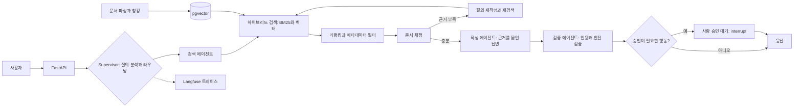

# 아키텍처

조의 설계를 그림과 글로 남기는 자리입니다. 발표와 `EVAL_REPORT.md`가 이 문서를 가리킵니다. 아래는 출발점이고, 조의 구조에 맞게 고치세요.

## 요청 흐름 (출발점)

이 도식은 출발점이다. 서비스가 쓰는 실제 노드와 분기는 아래 표 첫 두 행과 `backend/graph/build.py`가 기준이고, 리랭커는 쓰지 않는다([`EVAL_REPORT.md`](../EVAL_REPORT.md) 3-2절).

## 조가 채울 것

| 질문 | 답 |
|---|---|
| 왜 그래프인가(분기, 반복, 승인이 왜 필요한가) | 질문마다 다른 노드열로 가는 **분기**, 근거가 모자라면 돌아가는 **반복**, 사람이 승인할 때까지 멈췄다 이어지는 **승인**이 있어서 상태를 가진 그래프(LangGraph)로 만들었다. ① 분기: 질의 분석(`classify`, LLM 1회)이 질문을 정책 질문(`rule`), 결정표(`decision`), 팀 합동 검토(`review`), 도메인 밖 거절(`out_of_domain`)로 나눠 서로 다른 노드열로 보낸다(`backend/graph/build.py`, 연결은 결정 0064). ② 반복: 정책 질문은 `rewrite`, `search`, `judge`(문서 채점)로 근거가 충분한지 판정하고, 부족하면 재작성으로 돌아가 다시 찾으며(재검색 상한 `MAX_RESEARCH` 2, 서비스 기본값은 1), 끝내 모자라면 `give_up`으로 거절이나 되묻기로 닫는다. 충분하면 `write_answer`, `verify`(인용 검사), `ground`(근거 판정), `save` 순이고, 검사에서 걸리면 답을 고치거나 거절한다. ③ 승인: 결정표 변환과 합동 검토 쟁점표는 `interrupt()`에서 멈추고 같은 `thread_id`로 이어져야 해서 체크포인터가 필요하다(아래 3, 4행). 그래프가 아닌 구현(함수 호출 순서)과 나란히 잰 값은 없어 그래프가 더 낫다고는 말하지 않는다([`EVAL_REPORT.md`](../EVAL_REPORT.md) 4장). 이유를 항목별로 풀어 쓴 문서는 [why_langgraph.md](./why_langgraph.md)다. 서비스의 실제 노드는 `load_memory`, `classify` 다음에 정책 질문(`rewrite`, `search`, `judge`, `write_answer`, `verify`, `ground`, `save`), 결정표(`decision_params`, `decision_run`, `decision_answer`), 합동 검토(`review` 하위 그래프), 도메인 밖 거절(`out_of_domain`) 중 하나로 간다. |
| Supervisor와 서브에이전트는 각각 무엇을 책임지고, 무엇을 서로 모르게 하는가(컨텍스트 격리) | Supervisor는 **코드 라우팅**이다(결정 0055. LLM 라우팅은 스위치로만 있고 기본은 꺼짐). 맡는 일은 기억 불러오기(`load_memory`), 질의 분석(`classify`, LLM 1회), 다음에 부를 에이전트 고르기, 재검색 여부(`after_judge`), 거절 닫기(`out_of_domain`, `give_up`)다. 서브에이전트는 검색(`rewrite`, `search`, `judge`), 작성(`write_answer`), 검증(`verify`, `ground`, `save`)이고, 경로를 연결하면 결정표(`decision`)와 합동 검토(`review`)가 같은 자리에 붙는다(`backend/graph/multi.py`). **서로 모르게 하는 것:** 에이전트는 자기 상태 스키마(`reads`와 `writes`)에 있는 칸만 받고, 그 밖을 읽거나 쓰면 오류가 난다(시험 `tests/test_multi_graph.py`의 `test_each_agent_receives_only_its_own_fields`). 작성 에이전트는 검색어, 판정 사유, 프로필, 사용자 id를 받지 않고 질문과 문맥 청크 등만 본다. 검증 에이전트는 검색 상태를 받지 않고 답, 인용 후보, 청크와 저장에 쓰는 `user_id`, `thread_id`만 받는다. 검색 에이전트는 답 초안과 인용 후보를 받지 않는다. 합동 검토는 질문, `user_id`, `thread_id`, 기준일만 받고 청크나 프로필을 받지 않는다. **한계:** 이 격리는 단일 그래프와 같은 노드를 다시 연결한 구조에서 입출력 칸을 제한한 것이다. `/chat`은 단일 그래프를 쓰고 멀티는 측정과 시험에서만 쓰며, 단일 대비 차이는 같은 조건 3회의 흔들림 안이었다(README 구조 절, `EVAL_REPORT.md` 4장). Supervisor가 잘못 나누는 입력은 이 표 아래에 있다. |
| 어디서 사람 승인(interrupt)을 받는가, 왜 거기인가 | 세 곳이다. ① 결정표 변환(`backend/graph/decision/convert.py`의 `human_approval`): 모델이 만든 결정표 초안과 원문 셀 대조표를 승인함에 올린 뒤 멈추고, 승인 전 실행은 0건이다. 권한표는 큰 표라 한 칸이 밀려도 티가 나지 않아 사람이 원문과 대조해 승인한다. 대조표에 원문과 다른 칸이 있어도 승인할 수 있으나 사유가 필수다. ② 합동 검토 쟁점표(`backend/graph/departments/review.py`의 `approval`): 네 팀의 쟁점을 한 표로 모은 뒤 멈추고, 승인하면 저장, 반려하면 사유만 기록한다. 최종 판단은 사람이 하고 에이전트는 쟁점을 정리하는 데까지만 한다. ③ 팀 에이전트가 재시도 상한(3회)까지 실패했을 때(`team_failure_gate`): 그 팀만 다시 돌릴지 검토하지 못한 것으로 표시할지 사람이 고른다. 정책 질문 답은 승인을 받지 않는다. 읽기 전용이고 인용 검사와 근거 판정을 코드가 하기 때문이다. 승인 요청은 관리자만 처리한다(일반 계정은 403). interrupt가 있는 노드에는 다른 일을 넣지 않는다. 재개하면 그 노드가 처음부터 다시 돌기 때문에 쓰기는 앞뒤 노드(`queue_approval`, `finalize`)로 나눴고 둘 다 같은 입력으로 다시 돌아도 결과가 같다. |
| 체크포인트에서 무엇이 저장되고 어떻게 재개되는가 | 저장: LangGraph 체크포인터가 노드를 지날 때마다 `thread_id`별로 State 칸(질문, 청크 dict, 판정, 초안 답, 승인 대기 값)을 Postgres 표(`checkpoints`, `checkpoint_blobs`, `checkpoint_writes`와 마이그레이션 기록 `checkpoint_migrations`, 기억 Store의 `store`, `store_migrations`: 모두 라이브러리가 만들고 관리하며 구조를 바꾸지 않는다, `backend/graph/checkpoint.py`의 `LANGGRAPH_TABLES`)에 쓴다. 배포와 시연은 Postgres 체크포인터이고, 메모리 체크포인터는 시험과 로컬 개발용이라 재시작을 견디지 못한다(`backend/graph/checkpoint.py`의 `is_restart_safe()`가 거짓이며 환경변수 `CHECKPOINTER`로 고른다). 그 표에는 대화 내용이 들어가므로 RLS를 켠다. 재개: 승인 API가 같은 `thread_id`로 `Command(resume=...)`를 그래프에 넘기면 interrupt가 멈춘 자리부터 이어진다. 같은 승인 건에 결정이 겹쳐 오면 프로세스 안 잠금과 Postgres 자문 잠금(`PostgresDecisionRepo.decision_lock`)으로 하나씩 처리한다. 확인한 것: 시험용 Postgres에서 프로세스를 나눠 멈춤, 종료, 재개(`tests/test_decision_approval.py`), 그리고 운영 DB와 Cloud Run에서 이전 리비전이 만든 쟁점표 승인 대기 1건을 새 리비전 `provena-api-00029-qbd`에서 승인해 재개한 1건(2026-11-09, `EVAL_REPORT.md` 4장). 리비전이 바뀐 뒤의 재개는 이 한 건(승인)뿐이고, 반려와 결정표 승인 건, 팀 실패 알림 건의 재시작 뒤 재개는 확인하지 못했다. |
| 로그인한 사용자 id가 thread와 Store namespace에 어떻게 들어가는가 | `backend/auth.py`의 `current_user_id()`를 FastAPI 의존성으로 사용한다. `Depends(current_user_id)`가 `provena_auth` HttpOnly JWT 쿠키를 읽고, `AUTH_SECRET` 환경변수와 HS256으로 서명·만료를 검증한다. 인증에 성공하면 JWT의 UUID `user_id`를 정규화된 문자열로 반환하며, 쿠키가 없거나 인증 정보가 유효하지 않거나 만료·위조된 경우 HTTP 401을 반환한다. 요청 본문이나 query string으로 클라이언트가 전달한 사용자 ID는 신뢰하지 않는다. 반환한 문자열은 Graph 입력의 `AgentState.user_id: str`로 전달하는 계약이다. 서버는 `POST /chat`에서 이 id로 그래프 thread 이름을 `<user_id>:<thread_id>`로 만들고(`backend/api/routes.py`), 장기 기억 Store namespace는 `(user_id, "profile")`로 나눈다(`backend/memory/profile.py`). 남의 thread는 404로 읽을 수 없고, 두 계정의 대화와 기억이 섞이지 않음은 `tests/test_api_isolation.py`와 배포 환경 실측으로 확인했다(`EVAL_REPORT.md` 4장). |
| 무엇을 State에 두고 무엇을 Store에 두는가 | State는 한 대화(`thread_id`) 안에서만 쓰는 값이다. 질문, 검색 결과(청크는 체크포인트 직렬화를 피하려 dict), 재검색 횟수, 판정 결과, 초안 답, 인용, 승인 대기 값이 여기 있고 체크포인트와 함께 저장된다(`backend/graph/state.py`). Store는 다음 대화에도 써야 하는 값이다. 답에 쓰는 사실인 소속(`affiliation`)·직급(`rank`)·담당 서비스(`service`)만 두며 namespace는 `(user_id, "profile")`로 사용자마다 나눈다. 질문, 대화 내용, 검색 결과는 Store에 넣지 않는다. `load_memory` 노드가 Store에서 프로필을 읽어 State의 `profile`로 옮기고, 사용자가 `GET/PATCH/DELETE /me/memory`로 보고 고치거나 지울 수 있다(`backend/memory/profile.py`). 승인 건, 결정표, 쟁점표, 저장한 답과 인용은 그래프 State나 Store가 아니라 앱의 Postgres 표(`approvals`, `decision_tables`, `issue_tables`, 답 저장소)에 둔다. |
| 벡터DB는 무엇이고 왜 골랐는가(선택 이유와 한계) | Postgres의 pgvector다. 운영은 Supabase, 데모는 로컬 pgvector 컨테이너다. 가이드 권고를 따랐고(`docs/PRD.md` 기술 선택 표), 같은 Postgres에 체크포인트, Store, 승인, 답 기록 표도 두어 저장소를 하나로 운영한다. 다른 벡터DB와 나란히 잰 값은 없어 pgvector가 가장 낫다고는 말하지 않는다. 임베딩 모델과 청크는 따로 비교해 `voyage-4`, 800자·겹침 120자로 정했다(`EVAL_REPORT.md` 3장). 한계: 무료 등급 Nano에서 전수 비교 벡터 질의가 SPEC 검색 p95 3초를 넘었고(`EVAL_REPORT.md` 1장), 이후 HNSW 색인(`SEARCH_HNSW=1`)을 켰다. 로컬 노트북에서 평가셋 v1 30문항 검색 시간의 합계는 전수 8.4~9.0초, HNSW 1.1~1.2초였다(같은 8장 참고 문단, 서비스 응답 시간은 아님). 벡터 칸 차원이 2,000을 넘는 모델은 HNSW 색인을 만들 수 없다(`docs/specs/search.md`). |
| 신뢰 경계: 코퍼스 안의 지시문(간접 인젝션)은 어디서 막는가 | 검색된 원문(본문, 표 칸, 제목)은 지시가 아니라 자료로만 다룬다. 막는 곳은 네 겹이다. ① 프롬프트: 원문을 `<<<자료>>>`와 `<<<끝>>>` 사이의 데이터로만 넣는다(질문 그래프와 합동 검토 팀 에이전트 모두). ② 입력 정화(`GRAPH_SANITIZE_INPUT`, 기본 켬, `backend/graph/untrusted.py`): 모델에 넣기 전에 모델·AI·에이전트를 상대로 한 지시 문장을 뺀다. ③ 출력 검사(`GRAPH_SCRUB_OUTPUT`, 기본 켬): 최종 답이나 쟁점표 문장에 원문 지시 문장의 표식 후보나 지시 문장 일부가 그대로 있으면 그 문장을 뺀다. ④ 코드 경로: 인용 chunk_id는 받아 온 원문과 대조하고, 승인은 모델이 아니라 `interrupt()` 코드 경로로만 통과한다. 규칙(정규식)은 알려진 범주만 잡으므로 번역, 암시, 오타, 표식 없는 지시는 못 잡는다. 시험 결과와 막지 못한 것은 `EVAL_REPORT.md` 6장에 있다. |

### Supervisor가 잘못 나누는 입력 (측정으로 확인된 것만)

`classify`(질의 분석)의 분류가 틀려 경로가 잘못 나뉜 사례다. 표 밖의 오분류는 측정한 사례가 없다.

| 입력 | 어떻게 잘못 나뉘었나 | 근거 결과 파일 |
|---|---|---|
| v2 7번(별도 DB·마이크로서비스 도입 승인), 15번(클라우드 약정 할인 계약 승인), 38번(새 SaaS 도구 요청 시작과 TPRM 시점). 정책 문서에 답이 있는 사실 질문 | 7번과 38번을 `review`, 15번을 `decision`으로 나눴다(7번 3회, 15번과 38번 2회씩, 회차마다 단일과 멀티가 같은 분류). 당시 두 경로가 측정에 연결되지 않아 정책 질문 경로로 처리되어 답은 나왔다. 연결되면 승인 대기나 결정표 거절로 끝날 수 있어, 금액이 없으면 결정표로 보내지 않고 사실을 묻는 질문은 합동 검토로 보내지 않는 규칙을 `classify`에 넣었다 | `evals/results/agent_v2_multi_pg/`, `_r2/`, `_r3/`의 `single/rows.jsonl`, `multi/rows.jsonl`의 `route` 칸. 규칙 이후 `evals/results/agent_v2_q_d6151_r1_bo2sda2_api/`(`_r2_`, `_r3_`)에서는 7, 15, 38번 모두 `rule` |
| v1 3번(정기·패치 릴리스 주기). 정책에 답이 있는 질문 | `out_of_domain`으로 분류해 검색 없이 거절했다(과잉 거절, 3회에 각 1행). 도메인 밖은 뒤 단계가 되돌릴 수 없어, 두 번 같은 분류가 나올 때만 따르고 갈리면 정책 질문 경로로 보내도록 고쳤다 | `evals/results/agent_v1_final_asof_r2/`, `agent_v1_final_ground_r2/`, `agent_v1_service_pg_r3/`의 `rows.jsonl`(`route`가 `out_of_domain`). 시험 `tests/test_question_graph.py`의 `test_out_of_domain_needs_two_same_answers_and_a_split_goes_to_policy_path` |
| 검증 109번(데이터팀 dbt 모델 SQL 서브쿼리와 팀 스타일 가이드). 관련 문항 | `out_of_domain`으로 분류해 거절했다(단일과 멀티 2행). 두 번 확인 규칙이 적용된 최종 설정에서도 그대로여서 고치지 못했고, 같은 분류가 두 번 나온 이유는 원인 확인 못 함 | `evals/results/agent_v2_q_d6151_h1_bo2sda2_api/single/rows.jsonl`, `multi/rows.jsonl` |
| 외부 SaaS 도입처럼 승인된 결정표 목록의 업무 종류와 바로 맞지 않는 금액 승인자 질문(금액 5종 x 3회 15건) | 분류가 `decision`으로 보냈으나 값 뽑기가 업무 종류를 찾지 못해 리비전 `provena-api-00029-qbd`에서 15건 모두 "결정표를 실행하지 않았습니다: task_type이 필요하다"로 거절했다. 업무 종류를 못 찾으면 거절하지 않고 `rule`로 보내도록 고쳤고(PR #97), 리비전 `provena-api-00030-6t4`에서는 15건 중 11건이 정답 구간 행을 인용해 답했다. 재배포 리비전 `provena-api-00032-zhs`에서는 15건 중 10건이 답했고 5건(1만 달러 3건, 30만 달러 2건)은 거절해 사전 등록 62.23, 62.24의 기준을 채우지 못했다. 이어서 세 가지를 순서대로 다뤘다. 사전 등록 62.27(PR #115)은 금액 구간 행을 고를 때 질문이 이름을 부른 표를 먼저 두고, 질문을 나눴을 때 구간 행의 후보 페이지에 전체 질문 벡터의 상위 페이지를 더했다. 리비전 `provena-api-00034-tkx`에서는 15건 중 12건이 답하고 3건(202번 2건, 204번 1건)이 거절해 62.27의 통과 기준(거절 2 이하)을 채우지 못했으나, 사전 등록 62.28에서 사용자가 PR #115를 되돌리지 않고 유지하기로 결정했다(거절 3건은 검색 뒤 판정 단계의 거절이고, 되돌리면 00032의 거절 5건으로 돌아가기 때문이다). 사전 등록 62.29(범위 축소, 결정 0095)는 근거 판정에서 시점 표현이 없는 질문에 모델이 낸 `out_of_period` 표를 `unsupported` 표로 읽어 답을 다시 쓰고 재판정하게 했다. 리비전별 금액 15건의 답/거절은 00030-6t4가 11/4, 00032-zhs가 10/5, 00034-tkx가 12/3이다. 62.29 수정의 효과는 다음 배포 측정에서 판정한다(아직 배포 재측정을 하지 않았다) | `evals/results/range_retrieval_62_7/answers_deploy/`(`00029-qbd`), `answers_deploy_provena-api-00030-6t4/`, `answers_deploy_provena-api-00032-zhs/`, `answers_deploy_provena-api-00034-tkx/`. 5장 5-2절 10번 행, 5-4절 |

위 표와 반대 방향, 곧 합동 검토나 결정표로 가야 할 질문이 정책 질문 경로로 가는 경우는 비율을 모른다. 그것을 재는 평가셋이 저장소에 추적되어 있지 않다(`EVAL_REPORT.md` 4장). `evals/dataset_review_v1.jsonl`은 합동 검토의 정답 쟁점을 재는 초안 10건이며 이 오분류를 재는 평가셋이 아니다.

## 조원 간 계약서 (병렬로 일하기 전에 먼저 씁니다)

3명이 동시에 일하면 함수 시그니처만 맞춰서는 부족합니다. DART 실험에서 한쪽이 코퍼스 파일(242청크)에서 기업 목록을 만들어 두어, 코퍼스를 키우자 새 기업을 전부 "없는 기업"으로 거절할 구조가 되었습니다. 시그니처에 보이지 않는 의존이 문제였습니다.

| 항목 | 내용 |
|---|---|
| 각자 수정할 수 있는 경로 | 예) A: `backend/rag/`, `data/`, B: `backend/graph/`, C: `evals/`, `docs/` **3조 (안, D0 확정, `docs/TEAM_GUIDE.md` 5장)** 김승욱: `backend/graph/`, `backend/memory/`, `backend/prompts/`, `skills/`, `backend/main.py`, `backend/services/`, `Dockerfile`, `docker-compose.yml`, `.env.example`, `db/`, `evals/agent/`, `evals/safety/`, `mock_erp/` 박진형: `backend/rag/`, `data/`, `evals/retrieval/`, `extras/mcp_skill/` 강경희: `backend/auth.py`, `web/` 공동(3명 승인): `backend/schemas/`, 평가셋 |
| 모듈 사이의 함수와 시그니처 | 예) `retrieve(question, k, ...) -> list[dict]`, `build_graph(retriever=None, checkpointer=None)` **3조 (안, D0 확정)** 김승욱 제공: `build_graph(retriever=None, checkpointer=None)`. 그래프는 검색기와 체크포인터를 주입받는다(`docs/specs/question-graph.md`). 로그인 저장소: `PostgresAuthStore(dsn)`(`backend/services/auth_store.py`)가 강경희의 `AuthStore` Protocol(`get_by_login_id`, `get_by_user_id`)을 구현하고, `backend/main.py`가 `DATABASE_URL`이 있을 때 `create_auth_router(store=...)`로 붙인다 그래프가 받는 것: 검색 `retriever(SearchQuery) -> list[Chunk]`(박진형, 형식은 `backend/schemas/`), 로그인한 사용자 id를 꺼내는 함수(강경희). 두 줄은 D0에서 채운다 강경희 제공: 구현 함수는 `current_user_id(request: Request) -> str`이며 FastAPI 계약상 `current_user_id() -> str`로 사용한다(`user_id: str = Depends(current_user_id)`). 서명된 `provena_auth` 인증 쿠키에서 UUID 문자열을 추출하고, 인증 실패 시 HTTP 401을 반환한다. Graph에는 `AgentState.user_id: str`로 전달하며, 연결은 `backend/api/routes.py`에서 끝났다. |
| 의존하는 파일과 환경변수 | 코퍼스 경로, 모델 이름, `DEMO_MODE` 등. **코드가 읽는 파일을 빠짐없이** **3조 (안, D0 확정)** 김승욱 파트: `DEMO_MODE`, LLM 키(`.env.example`), `LLM_MAX_RETRIES`·`LLM_TIMEOUT_S`·`LLM_FALLBACK_MODEL`, `USE_SKILLS`, `DATABASE_URL`(체크포인터, 답·인용 저장, 로그인 users 조회), `LANGFUSE_*`. 로컬 데모 기동용: `PROVENA_ENV`, `PROVENA_DEV_MODE`, `DEMO_USER_LOGIN_ID`·`DEMO_USER_PASSWORD`, `DEMO_ADMIN_LOGIN_ID`·`DEMO_ADMIN_PASSWORD`(시드, `backend/services/demo_seed.py`), compose 포트 `API_PORT`. 파일: `skills/`의 런타임 Skill(`citation-rules`, `grounding-check`, `glossary`, 파일이 없으면 그래프가 멈춘다), 데모 모드 녹화 응답(경로는 D0), `db/101_auth_users.sql`(users 테이블), 화면 정적 파일 `web/`(`backend/main.py`가 내준다) 박진형 파트(코퍼스·색인 경로, 임베딩·리랭커 모델 이름), 강경희 파트: 파일 `backend/auth.py`; `AUTH_SECRET`(JWT 서명·검증에 필요한 환경변수), 쿠키 이름 `provena_auth`, JWT 알고리즘 `HS256`. 테스트 사용자는 `tests/test_auth_router_runtime.py`의 `FakeAuthStore`와 fixture에서 생성하며, `db/01_init.sql`에는 사용자 seed가 없다. |
| 오프라인 규칙 | 키 없이 돌 때 어떤 모델과 파일을 쓰는가 **3조 (안, D0 확정)** LLM 키가 없으면 `DEMO_MODE=1`로 기록해 둔 응답을 재생한다. 그래프 시험은 가짜 검색기와 메모리 체크포인터로 키와 DB 없이 돈다. 로컬 데모 계정 2개는 `PROVENA_ENV=local`과 `PROVENA_DEV_MODE=1`이 모두 켜졌을 때만 시드하고 그 밖의 모드에서는 만들지 않는다(compose가 `.env.example`의 로컬 데모 계정 값을 읽는다. `AUTH_SECRET`은 저장소에 두지 않고, 비어 있으면 로컬 데모 모드에서만 실행마다 무작위로 만든다). 임베딩·리랭커 모델의 오프라인 실행(`HF_HUB_OFFLINE=1`)은 박진형 파트에서 D0에 채운다 |

## 결정 기록

바꿀 때마다 한 줄씩 남깁니다. `날짜 | 무엇을 | 왜 | 대안`

3조는 결정마다 이유와 버린 대안을 [`docs/decisions.md`](decisions.md)에 적는다.
