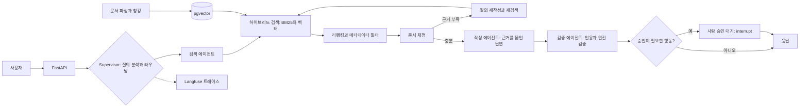

# 아키텍처

조의 설계를 그림과 글로 남기는 자리입니다. 발표와 `EVAL_REPORT.md`가 이 문서를 가리킵니다. 아래는 출발점이고, 조의 구조에 맞게 고치세요.

## 요청 흐름 (출발점)

## 조가 채울 것

| 질문 | 답 |
|---|---|
| 왜 그래프인가(분기, 반복, 승인이 왜 필요한가) | |
| Supervisor와 서브에이전트는 각각 무엇을 책임지고, 무엇을 서로 모르게 하는가(컨텍스트 격리) | |
| 어디서 사람 승인(interrupt)을 받는가, 왜 거기인가 | |
| 체크포인트에서 무엇이 저장되고 어떻게 재개되는가 | |
| 로그인한 사용자 id가 thread와 Store namespace에 어떻게 들어가는가 | |
| 무엇을 State에 두고 무엇을 Store에 두는가 | |
| 벡터DB는 무엇이고 왜 골랐는가(선택 이유와 한계) | |
| 신뢰 경계: 코퍼스 안의 지시문(간접 인젝션)은 어디서 막는가 | |

## 조원 간 계약서 (병렬로 일하기 전에 먼저 씁니다)

3명이 동시에 일하면 함수 시그니처만 맞춰서는 부족합니다. DART 실험에서 한쪽이 코퍼스 파일(242청크)에서 기업 목록을 만들어 두어, 코퍼스를 키우자 새 기업을 전부 "없는 기업"으로 거절할 구조가 되었습니다. 시그니처에 보이지 않는 의존이 문제였습니다.

| 항목 | 내용 |
|---|---|
| 각자 수정할 수 있는 경로 | 예) A: `backend/rag/`, `data/`, B: `backend/graph/`, C: `evals/`, `docs/` **3조 (안, D0 확정, `docs/TEAM_GUIDE.md` 5장)** 김승욱: `backend/graph/`, `backend/memory/`, `backend/prompts/`, `skills/`, `backend/main.py`, `backend/services/`, `Dockerfile`, `docker-compose.yml`, `.env.example`, `db/`, `evals/agent/`, `evals/safety/`, `mock_erp/` 박진형: `backend/rag/`, `data/`, `evals/retrieval/`, `extras/mcp_skill/` 강경희: `backend/auth.py`, `web/` 공동(3명 승인): `backend/schemas/`, 평가셋 |
| 모듈 사이의 함수와 시그니처 | 예) `retrieve(question, k, ...) -> list[dict]`, `build_graph(retriever=None, checkpointer=None)` **3조 (안, D0 확정)** 김승욱 제공: `build_graph(retriever=None, checkpointer=None)`. 그래프는 검색기와 체크포인터를 주입받는다(`docs/specs/question-graph.md`) 그래프가 받는 것: 검색 `retriever(SearchQuery) -> list[Chunk]`(박진형, 형식은 `backend/schemas/`), 로그인한 사용자 id를 꺼내는 함수(강경희). 두 줄은 D0에서 채운다 |
| 의존하는 파일과 환경변수 | 코퍼스 경로, 모델 이름, `DEMO_MODE` 등. **코드가 읽는 파일을 빠짐없이** **3조 (안, D0 확정)** 김승욱 파트: `DEMO_MODE`, LLM 키(`.env.example`), `DATABASE_URL`(체크포인터, 답·인용 저장), `LANGFUSE_*`. 파일: `skills/`의 런타임 Skill, 데모 모드 녹화 응답(경로는 D0) 박진형 파트(코퍼스·색인 경로, 임베딩·리랭커 모델 이름), 강경희 파트(인증 비밀값, 데모 계정): D0에서 채운다 |
| 오프라인 규칙 | 키 없이 돌 때 어떤 모델과 파일을 쓰는가 **3조 (안, D0 확정)** LLM 키가 없으면 `DEMO_MODE=1`로 기록해 둔 응답을 재생한다. 그래프 시험은 가짜 검색기와 메모리 체크포인터로 키와 DB 없이 돈다. 임베딩·리랭커 모델의 오프라인 실행(`HF_HUB_OFFLINE=1`)은 박진형 파트에서 D0에 채운다 |

## 결정 기록

바꿀 때마다 한 줄씩 남깁니다. `날짜 | 무엇을 | 왜 | 대안`

3조는 결정마다 이유와 버린 대안을 [`docs/decisions.md`](decisions.md)에 적는다.
