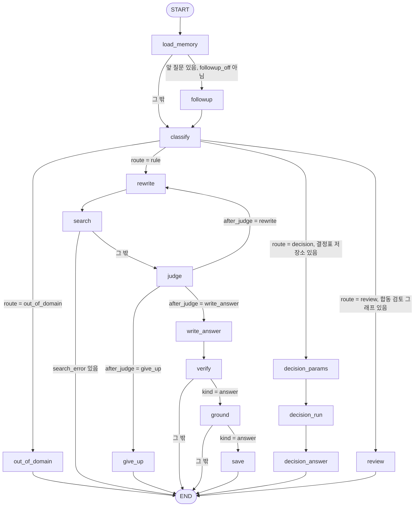
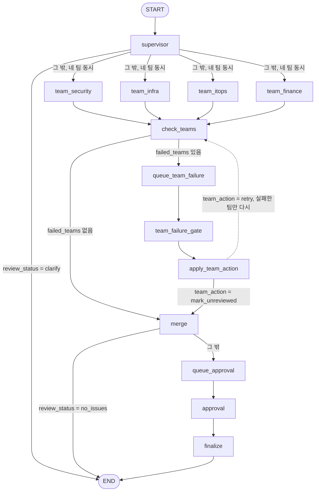
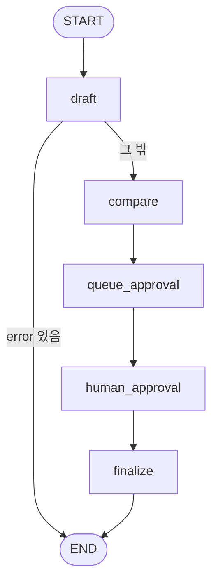
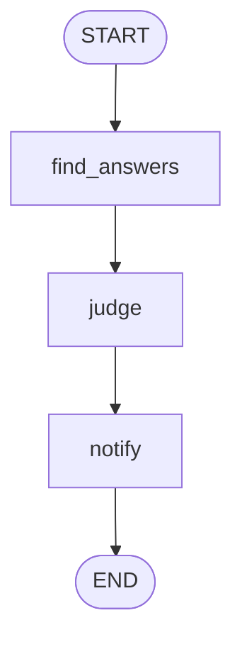
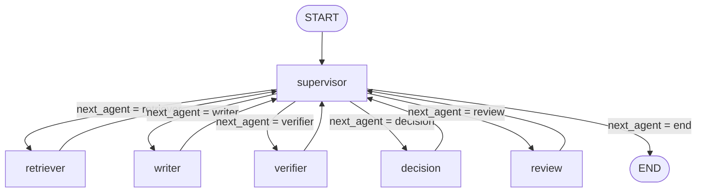

# GRAPH: 그래프별 노드 책임과 입출력 상태

이 문서는 `backend/graph/`의 LangGraph 그래프를 노드 단위로 적는다. 노드 이름, 간선, 분기 조건은 코드의 `add_node`, `add_edge`, `add_conditional_edges` 호출에서 옮겼고, 읽는 상태 키와 쓰는 상태 키는 노드 함수 본문(상태에서 읽는 키, 돌려주는 dict의 키)에서 옮겼다. 줄 번호는 커밋 `44450129` 기준이다. 설계 개요는 [SDD.md](./SDD.md) 4-3, 요청 흐름과 설계 질문은 [ARCHITECTURE.md](./ARCHITECTURE.md), 그래프로 만든 이유는 [why_langgraph.md](./why_langgraph.md)에 있다.

## 1. 개요

### 1-1. 그래프 목록

| 그래프 | 만드는 함수(진입점) | 상태 스키마 | 노드 수 | 서비스에서 쓰는 곳 |
|---|---|---|---|---|
| 그래프 1. 질문 그래프 | `backend/graph/build.py:395` `build_graph` | `AgentState`(`backend/graph/state.py:69`) | 16(항상 12, 결정표 저장소가 있을 때 3, 합동 검토 그래프가 있을 때 1) | `POST /chat`. 앱 시작 때 `backend/main.py:273` `build_question_graph`가 결정표 저장소와 합동 검토 그래프를 붙여 만든다 |
| 그래프 2. 합동 검토 그래프 | `backend/graph/departments/review.py:120` `build_review_graph` | `ReviewState`(`review.py:65`) | 13 | 질문 그래프의 `review` 노드(하위 그래프). 질문 종류가 합동 검토일 때 |
| 그래프 3. 결정표 변환 그래프 | `backend/graph/decision/convert.py:106` `build_convert_graph` | `ConvertState`(`convert.py:79`) | 5 | `POST /decision-tables/convert`(관리자) |
| 그래프 4. 리콜 그래프 | `backend/graph/recall/graph.py:75` `build_recall_graph` | `RecallState`(`recall/graph.py:56`) | 3 | 개정 웹훅 처리(`backend/graph/recall/service.py:96`) |
| 그래프 5. 멀티 에이전트 질문 그래프 | `backend/graph/multi.py:299` `build_multi_graph` | `MultiState`(`multi.py:58`) | 6(항상 4, 연결 시 2) | 서비스 경로가 아니다. 평가 실행기(`evals/agent/exp_multi_v2.py`)와 안전 평가(`evals/safety/run_safety.py`)가 단일 그래프와 비교할 때 쓴다 |

그래프 5는 그래프 1의 노드와 분기 함수를 그대로 꺼내(`SingleParts`, `multi.py:127`) Supervisor와 하위 에이전트 안에 다시 배선한 것이다. 새 노드 함수는 `supervisor` 하나다.

### 1-2. 체크포인터와 thread_id

| 항목 | 내용 | 코드 위치 |
|---|---|---|
| 체크포인터 선택 | `CHECKPOINTER`가 `memory` 또는 `postgres`면 그대로, 비어 있으면 `DATABASE_URL`이 있을 때 `postgres`, 없으면 `memory`. `postgres`인데 `DATABASE_URL`이 없으면 오류로 멈춘다 | `backend/graph/checkpoint.py:33` `checkpointer_kind` |
| 배포 체크포인터 | `PostgresSaver`와 `PostgresStore`(연결 풀 1~4, `autocommit`, 준비된 문장 끔). 표 `checkpoints`, `checkpoint_blobs`, `checkpoint_writes`, `checkpoint_migrations`, `store`, `store_migrations`를 만들고 RLS를 켠다 | `checkpoint.py:89` `open_persistence`, `checkpoint.py:49` `enable_rls` |
| 재시작 안전 여부 | `PostgresSaver`일 때만 참이다. 메모리 체크포인터는 시험과 로컬 개발용이다 | `checkpoint.py:44` `is_restart_safe` |
| 같은 체크포인터를 쓰는 그래프 | 질문 그래프(합동 검토 하위 그래프 포함)와 결정표 변환 그래프. 합동 검토 하위 그래프는 체크포인터 없이 만들어 질문 그래프의 체크포인터로 멈추고 재개한다 | `backend/graph/decision/routes.py:574-577`, `backend/main.py:283-285` |
| 체크포인터를 쓰지 않는 그래프 | 리콜 그래프(한 번 돌고 끝난다), 멀티 그래프(평가 실행기가 넘길 때만) | `recall/service.py:96` |
| 질문 그래프 thread_id | `"{user_id}:{thread_id}"`. `user_id`는 로그인한 사용자 UUID, `thread_id`는 화면의 대화 번호다 | `backend/api/routes.py:149` `internal_thread`, `routes.py:307-309` |
| 결정표 변환 thread_id | `convert_` 뒤에 16자리 16진수(`new_id("convert")`) | `backend/graph/decision/repo.py:101`, `decision/routes.py:430` |
| 평가용 단일 검토 thread_id | `eval-single:{request_id}` | `backend/api/eval_review.py:141` |

### 1-3. interrupt() 위치

| 그래프 | 노드 | interrupt 종류(`kind`) | 코드 위치 |
|---|---|---|---|
| 합동 검토 | `team_failure_gate` | `team_review_failed`(재시도 상한까지 실패한 팀이 있을 때) | `backend/graph/departments/review.py:257` |
| 합동 검토 | `approval` | `issue_table`(쟁점표 승인) | `review.py:303` |
| 결정표 변환 | `human_approval` | `decision_table`(결정표 초안 승인) | `backend/graph/decision/convert.py:150` |

질문 그래프 자체의 노드에는 `interrupt()`가 없다. 합동 검토가 질문 그래프의 `review` 노드 안에서 멈추면 질문 그래프 전체가 같은 `thread_id`에서 멈춘다. 리콜 그래프와 멀티 그래프의 자체 노드에도 `interrupt()`가 없다.

## 2. 그래프별 흐름도와 노드 표

흐름도의 노드 라벨은 코드의 노드 이름 그대로다. `START`와 `END`는 LangGraph의 시작과 끝이다. 노드 표의 "외부 호출"에서 LLM 호출 수는 서비스 설정(6장)에서의 횟수이고, 다수결·미리 부르기처럼 병렬로 겹쳐 부르는 호출은 따로 적었다.

### 그래프 1. 질문 그래프 (`build_graph`)

배선은 `backend/graph/build.py:2124-2168`이다. 모든 노드는 `timed_node`(`build.py:2114`)로 감싸 시작·끝 시각을 요청 단위 집계에 남긴다(결과와 예외는 그대로다).

분기 규칙(코드 그대로):

- `load_memory` 뒤(`build.py:2144`): `previous_questions(state)`가 비어 있지 않고 `followup_off`가 참이 아니면 `followup`, 아니면 `classify`.
- `classify` 뒤(`build.py:2155`): `route` 값으로 간다. `decision`은 결정표 저장소(`decision_repo`)가 없으면 `rewrite`, `review`는 합동 검토 그래프(`review_graph`)가 없으면 `rewrite`로 간다. 서비스는 둘 다 넘기므로(`backend/main.py:284-285`) 16개 노드가 모두 있다.
- `search` 뒤(`build.py:2161`): `search_error`가 있으면 끝, 아니면 `judge`.
- `judge` 뒤(`after_judge`, `build.py:1336`): ① `judge_reason`이 비었으면(근거 충분) `write_answer` ② `judge_none`이면 `give_up` ③ `sub_research_phase`가 `due`면 `rewrite` ④ `judge_partial`이고 하위 질문이 2개 이상이면 `write_answer`(일부 답) ⑤ `retries`가 재검색 상한(`SEARCH_MAX_RESEARCH`, `GRAPH_SECTION_KEEPS_RESEARCH`가 켜져 있으면 섹션 읽기 횟수만큼 더함) 이하이고 재검색이 막히지 않았으면 `rewrite` ⑥ 그 밖은 `give_up`.
- `verify` 뒤(`after_verify`, `build.py:1678`): `kind`가 `answer`면 `ground`, 아니면 끝.
- `ground` 뒤(`after_ground`, `build.py:2091`): `kind`가 `answer`면 `save`, 아니면 끝.

| 노드 | 책임 | 읽는 상태 키 | 쓰는 상태 키 | 다음 노드/분기 조건 | 외부 호출 | 실패 시 동작 | 코드 위치 |
|---|---|---|---|---|---|---|---|
| `load_memory` | 새 질문의 실행 칸을 비우고, 사용자 기억(소속 등)과 기준일을 채운다 | `user_id`, `as_of`, `thread_id`·`question`(근거 확인 기록 표지), `LEFTOVER_FIELDS`의 키(남아 있을 때만) | `profile`, `as_of`, `as_of_given`, `kind`, `answer`, `retries`, `judge_reason`, `judge_partial`, `next_section`, `clarify_question`, `raw_citations`, `citations`, `dropped_citations`, `trimmed_citations`, `sub_queries`, `decompose_source`, `search_error`, `chunks`, `answer_id`, `drafted`, `period_covered`, `refuse_reason`, `grounding`, `skills_used`, `search_cache`, `search_stats`, `started_at`(`GRAPH_ANSWER_BUDGET_S`일 때), `LEFTOVER_FIELDS`의 키(`build.py:77`) | `followup` 또는 `classify` | Store 읽기(`get_profile`, namespace `(user_id, "profile")`). 키 없는 데모 재생에서는 읽지 않는다 | 근거 확인 기록 지우기 실패만 로그로 넘긴다. Store 오류는 잡지 않아 요청 오류가 된다 | `build.py:637` |
| `followup` | 같은 대화의 앞 질문에 기대는 질문을 혼자서도 뜻이 통하는 질문으로 다시 쓴다 | `question`, `asked`, `understood_by_asked`, `understood_question`, `user_question` | `question`, `user_question`, `understood_question`, `understood_by_asked` | `classify` | LLM 1회(`FOLLOWUP_SYSTEM`). 내부 지시만 요구하는 질문이면 부르지 않는다 | 비용 상한 예외만 올린다. 그 밖의 오류, 형식 오류, 코드 검사 탈락은 질문을 그대로 둔다 | `build.py:675` |
| `classify` | 질문 종류(`rule`, `decision`, `review`, `out_of_domain`)를 정한다. 결정표 질문이면 업무 종류와 금액도 뽑는다 | `question`, `profile`, `search_cache`, `retries`, `judge_reason`, `as_of_given` | `route`, `decision_query`(`decision`일 때), `search_cache`(동시 접수일 때 미리 받은 재작성·분해 응답과 미리 돌리기 열쇠) | `route`로 분기(위 규칙) | LLM 1회(분류). 도메인 밖이면 1회 더 확인. 결정표면 LLM 1회(값 뽑기). `GRAPH_PARALLEL_INTAKE`면 재작성·분해 LLM을 동시에 부른다. 결정표 저장소 읽기(`list_approved`, `list_pending`) | 응답을 읽지 못하거나 모르는 값이면 `rule`. 시스템 프롬프트만 요구하는 질문은 LLM 없이 `out_of_domain`. 정책 경로가 아니면 동시에 부른 결과를 버린다 | `build.py:779`, `route_of` `build.py:133` |
| `out_of_domain` | 핸드북과 무관한 질문을 검색 없이 거절한다 | 없음 | `kind`(`refuse`), `answer`, `citations` | 끝 | 없음 | 해당 없음 | `build.py:1029` |
| `rewrite` | 검색어(영어 용어 포함), 검색 범위 절, 질문 속 기준 시점을 정한다 | `question`, `profile`, `org`, `next_section`, `search_query`, `sub_research_phase`, `sub_research`, `judge_query`, `judge_reason`, `judge_missing`, `retries`, `chunks`, `as_of_given`, `search_cache`, `skills_used` | `search_query`, `search_org`, `skills_used`, `as_of`(질문에 시점이 있을 때), `search_cache`, `sub_research_phase`, `judge_query` | `search` | LLM 0~1회(`REWRITE_SYSTEM`, `glossary` Skill). 섹션 읽기, 하위 질문 재검색, 판정이 낸 재검색어가 있으면 부르지 않는다. 미리 돌린 결과가 있으면 그것을 쓴다(`rewrite_node`) | 응답을 읽지 못하면 원 질문을 검색어로 쓴다. 재작성 검색어가 찾은 문서의 지시를 옮겼으면 원 질문으로 되돌린다 | `rewrite_node` `build.py:970`, 본문 `build.py:1033` |
| `search` | 핸드북을 검색해 근거 목록(`chunks`)을 만들거나 넓힌다. 첫 검색에서만 질문을 하위 질문으로 나눈다 | `question`, `search_query`, `search_org`, `as_of`, `retries`, `next_section`, `sub_research_phase`, `sub_research`, `judge_partial`, `sub_queries`, `chunks`, `search_cache`, `search_stats` | `chunks`, `search_cache`, `search_stats`, `sub_queries`, `decompose_source`, `query_targets`, `intro_chunk_ids`, `next_section`, `judged_chunks`, `sub_research_phase`. 오류일 때 `kind`, `answer`, `citations`, `search_error` | `search_error`가 있으면 끝, 아니면 `judge` | 검색(`backend.rag.retrieve.search`, `SEARCH_VIA_MCP`면 MCP), 섹션 읽기(`get_section`), 페이지 안 검색·도입부 채우기. 첫 검색의 질문 분해 LLM 1회(동시 접수가 미리 받았으면 0회) | 임베딩 API 일시 오류는 거절(`search_error=unavailable`), 키 없음은 거절(`no_key`), 코퍼스에 없는 이름은 되묻기(`unknown_name`)로 끝낸다. 섹션 읽기·페이지 검색 실패는 근거 목록을 그대로 두고 판정에 넘긴다 | `search_node` `build.py:988`, 본문 `build.py:1173` |
| `judge` | 근거가 충분한지, 일부만 있는지, 무엇이 빠졌는지, 다음에 읽을 섹션이나 재검색어를 판정한다. 충분이면 같이 쓴 답을 넘긴다 | `question`, `chunks`, `sub_queries`, `retries`, `judged_chunks`, `section_reads`, `search_stats`, `judge_votes`, `judge_checks_log`, `sub_research_phase`. 같이 쓰는 답은 `write_answer`와 같은 키를 읽는다 | `judge_reason`, `judge_partial`, `judge_missing`, `judge_query`, `judge_scope`, `clarify_question`, `retries`, `next_section`, `section_reads`, `judged_chunks`, `search_stalled`, `judge_none`, `early_answer`, `skills_used`, `judge_votes`, `judge_quote_ids`, `judge_quotes`, `judge_checks_log`, `sub_research`, `sub_research_phase` | `after_judge`(위 규칙) | 판정 LLM 1회(`GRAPH_JUDGE_VOTE`면 3표 병렬, 2표가 같으면 확정). `GRAPH_JUDGE_ANSWER=parallel_all`이면 답 작성 LLM을 동시에(`GRAPH_ANSWER_BEST2`면 2개). `GRAPH_SPECULATE_GROUND`면 답 후보의 근거 판정을 미리 부른다 | 근거 목록이 비면 LLM 없이 부족으로 본다. 응답을 읽지 못하면 부족(`근거 부족`). 표가 모두 실패하면 첫 오류를 올린다. 부족이면 같이 쓴 답을 버린다 | `judge_node` `build.py:1007`, 본문 `build.py:1236` |
| `give_up` | 판정이 낸 되묻기 문장을 내거나 거절한다 | `clarify_question`, `chunks`, `question` | `kind`(`clarify` 또는 `refuse`), `answer`, `citations` | 끝 | 없음 | 되묻기 문장이 내부 문구를 흘리거나 원문 지시를 옮겼거나 숫자를 담으면 거절로 바꾼다 | `build.py:1352` |
| `write_answer` | 근거 목록으로 인용이 붙은 한국어 답 초안을 쓴다 | `early_answer`, `question`, `chunks`, `as_of`, `judge_partial`, `judge_scope`, `query_targets`, `judge_quote_ids`, `route`, `retries`, `started_at`, `skills_used` | `answer`, `raw_citations`, `period_covered`, `drafted`, `skills_used`, `answer_facts`, `best2_log` | `verify` | 답 작성 LLM 0~2회(`citation-rules` Skill, 권한표를 읽으면 `delegation` Skill). `early_answer`가 있으면 부르지 않는다. `GRAPH_ANSWER_WAIT_S`면 추론 답과 빠른 답을 같이 보내 정한 시간까지 추론 답을 기다린다 | 응답이 JSON이 아니면 원문을 답으로 두고 인용을 비워, 다음 `verify`가 거절한다 | `build.py:1639` |
| `verify` | 인용이 실제 근거 청크인지 코드로 대조하고, 유출·원문 지시 옮김·기간 없음을 거른다 | `answer`, `raw_citations`, `chunks`, `question`, `period_covered` | `kind`, `answer`, `citations`, `dropped_citations`, `trimmed_citations`, `refuse_reason`, `grounding` | `kind = answer`면 `ground`, 아니면 끝 | 없음(코드) | 내부 문구 유출, 남는 문장 없음, 요청 기간 자료 없음, 유효 인용 없음, 자료에 없다는 말뿐인 답은 각각 정해진 거절로 끝낸다 | `build.py:1655` |
| `ground` | 답의 값이 인용 청크로 받쳐지는지 코드 규칙과 LLM으로 판정하고, 받쳐지지 않으면 다시 쓰거나 문장을 빼거나 거절한다 | `question`, `answer`, `citations`, `chunks`, `as_of`, `judge_partial`, `judge_quote_ids`, `route`, `trimmed_citations`, `dropped_citations`, `skills_used` | `answer`, `citations`, `trimmed_citations`, `grounding`, `skills_used`, `kind`, `refuse_reason`, `dropped_citations` | `kind = answer`면 `save`, 아니면 끝 | 근거 판정 LLM 0~1회(`grounding-check` Skill. 미리 부른 판정이 있으면 그것을 쓴다). 받쳐지지 않으면 답 다시 쓰기 LLM 1회와 재판정 | `USE_SKILLS`를 끄면 LLM 판정을 건너뛴다. 받쳐지지 않는 주장(`unsupported`)은 한 번 다시 쓰고, 안 되면 그 문장만 빼 본다. 그 밖의 사유는 거절(`refuse_reason`) | `ground` `build.py:2010`, `ground_once` `build.py:1933` |
| `save` | 답과 인용, 근거 판정 기록을 저장해 리콜이 찾을 수 있게 한다 | `user_id`, `thread_id`, `question`, `answer`, `as_of`, `citations`, `grounding`, `skills_used` | `answer_id` | 끝 | DB 쓰기(답 저장소. `RECALL_STORE=postgres`면 Postgres) | 예외를 잡지 않아 요청 오류가 된다 | `build.py:2094` |
| `decision_params` | 결정표 질문의 업무 종류와 금액을 뽑는다 | `decision_query`, `question` | `decision_query` | `decision_run` | LLM 0~1회(`classify`가 이미 뽑았으면 0회). 결정표 저장소 읽기 | 업무 종류는 승인된 목록 안의 값만 받는다 | `build.py:1015` |
| `decision_run` | 승인된 결정표를 규칙으로 실행한다(승인 전 실행 금지) | `decision_query` | `decision_result` 또는 `decision_error` | `decision_answer` | DB 읽기(결정표). LLM 없음 | 미승인, 표 0개·2개 이상, 없는 구간 등 `DecisionError`는 `decision_error`(`status`, `reason`, `message`)로 담는다 | `backend/graph/decision/execute.py:70`, 노드 등록 `build.py:2149` |
| `decision_answer` | 실행 결과를 코드로 한국어 답과 근거 인용 1개로 쓴다 | `decision_error`, `decision_result` | `kind`, `answer`, `citations` | 끝 | 없음 | `decision_error`가 있으면 그 이유로 거절한다 | `build.py:1023` |
| `review` | 합동 검토 하위 그래프(그래프 2) 전체를 돈다 | `question`, `user_id`, `thread_id`, `as_of`(두 스키마에 같은 이름으로 있는 키) | `kind`, `answer`, `clarify_question`, `review_status`, `issue_table`, `as_of`(입력 키 `question`, `user_id`, `thread_id`는 같은 값으로 돌려준다) | 끝(승인 대기면 이 노드 안에서 멈춘다) | 그래프 2의 호출 | 그래프 2의 노드 표 참고 | `build.py:2158` |

### 그래프 2. 합동 검토 그래프 (`build_review_graph`)

배선은 `backend/graph/departments/review.py:335-359`이다. 팀 에이전트 4개는 `backend/graph/departments/teams.py:26-29`의 `Team` 정의에서 `team_{team_id}` 이름으로 만든다. `after_supervisor`가 팀 노드 목록을 돌려주면 네 팀이 같은 단계에서 병렬로 돈다.

점선은 `after_team_action`(`review.py:275`)이 실패한 팀 노드(`team_{team}`) 목록을 돌려주는 경우이고, 그 팀 노드가 다시 `check_teams`로 간다. 그림에서는 팀 노드를 거치는 길을 줄여 그렸다.

| 노드 | 책임 | 읽는 상태 키 | 쓰는 상태 키 | 다음 노드/분기 조건 | 외부 호출 | 실패 시 동작 | 코드 위치 |
|---|---|---|---|---|---|---|---|
| `supervisor` | 요청에 검토할 값이 빠졌으면 되묻고, 아니면 팀별로 볼 것을 나눈다 | `question`, `as_of` | `as_of`, `kind`, `answer`, `clarify_question`, `review_status`, `saved_table_id`, `team_results`(비움), `tasks` | `review_status = clarify`면 끝, 아니면 팀 노드 4개(`after_supervisor` `review.py:170`) | LLM 1회(형식이 깨지면 1회 더) | 요청이 비면 LLM 없이 되묻는다. 팀 몫을 내지 않으면 요청 그대로를 팀 몫으로 쓴다 | `review.py:152` |
| `team_security` | 보안 팀 관점의 쟁점을 근거 인용과 함께 낸다 | `question`, `tasks`, `as_of` | `team_results`(합치기 규칙 `_merge_dicts`) | `check_teams` | 검색 1회(k=10, 팀 절 `org`), LLM 최대 3회(`TEAM_ATTEMPTS`), 팀 Skill | 응답을 읽지 못함, 쟁점이 모두 인용 검사 탈락, 일시 오류는 상한까지 다시 하고 그래도 안 되면 `gave_up`. 근거가 없으면 재시도 없이 "검토하지 못함" | `team_node` `review.py:216`, `review_team` `review.py:176` |
| `team_infra` | 인프라·SRE 팀 관점의 쟁점을 낸다 | `team_security`와 같음 | 같음 | 같음 | 같음 | 같음 | 같음 |
| `team_itops` | IT 운영 팀 관점의 쟁점을 낸다 | 같음 | 같음 | 같음 | 같음 | 같음 | 같음 |
| `team_finance` | 재무 팀 관점의 쟁점을 낸다 | 같음 | 같음 | 같음 | 같음 | 같음 | 같음 |
| `check_teams` | 재시도 상한까지 실패한 팀을 모은다 | `team_results` | `failed_teams`, `review_status`(실패가 있으면 `team_review_failed`) | 실패한 팀이 있으면 `queue_team_failure`, 없으면 `merge`(`after_check` `review.py:236`) | 없음 | 해당 없음 | `review.py:230` |
| `queue_team_failure` | 팀 실패 알림을 승인함에 올린다 | `failed_teams`, `thread_id`, `question`, `as_of`, 실행 설정의 `thread_id` | `approval_id`, `decision`(비움) | `team_failure_gate` | DB 쓰기(`queue_review_item`, `kind=team_review_failed`) | 같은 입력으로 다시 돌아도 같은 승인 건 번호다 | `review.py:243` |
| `team_failure_gate` | 사람에게 `retry` 또는 `mark_unreviewed`를 받는다(interrupt) | `failed_teams`, `approval_id`, `thread_id` | `decision`(`action`, `approve`, `comment`, `decided_by`) | `apply_team_action` | `interrupt()` | 틀린 재개 값은 상태를 바꾸지 않고 같은 요청을 `rejected_resume`(`bad_action`, `approver_missing`)과 함께 다시 올린다. 다른 승인 건 번호의 값은 받지 않는다 | `review.py:251`, interrupt `review.py:257` |
| `apply_team_action` | 사람 결정을 승인함에 적는다 | `decision`, `approval_id` | `team_action`, `decision`(비움) | `retry`면 실패한 팀 노드, 아니면 `merge`(`after_team_action` `review.py:275`) | DB 쓰기(`decide_review_item`) | 같은 입력으로 다시 돌아도 결과가 같다. 저장 실패는 API가 503으로 알리고 같은 결정으로 이 노드만 다시 돈다 | `review.py:269` |
| `merge` | 팀 결과를 쟁점표 한 장으로 합친다(코드) | `question`, `as_of`, `team_results` | `table`, `review_status`(`no_issues` 또는 `pending_approval`), 쟁점이 없으면 `kind`, `answer` | `no_issues`면 끝, 아니면 `queue_approval`(`after_merge` `review.py:284`) | 없음 | 해당 없음 | `review.py:278` |
| `queue_approval` | 쟁점표를 승인함에 올린다 | `table`, `thread_id`, 실행 설정의 `thread_id` | `approval_id`, `decision`(비움) | `approval` | DB 쓰기(`queue_review_item`, `kind=issue_table`) | 승인 건 번호는 표 내용에서 정해져 다시 돌아도 같다 | `review.py:287` |
| `approval` | 사람 승인·반려를 받는다(interrupt) | `table`, `approval_id`, `thread_id` | `decision`(`approve`, `comment`, `decided_by`) | `finalize` | `interrupt()` | 불리언 `True`만 승인이다. 승인자 없는 승인은 `approver_missing`으로 다시 묻는다. 다른 승인 건 번호의 값은 받지 않는다 | `review.py:295`, interrupt `review.py:303` |
| `finalize` | 승인이면 쟁점표를 저장하고, 반려면 사유만 기록한 뒤 승인 건을 닫는다 | `table`, `decision`, `approval_id`, `thread_id`, `user_id` | `kind`, `answer`, `review_status`(`approved` 또는 `rejected`), `saved_table_id`, `issue_table` | 끝 | DB 쓰기(쟁점표 저장소 `save` 또는 `record_rejection`, 승인함 `decide_review_item`) | 저장을 먼저 하고 승인 건을 나중에 닫는다. 저장 실패는 API가 503으로 알리고 같은 결정으로 이 노드만 다시 돈다 | `review.py:319` |

### 그래프 3. 결정표 변환 그래프 (`build_convert_graph`)

배선은 `backend/graph/decision/convert.py:170-180`이다. 체크포인터 없이 만들면 `ValueError`다(`convert.py:108`).

| 노드 | 책임 | 읽는 상태 키 | 쓰는 상태 키 | 다음 노드/분기 조건 | 외부 호출 | 실패 시 동작 | 코드 위치 |
|---|---|---|---|---|---|---|---|
| `draft` | 권한표 한 업무 종류의 원문 칸을 결정표 초안으로 옮긴다 | `source_cells`, `category` | `draft_rules`. 실패하면 `outcome`(`failed`), `error` | `error`가 있으면 끝, 아니면 `compare` | LLM 1회(`decision_draft`). 원문 칸은 정화한 사본을 `<<<자료>>>` 안에 넣는다 | 원문 칸이 없거나 업무 종류가 다르면 `no_source`, 초안을 읽지 못하거나 칸 속 지시를 옮겼으면 `draft_unreadable`로 재시도 없이 끝낸다(승인함에 올리지 않는다) | `convert.py:111` |
| `compare` | 초안과 원문 칸을 셀 단위로 대조한다(코드) | `source_cells`, `draft_rules` | `comparison` | `queue_approval` | 없음 | 해당 없음 | `convert.py:129` |
| `queue_approval` | 초안을 `draft` 상태 결정표로 만들고 승인함에 올린다 | `comparison`, `category`, `draft_rules`, `rule_seq`, `version_id`, 실행 설정의 `thread_id` | `table_id`, `approval_id`, `summary` | `human_approval` | DB 쓰기(`queue_draft`) | 같은 `thread_id`면 있던 건을 돌려준다 | `convert.py:132` |
| `human_approval` | 관리자 승인·반려를 받는다(interrupt) | `approval_id`, `summary`, `table_id`, `category`, `draft_rules`, `comparison` | `decision` | `finalize` | `interrupt()` | 틀린 재개 값은 상태를 바꾸지 않고 같은 요청을 `rejected_resume`(`bad_format`, `approval_id_mismatch`, `approver_missing`, `comment_required`)과 함께 다시 올린다. 원문과 다른 칸이 있는 초안의 승인에는 사유가 필수다 | `convert.py:141`, interrupt `convert.py:150` |
| `finalize` | 결정을 결정표와 승인 건에 반영한다 | `decision`, `approval_id` | `outcome`, `status` | 끝 | DB 쓰기(`repo.decide`) | 저장 실패는 API가 503으로 알리고 같은 결정으로 이 노드만 다시 돈다(`stalled_state` `convert.py:205`) | `convert.py:165` |

### 그래프 4. 리콜 그래프 (`build_recall_graph`)

배선은 `backend/graph/recall/graph.py:153-161`이다. 저장, 멱등, 웹훅 전송은 그래프 밖(`recall/service.py`)에서 한다.

| 노드 | 책임 | 읽는 상태 키 | 쓰는 상태 키 | 다음 노드/분기 조건 | 외부 호출 | 실패 시 동작 | 코드 위치 |
|---|---|---|---|---|---|---|---|
| `find_answers` | 개정된 섹션을 인용한 과거 답을 찾고, 개정 전후 섹션 원문을 읽는다 | `changed` | `changed`, `affected`, `old`, `new` | `judge` | DB 읽기(`find_by_article`), 섹션 읽기 2회까지 | 영향받는 답이 없으면 원문을 읽지 않는다. 섹션 읽기 실패는 `None`으로 두고 이어 간다 | `recall/graph.py:82` |
| `judge` | 답마다 따로 결론이 바뀌었는지 판정한다 | `changed`, `old`, `new`, `affected` | `judgements`, `judge_failures` | `notify` | 답마다 LLM 1회(모델이 없으면 규칙 판정) | 설명에 지시문·표지·다른 사용자 값이 섞이면 고정 문장으로 바꾸고 실패로 센다 | `recall/graph.py:96` |
| `notify` | 결론이 바뀐 답만 알림 후보로 만들고 중요도·확신도로 관리자 검토 여부를 정한다 | `changed`, `old`, `new`, `affected`, `judgements`, `judge_failures` | `notices`, `judge_failures` | 끝 | 없음(코드 규칙 `analyze_change`) | 판정은 "그대로"인데 코드 규칙이 중요한 변경이라 하면 버리지 않고 `needs_review`, `judge_disagrees_with_rule`로 검토함에 둔다. 확신도가 `RECALL_MIN_CONFIDENCE`보다 낮으면 검토함 | `recall/graph.py:111` |

### 그래프 5. 멀티 에이전트 질문 그래프 (`build_multi_graph`)

배선은 `backend/graph/multi.py:380-387`, 하위 에이전트 조립은 `multi.py:173-213`이다. 하위 에이전트는 각자 `AgentSpec`의 `reads`·`writes` 키만으로 만든 상태 스키마로 컴파일되어 그 밖의 키를 읽거나 쓰면 오류가 난다. 서비스(`/chat`)는 이 그래프를 쓰지 않는다.

| 노드 | 책임 | 읽는 상태 키 | 쓰는 상태 키 | 다음 노드/분기 조건 | 외부 호출 | 실패 시 동작 | 코드 위치 |
|---|---|---|---|---|---|---|---|
| `supervisor` | 첫 방문에 `load_memory`, `followup`, `classify`를 돌리고, 매번 허용 경로를 계산해 다음 에이전트를 고른다. 거절은 `out_of_domain`, `give_up` 노드로 직접 닫는다 | 상태 전체 | 그 노드들이 쓰는 키, `next_agent`, `supervisor_log`, `agent_trace`, `handoffs` | `next_agent`로 분기(`route_options` `multi.py:224`) | 단일 그래프 노드의 호출. `SUPERVISOR_ROUTER=llm`이고 허용 경로가 2개 이상일 때만 라우터 LLM 1회 | 라우터 응답이 허용 경로 밖이거나 읽을 수 없으면 코드 라우팅 결과를 쓴다 | `multi.py:345` |
| `retriever` | `rewrite` → `search` → `judge`(단일 그래프 노드 그대로) | `RETRIEVER.reads`(`multi.py:82`) | `RETRIEVER.writes`(`multi.py:85`), `agent_trace`, `handoffs` | `supervisor` | 단일 그래프의 `rewrite`, `search`, `judge`와 같다 | 단일 그래프와 같다 | `multi.py:79`, `_agent_node` `multi.py:288` |
| `writer` | `write_answer` | `WRITER.reads`(`multi.py:93`) | `WRITER.writes`(`multi.py:94`), `agent_trace`, `handoffs` | `supervisor` | 단일 그래프의 `write_answer`와 같다 | 같다 | `multi.py:90` |
| `verifier` | `verify` → `ground` → `save` | `VERIFIER.reads`(`multi.py:99`) | `VERIFIER.writes`(`multi.py:100`), `agent_trace`, `handoffs` | `supervisor` | 단일 그래프의 `verify`, `ground`, `save`와 같다 | 같다 | `multi.py:96` |
| `decision` | `decision_params` → `decision_run` → `decision_answer`(결정표 저장소를 줄 때만) | `question`, `decision_query` | `decision_query`, `decision_result`, `decision_error`, `kind`, `answer`, `citations`, `agent_trace`, `handoffs` | `supervisor` | 단일 그래프의 결정표 3노드와 같다 | 같다 | `multi.py:103` |
| `review` | 합동 검토 하위 그래프(합동 검토 그래프를 줄 때만) | `question`, `user_id`, `thread_id`, `as_of` | `kind`, `answer`, `clarify_question`, `review_status`, `issue_table`, `agent_trace`, `handoffs` | `supervisor` | 그래프 2와 같다 | 같다 | `multi.py:109` |

## 3. 노드 수 요약

| 그래프 | 노드 수 | 노드 |
|---|---|---|
| 질문 그래프 | 16 | 항상: `load_memory`, `followup`, `classify`, `out_of_domain`, `rewrite`, `search`, `judge`, `give_up`, `write_answer`, `verify`, `ground`, `save`. 결정표 저장소가 있을 때: `decision_params`, `decision_run`, `decision_answer`. 합동 검토 그래프가 있을 때: `review` |
| 합동 검토 그래프 | 13 | `supervisor`, `team_security`, `team_infra`, `team_itops`, `team_finance`, `check_teams`, `queue_team_failure`, `team_failure_gate`, `apply_team_action`, `merge`, `queue_approval`, `approval`, `finalize` |
| 결정표 변환 그래프 | 5 | `draft`, `compare`, `queue_approval`, `human_approval`, `finalize` |
| 리콜 그래프 | 3 | `find_answers`, `judge`, `notify` |
| 멀티 에이전트 질문 그래프 | 6 | 항상: `supervisor`, `retriever`, `writer`, `verifier`. 연결할 때: `decision`, `review` |

## 4. 상태 스키마

### 4-1. AgentState (질문 그래프, `backend/graph/state.py:69`)

`TypedDict(total=False)`다. 합치기 규칙(reducer)이 있는 칸은 `asked` 하나이고(`keep_recent_questions`, `state.py:16`: 입력으로 온 질문을 뒤에 붙이고 바로 앞과 같은 글은 다시 붙이지 않으며 최근 3개만 남긴다), 나머지 칸은 노드가 돌려준 값으로 덮어쓴다. 메시지 목록과 `add_messages`는 쓰지 않는다. 청크는 체크포인트 직렬화를 위해 dict로 담는다.

| 칸 | 타입 | 쓰는 곳 |
|---|---|---|
| `question` | `str` | 입력(`/chat`), `followup` |
| `user_id`, `thread_id` | `str` | 입력(`/chat`) |
| `as_of` | `str \| None` | 입력, `load_memory`(없으면 한국 날짜의 오늘), `rewrite`(질문 속 시점), `review`(하위 그래프가 채움) |
| `as_of_given` | `bool` | `load_memory` |
| `org` | `str \| None` | 입력 |
| `asked` | `Annotated[list[str], keep_recent_questions]` | 입력(`/chat`이 질문마다 `[질문]`을 넘김) |
| `followup_off` | `bool` | 입력(`CHAT_FOLLOWUP`이 꺼지면 참) |
| `user_question`, `understood_question` | `str \| None` | `followup` |
| `understood_by_asked` | `dict[str, str]` | `followup` |
| `profile` | `dict` | `load_memory` |
| `route` | `str` | `classify` |
| `search_query`, `search_org` | `str`, `str \| None` | `rewrite`(새 질문에서 `load_memory`가 비움) |
| `chunks` | `list[dict]` | `search`(`load_memory`가 비움) |
| `retries` | `int` | `judge`(`load_memory`가 0으로) |
| `judge_reason`, `judge_partial`, `judge_missing`, `judge_scope`, `judge_none` | `str`, `bool`, `list[str]`, `str`, `bool` | `judge` |
| `judge_query` | `str` | `judge`(`rewrite`가 쓴 뒤 비움) |
| `section_reads` | `int` | `judge` |
| `next_section` | `dict \| None` | `judge`(`search`가 섹션을 읽은 뒤 비움) |
| `sub_research` | `str` | `judge` |
| `sub_research_phase` | `str` | `judge`(`due`), `rewrite`(`search`), `search`(`done`) |
| `query_targets`, `sub_queries`, `intro_chunk_ids` | `list[str]` | `search` |
| `decompose_source`, `search_error` | `str` | `search` |
| `clarify_question` | `str \| None` | `judge`, `review` |
| `raw_citations` | `list` | `write_answer` |
| `search_cache` | `dict` | `load_memory`, `classify`, `rewrite`, `search` |
| `search_stats` | `dict` | `load_memory`, `search` |
| `started_at` | `float` | `load_memory`(`GRAPH_ANSWER_BUDGET_S`일 때) |
| `judge_checks_log`, `judge_votes` | `list[dict]` | `judge`(기록용) |
| `judge_quote_ids`, `judge_quotes` | `list[str]`, `list[list[str]]` | `judge` |
| `answer_facts`, `best2_log` | `dict` | `write_answer`(기록용) |
| `early_answer` | `dict` | `judge` |
| `judged_chunks` | `int` | `judge`, `search`(섹션을 읽으면 0) |
| `search_stalled` | `bool` | `judge` |
| `kind` | `str`(`answer`, `clarify`, `refuse`) | `out_of_domain`, `search`(오류), `give_up`, `verify`, `ground`, `decision_answer`, `review`(`load_memory`가 비움) |
| `answer` | `str` | `write_answer`, `verify`, `ground`, `out_of_domain`, `search`(오류), `give_up`, `decision_answer`, `review` |
| `citations` | `list[dict]` | `verify`, `ground`, `out_of_domain`, `search`(오류), `give_up`, `decision_answer` |
| `dropped_citations`, `trimmed_citations` | `list` | `verify`, `ground` |
| `answer_id` | `str \| None` | `save` |
| `refuse_reason` | `str` | `verify`, `ground` |
| `grounding` | `dict` | `verify`(기간 없음 거절), `ground` |
| `skills_used` | `list[str]` | `rewrite`, `judge`, `write_answer`, `ground` |
| `drafted`, `period_covered` | `bool`, `bool \| None` | `write_answer` |
| `decision_query` | `dict` | `classify`, `decision_params` |
| `decision_result`, `decision_error` | `dict` | `decision_run` |
| `review_status`, `issue_table` | `str`, `dict` | `review` |

### 4-2. 그 밖의 상태 스키마

| 스키마 | 칸(타입) | 합치기 규칙 | 쓰는 곳 |
|---|---|---|---|
| `ReviewState`(`review.py:65`) | 입력 `question`, `user_id`, `thread_id`, `as_of`. 중간 `tasks`(dict), `team_results`(dict), `failed_teams`(list), `team_action`(str), `table`(dict), `approval_id`(str), `decision`(dict \| None). 출력 `kind`, `answer`, `clarify_question`, `review_status`, `saved_table_id`, `issue_table` | `team_results`만 `_merge_dicts`(`review.py:61`, 팀 id별로 합친다. 네 팀이 같은 단계에서 동시에 쓰기 때문이다) | 2장 그래프 2 표 |
| `ConvertState`(`convert.py:79`) | 입력 `category`, `rule_seq`, `version_id`, `source_cells`, `requested_by`. 중간 `draft_rules`, `comparison`, `table_id`, `approval_id`, `summary`, `decision`. 출력 `outcome`, `error`, `status` | 없음 | 2장 그래프 3 표 |
| `RecallState`(`recall/graph.py:56`) | `changed`, `affected`, `old`, `new`, `judgements`, `judge_failures`, `notices` | 없음 | 2장 그래프 4 표 |
| `MultiState`(`multi.py:58`) | `AgentState` 전체와 `next_agent`(str), `agent_trace`(list[str]), `supervisor_log`(list[dict]), `handoffs`(list[dict]) | `asked`만(`AgentState`에서 물려받음). 기록 칸은 노드가 목록을 새로 만들어 덮어쓴다 | 2장 그래프 5 표 |

## 5. 중단과 재개

### 5-1. 멈추는 곳과 저장되는 것

| 항목 | 내용 | 코드 위치 |
|---|---|---|
| 멈추는 노드 | `team_failure_gate`, `approval`(합동 검토), `human_approval`(결정표 변환). interrupt가 있는 노드에는 읽기만 두고, 쓰기는 앞 노드(`queue_team_failure`, `queue_approval`)와 뒤 노드(`apply_team_action`, `finalize`)로 나눴다. 재개하면 멈춘 노드가 처음부터 다시 돌기 때문이다 | `review.py:251`, `review.py:295`, `convert.py:141` |
| interrupt 값 | 쟁점표: `approval_id`, `kind`, `summary`, `thread_id`, `table`. 팀 실패: `approval_id`, `kind`, `summary`, `failed_teams`, `thread_id`. 결정표: `approval_id`, `kind`, `summary`, `table_id`, `category`, `draft`, `comparison` | `review.py:254`, `review.py:298`, `convert.py:145` |
| 체크포인트에 남는 것 | 노드를 지날 때마다 `thread_id`별 상태 칸 전체(질문, 근거 청크 dict, 판정, 팀 결과, 쟁점표 또는 초안과 대조표, interrupt 값)가 Postgres 체크포인트 표에 쓰인다 | `checkpoint.py:136` |
| 승인함에 남는 것 | 멈추기 전 노드가 승인 건(`approval_id`, `kind`, 요약, `thread_id`)을 승인함 저장소에 올린다. 결정 뒤 노드가 결과를 적는다 | `review.py:248`, `review.py:292`, `convert.py:138` |
| 채팅 화면 알림 | 질문 그래프가 멈추면 스트림이 `approval_request` 이벤트(`approval_id`, `kind`, `summary`)를 내고 `done` 없이 끝난다. 승인 대기 중인 대화의 새 질문은 409 `approval_pending`이다 | `backend/graph/stream.py:47`, `backend/api/routes.py:405-406` |

### 5-2. 재개 API

| 경로 | 권한 | 하는 일 | 코드 위치 |
|---|---|---|---|
| `GET /approvals` | 관리자 | 승인 대기 목록. 각 건의 interrupt 값을 가장 안쪽 그래프 상태에서 읽는다(`pending_interrupt`) | `decision/routes.py:457`, `convert.py:195` |
| `GET /approvals/{approval_id}` | 관리자 | 승인 건 하나와 재개 기록(`resume_count`, `duplicate_ignored_count`, `last_resumed_at`, `last_resume_result`) | `decision/routes.py:472` |
| `POST /approvals/{approval_id}` | 관리자와 CSRF | 결정표·쟁점표는 `{approve, comment}`, 팀 실패 알림은 `{action, comment}`를 받아 같은 `thread_id`로 `Command(resume=값)`을 넘긴다. `decided_by`는 로그인한 관리자로 채운다. 결정표는 변환 그래프, 쟁점표와 팀 실패 알림은 질문 그래프로 재개한다 | `decision/routes.py:485`, `_resume` `decision/routes.py:351` |
| `POST /decision-tables/convert` | 관리자와 CSRF | 결정표 변환 그래프를 새 `thread_id`로 시작해 `human_approval`에서 멈춘 승인 건을 돌려준다 | `decision/routes.py:424` |

### 5-3. 중복·잘못된 결정 처리

| 경우 | 동작 | 코드 위치 |
|---|---|---|
| 같은 승인 건에 동시에 온 요청 | 프로세스 안 스레드 잠금과 Postgres 자문 잠금(`pg_advisory_xact_lock`)으로 하나씩 처리한다. 뒤 요청은 끝난 건의 재전송으로 처리되어 그래프를 다시 재개하지 않는다 | `_decision_lock` `decision/routes.py:517` |
| 이미 끝난 건에 같은 결정 | 200, 상태 그대로. 재개 기록은 `duplicate_ignored` | `_repeat_decision` `decision/routes.py:374` |
| 이미 끝난 건에 다른 결정 | 409 | `decision/routes.py:374`, `R.AlreadyDecided` `decision/routes.py:363` |
| 결정을 받은 뒤 저장 실패 | 503 `save_failed`. 결정은 체크포인트의 `decision`에 남고 그래프는 저장 노드 앞에 멈춘다. 같은 결정을 다시 보내면 그 노드만 다시 돈다(`graph.invoke(None, config)`) | `stalled_state` `convert.py:205`, `decision/routes.py:356-365` |
| 틀린 재개 값(형식, 다른 승인 건 번호, 승인자 없음, 사유 필수, 틀린 action) | 상태를 바꾸지 않고 같은 승인 요청이 `rejected_resume` 이유와 함께 다시 올라온다. API는 400과 그 이유를 돌려주고 재개 기록은 `rejected_value` | `convert.py:149-163`, `review.py:256-267`, `review.py:302-317`, `decision/routes.py:366-370` |

### 5-4. 재시작 뒤 재개 증거

운영 재배포(새 리비전 100%)를 서버 재시작으로 보고, 재배포 전 리비전에서 만든 승인 대기 3건을 재배포 뒤 리비전에서 결정했다. 결과는 `evals/results/d10_restart_provena-api-00079-tmt/`(`README.md`, `summary.json`, `restart_resume.json`)에 있다.

| 항목 | 값 |
|---|---|
| 재배포 전 리비전 | `provena-api-00075-5zk`(커밋 `eb7516ca`) |
| 재배포 뒤 리비전 | `provena-api-00079-tmt`(커밋 `c565998d`) |
| 대기 건 | 쟁점표 승인 1건, 쟁점표 반려 1건, 결정표 초안 반려 1건(`Legal Contracts`) |
| 확인 항목 | R1~R9 3/3 통과(대기 목록 유지, 체크포인트에서 행 수 복원, 대기 중 새 질문 409, 일반 계정 403, 관리자 결정 200, 저장 결과, 같은 결정 200·반대 결정 409, 재요청 뒤 결과 불변, 대기 목록에서 빠짐). R10 재개 기록 통과(건마다 `resume_count` 1, `duplicate_ignored_count` 1) |
| 재개 확인 시간 | 2026-11-16T01:22:42Z ~ 01:22:47Z(5.6초) |

절차와 판정 코드는 `evals/safety/deploy_restart_resume_check.py`이고, 시험용 Postgres에서 프로세스를 나눠 재개하는 시험은 `tests/test_decision_approval.py`, `tests/decision_restart_worker.py`다.

## 6. 경로를 바꾸는 설정 스위치

"코드 기본값"은 환경 변수가 비었을 때 코드가 쓰는 값이고, "서비스 값"은 앱이 뜰 때 비어 있는 환경 변수에 채우는 값(`backend/graph/service_profile.py`의 `SERVICE_ENV`, 사전 등록 61.51)이다. 환경 변수에 값을 직접 주면 그 값이 이기고, `off`를 주면 그 설정을 끈다. `SERVICE_PROFILE=off`면 아무것도 채우지 않는다(`service_profile.py:158`). 운영 리비전의 환경 변수로 덮어쓴 값은 이 표에 없다.

| 스위치 | 읽는 곳 | 코드 기본값 | 서비스 값 | 바뀌는 경로 |
|---|---|---|---|---|
| `SEARCH_DECOMPOSE` | `backend/graph/decompose.py:45` | 켬 | 채우지 않음(켬) | 첫 `search`에서 질문을 하위 질문으로 나눈다(`sub_queries`). 하위 질문이 2개 이상이면 일부 판정이 재검색 없이 `write_answer`로 간다 |
| `GRAPH_DECOMPOSE_KEEP_SUBJECT` | `backend/graph/decompose.py:55` | 끔 | 켬(`service_profile.py:135`) | 분해 프롬프트에 원 질문의 대상·조건을 모든 하위 질문에 넣으라는 규칙 한 줄을 더하고(예비 분해도 같은 프롬프트), 모든 하위 질문에서 빠진 앞머리 대상 구를 코드가 하위 질문 앞에 붙인다(`keep_subject`). 합치는 방식과 자리 수는 그대로다 |
| `SEARCH_MAX_RESEARCH` | `build.py:371`(상한 `MAX_RESEARCH = 2`, `build.py:64`) | 2 | 1(`service_profile.py:56`) | `after_judge`의 `rewrite`(재검색) 횟수 상한. 0~2 밖이면 시작 오류 |
| `GRAPH_SECTION_KEEPS_RESEARCH` | `build.py:458` | 끔 | 켬(`service_profile.py:64`) | 판정이 고른 섹션 읽기가 재검색 횟수를 쓰지 않는다 |
| `GRAPH_STOP_STALLED_SEARCH` | `build.py:533` | 끔 | 켬(`service_profile.py:59`) | 재검색이 근거를 더하지 못했거나 근거 목록이 찼으면 `judge`가 판정을 다시 부르지 않고, `after_judge`가 `rewrite` 대신 `give_up`으로 보낸다 |
| `GRAPH_REFUSE_ON_NONE` | `backend/graph/answer_fixes.py:83` | 끔 | 켬(`service_profile.py:74`) | 첫 판정이 근거 전무이고 표가 갈리지 않았으면 재검색 없이 `give_up` |
| `GRAPH_RESEARCH_SAME_PAGE` | `answer_fixes.py:87` | 끔 | 켬(`service_profile.py:75`) | 일부 판정 뒤 재검색을 문맥 페이지 안 검색(`page_requery`)으로 바꾼다 |
| `GRAPH_SUB_RESEARCH`, `GRAPH_PAGE_RESEARCH` | `answer_fixes.py:67`, `answer_fixes.py:75` | 끔 | 채우지 않음(끔) | 빠진 하위 질문을 상한 밖에서 한 번 더 찾는다(`sub_research_phase = due`면 `rewrite`) |
| `GRAPH_UNKNOWN_NAME` | `answer_fixes.py:79` | 끔 | 켬(`service_profile.py:73`) | 코퍼스에 없는 이름을 묻는 첫 검색은 되묻기로 끝(`search_error = unknown_name`) |
| `GRAPH_JUDGE_QUERY` | `build.py:457` | 끔 | 켬(`service_profile.py:62`) | 재검색 때 판정이 낸 검색어를 써서 `rewrite`가 LLM을 부르지 않는다 |
| `GRAPH_SKIP_FIRST_REWRITE` | `build.py:532` | 끔 | 켬(`service_profile.py:58`) | 분해를 켜고 질문에 시점이 없으면 첫 `rewrite`의 LLM을 건너뛴다 |
| `GRAPH_PARALLEL_INTAKE` | `build.py:454` | 끔 | 켬(`service_profile.py:54`) | `classify` 안에서 첫 재작성·분해를 동시에 부르고, 정책 경로가 아니면 결과를 버린다 |
| `GRAPH_SPECULATE_FIRST`, `GRAPH_SPECULATE_EARLY_SEARCH` | `answer_fixes.py:222`, `answer_fixes.py:228` | 끔 | 켬(`service_profile.py:85`, `service_profile.py:118`) | 분해가 "나누지 않음"이고 경로가 정책이면 미리 돌린 `rewrite`·`search`·`judge` 결과를 노드가 그대로 돌려준다. 아니면 버리고 노드를 직접 돌린다 |
| `GRAPH_JUDGE_ANSWER` | `build.py:387` | 끔 | `parallel_all`(`service_profile.py:57`) | `judge`와 답 작성을 동시에 부르고, 충분 판정이면 `write_answer`가 그 답(`early_answer`)을 쓴다 |
| `GRAPH_QUERY_BRANCHES` | `backend/graph/query_plan.py:24` | 끔 | 켬(`service_profile.py:69`) | 대상별로 절차가 갈리는 주제의 첫 검색을 대상별 하위 질문으로 나눈다(`query_targets`) |
| `GROUND_SKIP_BACKED` | `build.py:534` | 끔 | 채우지 않음(끔) | 값이 모두 인용 청크에 있으면 `ground`의 LLM 판정을 건너뛴다 |
| `USE_SKILLS` | `backend/services/skills.py:21` | 켬 | 채우지 않음(켬) | 끄면 `ground`의 LLM 판정을 건너뛰고 Skill 본문을 붙이지 않는다 |
| `GRAPH_SCRUB_OUTPUT` | `backend/graph/untrusted.py:59` | 켬 | 채우지 않음(켬) | `verify`, `give_up`, 재작성 검색어에서 원문 지시를 옮긴 문장을 빼고, 남는 문장이 없으면 거절 |
| `SEARCH_VIA_MCP` | `backend/graph/mcp_retriever.py:29` | 끔 | `MCP_TOKEN`이 있을 때만 켬(`service_profile.py:153-154`) | `search`의 검색과 섹션 읽기를 MCP 서버로 부른다(결과는 직접 호출과 같다). 서버가 검색 한 번의 임베딩 사용량을 응답 `usage`로 돌려주고 그래프 쪽 검색기가 /chat 요청 집계에 더한다(`backend/services/step_cost.py` `record_embed_usage`) |
| `CHAT_FOLLOWUP` | `backend/api/routes.py:188` | 켬 | 채우지 않음(켬) | 끄면 `/chat`이 `followup_off`를 참으로 넘겨 `load_memory` 뒤 `followup`을 지나지 않는다 |
| `CHECKPOINTER` | `checkpoint.py:36` | `DATABASE_URL`이 있으면 `postgres` | 채우지 않음 | 체크포인터 종류. `memory`면 재시작 뒤 승인 대기가 사라진다 |
| `SUPERVISOR_ROUTER` | `multi.py:218` | `code` | 채우지 않음 | 멀티 그래프 전용. `llm`이면 허용 경로가 2개 이상일 때만 라우터 LLM을 부른다 |
| `RECALL_MIN_CONFIDENCE` | `recall/graph.py:36` | 0.5 | 채우지 않음 | 리콜 `notify`에서 이 값보다 확신도가 낮은 알림을 관리자 검토함으로 보낸다 |

경로는 바꾸지 않고 시간이나 고르는 답만 바꾸는 스위치(`GRAPH_ANSWER_WAIT_S` 4.0, `GRAPH_ANSWER_BUDGET_S` 6.5, `GRAPH_JUDGE_VOTE`, `GRAPH_ANSWER_BEST2`, `GRAPH_SPECULATE_GROUND`, `GRAPH_ADOPT_GROUNDED_CANDIDATE` 등)는 `service_profile.py:52-138`에 있다.
