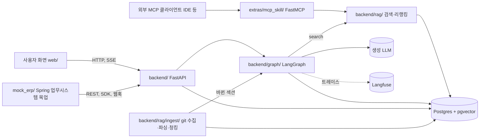
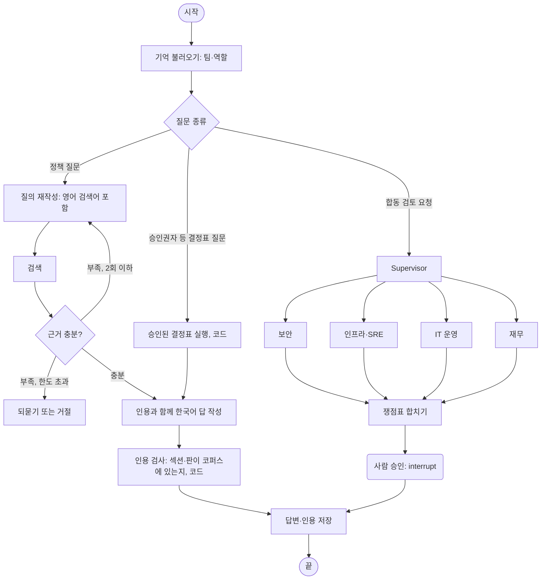

# Provena SDD

PRD의 기능을 어떤 모듈·데이터·API로 만들지 적은 설계 문서다. "무엇을"은 PRD, "어떻게"는 이 문서, "누가·어떤 규칙으로"는 팀 작업 지침서가 맡는다. 아직 정하지 않은 것은 11장에 모았다.

---

## 1. 범위

| 구분 | 내용 |
|---|---|
| 만드는 것 | F-01 근거 답변, F-04 결정표, F-02 답변 리콜(연결 정책 리콜 포함), F-03 팀 합동 검토, 공통 P-01~P-04 (로그인·기억, 문서 적재, 업무시스템 연동, 데모 모드), 가산 3종(자동화, GraphRAG, MCP·Skill) |
| 되면 만드는 것 | F-05 정책 변경 영향 시뮬레이터 (D5 중간 점검에서 판단) |
| 만들지 않는 것 | 실제 조직 시스템(배포·구매) 연동, 조직 내부망 배포, GitLab 비공개(internal) 문서 |
| 지켜야 할 게이트 | G1 배포, G2 재현(compose), G3 코퍼스 규모, G4 에이전트 구성, G5 평가, G6 관측, G7 저장소 (PRD 7장) |

## 2. 전체 구조

### 2-1. 구성도



### 2-2. 구성 요소

| 구성 요소 | 하는 일 | 기술 |
|---|---|---|
| `web/` | 로그인, 채팅, 승인함, 리콜 알림, 관리자 화면 | Vite + React + Tailwind. 빌드 결과(정적 파일)를 FastAPI가 직접 내준다 |
| `backend/` (`main.py`, `auth.py`) | 인증·권한, 채팅 스트리밍, 승인, 리콜, 결정표 실행, 웹훅 | FastAPI, OpenAPI 자동 문서 |
| `backend/graph/` | 질문 처리 그래프, 결정표 변환, 리콜 판정, 변경 전 영향 미리보기(F-05, 드라이런), 리콜 알림 확신도·심각도·요약(F-08) | LangGraph (체크포인트, interrupt, Store), LangChain 채팅 모델. 결정표 변환·리콜 판정 로직은 직접 구현 |
| `backend/rag/retrieve/` | 하이브리드 검색(벡터 + BM25), 판(커밋 날짜)·절·문서 권한 필터, 리랭킹, 한국어 질문의 영어 질의 변환, 한국어 문서 토큰 | LangChain 임베딩·pgvector 저장소·리트리버, 로컬 임베딩·리랭커. 인용 검사는 직접 구현 |
| `backend/rag/ingest/` | 핸드북 git 저장소 수집, Markdown 파싱, 청킹, 커밋 비교, git 없는 두 시점 문서 묶음 비교(F-07) | Python, git. 제목·절 단위 청킹은 직접 구현. 문서 출처는 `DocumentSource`(git, 디렉터리 스냅샷)로 바꿔 끼운다 |
| `extras/mcp_skill/` | 검색을 읽기 전용 MCP 도구 3개로 노출. 에이전트 검색 노드가 MCP 클라이언트로 호출 (2-3) | FastMCP |
| `skills/` | 에이전트가 실행 중에 읽는 판단 규칙 (2-3) | SKILL.md |
| `mock_erp/` | 업무시스템(구매·배포 승인)이 플랫폼을 부르는 시연 | Java(Spring Boot) 목업은 크게, Python 예제는 작게 |
| SDK | 업무시스템이 쓰는 클라이언트 | OpenAPI 명세에서 자동 생성한 Java·Python SDK (생성 도구는 11장) |
| DB | 문서·청크·판, 사용자, 답변·인용, 결정표, 승인, 리콜 | 운영: Supabase Postgres + pgvector / 데모: 로컬 pgvector 컨테이너 |
| 관측 | 그래프 단계별 트레이스, 평가 점수 연결 | Langfuse |

### 2-3. MCP 도구와 런타임 Skill

가산 3종 중 MCP와 Skill은 둘 다 해야 인정된다(가이드 p.20). 3차에서 새로 만든 것만 인정된다.

**MCP 서버 (`extras/mcp_skill/`)**

도구 3개는 모두 읽기 전용이고 멱등(같은 입력이면 같은 결과)이다. `backend/rag/`와 `backend/rag/ingest/`의 함수를 감싸기만 하고, 검색 로직을 MCP 안에 다시 짜지 않는다.

| 도구 | 입력 | 출력 | 감싸는 함수 | 쓰는 곳 |
|---|---|---|---|---|
| `search_handbook` | 질문, 절(선택, 예: security), 판 날짜 `as_of`(선택), k | 청크 목록 (chunk_id, 절, 페이지 제목, 제목 경로, 판 날짜(커밋 날짜), 본문, 출처 URL, 점수) | `rag.search(SearchQuery)` | 질문 그래프의 검색 노드, 팀 에이전트 |
| `get_section` | 페이지 id(`rule_seq`), 제목 경로, 판 날짜(선택) | 섹션 원문 한 개와 출처 URL | 섹션 조회 (DB) | 답 작성 시 원문 확인, 인용 검사 |
| `list_changed_sections` | 기준 시각 | 바뀐 섹션 목록 (`ChangedArticle`) | `ingest` 커밋 비교 결과 | 리콜 그래프 |

- 입출력 형식은 `backend/schemas/`의 `SearchQuery`, `Chunk`, `ChangedArticle`을 그대로 쓴다(6장). 섹션 단위 조회를 `get_section`으로 따로 둘지는 11장에서 정한다.
- **쓰기·실행 도구는 MCP에 내보내지 않는다.** 결정표 실행, 승인, 리콜 확인은 API와 interrupt를 거쳐야 한다. 승인 우회 도구 호출을 구조로 막는 장치다(인젝션 시험 계획).
- 비공개(`internal.gitlab.com`)로만 연결된 칸·링크는 도구가 근거로 내보내지 않고 "비공개 문서"로 표시한다(9장).
- 클라이언트는 `langchain[mcp]`(베타)를 쓴다. 서버는 `fastmcp` 4.x로 맞춘다. 옛 `langchain-mcp-adapters`는 보관(archived)되어 쓰지 않는다. 베타가 문제를 일으키면 공식 MCP Python SDK나 FastMCP 클라이언트를 직접 부른다.
- 검색 노드는 설정값 `SEARCH_VIA_MCP`로 MCP 호출과 직접 함수 호출을 바꾼다. MCP 서버가 멈췄을 때 대신 쓰고, 두 경로의 결과가 같은지 시험할 때도 쓴다.
- 접근은 토큰 헤더로 제한한다. 토큰은 `.env`에만 둔다. MCP 도구 호출도 Langfuse 트레이스에 단계로 남긴다.
- 서버를 띄우는 곳(FastAPI 앱에 붙일지, 따로 띄울지)은 11장에서 정한다.

**런타임 Skill (`skills/`, 에이전트가 읽는다)**

폴더마다 `SKILL.md`를 둔다. 팀 관점 Skill 폴더는 `security`, `infra`, `itops`, `finance`다(최종 확인은 11장).

| Skill | 구분 | 쓰는 곳 | 담는 판단 규칙 | 근거 섹션 (코퍼스) |
|---|---|---|---|---|
| `delegation` | 필수 | 질문 그래프 (승인권자 질문) | 금액 구간 경계(구간 끝값일 때 어느 칸인지) 읽는 법, 업무 승인(Functional)과 재무 승인(Financial) 구분, "상위 단계 승인은 아래 단계 승인을 먼저 거친다"는 주석 적용, 행·열 읽는 순서, 표에 없거나 비공개 칸이면 거절 | 2023-05 승인 권한표 (`www-gitlab-com` 커밋 0a3de83375) |
| `security` | 필수 | 보안 에이전트 | 외부 SaaS 도입 시 제3자 위험 검토 순서, 보안 위험 승인 단계, 취약점 공개 시점 같은 시한 규칙 확인 | 보안 절 (`security`) |
| `infra` | 필수 | 인프라·SRE 에이전트 | 장애 심각도(S1~S2) 정의, 지휘 역할과 대응 순서, on-call 에스컬레이션, 장애 리뷰 기한 확인 | 인프라·장애 대응 절 (`engineering/infrastructure-platforms`) |
| `itops` | 필수 | IT 운영 에이전트 | 계정·접근 관리, 도구 도입 승인 확인 순서 | IT 운영 절 (`business-technology`) |
| `finance` | 필수 | 재무 에이전트 | 비용·지급 승인 확인 순서, 법인카드 예외 승인자, 출장·접대비 한도 확인 | 재무 절 (`finance`) |
| `citation-rules` | 필수 | 답 작성 노드, 팀 에이전트 | 문장마다 근거 인용(페이지 제목 + 제목 경로 + 판 날짜 + 원문 URL). 답에 CC BY-SA 4.0 표시를 붙이고, 요약·재서술한 답에는 "수정됨"을 붙인다(8장). 금액·기한은 원문에 있는 값만 쓴다 | 정답 근거 인용률(가이드 p.17), 인용 정확도(PRD 13-2) |
| `grounding-check` | 필수 | 인용 검사 노드 | 문장이 인용 섹션으로 받쳐지는지 판정하는 기준과 반례 | 오답 근거·환각 위험 지표(가이드 p.17) |
| `glossary` | 필수 | 질의 재작성, 답 작성 | 핸드북 용어의 한국어 표기와 영어 원어 짝 (예: S1·S2 심각도, on-call, IMOC, RCA, PAO, Director·VP 직급, 업무 승인·재무 승인) | 한국어 질문을 영어 검색어로 바꿀 때와 용어 표기 |
| `report-writing` | 조건부 | 답변·쟁점표 양식 | 팀 Skill의 출력 형식만으로 쟁점표 양식이 흔들릴 때 쓴다 | |
| `chat-tool-guide` | 조건부 | 에이전트가 MCP 도구를 고르는 규칙 | 검색 노드가 도구를 고정 호출하지 않고 LLM이 도구를 고르게 할 때 쓴다 | |
| `mail-templates` | 조건부 | 리콜 알림·업무시스템 웹훅 문구 | 리콜 알림·웹훅을 만들 때 쓴다 | |
| `retrieval-slots` | 조건부 | 검색 결과 관련도 판정 기준 | 검색 평가를 사람 판정 외에 자동 판정으로도 할 때 쓴다 | |

- `delegation`을 따로 둔 이유: 승인권자 질문(예: 외부 SaaS 3만 달러, 정확히 2.5만·5만 달러)은 금액 구간 경계 해석에서 갈린다. Skill이 있을 때와 없을 때 차이가 가장 잘 드러난다.
- 근거 섹션은 PRD 5장 대표 질문과 개정 커밋에서 골랐다. 정답 섹션은 D1에 원문으로 확정한다. Skill을 쓸 때 원문 섹션을 다시 확인하고 페이지 id(`rule_seq`)와 제목 경로를 적는다. 구간 끝값 처리와 금액 수치는 원문 표기를 그대로 따른다.
- 각 SKILL.md는 이런 형식이다.

| 부분 | 내용 |
|---|---|
| 머리말 | `name`, `description` (언제 쓰는지 한 줄) |
| 판단 규칙 | 확인할 것을 순서대로. 규칙마다 근거 섹션(페이지 id, 제목 경로) |
| 출력 형식 | 팀 에이전트는 쟁점표 행(쟁점, 근거 섹션, 판단, 확신도), `delegation`은 승인권자와 근거 행 |
| 거절 조건 | 근거 섹션을 못 찾거나 비공개 문서로만 연결되면 추측하지 않고 "확인 필요"로 낸다 |
| 출처 | 3차에서 새로 작성한다. 다른 저장소나 2차의 Skill을 복사하지 않는다 |

**불러오는 방식.** 팀 에이전트는 자기 팀 SKILL.md를 시스템 프롬프트에 넣는다. 질문 그래프는 "질문 종류" 노드가 결정표 질문으로 분류하면 `delegation`을 답 작성 노드에 넣는다. 설정값 `USE_SKILLS`로 전부 켜고 끈다. 켰을 때와 껐을 때 나머지 조건(모델, 프롬프트, 검색)은 같아야 한다. `backend/services/skills.py`가 불러오기를 맡는다.

### 2-4. 개발 도구 Skill

`.claude/skills/`에 두고 저장소에 커밋해 팀이 같이 쓴다. 에이전트가 실행 중에 쓰는 것이 아니므로 가산(가이드 p.20) 근거로 내세우지 않는다.

| Skill | 하는 일 |
|---|---|
| `task-brief` | 작업 지시서 양식 (목적, 입출력, 인수 테스트, 건드릴 파일) |
| `test-first` | 테스트를 먼저 쓰고 구현 |
| `self-check` | "완료" 전에 테스트·린트를 실제로 실행하고 출력 확인 |
| `run-eval` | 평가셋 실행과 지표 비교 (`python evals/run_all.py`, 예정) |
| `replay` | 데모 모드 녹화 응답 재생 |
| `data-check` | 핸드북 git 수집기·권한표 파서 점검 |
| `regression` | 지표가 기준선보다 떨어졌는지 확인 |
| `db` | 로컬 pgvector와 Supabase 차이 (풀러, 마이그레이션) |
| `docs-sync` | 코드가 바뀌면 SPEC·SDD 해당 절을 같이 고치기 (가이드 p.14) |
| `commit` | 커밋 메시지 규칙, 수동 호출만 |
| `skill-eval` | 런타임 Skill 켬·끔 비교 (10장) |

## 3. 디렉토리 구조

**규칙:** 루트를 뺀 하위 폴더마다 맨 위에 폴더 이름과 같은 md 파일을 둔다(`backend/rag/rag.md`, `backend/rag/ingest/ingest.md`). 이 파일에는 폴더가 하는 일, 작업 기록(작업자는 git id·이름·별칭 중 하나 필수), 문제 기록과 해결 판정을 적는다. 형식은 팀 작업 지침서 5-1장을 따른다. 루트 바로 아래 폴더와 기능 단위 폴더는 필수이고, 그보다 아래와 `tests/`, 데이터·캐시 폴더는 선택이다. 폴더 주인은 지침서 5장에 있다.

```
repo/  (강사 템플릿 docs/SCAFFOLD.md 구조를 따른다)
├─ README.md                 # 프로젝트 소개, 실행 방법, 데이터 출처·라이선스 표기 (루트에는 폴더 md를 두지 않는다)
├─ AGENTS.md, CLAUDE.md      # 개발 도구 규칙 (CLAUDE.md는 AGENTS.md를 가리킨다)
├─ .claude/skills/           # 개발 도구 Skill (2-4)
├─ .mcp.json                 # 개발용 MCP 연결 설정
├─ .github/                  # PR 양식, CI(ci.yml), 비밀값 검사(secret-scan.yml)
├─ pytest.ini                 # 시험은 `pytest -q`, 평가는 `python evals/run_all.py`(예정). 의존성은 backend/requirements.txt
├─ Dockerfile, docker-compose.yml, .env.example
├─ EVAL_REPORT.md            # 개선 전후 지표 (제출물)
│
├─ docs/    docs.md          # TOPIC.md, SCAFFOLD.md, ARCHITECTURE.md, GATES.md, SPEC.md, SDD.md, TEAM_GUIDE.md, specs/, deliverables/
│
├─ backend/
│  ├─ backend.md
│  ├─ main.py                     # FastAPI 진입점(/health), 라우트: 채팅 스트리밍, 승인, 리콜, 결정표 실행, 웹훅
│  ├─ auth.py                     # 로그인, 사용자 식별 (bcrypt + JWT 쿠키)
│  ├─ app.py                      # 그래프 조립(build_app)
│  ├─ persistence.py              # 체크포인터·Store (DATABASE_URL이면 Postgres)
│  ├─ schemas/      schemas.md    # 파트 사이 데이터 형식 (3명 승인): chunk.py events.py approval.py recall.py decision.py
│  ├─ services/     services.md   # llm.py (LLM 호출은 여기 한 곳: 데모 모드, Langfuse, 비용 상한), skills.py (런타임 Skill 불러오기)
│  ├─ rag/          rag.md
│  │  ├─ ingest/    ingest.md
│  │  │     handbook.py           # 핸드북 git 수집(고른 절만), 2023 권한표 판 고정
│  │  │     history.py            # git 커밋 이력에서 판 목록 (리콜 시험 데이터)
│  │  │     parse.py              # Markdown·Hugo 단축코드·HTML 표 파싱, 원문 대조
│  │  │     chunk.py              # 제목(#) 단위 청킹, 긴 절은 문단으로 나눔, 120자 겹침
│  │  │     diff.py               # 커밋 사이 섹션 비교, 바뀐 섹션 찾기
│  │  │     load.py               # 임베딩 적재, manifest, 스냅샷
│  │  │     schedule.py           # 증분 수집(새 커밋만), 정시 실행, 중복 실행 방지 (가산: 자동화)
│  │  └─ retrieve/  retrieve.md
│  │        embed.py              # 다국어 로컬 임베딩
│  │        search.py             # 하이브리드 검색, 판·절 필터, 한→영 질의 변환
│  │        rerank.py             # bge-reranker-v2-m3
│  │        link_graph.py         # 핸드북 페이지 링크 그래프 (가산: GraphRAG)
│  ├─ graph/        graph.md      # 질문 처리 그래프, 상태, 라우팅, 인용 검사, 답변 저장
│  │  ├─ departments/ departments.md # Supervisor와 팀 에이전트 (보안·인프라·IT 운영·재무)
│  │  ├─ decision/  decision.md   # 권한표를 결정표로 변환 (F-04)
│  │  └─ recall/    recall.md     # 리콜 판정 (F-02)
│  ├─ memory/       memory.md     # Store 장기 기억 (팀·역할·담당 서비스)
│  └─ prompts/      prompts.md
│
├─ skills/          skills.md     # 런타임 Skill (가산: MCP와 Skill). 상세는 2-3
│     ├─ delegation/SKILL.md      # 권한표 해석
│     ├─ security/  infra/  itops/  finance/     # 팀 관점 Skill 4개
│     ├─ citation-rules/  grounding-check/  glossary/   # 공통 Skill 3개
│     └─ (조건부) report-writing/  chat-tool-guide/  mail-templates/  retrieval-slots/
├─ extras/mcp_skill/  mcp_skill.md   # 가산 자리
│     ├─ mcp_server/server.py     # FastMCP 서버, 읽기 전용 도구 3개: search_handbook, get_section, list_changed_sections
│     └─ tests/                   # MCP 경로와 직접 호출 경로의 결과 일치 시험
├─ web/   web.md   (pages/: login, chat, approvals, recalls, admin)
├─ mock_erp/  mock_erp.md   (Spring Boot 업무시스템 목업, python_example/)
├─ db/    db.md    (init.sql, seed: 데모 계정 2개. SQL 번호대는 파트마다 100번대씩)
├─ data/  data.md  (corpus/ 원문 스냅샷, manifest.jsonl, LICENSES/: CC BY-SA 4.0 고지와 출처. 코드와 폴더를 나눈다, 8장)
├─ evals/ evals.md
│     ├─ dataset_v1.jsonl, dataset_v2.jsonl
│     ├─ freeze.py, FROZEN.json, PREREGISTER.md
│     ├─ run_all.py               # 한 줄 재현 명령
│     ├─ retrieval/ (retrieval.md)  agent/ (agent.md)  safety/ (safety.md)  results/
└─ tests/
```

## 4. 모듈 설계

### 4-1. ingest: 수집에서 적재까지

| 단계 | 입력 | 출력 | 비고 |
|---|---|---|---|
| 수집 | GitLab 핸드북 저장소(`gitlab-com/content-sites/handbook`) 고른 절, 옛 저장소(`www-gitlab-com`)의 2023-05 권한표 1개 파일 | 원본 Markdown + 메타(절, 페이지 경로, 커밋 sha, 커밋 날짜, 원문 URL) | 공개 저장소. API 요청 간격 1초 이상. 고른 절은 PRD 8장 |
| 파싱 | Markdown, Hugo 단축코드, HTML 표(권한표는 CSS grid div) | 제목 계층·문단·표 행 | 원문 대조 3건 이상 기록. 권한표는 행(업무 종류 × 금액 구간)과 칸(역할 11개)으로 펼친다. 비공개(`internal.gitlab.com`)로만 연결된 칸은 "비공개"로 표시하고 결정표에서 뺀다 |
| 청킹 | 구조 | Chunk (제목 단위, 긴 절은 문단 묶음 약 800자, 앞 청크 끝 약 120자 겹침, 청크 앞에 제목 경로) | 제목 단위와 고정 길이 비교, 겹침 0자와 120자 비교(D2, 골든셋). 규모는 겹침 없이 센다: 실측 22,509청크(sha256 고유, 800자 분할), D1 수집기로 다시 센다 |
| 판 비교 | 같은 페이지의 두 커밋, 또는 git 없는 두 시점 문서 묶음(F-07) | `ChangedArticle`(바뀐 섹션, 변경 종류 added·removed·modified) 목록 | 제목 경로 기준 정렬 후 본문 비교. 제목만 바뀐 섹션은 본문 유사도로 같은 섹션으로 본다. 서식만 바뀐 커밋(링크·오탈자)은 표시만 하고 리콜에 넘기지 않는다. 두 입력 모두 같은 형식으로 리콜·영향 미리보기에 넘긴다 |
| 적재 | Chunk | DB (청크, 임베딩, manifest) | manifest에 출처, 수집일, 커밋 sha, 문서당 청크 수, 원문 길이, 보존 길이, 잘림 여부(가이드 p.15, p.21). 인젝션 시험용 `TEST` 문서는 G3 청크 수에서 뺀다 |

**증분 수집 (가산 자동화, 가이드 p.20):** 마지막으로 받은 커밋 이후의 새 커밋만 받아, 바뀐 파일만 다시 파싱한다. 삭제는 파일 목록을 완전히 받았을 때만 반영한다. 중복 실행을 막고, 정해진 시각 실행 기록과 실패 알림을 남긴다. 바뀐 섹션은 `ChangedArticle`로 리콜 그래프에 넘긴다.

**리콜 시험 데이터:** 핸드북 git 이력에서 "답이 바뀌는 규칙 변경" 커밋을 골라 개정 전후 판 쌍을 만든다. 권한표는 2021-10~11 커밋(예: "Remove VP from 50 to 250")을 쓴다. 커밋 목록은 PRD 8장.

### 4-2. rag: 검색

- 입력 `SearchQuery(query, org, as_of, k)` → 출력 `list[Chunk]` (점수 포함). `org`는 "절"(예: security), `as_of`는 "이 날짜 기준 핸드북 판"이다(6장).
- 순서: 절·판 필터 → 벡터 검색(pgvector) + BM25 → RRF로 합치기 → 리랭킹 → 상위 k
- **한국어 질문, 영어 문서:** 벡터 검색은 다국어 임베딩으로 한국어 질문을 그대로 쓴다. BM25는 영어 단어끼리만 맞으므로 LLM이 질문을 영어 검색어로 바꾼 뒤 계산한다. 두 방식(직접 교차언어 vs 번역 후 검색)을 D2 평가셋으로 비교한다(11장).
- `as_of`가 있으면 그 날짜에 유효했던 커밋 판만 검색한다.
- **문서 권한(F-06):** 청크마다 볼 수 있는 그룹(`acl`, 비면 공개)을 붙인다. 그룹은 정책 파일(`data/acl_policy.json`, 절·경로 접두어 → 그룹)로 정하므로 임베딩을 다시 만들지 않는다. API는 항상 사용자 그룹을 `SearchQuery.allowed_groups`로 넘기고, 검색은 순위를 매기기 전에 거른다. 검색 결과 캐시와 리랭킹 캐시는 그룹까지 키에 넣어 사용자 사이에 새지 않게 한다. 관리자는 전체를 본다.
- **한국어 문서:** BM25 토큰에 한글 토큰을 더한다. 영어 토큰은 바꾸지 않아 기존 색인을 그대로 쓴다.
- 바꾸는 순서는 한 번에 하나: 청킹 → 임베딩 → 하이브리드 → 리랭킹. 나머지는 고정한 채(lasagna 방식) 바꿀 때마다 Recall·MRR을 다시 잰다.
- GraphRAG(가산, 가이드 p.20): 핸드북 페이지 사이 링크 19,366개(전체 4,195쪽 중 2,622쪽이 링크를 가짐, 실측)로 정책 참조 그래프를 만든다. 비공개 주소로 가는 링크(450쪽에서 발견)는 끝점 없는 간선이라 뺀다. 벡터 검색이 지는 질문 유형(예: "배포 승인 정책이 바뀌면 영향받는 다른 정책은?")을 정의하고 개선 전후를 보인다. F-02 연결 정책 리콜도 이 그래프를 쓴다.

### 4-3. graph: 질문 처리 그래프



| 노드 | LLM 사용 | 설명 |
|---|---|---|
| 기억 불러오기 | 없음 | Store namespace `(user_id, "profile")`: 팀, 역할(예: SRE, 개발), 담당 서비스 |
| 질문 종류 | 있음 | 정책 질문 / 결정표 질문 / 합동 검토 |
| 질의 재작성 | 있음 | 핸드북 용어(영어)로 바꾸고 절·시점 조건을 뽑는다. `glossary` Skill을 쓴다 |
| 검색 | 없음 | `search_handbook` 호출 (MCP 또는 직접 호출, `SEARCH_VIA_MCP`) |
| 근거 충분 판정 | 있음 | 재검색은 최대 2회 |
| 답 작성 | 있음 | `citation-rules` Skill을 쓴다. 결정표 질문이면 `delegation` Skill도 쓴다 |
| 인용 검사 | 없음 | 인용한 섹션 id·판이 실제로 있는지. `grounding-check` Skill을 기준으로 삼는다 |
| 결정표 실행 | 없음 | 관리자가 승인한 결정표만 실행한다 |
| Supervisor, 팀 에이전트 | 있음 | 가이드 G4 최소형(Supervisor + 하위 에이전트 2개 이상)을 만족한다. 팀 에이전트마다 자기 팀 Skill(`security`, `infra`, `itops`, `finance`)을 쓴다 |
| 사람 승인 | 없음 | interrupt로 멈추고 `resume()`으로 이어 간다 |

**단일 대 멀티 (가이드 p.7, p.17):** 위 그림의 정책 질문 경로는 두 가지로 만든다. 단일은 한 그래프가 검색 → 작성 → 검증을 순서대로 하고(`single_pass`), 멀티는 Supervisor가 검색·작성·검증 하위 에이전트를 불러 같은 일을 나눠 한다. 같은 평가셋(정책 질문 전체)으로 두 경로를 비교한다. 합동 검토는 그와 별도인 시연 경로다.

**체크포인트와 재시작:** 체크포인터는 Postgres에 둔다. 사람 승인(interrupt)에서 멈춘 뒤 서버를 재시작해도 같은 `thread_id`로 승인 지점부터 재개되는지 시험한다(가이드 p.7, p.22).

**합동 검토 예 (F-03):** "새 외부 SaaS 모니터링 도구를 연 4만 달러에 도입하려 한다." 보안(제3자 위험 검토·데이터 분류), 인프라·SRE(운영·장애 대응 영향), IT 운영(계정·접근 관리·도구 승인), 재무(권한표상 승인권자) 에이전트가 각자 핸드북 근거로 쟁점을 뽑는다. 팀 에이전트 4개는 고른 코퍼스 절과 1:1로 맞춘다.

**결정표 변환 (F-04, 관리자 흐름):** 권한표 행 선택 → LLM이 결정표를 처음 작성 → 원문과 셀 대조표 생성 → 사람 승인(interrupt) → 승인되면 `decision_tables`에 저장하고 실행 가능 상태가 된다. 계약 `DecisionRule`(업무 종류 × 금액 구간 → 승인자, 협조 부서)과 권한표 모양이 같다. 권한표는 "업무 승인(Functional)"과 "재무 승인(Financial)"이 따로 있어, 재무 승인자를 `DecisionRule`에 별도 칸으로 둘지 `cooperating_depts`에 담을지 11장에서 정한다. 변환 정확도는 셀 단위로 측정해 공개한다.

**리콜 (F-02, 별도 그래프):** `ChangedArticle` 수신 → 그 섹션을 인용한 과거 답 찾기(코드, `citations` 테이블) → 개정 전후 섹션으로 결론이 바뀌었는지 판정(LLM) → 바뀐 답만 `RecallNotice` 생성. 링크로 연결된 다른 정책은 참조 그래프로 찾아 관리자에게 "함께 볼 정책" 후보로 만든다.

동작 기본값(판정 응답이 깨질 때, 기준일이 신판보다 늦을 때, 쟁점이 0건일 때, 결정표를 지정하지 않을 때, 절·기준일이 없을 때)은 11장 11-2에 모았다.

### 4-4. api: 엔드포인트

| 메서드 | 경로 | 권한 | 설명 |
|---|---|---|---|
| POST | `/auth/login` | 누구나 | 로그인 (방식은 11장) |
| POST | `/auth/logout` | 로그인 | |
| GET | `/me` | 로그인 | 사용자 정보, 역할 |
| POST | `/chat` | 로그인 | `{thread_id, message}` → SSE로 `AgentEvent` 스트림 |
| GET | `/threads` | 로그인 | 내 대화 목록 |
| GET, PATCH, DELETE | `/me/memory` | 로그인 | 내 장기 기억 보기·고치기·지우기 (가이드 p.10) |
| GET | `/approvals` | 관리자 | 승인 대기 목록 |
| POST | `/approvals/{id}` | 관리자 | `Decision` → 그래프 재개 |
| GET | `/recalls` | 로그인 | 내 리콜 알림 (관리자는 전체 + 함께 볼 정책 후보) |
| POST | `/recalls/{id}/ack` | 로그인 | 확인 표시 |
| GET | `/decision-tables` | 로그인 | 승인된 결정표 목록 |
| POST | `/decision-tables/{id}/run` | 로그인 | 결정표 실행 (LLM 없음). 업무시스템의 "승인권자 확인" 호출 |
| POST | `/webhooks/regulation-updated` | 서비스 키 | 수집 쪽에서 정책 변경 알림 (경로 이름은 계약 유지) |
| POST | `/impact-preview` | 관리자 | 바뀐 섹션 목록·커밋·MR diff → 영향받을 답·결정표 칸·알림 대상 수(F-05). 드라이런이라 저장·알림·웹훅 없음 |
| POST | `/recalls/{id}/feedback` | 로그인 | 리콜 알림이 쓸모 있었는지(`useful`, `reason`). 같은 유형의 다음 알림 심각도에 반영(F-08) |
| POST, GET | `/webhook-subscriptions` | 관리자 | 업무시스템 웹훅 주소 등록·조회. 리콜 알림이 생기면 등록된 주소로 보내고, 실패하면 재시도하고 기록한다 |
| GET, POST | `/maintenance-candidates` | 관리자 | 연결 정책 후보 목록, 확인 필요·불필요 판단 |
| GET | `/health` | 누구나 | 상태 확인 (Supabase 정지 방지 호출 포함) |

리콜 웹훅 형식(수신 경로, 본문, 서명)은 11장 11-1에서 정한다.

### 4-5. web: 화면

| 화면 | 보이는 것 | 부르는 API |
|---|---|---|
| 로그인 | 아이디·비밀번호 | `/auth/login` |
| 채팅 | 한국어 답 스트리밍, 오른쪽 인용 패널(절, 페이지, 섹션, 판 날짜, 원문 링크, CC BY-SA 4.0 표시) | `/chat`, `/threads` |
| 승인함 (관리자) | 변환된 결정표·쟁점표, 원문 대조, 승인/반려 | `/approvals` |
| 리콜 알림 | 바뀐 답, 개정 전후 섹션, 설명 | `/recalls` |
| 관리자 | 결정표 목록, 연결 정책 후보 | `/decision-tables`, `/recalls` |

## 5. 데이터 모델

테이블 이름과 칸 이름은 계약(`backend/schemas/`) 필드와 같게 둔다. 뜻은 핸드북 코퍼스에 맞춘다(6장).

| 테이블 | 주요 칸 | 쓰는 곳 |
|---|---|---|
| `docs` | rule_seq(페이지 id), org(절), title(페이지 제목), fmt(md), source_url(핸드북 URL), fetched_at | ingest |
| `versions` | version_id(커밋 sha 기반), rule_seq, version_date(커밋 날짜), file_sha256 | ingest, diff |
| `chunks` | chunk_id, version_id, article(제목 경로), kind, text, text_sha256, acl(볼 수 있는 그룹, 비면 공개), embedding | ingest, rag |
| `rule_links` | from_rule, to_rule, kind(페이지 링크) | GraphRAG (가산), F-02 연결 정책 리콜 |
| `users` | user_id, login_id, password_hash, role(user, admin), groups(문서 권한 그룹) | api |
| `answers` | answer_id, user_id, thread_id, question, answer, as_of, created_at | graph |
| `citations` | answer_id, chunk_id, version_id | graph, recall |
| `decision_tables` | table_id, rule_seq, version_id, cells(json), status(draft, approved, rejected), approved_by | graph, api |
| `approvals` | approval_id, kind, thread_id, status, decided_by | graph, api |
| `recall_notices` | notice_id, answer_id, user_id, changed(json), conclusion_changed, confidence, severity(high, low), acked | graph, api |
| `recall_feedback` | notice_id, user_id, useful, reason, created_at. 같은 섹션·변경 유형에 "필요 없음"이 쌓이면 다음 알림 심각도를 낮춘다 | api, recall |
| `maintenance_candidates` | candidate_id, upper_rule(바뀐 정책), upper_version_id, rule_seq(연결된 정책), article, status, decided_by | graph, api |
| `webhook_subscriptions` | sub_id, url, secret_ref, active | api |
| `webhook_deliveries` | delivery_id, sub_id, notice_id, status, tries | api |
| LangGraph 체크포인트·Store | 라이브러리가 만든다 | graph |

- 대화는 `thread_id`, 장기 기억은 Store namespace `(user_id, ...)`로 사용자마다 나눈다(P-01, G4).
- Store 기억(가이드 p.10): 무엇을 기억할지 기준(팀·역할·담당 서비스처럼 답에 쓰는 사실만), State와 Store의 경계(대화 중 값은 State, 다음 대화에도 쓸 값만 Store), 틀린 기억을 고치는 절차(`GET/PATCH/DELETE /me/memory`), DB 기반 Store.
- `citations`가 리콜의 핵심이다. 답과 근거 판(커밋)을 묶어 두어야 정책이 바뀔 때 영향받는 답을 찾을 수 있다.

## 6. 파트 사이 계약

`backend/schemas/`의 형식이다. 이 계약은 D0에 동결한다. 필드 추가는 PR 하나로 3명 승인, 이름 변경·삭제는 회의에서만 정한다. 이름을 바꾸면(예: `org` → `section`) 모든 파트에 영향이 있어 이름은 그대로 두는 것을 기본값으로 한다. 아래 필드 중 D0에 추가 여부를 정하는 것은 11장 11-1에 있다.

```python
# backend/schemas/chunk.py  (검색 → 에이전트)
class Chunk(BaseModel):
    chunk_id: str          # sha256 앞 16자
    org: str               # 핸드북 절 (예: "security", "finance")
    rule_seq: int          # 페이지 id (만드는 법은 11장)
    rule_title: str        # 페이지 제목
    article: str | None    # 제목 경로 (예: "Incident Management > Severities")
    version_id: str        # 커밋 기반 판 id (5장 versions, citations와 같은 값)
    version_date: str      # 이 판(커밋)의 날짜 YYYY-MM-DD
    fetched_at: str        # 수집일 YYYY-MM-DD
    kind: Literal["article", "annex", "row", "buchik", "pre"]  # article(섹션), row(권한표 행) 위주로 쓴다. 나머지 값은 남겨 둔다
    text: str
    source_url: str        # 핸드북 페이지 URL

class SearchQuery(BaseModel):
    query: str
    org: str | None = None     # 절
    as_of: str | None = None   # 이 날짜 기준 핸드북 판(커밋)만
    k: int = 8

# backend/schemas/events.py  (에이전트 → 화면)
class AgentEvent(BaseModel):
    type: Literal["token", "citation", "approval_request", "error", "done"]
    thread_id: str
    data: dict

# backend/schemas/approval.py  (에이전트 ↔ 화면)
class ApprovalItem(BaseModel):
    approval_id: str
    kind: Literal["decision_table", "issue_table"]
    summary: str
    created_at: str

class Decision(BaseModel):
    approval_id: str
    approve: bool
    comment: str = ""

# backend/schemas/recall.py  (수집 → 에이전트 → 화면)
class ChangedArticle(BaseModel):   # 바뀐 섹션 (같은 페이지의 두 커밋 비교)
    rule_seq: int
    article: str
    old_version_date: str
    new_version_date: str

class RecallNotice(BaseModel):
    answer_id: str
    user_id: str
    changed: ChangedArticle
    conclusion_changed: bool
    explanation: str

class MaintenanceCandidate(BaseModel):   # 연결 정책 개정 → 관리자 "함께 볼 정책" (F-02)
    candidate_id: str
    upper_rule: str        # 개정된 정책 페이지 (링크로 연결된 쪽)
    upper_version_id: str
    rule_seq: int          # 영향받는 다른 정책 페이지
    article: str
    reason: str            # 페이지 링크 그래프에서 찾은 근거
```

`backend/schemas/decision.py`의 결정표 형식은 아래 뜻을 따른다. 필드 목록은 11장 11-1의 결정(3-2, 3-3)을 반영해 D0에 동결한다.

| 형식 | 담는 것 |
|---|---|
| `DecisionRule` | 업무 종류 × 금액 구간 → 승인자(업무 승인), 협조 부서(`cooperating_depts`). 재무 승인자를 담는 방법은 11장 |
| `DecisionTable` | `decision_tables` 테이블(5장)과 같은 칸: table_id, rule_seq, version_id, cells, status(draft, approved, rejected), approved_by |

핸드북 코퍼스에서 계약 필드의 뜻은 이렇다.

| 계약 필드 | 뜻 |
|---|---|
| `Chunk.org` | 핸드북 절 (security, finance 등) |
| `Chunk.rule_seq` | 페이지 id |
| `Chunk.article` | 제목 경로 (예: `Incident Management > Severities`) |
| `Chunk.version_id`, `version_date` | 커밋 기반 판 id, 커밋 날짜 |
| `Chunk.kind` | `article`(섹션), `row`(권한표 행) 위주로 쓴다. 나머지 값은 남겨 둔다 |
| `Chunk.source_url` | 핸드북 페이지 URL |
| `DecisionRule` | 업무 종류 × 금액 구간 → 승인자(업무 승인), 협조(재무 승인자) |

기다리지 않는 법: 주는 쪽은 D1에 고정 응답을 돌려주는 가짜 함수(`search()`, `run()`)를 먼저 올린다.

## 7. 배포와 실행 모드

| 모드 | DB | LLM | 계정 | 실행 |
|---|---|---|---|---|
| 데모 (G2) | 로컬 pgvector 컨테이너 + 스냅샷 | 키 없음: 기록해 둔 응답 재생 | 데모 전용 2개 시드 (평가용과 다른 값) | `docker compose up` (10분 안) |
| 운영 (G1) | Supabase Postgres + pgvector | 생성 LLM (11장) | 평가용 테스트 계정 2개 (비공개 제출) | GCP Cloud Run |

- 임베딩·리랭커는 두 모드 모두 로컬 모델이다(`HF_HUB_OFFLINE=1`로 오프라인 실행 확인).
- 데모 모드는 키가 없으므로 한→영 질의 변환도 기록된 응답을 재생하거나, 다국어 임베딩만으로 검색한다(BM25 영어 질의 없음). 차이는 리포트에 적는다.
- 모든 LLM 호출은 `backend/services/llm.py` 한 곳을 거친다. 데모 모드 재생, Langfuse 트레이스, 비용 상한을 이곳에서 처리한다.
- Cloud Run 메모리와 이미지 크기는 D0에 확인한다(11장).
- Supabase 무료 플랜은 1주 비활성 시 정지되므로 `/health`를 정기 호출한다.
- Supabase 접속은 풀러 연결 문자열을 기본으로 쓰고, 마이그레이션은 직접 연결로 한다(가이드 p.11).
- 서비스 역할 키(service role)는 서버에서만 쓰고 프런트나 저장소에 올리지 않는다(가이드 p.12).

## 8. 데이터 이용 조건

| 항목 | 내용 | 출처 |
|---|---|---|
| 핸드북 본문 | CC BY-SA 4.0. GitLab 원문: "Our handbook falls under the Attribution-ShareAlike 4.0 International license" | https://handbook.gitlab.com/handbook/about/handbook-usage/ |
| 2023 권한표 (옛 저장소) | 같은 커밋(0a3de83375)의 handbook-usage 페이지에 같은 문장 | gitlab.com/gitlab-com/www-gitlab-com |
| 답에 원문을 보일 때 | 페이지 URL, CC BY-SA 4.0 링크, 수정 여부를 함께 표시한다(법적 코드 3(a)(1)). 요약·재서술한 답에는 "수정됨"을 붙인다(안전한 쪽 해석) | https://creativecommons.org/licenses/by-sa/4.0/legalcode.en |
| 저장소 | 코드와 원문 텍스트를 폴더로 나눈다. 원문 폴더에만 CC BY-SA 4.0과 출처를 적는다. 원문을 고쳐 올리면 그 수정본은 CC BY-SA로 공개해야 한다 | 같은 법적 코드 3(b), CC FAQ |
| 상표 | "GitLab 핸드북 기반 데모"처럼 사실대로 쓴다. 로고를 쓰지 않고, "GitLab Inc.와 제휴·보증 관계가 없다"를 README와 발표에 적는다 | GitLab Trademark Guidelines |

## 9. 보안과 신뢰 경계

| 위험 | 대응 |
|---|---|
| 문서 속 간접 인젝션 | 검색된 원문은 지시가 아닌 자료로만 다룬다. 결정표 실행은 관리자 승인(interrupt)을 거쳐야만 되고, 인용은 코드로 원문과 대조한다. MCP에는 쓰기·실행 도구를 내보내지 않는다. 시험 최소 30건(`evals/safety/`), 공격문은 핸드북 문서(런북·정책) 안에 심는다. 상세는 인젝션 시험 계획 |
| 출처 유출 | 다른 사용자 대화와 기억이 섞이지 않는지 시험. 평가자는 평가용 계정 A·B로 직접 확인한다(가이드 p.21) |
| 권한 | 결정표 승인·반려, 전체 리콜, 변경 전 영향 미리보기는 관리자만. 문서는 사용자 그룹으로 검색 단계에서 거르고(F-06), 리콜 알림도 볼 수 있는 섹션만 인용한다 |
| 비밀값 | `.env`에만. 평가 계정 비밀번호는 저장소에 없음 |
| 결정표 오류 | 승인 전 실행 금지. 셀 대조표를 승인 화면에 보여 준다 |
| 비공개 링크 | 비공개 주소로만 연결된 칸·링크는 답의 근거로 쓰지 않고 "비공개 문서"로 표시한다 |

## 10. 평가 연결

| 무엇 | 어디서 | 기준 |
|---|---|---|
| 검색 Recall·MRR | `evals/retrieval/` | PRD 13-2 숫자 기준. 한국어 질문 → 영어 근거 섹션 |
| 답 정확도, 인용, 거절 | `evals/agent/` | 평가셋 v1 30 → v2 50. 지표 5개로 나눠 보고: 정답 근거 인용률, 오답 근거, 과잉 거절, 올바른 거절, 환각 위험 (가이드 p.17). 질문 작성자는 정답 청크를 보지 않고, 정답 청크는 다른 팀원이 찾는다 (가이드 p.16) |
| G4·G5 테스트가 진짜인지 | `docs/GATES.md` | 핵심 코드를 한 줄 깨면 실패하는 테스트 3건 이상 (가이드 p.17) |
| 단일 대 멀티 | `evals/agent/` | 같은 평가셋 |
| 결정표 변환 정확도 | `evals/agent/` | 셀 단위, 2023 권한표 정답과 대조 |
| 답변 리콜 | `evals/agent/` | 핸드북 실제 개정 커밋 전후 판 쌍으로 재현율·정밀도 (PRD 13-2) |
| 연결 정책 후보, 링크 추출 | `evals/agent/` | 후보 정밀도, 링크 그래프 간선 정확도 |
| GraphRAG (가산) | `evals/retrieval/` | 벡터 검색이 지는 질문 유형에서 그래프 검색 개선 전후 (가이드 p.20) |
| Skill 있을 때와 없을 때 (가산) | `evals/agent/` | 같은 평가셋(v2 50건과 합동 검토 질문), `USE_SKILLS` 켬·끔. 답 정확도, 근거 인용률, 거절 정확도를 `delegation` 대상 질문만 따로도 본다. 점수 차이 표와 실제 답 비교 예시 2~3개를 싣고, 차이가 없거나 나빠진 경우도 그대로 공개한다 |
| MCP 경로 결과 일치 (가산) | `extras/mcp_skill/tests/` | 직접 호출과 chunk_id 순서 같음. Langfuse 트레이스에 MCP 도구 호출 단계가 보이고, 외부 MCP 클라이언트 하나에서 `search_handbook` 결과가 나옴 (시연 영상용) |
| 범용 챗봇 비교 | `evals/safety/` | PRD 10-1 (IT 질문으로 수집) |
| 재현 | `evals/run_all.py` | 한 줄 재현 명령 |

## 11. 미정 사항 (D0에 정함)

D0(10/30) 회의에서 안건마다 추천안을 먼저 보고, 반대가 없으면 추천안으로 정한다. 계약은 정하면 동결하고, 이후 바꾸려면 PR 하나로 3명 승인을 받는다.

### 11-1. 파트 사이 계약

| # | 항목 | 선택지 | 추천 | 이유 |
|---|---|---|---|---|
| 3-1 | 페이지 id(`rule_seq`) 만드는 법 | 페이지 경로 해시 / 일련번호 | 페이지 경로 해시(정수) | 판이 바뀌어도 같은 페이지는 같은 id |
| 3-2 | 결정표의 재무 승인 | `DecisionRule`에 재무 승인자 칸 추가 / `cooperating_depts`에 담기 | 칸 추가 | 권한표는 업무 승인과 재무 승인이 따로 있어 섞으면 뜻이 흐려진다 |
| 3-3 | 결정표 승인자 기록 | `Decision`에 `decided_by` 추가 / 실행 설정에서 읽기 | 필드 추가 | 누가 승인했는지 기록이 남아야 한다 |
| 3-4 | 섹션 단위 조회 (검색 → 에이전트) | `get_article(rule_seq, article, as_of)` 따로 / `SearchQuery`에 `rule_seq` 추가 | 따로 | 리콜은 같은 섹션의 개정 전후 원문이 필요하고, 검색과 목적이 다르다 (MCP 도구 `get_section`이 이 역할) |
| 3-5 | 바뀐 섹션의 종류 | `ChangedArticle`에 추가·삭제·수정 칸 추가 / 두지 않기 | 칸 추가 | 삭제된 섹션을 인용한 답은 수정과 판정이 다르다 |
| 3-6 | 청크 본문 해시 | `Chunk`에 본문 sha256 칸 추가 / 매번 계산 | 칸 추가 | G3 "서로 다른 청크 수"를 셀 때와 중복 제거에 쓴다 |
| 3-7 | 리콜 웹훅 형식 | 아래 안 / 다른 형식 | 아래 안 | 업무시스템 쪽 수신 경로 `POST /webhooks/recall`, 본문은 `RecallNotice` JSON 그대로, 서명은 헤더 `X-Signature: sha256=<HMAC-SHA256(secret, 원본 본문) 16진수>`. secret은 `webhook_subscriptions.secret_ref`가 가리키는 값이고 저장소에 적지 않는다 |
| 3-8 | 웹훅 비밀값이 비었을 때 | 서명 검사 건너뜀 / 항상 필수 | 배포 주소는 필수, 로컬 데모만 건너뜀 | 배포 주소에서 서명 없는 웹훅을 받지 않는다 |
| - | 결정표 실행 API 요청 필드 이름, 응답 코드(202, 409) | Spec에서 정함 | D0 Spec 작성 때 정함 | 업무시스템과 맞물리는 부분 |

### 11-2. 동작 기본값

| # | 기본값 | 추천 |
|---|---|---|
| 4-1 | 리콜 판정 LLM 응답이 깨지면 설명 맨 앞에 "[판정 실패, 확인 필요]"를 붙여 알림을 보내고 실패 목록에도 남긴다 (재현율 우선) | 그대로 |
| 4-2 | 이미 신판 날짜 이후 기준일로 받은 답은 영향이 없다고 보고 판정하지 않는다 | 그대로 |
| 4-3 | 합동 검토에서 쟁점이 0건이면 승인 없이 "쟁점 없음"으로 끝낸다 | 그대로 |
| 4-4 | 결정표 질문에서 표를 지정하지 않으면 업무 종류로 승인된 표가 정확히 1개일 때만 실행한다 (0개·2개 이상이면 거절) | 그대로 |
| 4-5 | 질문에 절이 없으면 전체 절에서, 기준일이 없으면 최신 판으로 검색한다 | 그대로 |

### 11-3. 기술과 구성

| 항목 | 선택지 | 추천 | 정할 때 |
|---|---|---|---|
| 생성 LLM | `haiku-5.5` / `gpt-6-luna`. `LLM_PROVIDER`(기본 anthropic)·`openai` 둘 다 받고, 키가 없으면 데모 모드 | 평가셋 v1로 비교해 하나를 고른다 | D0 후보, D2 확정 |
| 임베딩 | `bge-m3` / 비교 후보(Qwen3-Embedding-0.6B 등). 한국어 질문 → 영어 문서라 다국어 모델이 필요하다 | `bge-m3` 기본 | D0 후보, D2~D3 확정 |
| 한→영 질의 변환 | LLM이 BM25용 영어 검색어를 만든다 / 다국어 임베딩만 쓴다 | 두 방식을 평가셋으로 비교 | D2~D3 |
| 로컬 모델 실행, Cloud Run 메모리·이미지 크기 | 각자 PC에서 `bge-m3`를 불러 보고 확인 | 오늘 확인 | D0 |
| 리랭커 속도 | CPU(Cloud Run)에서 질문당 수 초가 걸릴 수 있다. 검색+리랭킹 p95 2초 기준을 지킬 수 있는지, 리랭킹 후보 수를 줄일지 | 재고 정한다 | D2 |
| Skill 폴더 이름 | `security`, `infra`(인프라·SRE), `itops`(IT 운영), `finance` | 이 이름 | D0 |
| 로그인 방식 | 자체 구현(FastAPI + Postgres + bcrypt + JWT 쿠키) / Supabase Auth | 자체 구현 (Supabase Auth는 데모 모드와 충돌) | D5 전 |
| MCP 서버 위치 | FastAPI 앱에 붙여 같은 Cloud Run 서비스 / 별도 서비스 | 같은 서비스 (데모 모드에서 같은 컨테이너가 단순) | D0 |
| `langchain[mcp]` 상태 | 베타 유지 여부 확인, 문제 시 공식 MCP SDK나 FastMCP 클라이언트 직접 호출 | 공식 문서에서 최신 상태 확인 | D0 |
| SDK 생성 도구 | OpenAPI 명세에서 Java·Python SDK를 만드는 도구와 산출물 위치 | 후보를 D0에 정한다 | D0 |
| 결정표 변환 재시도 | LLM 결과를 읽지 못하면 지금은 재시도 없이 실패로 끝난다. 재시도를 넣을지 | 추천 없음, 현재는 재시도 없음 | D4 |

### 11-4. 역할·평가·범위

| 항목 | 선택지 | 추천 | 정할 때 |
|---|---|---|---|
| 역할 배정, 폴더 주인 | 팀 작업 지침서 3장·5장 | 업무 분담안 그대로 확정 (가이드 p.28) | D0 |
| README, 시연 영상 3분, Langfuse 스크린샷(G7) 담당 | 팀원 중 한 명 | 추천 없음, 담당을 정한다 | D0 |
| 숫자 기준 | PRD 13-2 제안안 | 동결하고 중간에 낮추지 않는다 (가이드 p.14, p.19) | D0 |
| 평가셋 정답 기준일(`as_of`) | 고정 커밋 날짜 하나로 통일 / 문항마다 다르게 | 고정 커밋 날짜 하나 | D0 |
| 정답 판정 | 질문을 쓰지 않은 두 사람이 따로 판정하고, 다른 판정은 팀장이 정한다 | 이 방식 | D2 (11/3)에 동결 |
| F-05~F-08 | 핵심·가산·게이트를 끝낸 뒤 넣을지 | 끝낸 뒤 판단. 순서는 F-05 → F-06 → F-08 → F-07 | D5 중간 점검 |
| 정책 담당자의 위치 | 주 사용자로 옮김 / 두 번째 사용자로 더함 | 두 번째 사용자(PRD 4장). 주제서가 개발 조직을 주 사용자로 합격했으므로 바꾸지 않는다 | D0 공유 |
| 문서 권한 그룹 | 정책 파일로 절·경로마다 / 문서마다 | 정책 파일(임베딩 재생성 없음) | F-06을 넣을 때 |
