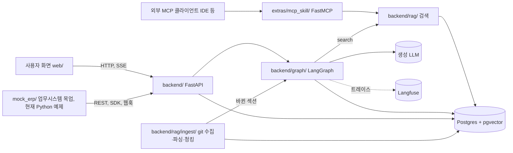
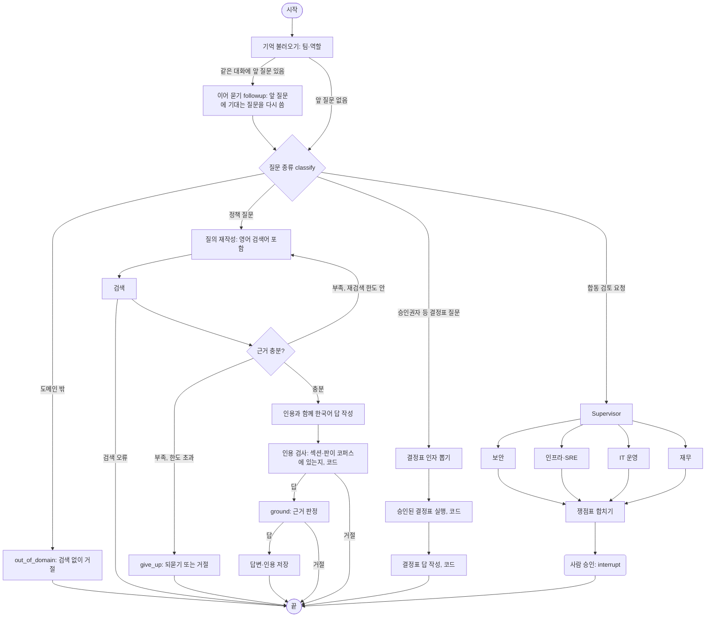

# Provena SDD

PRD의 기능을 어떤 모듈·데이터·API로 만들지 적은 설계 문서다. "무엇을"은 PRD, "어떻게"는 이 문서, "누가·어떤 규칙으로"는 팀 작업 지침서가 맡는다. 아직 정하지 않은 것은 11장에 모았다.

---

## 1. 범위

| 구분 | 내용 |
|---|---|
| 만드는 것 | F-01 근거 답변, F-04 결정표, F-02 답변 리콜(연결 정책 리콜 포함), F-03 팀 합동 검토, 공통 P-01~P-04 (로그인·기억, 문서 적재, 업무시스템 연동, 데모 모드), 가산 3종(자동화, GraphRAG, MCP·Skill) |
| 만드는 것(필수 뒤) | F-05 정책 변경 영향 시뮬레이터, F-06 문서 권한, F-08 알림 피로 줄이기, F-07 git 없는 변경 감지 (결정 0059, 0066) |
| 만들지 않는 것 | 실제 조직 시스템(배포·구매) 연동, 조직 내부망 배포, GitLab 비공개(internal) 문서 |
| 지켜야 할 게이트 | G1 배포, G2 재현(compose), G3 코퍼스 규모, G4 에이전트 구성, G5 평가, G6 관측, G7 저장소 (PRD 7장) |

## 2. 전체 구조

### 2-1. 구성도



### 2-2. 구성 요소

| 구성 요소 | 하는 일 | 기술 |
|---|---|---|
| `web/` | 로그인, 채팅, 승인함, 리콜 알림, 관리자 화면 | Vite + React + Tailwind. 빌드 결과(정적 파일)를 FastAPI가 직접 내준다 |
| `backend/` (`main.py`, `auth.py`) | 인증·권한, 채팅 스트리밍, 승인, 결정표 실행(리콜·웹훅·변경 감시 라우트는 `api/recalls.py`, `api/changes.py`) | FastAPI, OpenAPI 자동 문서 |
| `backend/graph/` | 질문 처리 그래프, 결정표 변환, 리콜 판정, 변경 전 영향 미리보기(F-05, 드라이런), 리콜 알림 확신도·심각도·요약(F-08). 리콜 판정 그래프, F-05, F-08은 `graph/recall/`에 구현했다(F-06 문서 권한은 연결 지점과 기본 공개 구현까지) | LangGraph (체크포인트, interrupt, Store). LangChain은 채팅 모델(`langchain-anthropic`·`langchain-openai`, `backend/services/llm.py`)과 메시지·콜백·Runnable 타입(`langchain_core`)에만 쓴다. 결정표 변환·리콜 판정 로직은 직접 구현 |
| `backend/rag/retrieve/` | 벡터 검색(확정 구성은 영어 문장 벡터만 쓰는 `dense_en`), 판(커밋 날짜)·절 필터, 한국어 질문의 영어 질의 변환, 링크 확장, 금액 구간 조회. 하이브리드(벡터 + BM25)와 리랭킹은 `SEARCH_MODE`·`RERANK_*`로 켜는 비교용이며 확정 구성에는 없다(결정 0048, `EVAL_REPORT.md` 3-2) | 임베딩은 Voyage API(`voyage-4`)를 직접 호출하고, pgvector는 psycopg SQL로 직접 조회한다(LangChain 임베딩·저장소·리트리버는 쓰지 않는다). 리랭커는 로컬 모델(11-0, 현재 미사용). 인용 검사는 직접 구현 |
| `backend/rag/ingest/` | 핸드북 git 저장소 수집, Markdown·PDF 파싱, 청킹, 커밋 비교, git 없는 두 시점 문서 묶음 비교(F-07) | Python, git. 제목·절 단위 청킹은 직접 구현. 문서 출처는 `DocumentSource`(git, 디렉터리 스냅샷)로 바꿔 끼운다. 한계(F-10, 2026-11-13 소유자 결정: 지금 잇지 않고 알려진 한계로 둔다): `handbook.collect()`(`backend/rag/ingest/handbook.py:254`)와 `schedule.py`는 아직 `DocumentSource`를 거치지 않는다(`backend/rag/ingest/source.py:7`, 추상화 정의 `source.py:29`). `DocumentSource`를 쓰는 곳은 `source.py` 자신과 `tests/test_ingest_source.py`뿐이다 |
| `extras/mcp_skill/` | 검색·섹션 조회·바뀐 섹션 목록, 결정표 실행 결과, 에이전트 실행 단계, 답의 근거 판정 기록을 읽기 전용 MCP 도구 6개로 노출. 에이전트 검색 노드가 MCP 클라이언트로 호출 (2-3) | FastMCP |
| `skills/` | 에이전트가 실행 중에 읽는 판단 규칙 (2-3) | SKILL.md |
| `mock_erp/` | 업무시스템(구매·배포 승인)이 플랫폼을 부르는 시연 | 계획은 Java(Spring Boot) 목업은 크게, Python 예제는 작게. 현재(2026-11-11)는 Python 예제(`mock_erp/python_example/`)만 있고 Java 목업은 만들지 않았다(`mock_erp/mock_erp.md` "만든 것과 만들지 않은 것") |
| SDK | 업무시스템이 쓰는 클라이언트 | OpenAPI 명세에서 openapi-generator 7.26.0로 자동 생성한 Java·Python SDK (생성 도구는 11장, 산출물은 `mock_erp/sdk/`, 2026-11-12). 명세는 `docs/api/openapi.json`, 손으로 쓴 Python 예제는 `mock_erp/python_example/`(`mock_erp/sdk/sdk.md`) |
| DB | 문서·청크·판, 사용자, 답변·인용, 결정표, 승인, 리콜 | 운영: Supabase Postgres + pgvector / 데모: 로컬 pgvector 컨테이너 |
| 관측 | 그래프 단계별 트레이스, 평가 점수 연결 | Langfuse |

### 2-3. MCP 도구와 런타임 Skill

가산 3종 중 MCP와 Skill은 둘 다 해야 인정된다(가이드 p.20). 3차에서 새로 만든 것만 인정된다.

**MCP 서버 (`extras/mcp_skill/`)**

도구 6개는 모두 읽기 전용이다. 저장소에 아무것도 쓰지 않고, 서버는 6개 모두에 읽기 전용·멱등 표시(`readOnlyHint`, `idempotentHint`)를 단다. 이 표시는 같은 입력으로 다시 불러도 저장소에 더해지는 것이 없다는 뜻이며, 결과 값이 늘 같다는 뜻은 아니다. 검색 3개, `explain_decision`, `get_grounding`은 저장된 자료가 그대로이면 같은 입력에 같은 결과를 돌려준다. `get_agent_trace`는 체크포인트를 읽기만 하지만, 대화가 진행되면 같은 `thread_id`의 결과가 달라진다. 앞 세 도구는 `backend/rag/`와 `backend/rag/ingest/`의 함수를, `explain_decision`은 결정표 실행기(`DecisionExecutor.run`)를, `get_agent_trace`는 LangGraph 체크포인터의 읽기를, `get_grounding`은 답 저장소의 근거 판정 기록 읽기를 감싸기만 하고, 검색·판단 로직을 MCP 안에 다시 짜지 않는다.

| 도구 | 입력 | 출력 | 감싸는 함수 | 쓰는 곳 |
|---|---|---|---|---|
| `search_handbook` | 질문, 절(선택, 예: security), 판 날짜 `as_of`(선택), k | 청크 목록 (chunk_id, 절, 페이지 제목, 제목 경로, 판 날짜(커밋 날짜), 본문, 출처 URL, 점수) | `rag.search(SearchQuery)` | 질문 그래프의 검색 노드, 팀 에이전트 |
| `get_section` | 페이지 id(`rule_seq`), 제목 경로, 판 날짜(선택) | 섹션 원문 한 개와 출처 URL | 섹션 조회 (DB) | 답 작성 시 원문 확인, 인용 검사 |
| `list_changed_sections` | 기준 시각 | 바뀐 섹션 목록 (`ChangedArticle`) | `ingest` 커밋 비교 결과 | 리콜 그래프 |
| `explain_decision` | 업무 종류 `task_type`, 금액 `amount_usd`(선택), `table_id`(선택), `band`(선택) | 승인된 결정표를 그 금액으로 실행한 결과(승인 순서, 구간, 근거 `source`). HTTP 실행 응답과 같은 칸이고 승인한 관리자 id는 없다 | 결정표 실행기 `DecisionExecutor.run` | 에이전트가 도구로 직접 고를 때, 외부 MCP 클라이언트 |
| `get_agent_trace` | 대화 `thread_id` | 마지막 실행의 노드 순서, 단계별 시각·걸린 시간, Supervisor 결정, 합동 검토 팀별 상태, 승인 대기 여부. 질문·답·사용자 id는 없고 비용 `cost_usd`는 기록이 없어 null | LangGraph 체크포인터 `list()` (읽기만) | 에이전트가 도구로 직접 고를 때, 외부 MCP 클라이언트 |
| `get_grounding` | 답 id `answer_id` | 저장된 답의 근거 판정 기록(판정 결과, 코드 규칙 건수, 다시 쓰기 결과, 쓴 Skill, 인용 `chunk_id`·`version_id`). 질문·답 본문·초안·판정 이유 문장·사용자 id는 없다 | 답 저장소 `get_grounding` (읽기만) | 에이전트가 도구로 직접 고를 때, 외부 MCP 클라이언트 |

- 검색 3개의 입출력 형식은 `backend/schemas/`의 `SearchQuery`, `Chunk`, `ChangedArticle`을 그대로 쓴다(6장). 섹션 단위 조회를 `get_section`으로 따로 둘지는 11장에서 정한다.
- **쓰기·실행 도구는 MCP에 내보내지 않는다.** 결정표 변환·승인, 리콜 확인은 API와 interrupt를 거쳐야 한다. `explain_decision`은 이미 사람이 승인한 표의 규칙을 계산해 돌려줄 뿐 표를 만들거나 승인하지 않는다. 승인 우회 도구 호출을 구조로 막는 장치다(인젝션 시험 계획).
- 비공개(`internal.gitlab.com`)로만 연결된 칸·링크는 도구가 근거로 내보내지 않고 "비공개 문서"로 표시한다(9장).
- 클라이언트는 `langchain[mcp]`(베타)를 쓴다. 서버는 `fastmcp` 4.x로 맞춘다. 옛 `langchain-mcp-adapters`는 보관(archived)되어 쓰지 않는다. 베타가 문제를 일으키면 공식 MCP Python SDK나 FastMCP 클라이언트를 직접 부른다.
- 검색 노드는 설정값 `SEARCH_VIA_MCP`로 MCP 호출과 직접 함수 호출을 바꾼다. MCP 서버가 멈췄을 때 대신 쓰고, 두 경로의 결과가 같은지 시험할 때도 쓴다. 운영 반영(2026-11-16) 뒤 컨테이너 접근 로그에 검색 노드의 `POST /mcp/ 200` 기록이 있다(운영 설정은 2026-11-16에 최종 판 `provena-api-00065-q84`와 당시 운영 판 `provena-api-00068-drb`에서 확인했다: `MCP_TOKEN` 있음, 비교용으로 바꾼 설정(`USE_SKILLS`, `SEARCH_LINK_N`) 없음, 두 판의 환경 변수 27개 같음, `evals/results/mcp_prod_20261116/`). 그 뒤 운영 판 `provena-api-00075-5zk`(커밋 `eb7516ca`)와 현재 운영 판 `provena-api-00079-tmt`(커밋 `c565998d`)의 배포 확인에서도 `/mcp/`를 토큰 없이 부르면 401이었고 `MCP_TOKEN`이 설정되어 있었다.
- 접근은 토큰 헤더로 제한한다. 토큰은 로컬은 `.env`, 운영은 Secret Manager 비밀값으로 둔다. MCP 도구 호출도 Langfuse 트레이스에 단계로 남긴다.
- 서버를 띄우는 곳(FastAPI 앱에 붙일지, 따로 띄울지)은 11장에서 정한다.

**런타임 Skill (`skills/`, 에이전트가 읽는다)**

폴더마다 `SKILL.md`를 둔다. 팀 관점 Skill 폴더는 `security`, `infra`, `itops`, `finance`다(최종 확인은 11장).

| Skill | 구분 | 쓰는 곳 | 담는 판단 규칙 | 근거 섹션 (코퍼스) |
|---|---|---|---|---|
| `delegation` | 필수 | 질문 그래프 (승인권자 질문) | 금액 구간 경계(구간 끝값일 때 어느 칸인지) 읽는 법, 업무 승인(Functional)과 재무 승인(Financial) 구분, "상위 단계 승인은 아래 단계 승인을 먼저 거친다"는 주석 적용, 행·열 읽는 순서, 표에 없거나 비공개 칸이면 거절 | 2023-05 승인 권한표 (`www-gitlab-com` 커밋 0a3de83375) |
| `security` | 필수 | 보안 에이전트 | 외부 SaaS 도입 시 제3자 위험 검토 순서, 보안 위험 승인 단계, 취약점 공개 시점 같은 시한 규칙 확인 | 보안 절 (`security`) |
| `infra` | 필수 | 인프라·SRE 에이전트 | 장애 심각도(S1~S2) 정의, 지휘 역할과 대응 순서, on-call 에스컬레이션, 장애 리뷰 기한 확인 | 인프라·장애 대응 절 (`engineering/infrastructure-platforms`) |
| `itops` | 필수 | IT 운영 에이전트 | 계정·접근 관리, 도구 도입 승인 확인 순서 | IT 운영 절 (`business-technology`) |
| `finance` | 필수 | 재무 에이전트 | 비용·지급 승인 확인 순서, 법인카드 예외 승인자, 출장·접대비 한도 확인 | 재무 절 (`finance`) |
| `citation-rules` | 필수 | 답 작성 노드, 팀 에이전트 | 문장마다 근거 인용(페이지 제목 + 제목 경로 + 판 날짜 + 원문 URL). 답에 CC BY-SA 4.0 표시를 붙이고, 요약·재서술한 답에는 "수정됨"을 붙인다(8장). 금액·기한은 원문에 있는 값만 쓴다 | 정답 근거 인용률(가이드 p.17), 인용 정확도(PRD 13-2) |
| `grounding-check` | 필수 | 인용 검사 노드 | 문장이 인용 섹션으로 받쳐지는지 판정하는 기준과 반례 | 오답 근거·환각 위험 지표(가이드 p.17) |
| `glossary` | 필수 | 질의 재작성, 답 작성 | 핸드북 용어의 한국어 표기와 영어 원어 짝 (예: S1·S2 심각도, on-call, IMOC, RCA, PAO, Director·VP 직급, 업무 승인·재무 승인) | 한국어 질문을 영어 검색어로 바꿀 때와 용어 표기 |
| `report-writing` | 조건부 | 답변·쟁점표 양식 | 팀 Skill의 출력 형식만으로 쟁점표 양식이 흔들릴 때 쓴다 | |
| `chat-tool-guide` | 조건부 | 에이전트가 MCP 도구를 고르는 규칙 | 검색 노드가 도구를 고정 호출하지 않고 LLM이 도구를 고르게 할 때 쓴다 | |
| `mail-templates` | 조건부 | 리콜 알림·업무시스템 웹훅 문구 | 리콜 알림·웹훅을 만들 때 쓴다 | |
| `retrieval-slots` | 조건부 | 검색 결과 관련도 판정 기준 | 검색 평가를 사람 판정 외에 자동 판정으로도 할 때 쓴다 | |
| `search-terms` | 조건부(기본 꺼짐) | 근거 판정이 재검색어를 쓸 때 | 일상 표현을 핸드북 영어 용어로 바꾼다. 코드 스위치 `GRAPH_REQUERY_TERMS=1`일 때만 붙는다(`backend/graph/build.py:346,909`, `backend/services/skills.py:14`). 첫 검색어에 붙는 검색어 용어표(`backend/graph/query_plan.py` `TERM_ROWS`, 결정 0101로 뺐다가 결정 0119로 되살림, `GRAPH_QUERY_TERMS`)와는 별개인 Skill이다 | |

- `delegation`을 따로 둔 이유: 승인권자 질문(예: 외부 SaaS 3만 달러, 정확히 2.5만·5만 달러)은 금액 구간 경계 해석에서 갈린다. Skill이 있을 때와 없을 때 차이가 가장 잘 드러난다.
- 근거 섹션은 PRD 5장 대표 질문과 개정 커밋에서 골랐다. 정답 섹션은 D1에 원문으로 확정한다. Skill을 쓸 때 원문 섹션을 다시 확인하고 페이지 id(`rule_seq`)와 제목 경로를 적는다. 구간 끝값 처리와 금액 수치는 원문 표기를 그대로 따른다.
- 각 SKILL.md는 이런 형식이다.

| 부분 | 내용 |
|---|---|
| 머리말 | `name`, `description` (언제 쓰는지 한 줄) |
| 판단 규칙 | 확인할 것을 순서대로. 규칙마다 근거 섹션(페이지 id, 제목 경로) |
| 출력 형식 | 팀 에이전트는 쟁점표 행(쟁점, 근거 섹션, 판단, 확신도), `delegation`은 승인권자와 근거 행 |
| 거절 조건 | 근거 섹션을 못 찾거나 비공개 문서로만 연결되면 추측하지 않고 "확인 필요"로 낸다 |
| 출처 | 3차에서 새로 작성한다. 다른 저장소나 2차의 Skill을 복사하지 않는다 |

**불러오는 방식.** 팀 에이전트는 자기 팀 SKILL.md를 시스템 프롬프트에 넣는다. 질문 그래프는 "질문 종류" 노드가 결정표 질문으로 분류하면 `delegation`을 답 작성 노드에 넣는다. 설정값 `USE_SKILLS`로 전부 켜고 끈다. 켰을 때와 껐을 때 나머지 조건(모델, 프롬프트, 검색)은 같아야 한다. `backend/services/skills.py`가 불러오기를 맡는다.

### 2-4. 개발 도구 Skill

개발 도구 Skill 폴더에 두고 저장소에 커밋해 팀이 같이 쓰기로 했다. 2026-11-11 `git ls-files` 기준 저장소에는 해당 폴더와 `.mcp.json`이 없다(개발 도구 규칙은 `AGENTS.md`·`CLAUDE.md`뿐). 없는 채로 둘지 넣을지는 팀장 판단이다. 에이전트가 실행 중에 쓰는 것이 아니므로 가산(가이드 p.20) 근거로 내세우지 않는다.

| Skill | 하는 일 |
|---|---|
| `task-brief` | 작업 지시서 양식 (목적, 입출력, 인수 테스트, 건드릴 파일) |
| `test-first` | 테스트를 먼저 쓰고 구현 |
| `self-check` | "완료" 전에 테스트·린트를 실제로 실행하고 출력 확인 |
| `run-eval` | 평가셋 실행과 지표 비교 (`python -m evals.agent.exp_multi_v2 run ...`, `python evals/ci_compare.py`. 명령은 SPEC 3장) |
| `replay` | 데모 모드 녹화 응답 재생 |
| `data-check` | 핸드북 git 수집기·권한표 파서 점검 |
| `regression` | 지표가 기준선보다 떨어졌는지 확인 |
| `db` | 로컬 pgvector와 Supabase 차이 (풀러, 마이그레이션) |
| `docs-sync` | 코드가 바뀌면 SPEC·SDD 해당 절을 같이 고치기 (가이드 p.14) |
| `commit` | 커밋 메시지 규칙, 수동 호출만 |
| `skill-eval` | 런타임 Skill 켬·끔 비교 (10장) |

## 3. 디렉토리 구조

**규칙:** 루트를 뺀 하위 폴더마다 맨 위에 폴더 이름과 같은 md 파일을 둔다(`backend/rag/rag.md`, `backend/rag/ingest/ingest.md`). 이 파일에는 폴더가 하는 일, 작업 기록(작업자는 git id·이름·별칭 중 하나 필수), 문제 기록과 해결 판정을 적는다. 형식은 팀 작업 지침서 5-1장을 따른다. 루트 바로 아래 폴더와 기능 단위 폴더는 필수이고, 그보다 아래와 `tests/`, 데이터·캐시 폴더는 선택이다. 폴더 주인은 지침서 5장에 있다.

```
repo/  (강사 템플릿 docs/SCAFFOLD.md 구조를 따른다)
├─ README.md                 # 프로젝트 소개, 실행 방법, 데이터 출처·라이선스 표기 (루트에는 폴더 md를 두지 않는다)
├─ AGENTS.md, CLAUDE.md      # 개발 도구 규칙 (CLAUDE.md는 AGENTS.md를 가리킨다)
├─ (개발 도구 Skill 폴더)          # 개발 도구 Skill (2-4, 계획. 저장소에 아직 없음)
├─ .mcp.json                 # 개발용 MCP 연결 설정 (계획. 저장소에 아직 없음)
├─ .github/                  # PR 양식, CI(ci.yml), 비밀값 검사(secret-scan.yml)
├─ pytest.ini                 # 시험은 `pytest -q`, 평가는 `evals/` 아래 실행기(명령은 SPEC 3장, `evals/evals.md`). 의존성은 backend/requirements.txt
├─ Dockerfile, docker-compose.yml, .env.example
├─ EVAL_REPORT.md            # 개선 전후 지표 (제출물)
│
├─ docs/    docs.md          # TOPIC.md, SCAFFOLD.md, ARCHITECTURE.md, GATES.md, SPEC.md, PRD.md, SDD.md, TEAM_GUIDE.md, why_langgraph.md, decisions.md, worklog.md, embedding_measurement.md, api/, db/, specs/, deliverables/
│
├─ backend/
│  ├─ backend.md
│  ├─ main.py                     # FastAPI 진입점(/health), 라우트: 채팅 스트리밍, 승인, 리콜, 결정표 실행, 웹훅
│  ├─ auth.py                     # 로그인, 사용자 식별 (bcrypt + JWT 쿠키)
│  ├─ admin_api.py                # 관리자 라우터: 사용자 권한, 가입 승인
│  ├─ profile_api.py              # 내 정보 `/me/profile`
│  ├─ api/          api.md        # 채팅·승인 외 라우트: routes.py(/chat, /threads, /me/memory), recalls.py, changes.py, threads.py, errors.py, middleware.py
│  ├─ schemas/      schemas.md    # 파트 사이 데이터 형식 (3명 승인): chunk.py events.py approval.py recall.py decision.py
│  ├─ services/     services.md   # llm.py (LLM 호출은 여기 한 곳: 데모 모드, Langfuse, 비용 상한), skills.py (런타임 Skill 불러오기)
│  ├─ rag/          rag.md
│  │  ├─ ingest/    ingest.md
│  │  │     handbook.py           # 핸드북 git 수집(고른 절만), 2023 권한표 판 고정
│  │  │     history.py            # git 커밋 이력에서 판 목록 (리콜 시험 데이터)
│  │  │     parse.py              # Markdown·Hugo 단축코드·HTML 표 파싱, 원문 대조
│  │  │     compare.py            # 원문 대조표: 파싱 결과 옆에 원본 줄·GitLab 원본 링크를 붙인다(사람이 눈으로 대조)
│  │  │     pdf.py                # PDF 파싱(Docling, OCR 끔) → 같은 요소 형식, 쪽 번호 보존, 서비스 색인 전용 청크
│  │  │     chunk.py              # 제목(#) 단위 청킹, 긴 절은 문단으로 나눔, 120자 겹침
│  │  │     diff.py               # 커밋 사이 섹션 비교, 바뀐 섹션 찾기
│  │  │     load.py               # 임베딩 적재, manifest, 스냅샷
│  │  │     snapshot.py           # 스냅샷 압축·풀기: data/corpus/ ↔ data/corpus.tar.gz, data/index/ ↔ data/index.tar.gz
│  │  │     changes.py            # 바뀐 섹션 목록 읽기 list_changed (MCP list_changed_sections, SELECT만)
│  │  │     hash_report.py        # 청크 해시 기록 다시 만들기(읽기만)
│  │  │     rechunk_increments.py # 증분이 넣은 현재 판 청크를 고친 청크 생성 코드로 한 번 다시 만듦(일회성, 결정 0118)
│  │  │     schedule.py           # 증분 수집(새 커밋만), 정시 실행, 중복 실행 방지, 변경 감시를 멈췄으면 건너뜀 (가산: 자동화)
│  │  │     snapshot_diff.py      # git 없는 변경 감지(F-07): 두 시점 문서 묶음을 섹션 단위로 비교해 같은 형식의 바뀐 섹션 목록을 만든다
│  │  │     source.py             # 문서 출처 추상화 `DocumentSource`(F-10). 한계: `handbook.collect()`·`schedule.py`는 아직 거치지 않는다(source.py:7)
│  │  └─ retrieve/  retrieve.md
│  │        embed.py              # 임베딩(기본 voyage-4 API, 로컬 모델은 비교용)
│  │        search.py             # 검색(기본 dense_en), 판·절 필터, 링크 확장, 금액 구간 조회
│  │        translate.py          # 한→영 질의 변환
│  │        ranges.py             # 금액 구간 조회 재료
│  │        rerank.py             # 리랭커 불러오기(기본은 쓰지 않음)
│  │        links.py              # 핸드북 페이지 링크 추출·주소 풀기 (가산: GraphRAG). 링크 확장은 search.py
│  │        index.py              # 색인 만들기(오프라인): data/chunks/chunks.jsonl → data/index/
│  │        load_snapshot.py      # 적재: data/index/ → DB (compose의 loader가 한 번 실행)
│  │        reembed_changed.py    # 바뀐 청크만 다시 임베딩해 색인 갈아 끼우기
│  │        section.py            # 섹션 원문 조회 get_section · section_names (MCP)
│  │        privacy.py            # 비공개 주소 가리기(MCP 서버와 그래프 공용)
│  │        hedge.py              # 검색 hedge(SEARCH_HEDGE, 기본 꺼짐)
│  ├─ graph/        graph.md      # 질문 처리 그래프(build.py의 build_graph로 조립), 상태, 라우팅, 인용 검사, 답변 저장. checkpoint.py = 체크포인터·Store(DATABASE_URL이면 Postgres)
│  │  ├─ departments/ departments.md # Supervisor와 팀 에이전트 (보안·인프라·IT 운영·재무)
│  │  ├─ decision/  decision.md   # 권한표를 결정표로 변환 (F-04)
│  │  └─ recall/    recall.md     # 리콜 판정·알림·웹훅·검토함·요약·영향 미리보기 (F-02, F-05, F-08)
│  ├─ memory/       memory.md     # Store 장기 기억 (현재 코드가 저장하는 칸은 소속·직급·담당 서비스 셋, `docs/specs/memory.md`)
│  └─ prompts/      prompts.md
│
├─ skills/          skills.md     # 런타임 Skill (가산: MCP와 Skill). 상세는 2-3
│     ├─ delegation/SKILL.md      # 권한표 해석
│     ├─ security/  infra/  itops/  finance/     # 팀 관점 Skill 4개
│     ├─ citation-rules/  grounding-check/  glossary/   # 공통 Skill 3개
│     └─ (조건부) report-writing/  chat-tool-guide/  mail-templates/  retrieval-slots/
├─ extras/mcp_skill/  mcp_skill.md   # 가산 자리
│     ├─ mcp_server/server.py     # FastMCP 서버, 읽기 전용 도구 6개: search_handbook, get_section, list_changed_sections, explain_decision, get_agent_trace, get_grounding
│     ├─ mcp_server/decision_tool.py   # explain_decision (결정표 실행기 호출)
│     ├─ mcp_server/trace_tool.py      # get_agent_trace (체크포인트 읽기)
│     ├─ mcp_server/grounding_tool.py  # get_grounding (답 저장소의 근거 판정 기록 읽기)
│     └─ (시험은 `tests/test_mcp_server.py`, 클라이언트는 mcp_client/client.py)
├─ web/   web.md   (react-app/src/pages/: 로그인, 가입, 내 정보, 채팅, 승인함, 리콜, 변경 감시, 관리자, 사용자 관리, 기억 설정, landing)
├─ mock_erp/  mock_erp.md   (python_example/, sdk/(sdk.md, 생성된 Python·Java SDK), src/는 설명 문서뿐: Spring Boot 목업은 만들지 않음)
├─ db/    db.md    (01_init.sql, 101~120번 앱 표 SQL, 201·202 검색·동기화 SQL, manual/. 데모 계정 2개는 SQL이 아니라 앱 시작 때 시드. 번호대 100은 로그인·그래프, 200은 검색)
├─ data/  data.md  (corpus.tar.gz 원문 스냅샷(풀면 corpus/), manifest.jsonl, chunks_index.jsonl, LICENSES/: CC BY-SA 4.0 고지와 출처. 코드와 폴더를 나눈다, 8장)
├─ evals/ evals.md
│     ├─ dataset_v1.jsonl, dataset_v2.jsonl
│     ├─ freeze.py, FROZEN.json, PREREGISTER.md
│     ├─ ci_compare.py            # 커밋된 최종 측정 결과를 통과선과 견줌(CI)
│     ├─ retrieval/ (retrieval.md)  agent/ (agent.md)  safety/ (safety.md)  latency/ (latency.md)  results/
└─ tests/
```

## 4. 모듈 설계

### 4-1. ingest: 수집에서 적재까지

| 단계 | 입력 | 출력 | 비고 |
|---|---|---|---|
| 수집 | GitLab 핸드북 저장소(`gitlab-com/content-sites/handbook`) 고른 절, 옛 저장소(`www-gitlab-com`)의 2023-05 권한표 1개 파일 | 원본 Markdown + 메타(절, 페이지 경로, 커밋 sha, 커밋 날짜, 원문 URL) | 공개 저장소. API 요청 간격 1초 이상. 고른 절은 PRD 8장 |
| 파싱 | Markdown, Hugo 단축코드, HTML 표(권한표는 CSS grid div) | 제목 계층·문단·표 행 | 원문 대조 3건 이상 기록. 권한표는 행(업무 종류 × 금액 구간)과 칸(역할 11개)으로 펼친다. 비공개(`internal.gitlab.com`)로만 연결된 칸은 "비공개"로 표시하고 결정표에서 뺀다 |
| 파싱(PDF) | 핸드북 고정 커밋 `static/pdfs/` 아래 글자 층이 있는 PDF(원본 목록 `SOURCES`, 현재 7건) | 같은 요소 형식(제목·문단·목록 항목·표 행). 줄 번호 대신 쪽 번호와 좌표. 서비스 색인 전용 청크 `data/chunks/pdf_chunks.jsonl`(쪽은 `source_url`의 `#page=N`) | Docling(CPU, OCR 끔)으로 로컬에서 한 번 변환하며 운영 이미지에는 넣지 않는다. 문서 형식별 코드는 없다. 평가 색인(`chunks.jsonl`)에는 넣지 않는다. 임베딩·DB 적재는 모델 확정 뒤 같은 적재 단계로 한다 |
| 청킹 | 구조 | Chunk (제목 단위, 긴 절은 문단 묶음 약 800자, 앞 청크 끝 약 120자 겹침, 청크 앞에 제목 경로) | 제목 단위와 고정 길이 비교, 겹침 0자와 120자 비교(D2, 골든셋). 규모는 서로 다른 본문으로 센다: 실측 청크 23,095, 서로 다른 본문 22,378(PR #23) |
| 판 비교 | 같은 페이지의 두 커밋, 또는 git 없는 두 시점 문서 묶음(F-07) | `ChangedArticle`(바뀐 섹션, 변경 종류 added·removed·modified) 목록 | 제목 경로 기준 정렬 후 본문 비교. 제목만 바뀐 섹션은 본문 유사도로 같은 섹션으로 본다. 서식만 바뀐 커밋(링크·오탈자)은 표시만 하고 리콜에 넘기지 않는다. 두 입력 모두 같은 형식으로 리콜·영향 미리보기에 넘긴다 |
| 적재 | Chunk | DB (청크, 임베딩, manifest) | manifest에 출처, 수집일, 쪽의 판 커밋 앞 12자(`version_id`; 수집 고정 커밋 전체 sha는 스냅샷 안 `collect_manifest.json`과 `data/data.md`), 문서당 청크 수, 원문 길이, 보존 길이, 잘림 여부(가이드 p.15, p.21). 인젝션 시험용 `TEST` 문서는 G3 청크 수에서 뺀다 |

**증분 수집 (가산 자동화, 가이드 p.20):** 마지막으로 받은 커밋 이후의 새 커밋만 받아, 바뀐 파일만 다시 파싱한다. 삭제는 파일 목록을 완전히 받았을 때만 반영한다. 중복 실행을 막고, 정해진 시각 실행 기록과 실패 알림을 남긴다. 바뀐 섹션은 `ChangedArticle`로 리콜 그래프에 넘긴다.

**리콜 시험 데이터:** 핸드북 git 이력에서 "답이 바뀌는 규칙 변경" 커밋을 골라 개정 전후 판 쌍을 만든다. 권한표는 2021-10~11 커밋(예: "Remove VP from 50 to 250")을 쓴다. 커밋 목록은 PRD 8장.

### 4-2. rag: 검색

- 입력 `SearchQuery(query, org, as_of, k)` → 출력 `list[Chunk]` (점수 포함). `org`는 "절"(예: security), `as_of`는 "이 날짜 기준 핸드북 판"이다(6장).
- 설계 당시 순서: 절·판 필터 → 벡터 검색(pgvector) + BM25 → RRF로 합치기 → 리랭킹 → 상위 k. **현재 확정 조합(2026-11-05)은 voyage-4 · `dense_en`(영어 문장 벡터만, BM25 없음) · 리랭커 없음 · k=5 · 질문 분해 · 링크 확장 L1x2 + 금액 구간 조회**다(`docs/specs/search.md` 확정 조합·Happy Path, `.env.example:193-195`). 하이브리드·리랭커는 `SEARCH_MODE`·`RERANK_*`로 켤 수 있는 비교용이다
- **한국어 질문, 영어 문서:** 설계 당시에는 다국어 임베딩으로 한국어 질문을 그대로 쓰는 방식과 번역 후 검색을 비교하기로 했다. 비교 결과 현재 기본은 LLM이 질문을 영어 문장으로 바꿔(`QUERY_TRANSLATE`, 번역은 장부에 저장) 그 문장의 벡터로 검색하는 `dense_en`이다(`docs/specs/search.md` 3·4단계).
- `as_of`가 있으면 그 날짜에 유효했던 커밋 판만 검색한다.
- **문서 권한(F-06):** 청크마다 볼 수 있는 그룹(`acl`, 비면 공개)을 붙인다. 그룹은 정책 파일(`data/acl_policy.json`, 절·경로 접두어 → 그룹)로 정하므로 임베딩을 다시 만들지 않는다. API는 항상 사용자 그룹을 `SearchQuery.allowed_groups`로 넘기고, 검색은 순위를 매기기 전에 거른다. **(2026-11-11 현재 미구현 부분: `data/acl_policy.json`과 `SearchQuery.allowed_groups`는 코드에 없다(`backend/schemas/chunk.py:35-40`, grep 0건). `chunks.acl`·`users.groups` 칸과 리콜 알림 쪽 확인(`backend/graph/recall/acl.py`)까지만 있고 코퍼스 `acl`은 전부 비어 있다. 검색 단계 거르기를 만들지는 팀장 판단이다. 2026-11-11 진형 결정: 검색 결과와 평가 점수가 바뀌므로 동결 전에는 만들지 않는다, 알려진 한계로 EVAL_REPORT 6장에 적었다.)** 검색 결과 캐시와 리랭킹 캐시는 그룹까지 키에 넣어 사용자 사이에 새지 않게 한다. 관리자는 전체를 본다.
- **한국어 문서:** BM25 토큰에 한글 토큰을 더한다. 영어 토큰은 바꾸지 않아 기존 색인을 그대로 쓴다.
- 바꾸는 순서는 한 번에 하나: 청킹 → 임베딩 → 하이브리드 → 리랭킹. 나머지는 고정한 채(lasagna 방식) 바꿀 때마다 Recall·MRR을 다시 잰다.
- GraphRAG(가산, 가이드 p.20): 핸드북 페이지 사이 링크 19,366개(전체 4,195쪽 중 2,622쪽이 링크를 가짐, 실측)로 정책 참조 그래프를 만든다. 비공개 주소로 가는 링크(450쪽에서 발견)는 끝점 없는 간선이라 뺀다. 벡터 검색이 지는 질문 유형(예: "배포 승인 정책이 바뀌면 영향받는 다른 정책은?")을 정의하고 개선 전후를 보인다. F-02 연결 정책 리콜도 이 그래프를 쓴다.

### 4-3. graph: 질문 처리 그래프



배선은 `backend/graph/build.py`의 `build_graph` "배선" 부분(2124~2167행)이다. 결정표 경로(`decision_params` → `decision_run` → `decision_answer`)는 결정표 저장소가 있을 때만 열리고 `decision_answer`에서 바로 끝난다(답 작성·인용 검사·저장을 지나지 않는다). 합동 검토(`review`)는 하위 그래프로 붙고 끝나면 바로 끝으로 간다(쟁점표 저장은 하위 그래프 안에서 한다). 결정표 저장소나 합동 검토 그래프가 없으면 해당 질문은 정책 질문 경로(`rewrite`)로 간다.

노드별 상세(책임, 읽고 쓰는 상태 키, 분기 조건, 실패 시 동작, 중단·재개)는 [GRAPH.md](./GRAPH.md)에 있다.

| 노드 | LLM 사용 | 설명 |
|---|---|---|
| 기억 불러오기 | 없음 | Store namespace `(user_id, "profile")`: 설계는 팀, 역할(예: SRE, 개발), 담당 서비스. 현재 코드가 저장하는 칸은 소속(`affiliation`)·직급(`rank`)·담당 서비스(`service`) 셋이다(`backend/api/routes.py:142-146`의 `MemoryPatch`, `docs/specs/memory.md`). 칸을 늘릴지 문서를 맞출지는 정하지 않았다 |
| 이어 묻기(`followup`) | 있음 | 같은 대화에 앞 질문이 쌓여 있을 때만 지난다. 지금 질문이 앞 질문에 기대면 혼자서도 뜻이 통하는 질문으로 다시 쓴다(LLM 1회). 그 밖에는 질문을 그대로 둔다. 스위치 `CHAT_FOLLOWUP`(기본 켬)을 끄면 지나지 않는다 |
| 질문 종류 | 있음 | 정책 질문 / 결정표 질문 / 합동 검토 / 도메인 밖 |
| 도메인 밖 거절(`out_of_domain`) | 없음 | 분명히 핸드북과 무관한 질문을 재작성과 검색 없이 거절한다 |
| 질의 재작성 | 있음 | 핸드북 용어(영어)로 바꾸고 절·시점 조건을 뽑는다. `glossary` Skill을 쓴다 |
| 검색 | 없음 | `search_handbook` 호출 (MCP 또는 직접 호출, `SEARCH_VIA_MCP`) |
| 근거 충분 판정 | 있음 | 재검색은 최대 2회(`MAX_RESEARCH=2`, `backend/graph/build.py:64`). 서비스 기본값(`SERVICE_PROFILE`)은 1회다(`backend/graph/service_profile.py:56`, `.env.example:60`) |
| 되묻기 또는 거절(`give_up`) | 없음 | 근거 충분 판정이 재검색 한도 초과 등으로 답을 쓰지 않기로 했을 때(`after_judge`) 판정이 낸 되묻기 문장(유출·출력 검사 통과, 숫자 없음)을 내거나 거절한다 |
| 답 작성 | 있음 | `citation-rules` Skill을 쓴다. 결정표 질문이면 `delegation` Skill도 쓴다 |
| 인용 검사 | 없음 | 인용한 섹션 id·판이 실제로 있는지. 답(`answer`)이면 근거 판정으로, 거절이면 끝으로 간다 |
| 근거 판정(`ground`) | 있음 | 답의 값이 인용 청크에 있는지 판정한다. `grounding-check` Skill 본문을 쓰며, Skill을 끄면(`USE_SKILLS=0`) 본문이 비어 이 LLM 호출을 건너뛴다. 답이면 저장으로, 거절이면 끝으로 간다 |
| 결정표 인자 뽑기 | 있음 | 업무 종류와 금액을 뽑는다(LLM 1회). 질문 종류 판정이 이미 뽑았으면 그 값을 쓴다 |
| 결정표 실행 | 없음 | 관리자가 승인한 결정표만 실행한다 |
| 결정표 답 작성 | 없음 | 실행 결과를 코드로 한국어 답과 인용 1개로 쓰고 그래프를 끝낸다. 실행하지 않았으면 이유를 알린다 |
| Supervisor, 팀 에이전트 | Supervisor는 없음(코드 라우팅, 결정 0055. LLM 방식은 스위치로 비교, 결정 0063), 팀 에이전트는 있음 | 가이드 G4 최소형(Supervisor + 하위 에이전트 2개 이상)을 만족한다. 팀 에이전트마다 자기 팀 Skill(`security`, `infra`, `itops`, `finance`)을 쓴다 |
| 사람 승인 | 없음 | interrupt로 멈추고 `resume()`으로 이어 간다 |

**단일 대 멀티 (가이드 p.7, p.17):** 위 그림의 정책 질문 경로는 두 가지로 만든다. 단일은 한 그래프가 검색 → 작성 → 검증을 순서대로 하고(`single_pass`), 멀티는 Supervisor가 검색·작성·검증 하위 에이전트를 불러 같은 일을 나눠 한다. 같은 평가셋(정책 질문 전체)으로 두 경로를 비교한다. 합동 검토는 그와 별도인 시연 경로다.

**체크포인트와 재시작:** 체크포인터는 Postgres에 둔다. 사람 승인(interrupt)에서 멈춘 뒤 서버를 재시작해도 같은 `thread_id`로 승인 지점부터 재개되는지 시험한다(가이드 p.7, p.22).

**합동 검토 예 (F-03):** "새 외부 SaaS 모니터링 도구를 연 4만 달러에 도입하려 한다." 보안(제3자 위험 검토·데이터 분류), 인프라·SRE(운영·장애 대응 영향), IT 운영(계정·접근 관리·도구 승인), 재무(권한표상 승인권자) 에이전트가 각자 핸드북 근거로 쟁점을 뽑는다. 팀 에이전트 4개는 고른 코퍼스 절과 1:1로 맞춘다.

**결정표 변환 (F-04, 관리자 흐름):** 권한표 행 선택 → LLM이 결정표를 처음 작성 → 원문과 셀 대조표 생성 → 사람 승인(interrupt) → 승인되면 `decision_tables`에 저장하고 실행 가능 상태가 된다. 계약 `DecisionRule`(업무 종류 × 금액 구간 → 승인자, 협조 부서)과 권한표 모양이 같다. 권한표는 "업무 승인(Functional)"과 "재무 승인(Financial)"이 따로 있어, 재무 승인자를 `DecisionRule`에 별도 칸으로 둘지 `cooperating_depts`에 담을지 11장에서 정한다. 변환 정확도는 셀 단위로 측정해 공개한다.

**리콜 (F-02, 별도 그래프):** `ChangedArticle` 수신 → 그 섹션을 인용한 과거 답 찾기(코드, `citations` 테이블) → 개정 전후 섹션으로 결론이 바뀌었는지 판정(LLM) → 바뀐 답만 `RecallNotice` 생성. 링크로 연결된 다른 정책은 참조 그래프로 찾아 관리자에게 "함께 볼 정책" 후보로 만든다. 판정은 답마다 따로 부르고(사용자 사이 내용이 섞이지 않는다), 판정 설명은 저장 전에 검사한다. 설명이 판정 지시문(20자 이상 겹침)이나 `CANARY-` 같은 표지를 담거나 다른 사용자의 id·질문을 담으면 "[판정 실패, 확인 필요]"로 시작하는 고정 문장으로 바꾸고 실패 목록에 남긴다. 확신도가 `RECALL_MIN_CONFIDENCE`(기본 0.5)보다 낮은 알림은 관리자 검토함으로 가고 사용자에게 보이지 않는다. 판정이 "결론 그대로"라 해도 코드 규칙이 금액·승인자·기한·권한 변경이나 섹션 신설·삭제라고 보면 알림을 버리지 않고 같은 검토함에 둔다(`judge_disagrees_with_rule`). 운영 확인(2026-11-16, 운영 판 `provena-api-00075-5zk`, `evals/results/recall_webhook_20261116_0807/`): 코드 규칙(`severity.py`의 `analyze_change`)이 변경을 찾는 섹션(후보 60개 중 6개)의 개정 1건을 웹훅으로 넣어 202, 처리 `done`이었고, 판정은 결론 그대로였으나 코드 규칙이 권한 변경으로 보아 1건이 관리자 검토함으로 갔다(`judge_disagrees_with_rule`). 답을 받은 계정에 바로 보인 알림은 0건이고, 등록된 웹훅 구독이 없어 전송은 0건이다. 운영 경로는 검토함 분기로 확인했고 직접 알림 분기는 단위 시험으로만 확인했다. 같은 날 첫 실행(`provena-api-00068-drb`, `evals/results/recall_webhook_20261116/`)은 시험 도구가 문구만 바뀐 섹션을 골라 설계대로 알림과 검토함 건이 생기지 않았다.

동작 기본값(판정 응답이 깨질 때, 기준일이 신판보다 늦을 때, 쟁점이 0건일 때, 결정표를 지정하지 않을 때, 절·기준일이 없을 때)은 11장 11-2에 모았다.

### 4-4. api: 엔드포인트

| 메서드 | 경로 | 권한 | 설명 |
|---|---|---|---|
| GET | `/auth/csrf` | 누구나 | CSRF 쿠키 발급(204). 로그인·가입·쓰기 요청의 `X-CSRF-Token` 값으로 쓴다 |
| POST | `/auth/login` | 누구나, CSRF | 로그인 (방식은 11장). 대기·거절 가입 신청 계정은 로그인되지 않는다 |
| POST | `/auth/signup` | 누구나, CSRF | 가입 신청 `{login_id, password, password_confirmation}` → 201. `users` 행은 만들지 않고 `signup_requests`에 `pending`으로 저장한다. 오류 409(이미 있는 아이디)·422·503 (`docs/specs/106-signup-approval.md`) |
| POST | `/auth/signup/verify` | 누구나, CSRF | 이메일 가입 신청의 인증번호 확인 `{login_id, code}`(이메일과 6자리 숫자) → `{status: "verified"}`(이미 확인된 신청도 같음). 오류 400(번호 틀림)·410(만료)·422(형식)·429(시도 횟수 초과)·503(저장소 없음). 확인해도 로그인되지 않고 최고 관리자 승인을 기다린다 (`backend/auth.py`의 `verify_signup`) |
| POST | `/auth/signup/resend` | 누구나, CSRF | 인증번호 다시 보내기 `{login_id}`. 대기 중이고 아직 확인하지 않은 이메일 가입 신청에만 보내고 `{status: "sent", verification_expires_at, verification_resend_available_at}`, 그 밖(신청 없음, 이미 끝남, 보내기 제한)은 구별하지 않고 `{status: "unavailable"}`. 오류 422·503(저장소·메일 공급자 없음, 전송 실패) (`backend/auth.py`의 `resend_signup`) |
| GET | `/auth/google/start`, `/auth/google/callback` | 누구나 | Google 로그인(PKCE). 운영 동작 미확인. 코드상 Google 설정이나 114가 없으면 `/login?oauth_error=google_unavailable`로 이동한다(`docs/specs/login.md`) |
| POST | `/auth/logout` | 로그인 | |
| GET | `/me` | 로그인 | 사용자 정보, 역할 `{user_id, role, login_id, profile_completed, is_owner}`(`login_id`는 화면 계정 메뉴 표시용). `profile_completed`(내 정보를 입력했는지)와 `is_owner`(최고 관리자인지)는 내 정보·사용자 관리 라우터가 붙을 때만 있다. 내 정보 저장소를 못 읽으면 503 (`backend/auth.py`) |
| GET, PUT | `/me/profile` | 로그인 (PUT은 CSRF) | 내 정보(이름 `name`, 부서 `dept`, 전화 `phone`, 주소 `address`, 칸마다 암호화 저장). GET은 전화번호를 가린 `{name, dept, phone_masked, address, updated_at}`(아직 없으면 404), `?view=edit`일 때만 원래 `phone`. PUT은 네 칸 전부를 받아 검사하고(틀리면 422 `{message, fields}`, 입력값은 되풀이하지 않음) GET과 같은 모양으로 답한다. 남의 내 정보를 주는 경로는 없다 (`backend/profile_api.py`, `db/104_user_profiles.sql`) |
| POST | `/chat` | 로그인, CSRF | `{thread_id?, message, as_of?, org?}` → SSE로 `AgentEvent` 스트림(token, citation, approval_request, error, done). `thread_id`가 없으면 서버가 `t-` + 12자리로 만든다. 그래프와 체크포인트의 thread 이름은 `<user_id>:<thread_id>`다. 전달 형식, 이벤트 순서, 이벤트별 data 키(`/chat`이 더하는 키 포함), `done`의 `code`는 6장 표를 따른다. 승인 대기 중인 thread의 새 질문은 409 `approval_pending`이다 (`backend/api/routes.py`) |
| GET | `/threads`, `/threads/{thread_id}` | 로그인 | 내 대화 목록 `{"threads": [{thread_id, title, status, created_at, updated_at}]}`(최근 순, `status`는 idle, running, pending_approval)과 상세(마지막 답 `last`, 대화 이력 `messages` 포함). `messages`는 질문 체크포인트에서 되살린 질문·답·근거다(오래된 순, 질문마다 `{role: "user", text, timestamp}`와 `{role: "assistant", text, state(done, no-evidence, approval), kind, answer_id, as_of, citations, timestamp}`, `citations`는 `/chat`의 citation과 같은 키에 `id`). 체크포인트를 못 읽으면 빈 목록이다. 남의 thread는 404 `not_found` (`db/111_threads.sql`, `backend/api/routes.py`의 `_messages`) |
| GET, PATCH, DELETE | `/me/memory` | 로그인 (PATCH, DELETE는 CSRF) | 내 장기 기억 보기·고치기·지우기 (가이드 p.10). GET `{user_id, profile, allowed_fields}`, PATCH는 `affiliation`, `rank`, `service` 중 고칠 칸만(그 밖의 칸과 빈 본문은 422), DELETE는 `{user_id, profile: {}}`. 사용자 id는 로그인 쿠키에서만 얻는다 |
| GET | `/approvals` | 관리자 | 승인 대기 목록 |
| GET | `/approvals/{approval_id}` | 관리자 | 승인 건 하나의 상태와 그래프 재개 기록(`resume_count`, `duplicate_ignored_count`, `last_resumed_at`, `last_resume_result`). 끝난 건도 읽는다. 팀 실패 알림 건이면 처리 결과(`resolution`)를 더한다 (`backend/graph/decision/routes.py`의 `get_approval`) |
| POST | `/approvals/{id}` | 관리자 | `Decision` → 그래프 재개 |
| POST | `/admin/eval/review` | 관리자, CSRF, 환경 변수 `EVAL_REVIEW_SINGLE=1`일 때만 | **평가 전용**(결정 0104, 사전 등록 62.41). 같은 합동 검토 요청을 에이전트 하나가 검토하는 기준선을 운영에서 재는 통로. `{message, as_of?, search: "same" \| "undivided"}` → JSON 한 번 `{status, search, issue_rows, unreviewed, clarify_question, retrieved, llm_calls, usage, latency_ms, revision, request_id}`. 꺼져 있으면 권한 검사보다 먼저 404 `not_found`, 하루 호출 상한(`EVAL_REVIEW_SINGLE_MAX_PER_DAY`, 기본 200)을 넘으면 429 `rate_limited`, 요청당 비용 상한을 넘으면 429 `limit_exceeded`. 쟁점표·승인함·대화 목록에 아무것도 쓰지 않는다. 서비스 경로는 이 코드를 부르지 않는다 |
| GET | `/admin/users` | 최고 관리자 | 사용자 목록 `{"users": [{login_id, role, is_owner, created_at}]}`(`created_at` 오름차순). 최고 관리자는 role admin이고 `login_id`가 `PROVENA_OWNER_LOGIN_ID`와 같은 계정 1명. 설정값이 비었거나 계정과 맞지 않으면 모두 403 (`backend/admin_api.py`, docs/specs/admin-roles.md) |
| POST | `/admin/users/{login_id}/promote` | 최고 관리자, CSRF | 일반 사용자를 관리자로. `{login_id, role: "admin", changed}`(이미 admin이면 `changed: false`, 기록 없음). 역할 변경과 기록(`db/105_admin_role_log.sql`)을 한 트랜잭션으로 쓴다. 없는 아이디 404, 최고 관리자 본인·비활성 계정 409 |
| POST | `/admin/users/{login_id}/revoke` | 최고 관리자, CSRF | 관리자를 일반 사용자로. `{login_id, role: "user", changed}`. 오류는 promote와 같다 |
| GET | `/admin/signup-requests` | 최고 관리자 | 가입 신청 목록 `{"requests": [{request_id, login_id, requested_at, status, email_verified}]}`. `password_hash`는 내지 않는다 |
| POST | `/admin/signup-requests/{login_id}/{action}` | 최고 관리자, CSRF | `action`은 `approve`·`reject`. 승인하면 `users` 행을 만든다. `{login_id, status, changed}`(이미 처리된 신청은 `changed: false`). 오류 401·403·404·409(이메일 인증 전)·422·503 (`docs/specs/106-signup-approval.md`, `admin-roles.md`) |
| POST | `/admin/signup-requests/by-id/{request_id}/{action}` | 최고 관리자, CSRF | 위와 같은 승인·거절을 신청 번호(`request_id`, 정수)로 한다. `{request_id, status, changed}`. 오류 404(신청 없음)·409(이메일 인증 전)·422(`action`이 `approve`·`reject`가 아님)·503 (`backend/admin_api.py`의 `review_signup_request_by_id`) |
| POST | `/admin/signup-requests/by-id/{request_id}/reset-verification` | 최고 관리자, CSRF | 아직 인증하지 않은 대기 이메일 가입 신청의 인증번호를 지우고 시도·발송 횟수를 초기화해 새 번호를 받을 수 있게 한다. `{request_id, reset: true}`. 오류 404(신청 없음)·409(초기화할 수 없는 신청)·503 (`backend/admin_api.py`의 `reset_signup_verification`) |
| GET | `/recalls` | 로그인 | `{items, unread}`. 일반 사용자는 자기 알림 중 볼 수 있는 섹션의 것만, 관리자는 전체와 `review_queue`(관리자 검토함), `candidates`(함께 볼 정책 후보), `judge_failures`(판정이 깨진 알림)를 더 받는다 |
| GET | `/recalls/{id}` | 로그인 | 알림 한 건. 남의 알림과 검토함·폐기된 알림은 404 `not_found`(관리자는 모두 봄) |
| POST | `/recalls/{id}/ack` | 로그인, CSRF | 확인 표시. 본인만(남의 알림은 404). 갱신된 알림을 돌려준다 |
| POST | `/recalls/{id}/review` | 관리자, CSRF | 검토함의 알림을 풀어 주거나(`release`) 폐기(`dismiss`). 검토함에 없으면 409 |
| GET | `/recalls/feedback-stats`, `/recalls/digests` | 로그인(통계는 관리자) | 의견 집계(유형별 정밀도), 하루 요약 목록(본인 것, 관리자는 전체) |
| POST | `/recalls/digest/flush`, `/recalls/process-pending` | 관리자, CSRF | 하루 요약 보내기, 쌓인 변경 처리(스위치와 무관하게 한 번 실행) |
| GET | `/changes`, `/changes/{event_id}` | 로그인 | 변경 감시 목록 `{items, last_run, more, monitoring}`(`since` 기본 30일 전, `limit`, `offset`)과 한 건(개정 전후 본문 포함). 영향받은 답 수를 붙인다 |
| POST | `/admin/sync` | 관리자·CSRF | 증분 수집 수동 실행. 기본 `dry_run=true`는 계획(slot·감시 상태)만 돌려주고, `dry_run=false`는 501 `manual_sync_not_supported`(실제 수동 실행은 두지 않는다, 2026-11-12 조장 리뷰(#132)에서 확정). 정시 수집은 팀장 PC 작업 스케줄러가 매일 02:14 KST에 실행하고 workflow `handbook-sync`는 비활성이다(`docs/specs/incremental.md`, 11-0절) |
| GET, PUT | `/changes/monitoring` | 조회는 로그인, 변경은 관리자·CSRF | 변경 감시 켜기·멈추기(`active`, `paused`). 멈추면 증분 수집이 아무것도 하지 않고 끝난다 |
| GET | `/decision-tables` | 로그인 | 승인된 결정표 목록 |
| POST | `/decision-tables/run` | 로그인 | 표를 모를 때 업무 종류로 승인된 표가 정확히 1개면 실행(LLM 없음) |
| POST | `/decision-tables/convert` | 관리자, CSRF | 권한표 한 업무 종류를 LLM 초안으로 바꿔 승인 대기까지 보낸다(201) |
| POST | `/decision-tables/{id}/run` | 로그인 | 결정표 실행 (LLM 없음). 요청 `{task_type, amount_usd?, band?}`(금액 칸 없는 구간 업무는 `band`로 고른다). 업무시스템의 "승인권자 확인" 호출 |
| POST | `/webhooks/regulation-updated` | 서비스 키 | 수집 쪽에서 정책 변경 알림 (경로 이름은 계약 유지). 우리 서비스가 업무시스템으로 보내는 리콜 웹훅의 수신 경로 `/webhooks/recall`(11장 3-7)과는 다른 경로다. 키는 `X-Service-Key` 또는 `Authorization: Bearer`(환경변수 `SERVICE_API_KEY`, 비면 항상 401). 한 건 또는 1~100건 목록, 형식 오류 400, 받으면 202 `{accepted, event_ids}`이고 리콜은 응답 뒤 백그라운드로 돈다 |
| POST | `/impact-preview` | 관리자 | 바뀐 섹션 목록·커밋·MR diff → 영향받을 답·결정표 칸·알림 대상 수(F-05). 드라이런이라 저장·알림·웹훅 없음. 입력은 `changes`(본문 포함 가능) 또는 `pages` 중 하나 |
| POST | `/recalls/{id}/feedback` | 로그인 | 리콜 알림이 쓸모 있었는지(`useful`, `reason`). 같은 유형의 다음 알림 심각도에 반영(F-08). 알림 한 건에 의견은 하나(다시 보내면 덮어씀) |
| POST, GET | `/webhook-subscriptions` | 관리자 | 업무시스템 웹훅 주소 등록·조회. 리콜 알림이 생기면 등록된 주소로 보내고, 실패하면 재시도하고 기록한다. 등록은 201이고 주소와 `secret_ref`를 검사해 틀리면 400, 응답에 비밀값은 없다. 전송 기록은 `GET /webhook-deliveries`(관리자) |
| GET, POST | `/maintenance-candidates`, `/maintenance-candidates/{id}` | 관리자(POST는 CSRF) | 연결 정책 후보 목록(`status` 거름), 확인 필요(`needed`)·불필요(`not_needed`) 판단 |
| GET | `/health` | 누구나 | 상태 확인 (Supabase 정지 방지 호출 포함: `DATABASE_URL`이 있으면 10분 간격으로 백그라운드 `SELECT 1`, 실패해도 200) |

리콜·변경 감시 경로(`/recalls*`, `/changes*`)는 브라우저 주소 이동(`Accept: text/html` 또는 `Sec-Fetch-Mode: navigate`)이면 로그인 확인보다 먼저 화면 파일(`index.html`)을 주고, 그 밖의 요청은 API로 처리한다. `/recalls/feedback-stats`, `/recalls/digests`, `/changes/monitoring`은 `/{id}` 경로보다 먼저 등록한다.

`/approvals`와 `/admin/users`는 화면 주소이기도 해서, GET에 `Accept: text/html`이 오면(브라우저 새로고침·주소 직접 입력) API 대신 React `index.html`을 내준다(빌드가 없으면 API 그대로). 화면의 fetch(`Accept: */*`)에는 API가 답한다.

**오류 응답 규약.** HTTP 오류 본문은 모두 같은 모양이다: `{"detail": "...", "error": {"code", "message", "request_id"}}`. 검증 오류에는 `error.details`가 더해진다 (`backend/api/errors.py`). 화면과 업무시스템은 HTTP 상태가 아니라 `error.code`로 분기한다.

- `detail`은 `error.message`와 같은 문자열이며, 아직 `detail` 문자열을 읽는 화면과의 호환을 위해 함께 낸다. 본문 검증 오류(422)의 `detail`은 고정 문구 "요청 형식이 올바르지 않습니다."이고 입력값을 담지 않는다.
- `details`는 항목마다 `loc`, `msg`, `type`만 담고 입력값은 담지 않는다(비밀번호 보호).

**요청 ID와 요청 로그.** 모든 응답에 `X-Request-ID` 헤더가 붙고, 오류 본문의 `request_id`는 이 헤더와 같은 값이다 (`backend/api/middleware.py`).

- 요청이 보낸 `X-Request-ID`가 `^[A-Za-z0-9._-]{8,64}$`에 맞으면 그대로 쓰고, 아니면 서버가 새로 만든다.
- 서버는 요청마다 요청 ID, 메서드, 경로, 상태, 걸린 시간(ms) 한 줄을 로그에 남긴다. SSE 응답은 스트림이 끝난 뒤의 시간이다. 질의 문자열과 본문은 남기지 않는다.
- `/chat`은 따로 사용 모델, 입력·출력 토큰, 호출 수, 비용, 걸린 시간 한 줄을 남긴다.
- 예외 처리기 밖으로 나온 오류는 `internal_error` 500으로 마무리하고 내용은 로그에만 남긴다.

**HTTP 상태별 `code`.** 엔드포인트가 `code`를 직접 정한 오류(`ApiError`, 결정표·승인 라우트의 `reason`)는 그 값을 쓴다. 결정표·승인 라우트는 `backend/graph/decision/rules.py`의 이름을 그대로 `code`로 쓰며, 이름은 바꾸지 않는다(김승욱 결정). `code`를 정하지 않은 `HTTPException`은 상태로 정한다: 400 `bad_request`, 401 `unauthorized`, 403 `forbidden`(CSRF 검사 실패 문구이면 `csrf_failed`), 404 `not_found`, 405 `method_not_allowed`, 409 `conflict`, 413 `payload_too_large`, 422 `validation_error`, 429 `rate_limited`, 500 `internal_error`, 502 `bad_gateway`, 503 `not_configured`. 그 밖의 상태는 500 이상이면 `internal_error`, 아니면 `bad_request`다.

| HTTP | `code` | 언제 |
|---|---|---|
| 400 | `bad_request` | 요청 형식·필수 값 오류(결정표·승인 라우트) |
| 400 | `comment_required`, `approver_missing`, `approval_id_mismatch`, `bad_format` | 승인 재개 값이 틀림 |
| 401 | `unauthorized` | 로그인 안 됨, 토큰 만료·폐기, 로그인 정보 불일치 |
| 403 | `forbidden` | 관리자 전용 라우트를 일반 사용자가 호출 |
| 403 | `csrf_failed` | CSRF 헤더와 쿠키 불일치 |
| 404 | `not_found` | 없는 자원. 남의 thread도 없는 것으로 본다 |
| 405 | `method_not_allowed` | 허용하지 않는 메서드 |
| 409 | `approval_pending` | 승인 대기 중인 thread에 새 질문 |
| 409 | `conflict` | 지금 상태에서 받을 수 없는 요청(결정표) |
| 409 | `already_decided` | 이미 끝난 승인 건에 다른 결정 |
| 409 | `not_approved` | 승인되지 않은 결정표 실행 |
| 409 | `ambiguous_table` | 권한표에 있는 업무 종류인데 승인된 표가 0개이거나 2개 이상 (권한표에 없는 업무 종류는 404 `not_found`) |
| 422 | `validation_error` | 본문·경로 검증 오류(`details`에 위치·사유), `/me/memory` PATCH의 빈 본문 |
| 422 | `ambiguous_band` | 금액이 두 구간에 함께 듦 |
| 429 | `rate_limited` | 로그인 시도 제한(ID별 60초 5회, IP별 60초 30회) |
| 500 | `internal_error` | 예상 못 한 오류, 인증 설정 오류 |
| 501 | `manual_sync_not_supported` | `POST /admin/sync`에서 `dry_run=false`(실제 수동 수집은 두지 않음, 2026-11-12 조장 리뷰(#132)에서 확정, `backend/api/changes.py:172`. 정시 수집은 팀장 PC 작업 스케줄러 매일 02:14 KST, workflow 비활성) |
| 502 | `draft_unreadable`, `no_source` | 결정표 변환 때 초안 또는 권한표 칸을 읽지 못함 |
| 503 | `not_configured` | 저장소·그래프·인증 저장소를 쓸 수 없음(DB 미연결 등) |
| 503 | `convert_failed`, `save_failed` | 결정표 변환 실패, 승인 결정 저장 실패 |

**스트림 안의 오류.** `/chat`은 스트림이 시작되면 HTTP 200이므로, 그 뒤의 실패는 위 표가 아니라 SSE `error` 이벤트(`limit_exceeded`, `provider_limit`, `timeout`, `internal_error`)로 전한다(6장). `limit_exceeded`는 HTTP 오류로는 나가지 않는다. 스트림이 시작되기 전의 실패(401, 403 `csrf_failed`, 409 `approval_pending`, 422, 503 `not_configured`)는 위 표의 HTTP 오류로 온다. 검색 색인이 적재되지 않은 경우는 오류가 아니라 거절(`done`, `no_results`)로 끝난다(6장). 운영 확인(2026-11-16): 운영 판 `provena-api-00068-drb`의 트래픽 0% 판(`LLM_DEADLINE_S=0.01`, `LLM_MAX_RETRIES=0`)에서 시간 초과가 `timeout`이 아니라 `internal_error`로 나왔다(`evals/results/failure_paths_20261116/`). `langchain_anthropic`이 SDK 예외를 `AnthropicTimeoutError`, `AnthropicRateLimitError`로 감싸 던지는데 이 이름이 `backend/api/routes.py`의 `TIMEOUT_ERRORS`, `PROVIDER_LIMIT_ERRORS`에 없었기 때문이다. 두 이름을 더하고 시험(`tests/test_api_chat.py`의 `test_langchain_anthropic_wrapped_errors_keep_their_code`)을 추가한 커밋 `eb7516ca`를 운영 판 `provena-api-00075-5zk`로 배포했고, 이 판에서 `limit_exceeded`, `no_results`, `timeout`이 기대한 코드와 문구로 나왔다. `provider_limit`는 운영에서 안전하게 만들 수 없어 코드와 단위 시험으로만 확인했다(`evals/results/failure_paths_after_fix_20261116/`).

**재시도.** 응답에 `Retry-After` 헤더는 없다. 코드의 안내 문구가 재시도를 말하는 경우는 아래와 같다.

| 상황 | 안내 |
|---|---|
| 429 `rate_limited` | 잠시 후 다시 시도한다 |
| SSE `error` `internal_error` | 잠시 후 다시 시도한다 |
| SSE `error` `provider_limit` | 1~2분 뒤 다시 시도하고, 계속되면 관리자에게 LLM 키의 잔액과 사용 한도 확인을 요청한다 |
| SSE `error` `timeout` | 질문을 더 짧게 줄이거나 나누어 잠시 뒤 다시 묻는다 |
| 409 `approval_pending` | 관리자 승인이 끝난 뒤 이어 간다 |
| 503 `save_failed` | 같은 결정을 다시 보내면 이어서 처리한다 |

SSE `error` `limit_exceeded`의 안내 문구는 비용 상한에 닿아 답을 멈췄다고 알리고, 질문을 줄이거나 나누어 다시 물어보라고 안내한다(2026-11-13 보완, `MSG_LIMIT`).

**질문 1건의 LLM 호출 수.** 호출 수를 직접 세어 막는 상한은 없다. 질문 1건의 LLM 비용 상한(`LLM_COST_CAP_USD`, 기본 `DEFAULT_COST_CAP_USD=0.05`달러, `backend/services/cost.py`, 닿으면 다음 호출 전에 멈추고 `limit_exceeded`)과 재검색 상한(`MAX_RESEARCH=2`, `backend/graph/build.py:64`)이 호출 수를 묶는다. 최종 판 `provena-api-00065-q84` 측정에서 질문 1건의 LLM 호출 수 최대는 41회(새 인용 5건), v2 50건은 37회였고 요청 1건의 비용 최대는 0.0172달러였다(`EVAL_REPORT.md` 8장). 측정 행의 `path.retries`는 그래프 상태의 재검색 횟수(첫 검색 0, 판정이 재검색으로 보낼 때마다 1 증가)이고, LLM 호출 하나의 재시도 횟수(`backend/services/llm_trace.py`의 `retries`, 측정 전용)와 다르다.

리콜 웹훅 형식(수신 경로, 본문, 서명)은 11장 11-1에서 정한다.

### 4-5. web: 화면

| 화면 | 보이는 것 | 부르는 API |
|---|---|---|
| 로그인 | 아이디·비밀번호 | `/auth/login` |
| 채팅 | 한국어 답 스트리밍, 오른쪽 인용 패널(절, 페이지, 섹션, 판 날짜, 원문 링크, CC BY-SA 4.0 표시) | `/chat`, `/threads` |
| 승인함 (관리자) | 변환된 결정표·쟁점표, 원문 대조, 승인/반려 | `/approvals` |
| 리콜 알림 | 바뀐 답, 개정 전후 섹션, 설명 | `/recalls` |
| 관리자 | 결정표 목록, 연결 정책 후보 | `/decision-tables`, `/recalls` |
| 가입 | 가입 신청(승인 전에는 로그인 불가 안내) | `/auth/signup` |
| 내 정보·기억 | 내 정보 입력·수정, 장기 기억(소속·직급·담당 서비스) 보기·고치기·지우기 | `/me/profile`, `/me/memory` |
| 변경 감시 | 바뀐 섹션 목록, 개정 전후 본문, 감시 켜기·멈추기(관리자) | `/changes`, `/changes/monitoring` |
| 사용자 관리 (최고 관리자) | 사용자 목록, 관리자 등록·해제, 가입 신청 승인·거절 | `/admin/users`, `/admin/signup-requests` |

(화면 주소는 `web/react-app/src/App.jsx`: `/login`, `/signup`, `/myinfo`, `/chat`, `/recalls`, `/changes`, `/approvals`, `/admin`, `/admin/users`, `/onboarding`)

## 5. 데이터 모델

테이블 이름과 칸 이름은 계약(`backend/schemas/`) 필드와 같게 둔다. 뜻은 핸드북 코퍼스에 맞춘다(6장). 아래 표는 요약이고, 현재 DB(앱 표 26개 + LangGraph 표 6개 = 32개, 2026-11-10 `db/109` 재정렬 뒤 `db/114`의 `user_identities` 추가)의 관계도는 [ERD](./db/ERD.md), 표와 칸의 정의는 [TABLE_SPEC](./db/TABLE_SPEC.md), 코드의 SQL과 색인 대조는 [QUERY_INDEX](./db/QUERY_INDEX.md), 마이그레이션 순서와 운영 적용 절차는 `db/db.md`에 있다.

| 테이블 | 주요 칸 | 쓰는 곳 |
|---|---|---|
| `docs` | rule_seq(페이지 id), org(절), title(페이지 제목), fmt(md), source_url(핸드북 URL), fetched_at | ingest |
| `versions` | version_id(커밋 sha 기반), rule_seq, version_date(커밋 날짜), version_date_before(판 날짜가 정확하지 않고 그 이전, I-001), file_sha256 | ingest, diff |
| `chunks` | chunk_id, version_id, article(제목 경로), kind, text, text_sha256, acl(볼 수 있는 그룹, 비면 공개), embedding | ingest, rag |
| (`chunks.link_targets`) | 본문 링크가 가리키는 페이지 rule_seq 배열(GIN 색인 `chunks_link_targets_gin`). 별도 `rule_links` 표는 만들지 않았고 이 칸이 같은 일을 한다 | 검색 링크 확장(GraphRAG 가산), F-02 연결 정책 리콜 |
| `users` | user_id, login_id, password_hash, role(user, admin), groups(문서 권한 그룹) | api |
| `answers` | answer_id, user_id, thread_id, question, answer, as_of, created_at, grounding(json, 밖으로 낼 수 있는 인용 검사 결과), skills_used(json) | graph |
| `citations` | answer_id, chunk_id, version_id | graph, recall |
| `decision_tables` | table_id, rule_seq, version_id, cells(json), status(draft, approved, rejected), approved_by | graph, api |
| `approvals` | approval_id, kind(decision_table, issue_table, team_review_failed), thread_id, status, decided_by, comment(반려 사유), decided_at, 재개 기록 resume_count·duplicate_ignored_count·last_resumed_at·last_resume_result(`db/112`) | graph, api |
| `recall_events` | event_key(= 수집이 정한 event_id), changed(json), status(running, done, failed), 건수. 같은 개정은 한 번만 처리한다 | recall |
| `recall_notices` | notice_id, event_key, answer_id, user_id, changed(json), conclusion_changed, explanation, confidence, severity(high, low), review_status(검토함), digest_status, judge_failed, acked, feedback_useful·feedback_reason·feedback_by·feedback_at(사용자 의견: 같은 섹션·변경 유형에 "필요 없음"이 쌓이면 다음 알림 심각도를 낮춘다). UNIQUE (answer_id, event_key) | graph, api |
| `recall_digests` | digest_id, user_id, day, count, notice_ids, payload. 하루 요약(`RECALL_DIGEST=daily`) | recall |
| `change_monitoring` | id(1), status(active, paused), updated_by. 변경 감시 스위치 | api, ingest |
| `maintenance_candidates` | candidate_id, upper_rule(바뀐 정책), upper_version_id, rule_seq(연결된 정책), article, status, decided_by | graph, api |
| `webhook_subscriptions` | sub_id, url, secret_ref, active | api |
| `webhook_deliveries` | delivery_id, sub_id, notice_id, kind(notice, digest), status(pending, success, failed), tries, attempts(시도별 상태 코드·오류 종류·시각) | api |
| `threads` | (user_id, thread_id), title, status(idle, running, pending_approval), last(json), created_at, updated_at. 사용자별 대화 목록 | api |
| `issue_tables` | table_id, approval_id, thread_id, user_id, request, as_of, issue_rows(json), unreviewed(json), approved_by, approved_at. 사람 승인을 받은 합동 검토 쟁점표(F-03) | graph |
| `signup_requests` | request_id, user_id, login_id, password_hash, status(pending, approved, rejected), requested_at, reviewed_at, reviewed_by. 가입 요청과 관리자 승인(결정 0082) | api |
| `user_identities` | (provider, subject), user_id, email, created_at. Google 로그인 계정 연결(provider는 `google`, 한 계정에 구글 계정 하나, `db/114`) | api |
| `user_profiles` | user_id, 이름·소속·전화·주소의 암호문(AES-256-GCM), key_version, updated_at. 로컬 데모 키 파일은 읽기 오류(권한·해독 오류 등)일 때 지우지 않고 시작을 멈추며(`ProfileCryptoError`), 읽은 내용의 형식이 틀린 경우에만 지우고 새로 만든다(`backend/services/profile_crypto.py` `_read_local_key`). 운영은 `PROFILE_ENC_KEYS`를 쓰므로 이 경로를 타지 않는다 | api |
| `admin_role_log` | log_id, at, by_user_id, target_user_id, action. 관리자 등록·해제 기록(쓰기 전용) | api |
| `token_revocations` | jti, expires_at, revoked_at. 로그아웃한 토큰 | api |
| `index_meta` | id(1), embedder, dim, n_chunks, status(loading, ready), generation 등. 색인 장부 | rag, ingest |
| `query_translations` | query_sha256, model, keywords, sentence. 질문 번역 장부 | rag |
| `sync_runs` | run_id, job, slot, trigger, status, started_at, finished_at, 건수. 정해진 시각 수집의 실행 기록과 중복 실행 방지 (job, slot) | ingest |
| `changed_articles` | event_id(= `recall_events.event_key`), run_id, rule_seq, article, old_version_date, new_version_date, change_type, status(pending, sent, failed). 리콜에 넘길 바뀐 섹션 | ingest, recall |
| LangGraph 체크포인트·Store | 라이브러리가 만든다(`checkpoints`, `checkpoint_blobs`, `checkpoint_writes`, `checkpoint_migrations`, `store`, `store_migrations`) | graph |

- 대화는 `thread_id`, 장기 기억은 Store namespace `(user_id, ...)`로 사용자마다 나눈다(P-01, G4).
- Store 기억(가이드 p.10): 무엇을 기억할지 기준(팀·역할·담당 서비스처럼 답에 쓰는 사실만), State와 Store의 경계(대화 중 값은 State, 다음 대화에도 쓸 값만 Store), 틀린 기억을 고치는 절차(`GET/PATCH/DELETE /me/memory`), DB 기반 Store.
- `citations`가 리콜의 핵심이다. 답과 근거 판(커밋)을 묶어 두어야 정책이 바뀔 때 영향받는 답을 찾을 수 있다.

## 6. 파트 사이 계약

`backend/schemas/`의 형식이다. 이 계약은 D0에 동결한다. 필드 추가는 PR 하나로 3명 승인, 이름 변경·삭제는 회의에서만 정한다. 이름을 바꾸면(예: `org` → `section`) 모든 파트에 영향이 있어 이름은 그대로 두는 것을 기본값으로 한다. 아래 필드 중 D0에 추가 여부를 정하는 것은 11장 11-1에 있다.

```python
# backend/schemas/chunk.py  (검색 → 에이전트)
class Chunk(BaseModel):
    chunk_id: str          # sha256 앞 16자
    org: str               # 핸드북 절 (예: "security", "finance")
    rule_seq: int          # 페이지 id (만드는 법은 11장)
    rule_title: str        # 페이지 제목
    article: str | None    # 제목 경로 (예: "Incident Management > Severities")
    version_id: str        # 커밋 기반 판 id (5장 versions, citations와 같은 값)
    version_date: str      # 이 판(커밋)의 날짜 YYYY-MM-DD
    fetched_at: str        # 수집일 YYYY-MM-DD
    kind: Literal["article", "annex", "row", "buchik", "pre"]  # 실제로 만드는 값은 article(섹션), row(권한표 행)뿐이다(backend/rag/ingest/chunk.py). annex, buchik, pre는 만드는 코드가 없고, 값 삭제는 3명 승인이라 남겨 둔다
    text: str
    source_url: str        # 핸드북 페이지 URL
    text_sha256: str | None = None   # 본문 sha256 (11-1 3-6)
    version_date_before: bool = False   # True면 판 날짜를 정확히 모르고 version_date 이전이라는 뜻(얕은 이력, I-001). 화면은 "YYYY-MM-DD 이전"으로 보인다
    line_start: int | None = None   # 원본 페이지 줄 범위(1부터, 끝 포함). 평가셋 `경로#L523` 정답 대조와 출처 링크용. 3명 승인 사항이었고 `backend/schemas/chunk.py`에 반영됨
    line_end: int | None = None

class SearchQuery(BaseModel):
    query: str
    org: str | None = None     # 절
    as_of: str | None = None   # 이 날짜 기준 핸드북 판(커밋)만
    k: int = 5                 # DEFAULT_K (확정 조합 k=5, docs/specs/search.md)
    sub_queries: list[str] | None = None   # 질문 분해 결과(2~3개), 있으면 하위 질문마다 검색

# backend/schemas/events.py  (에이전트 → 화면)
class AgentEvent(BaseModel):
    type: Literal["token", "citation", "approval_request", "error", "done"]
    thread_id: str
    data: dict  # type별 키는 SDD 6장 "AgentEvent.data" 표

# backend/schemas/approval.py  (에이전트 ↔ 화면)
class ApprovalItem(BaseModel):
    approval_id: str
    kind: Literal["decision_table", "issue_table", "team_review_failed"]
    summary: str
    created_at: datetime   # JSON에는 ISO 8601 문자열

class Decision(BaseModel):
    approval_id: str
    approve: bool
    comment: str = ""
    decided_by: str | None = None   # 승인한 관리자, 서버가 로그인 사용자로 채움 (11-1 3-3)

# backend/schemas/recall.py  (수집 → 에이전트 → 화면)
class ChangedArticle(BaseModel):   # 바뀐 섹션 (같은 페이지의 두 커밋 비교)
    rule_seq: int
    article: str
    old_version_date: str
    new_version_date: str
    change_type: Literal["added", "removed", "modified"]   # 11-1 3-5

class RecallNotice(BaseModel):
    answer_id: str
    user_id: str
    changed: ChangedArticle
    conclusion_changed: bool
    explanation: str

class MaintenanceCandidate(BaseModel):   # 연결 정책 개정 → 관리자 "함께 볼 정책" (F-02)
    candidate_id: str
    upper_rule: str        # 개정된 정책 페이지 (링크로 연결된 쪽)
    upper_version_id: str
    rule_seq: int          # 영향받는 다른 정책 페이지
    article: str
    reason: str            # 페이지 링크 그래프에서 찾은 근거
```

`backend/schemas/decision.py`의 결정표 형식은 아래 뜻을 따른다. 필드 목록은 11장 11-1의 결정(3-2, 3-3)을 반영해 D0에 동결한다.

| 형식 | 담는 것 |
|---|---|
| `DecisionRule` | 업무 종류 × 금액 구간 → 승인자(업무 승인), 재무 승인자, 협조 부서. 칸: `category`, `band`, `band_lo`, `band_hi`(USD, 없으면 비움), `approvers`, `financial_approvers`(11-1 3-2), `cooperating_depts`, `range_note`(원문에 구간 끝이 없어 해석으로 채운 칸의 설명, 답에 주의로 붙임, I-004). 이름은 수집 파트 `parse_authz()` 출력과 같다 |
| `DecisionTable` | `decision_tables` 테이블(5장)과 같은 칸: table_id, rule_seq, version_id, cells, status(draft, approved, rejected), approved_by |

핸드북 코퍼스에서 계약 필드의 뜻은 이렇다.

| 계약 필드 | 뜻 |
|---|---|
| `Chunk.org` | 핸드북 절 (security, finance 등) |
| `Chunk.rule_seq` | 페이지 id |
| `Chunk.article` | 제목 경로 (예: `Incident Management > Severities`) |
| `Chunk.version_id`, `version_date` | 커밋 기반 판 id, 커밋 날짜 |
| `Chunk.version_date_before` | `True`면 얕은 이력이라 정확한 날을 모르고 `version_date` 이전이라는 뜻(I-001, 기준 2023-12-01) |
| `Chunk.kind` | `article`(섹션), `row`(권한표 행) 위주로 쓴다. 나머지 값은 남겨 둔다 |
| `Chunk.source_url` | 핸드북 페이지 URL |
| `DecisionRule` | 업무 종류 × 금액 구간 → 업무 승인자(`approvers`), 재무 승인자(`financial_approvers`), 협조 부서(`cooperating_depts`) |

`AgentEvent.data`는 `type`마다 아래 키를 담는다. 화면(SSE)은 이 키만 읽는다.

**전달 형식.** `/chat`은 SSE(`text/event-stream`)로 응답한다. 이벤트 하나는 `event:` 줄에 `type`을, `data:` 줄에 `AgentEvent` 전체(`{"type", "thread_id", "data"}`)를 JSON 한 줄로 담는다. `thread_id`는 화면이 보낸 값이거나 서버가 만든 `t-` + 12자리이며, 그래프와 체크포인트의 내부 이름 `<user_id>:<thread_id>`는 밖으로 내보내지 않는다. 15초마다 연결 유지용 ping을 보내고, 응답 헤더는 `Cache-Control: no-store`, `X-Accel-Buffering: no`다 (`backend/api/routes.py`).

**이벤트 순서.** 끝나는 방식은 아래 넷 중 하나다 (`backend/graph/stream.py`, `backend/api/routes.py`).

| 경우 | 순서 |
|---|---|
| 정상 | `token` 0개 이상 → `citation` 0개 이상 → `done` |
| 검색 색인 미준비 | 안내 문구 `token` 1개 → `done`(`kind=refuse`, `code=no_results`). 원인은 로그에만 남긴다 |
| 사람 승인 대기 | `approval_request` 1개 이상에서 끝난다. `done`은 없고 thread 상태는 `pending_approval`이 된다 |
| 실패 | `error` 1개에서 끝난다. `done`은 없다 |

답은 인용 검사를 통과한 뒤에야 나가므로 `token`은 LLM 토큰 단위가 아니라 완성된 답을 공백 기준으로 나눈 조각이다. `citation`은 `done.kind`가 `answer`일 때만 나온다.

| type | 그래프 어댑터가 내는 키 (`backend/graph/stream.py`) | `/chat`이 더하거나 바꾸는 키 (`backend/api/routes.py`) |
|---|---|---|
| `token` | `text`. 답이 비면 나오지 않는다 | 없음 |
| `citation` | `chunk_id`, `rule_title`, `article`, `version_date`, `version_date_before`, `source_url` | `text`: 인용 청크 본문(화면 인용 패널용) |
| `approval_request` | `approval_id`, `kind`, `summary` (`ApprovalItem`과 같은 이름). 초안과 대조표는 `GET /approvals`로 본다 | `code`: 항상 `approval_pending`. 이 thread의 새 질문은 승인이 끝날 때까지 HTTP 409 `approval_pending`이다 |
| `error` | `code`(예외 클래스 이름), `message`(예외 문구) | 세 키로 바꾼다: `code`(`limit_exceeded`: 질문 1건의 LLM 비용 상한, `provider_limit`: LLM 제공자의 요청 한도(429)·잔액 부족, `timeout`: LLM 호출 시간 초과, `internal_error`: 그 밖의 모든 예외. 분류는 `backend/api/routes.py`의 `chat_error`이고, `langchain_anthropic`이 감싼 `AnthropicTimeoutError`, `AnthropicRateLimitError`도 SDK 원래 예외와 같은 `timeout`, `provider_limit`로 나간다), 안내 `message`, `request_id`. 예외 원문은 응답에 싣지 않고 로그에만 남긴다. 스트림이 HTTP 200으로 시작된 뒤이므로 HTTP 상태가 아니라 이 `code`로 판단한다 |
| `done` | `answer_id` (거절·되묻기로 저장한 답이 없으면 `null`). 이어 묻는 질문을 완전한 질문으로 다시 썼을 때만 `understood_question`(다시 쓴 질문) | `kind`(`answer`, `clarify`, `refuse`), `as_of`, `usage`(`input_tokens`, `output_tokens`, `cost_usd`, `calls`). 거절이면 `code`, 답이면 `attribution`. 측정용 칸(아래 목록, 항상 포함): `cost_by_step`, `cost_by_step_total_usd`, `embed_tokens`, `embed_calls`, `embed_cost_usd`. 거절·되묻기면 `refuse_stage`, `refuse_reason` |

`done.data.code`는 아래 하나뿐이다. 승인 대기(`approval_pending`)는 `approval_request`의 `code`이고 `done`에는 오지 않는다.

| `done.data.code` | 언제 | `kind` |
|---|---|---|
| `no_results` | 근거를 찾지 못해 거절한 답. 검색 색인이 적재되지 않아 거절한 경우도 같다(이때 `answer_id`는 `null`, `as_of`는 요청 값) | `refuse` |
| (없음) | 답, 되묻기. 답이면 `attribution`이 붙고 되묻기에는 더 붙는 키가 없다 | `answer`, `clarify` |

- `done.attribution`은 고정 값이다: `source`(`GitLab Handbook`), `license`(`CC BY-SA 4.0`), `license_url`, `modified`(`true`), `notice`(GitLab Inc.와 제휴·보증 관계가 없다는 문구).
- `done.understood_question`(D-14, 2026-11-15): 같은 대화의 앞 질문이 있고 지금 질문이 이어 묻는 질문이라 그래프가 질문을 다시 썼을 때만 있다. 화면은 답 위에 "이렇게 이해했습니다: …"로 보인다. 새 대화의 첫 질문과 다시 쓰지 않은 질문에는 이 키가 없다. 앞 질문은 그 사용자의 그 대화 체크포인트 상태에 쌓인 것을 쓴다(요청 본문은 그대로이고 `/chat`이 체크포인트를 더 읽지 않는다). `GET /threads/{thread_id}`의 `messages`에서는 질문 글이 사용자가 친 글이고 다시 쓴 질문은 그 답 항목의 `understood_question`이다. 규칙은 `docs/specs/question-graph.md` '이어 묻기' 절.
- `kind`, `as_of`는 그래프의 최종 상태에서 읽는다. 최종 상태를 읽지 못하면 두 값이 `null`일 수 있다.
- `done`의 측정용 칸(숫자와 코드뿐이고 질문·프롬프트·답 내용은 담지 않는다. 끄는 스위치 없이 항상 켜져 있고, 기존 칸의 이름과 모양은 그대로다. 구현은 `backend/services/step_cost.py`):
  - `cost_by_step`: 단계 이름 -> `{calls, input_tokens, output_tokens, cost_usd, llm_s}`. 그래프 단계 행에는 `cache_read_tokens`, `cache_creation_tokens`(입력 토큰 중 프롬프트 캐시에서 읽은 몫과 새로 쓴 몫, `input_tokens` 안에 들어 있다. 캐시를 끄면 0)도 있고, `cost_usd`는 캐시 읽기를 입력 단가의 0.1배, 5분 보관 쓰기를 1.25배로 센 값이다. 단계 이름은 그래프 노드와 호출 표지를 `/`로 이은 것(`classify/classify`, `rewrite/rewrite`, `search/decompose`, `judge/judge`, `write_answer/answer`, `ground/grounding` 등)이고 질문 번역 LLM은 `translate_keywords`, `translate_sentence`다. `llm_s`는 그 단계 LLM 호출 시간의 합이라 호출이 겹치면 실제 대기보다 길 수 있다.
  - `usage`의 `calls`, `input_tokens`, `output_tokens`, `cost_usd`는 질문 번역을 뺀 그래프 합이다. `cost_by_step`의 번역 단계를 뺀 합과 같다(반올림 오차 안에서). `cost_by_step_total_usd`는 번역을 포함한 단계 비용 합이다.
  - `embed_tokens`, `embed_calls`: 이 요청에서 부른 Voyage 임베딩 API 응답의 `usage.total_tokens` 합과 호출 수. 캐시 적중 등으로 호출이 없으면 0이다. `embed_cost_usd`는 `llm_prices.json`의 `embeddings`(voyage-4 100만 토큰당 0.06달러)로 환산한 값이며 계정 무료 한도는 반영하지 않는다.
  - `refuse_stage`: 마지막으로 `kind`를 거절·되묻기로 낸 그래프 노드(`out_of_domain`, `search`, `give_up`, `verify`, `ground`, `decision_answer` 등). `refuse_reason`: 사유 코드. 그래프가 정한 `refuse_reason`(`no_evidence`, `out_of_period`, `nonexistent_entity`, `unsupported`)이 있으면 그 값, 없으면 `unavailable`/`no_key`/`unknown_name`(검색), `decision_error`, `out_of_domain`, `leak`, `citation_check`, `no_evidence`(`give_up`의 거절), `clarify`(되묻기), `index_not_ready`(색인 미준비). 답이면 두 칸 모두 없다.
  - `path`: 답 경로 기록(검색한 실행만, `backend/services/step_cost.py` `path_meta`). 사전 등록 62.72부터 노드별 초 합 `timing`(`classify`, `search`, `judge`, `answer_pick`, `ground`, `save`), 판정 표마다 걸린 초 `vote_s`, `search_stats`의 검색 단계 시간 `ms_translate`·`ms_embed`·`ms_vector`·`ms_link`(밀리초)를 싣는다. 기록만이라 실패해도 답은 그대로다.

정상 종료 스트림의 예시다. 값은 형식을 보이기 위한 것이며 실제 값이 아니다.

```text
event: token
data: {"type":"token","thread_id":"t-1a2b3c4d5e6f","data":{"text":"Severity "}}

event: citation
data: {"type":"citation","thread_id":"t-1a2b3c4d5e6f","data":{"chunk_id":"0a1b2c3d4e5f6789","rule_title":"Incident Management","article":"Incident Management > Severities","version_date":"2026-10-12","version_date_before":false,"source_url":"https://handbook.gitlab.com/...","text":"..."}}

event: done
data: {"type":"done","thread_id":"t-1a2b3c4d5e6f","data":{"answer_id":"5c1d...","kind":"answer","as_of":"2026-10-12","usage":{"input_tokens":1200,"output_tokens":300,"cost_usd":0.004,"calls":3},"cost_by_step":{"judge/judge":{"calls":2,"input_tokens":900,"output_tokens":100,"cost_usd":0.0003,"llm_s":1.8},"write_answer/answer":{"calls":1,"input_tokens":300,"output_tokens":200,"cost_usd":0.0037,"llm_s":2.1}},"cost_by_step_total_usd":0.004,"embed_tokens":13,"embed_calls":1,"embed_cost_usd":7.8e-07,"attribution":{"source":"GitLab Handbook","license":"CC BY-SA 4.0","license_url":"https://creativecommons.org/licenses/by-sa/4.0/","modified":true,"notice":"..."}}}
```

기다리지 않는 법: 주는 쪽은 D1에 고정 응답을 돌려주는 가짜 함수(`search()`, `run()`)를 먼저 올린다.

## 7. 배포와 실행 모드

| 모드 | DB | LLM | 계정 | 실행 |
|---|---|---|---|---|
| 데모 (G2) | 로컬 pgvector 컨테이너 + 스냅샷 | 키 없음: 기록해 둔 응답 재생 | 데모 전용 2개 시드 (평가용과 다른 값) | `docker compose up` (10분 안) |
| 운영 (G1) | Supabase Postgres + pgvector | 생성 LLM (11장) | 평가용 테스트 계정 2개 (비공개 제출) | GCP Cloud Run |

- 기본 임베딩은 `voyage-4` API이고(`backend/rag/retrieve/embed.py:51, 53`), 리랭커는 쓰지 않는다(`.env.example:194-195`의 `RERANK_MODEL`·`RERANK_TOP` 빈 값, `backend/rag/retrieve/retrieve.md:5`). 로컬 모델(`HF_HUB_OFFLINE=1` 기본, `backend/requirements-local-models.txt`)은 비교용이다. 문서 임베딩은 오프라인에서 API로 만들어 스냅샷으로 적재하고(`data/index.tar.gz`), 키 없는 데모는 기록된 질문 벡터·응답만 재생한다(`docs/specs/search.md`, `embed.py` 질문 벡터 재생, PR #81).
- 데모 모드는 키가 없으므로 한→영 질의 변환과 질문 벡터도 기록된 것을 재생한다. 기록에 없는 질문은 재생할 수 없다(`README.md`·`docs/GATES.md` G2의 한계 설명).
- 모든 LLM 호출은 `backend/services/llm.py` 한 곳을 거친다. 데모 모드 재생, Langfuse 트레이스, 비용 상한을 이곳에서 처리한다.
- Cloud Run 메모리와 이미지 크기는 D0에 확인한다(11장).
- Supabase 무료 플랜은 1주 비활성 시 정지되므로 `/health`를 정기 호출한다.
- Supabase 접속은 풀러 연결 문자열을 기본으로 쓰고, 마이그레이션은 직접 연결로 한다(가이드 p.11).
- 서비스 역할 키(service role)는 서버에서만 쓰고 프런트나 저장소에 올리지 않는다(가이드 p.12).

## 8. 데이터 이용 조건

| 항목 | 내용 | 출처 |
|---|---|---|
| 핸드북 본문 | CC BY-SA 4.0. GitLab 원문: "Our handbook falls under the Attribution-ShareAlike 4.0 International license" | https://handbook.gitlab.com/handbook/about/handbook-usage/ |
| 2023 권한표 (옛 저장소) | 같은 커밋(0a3de83375)의 handbook-usage 페이지에 같은 문장 | gitlab.com/gitlab-com/www-gitlab-com |
| 답에 원문을 보일 때 | 페이지 URL, CC BY-SA 4.0 링크, 수정 여부를 함께 표시한다(법적 코드 3(a)(1)). 요약·재서술한 답에는 "수정됨"을 붙인다(안전한 쪽 해석) | https://creativecommons.org/licenses/by-sa/4.0/legalcode.en |
| 저장소 | 코드와 원문 텍스트를 폴더로 나눈다. 원문 폴더에만 CC BY-SA 4.0과 출처를 적는다. 원문을 고쳐 올리면 그 수정본은 CC BY-SA로 공개해야 한다 | 같은 법적 코드 3(b), CC FAQ |
| 상표 | "GitLab 핸드북 기반 데모"처럼 사실대로 쓴다. 로고를 쓰지 않고, "GitLab Inc.와 제휴·보증 관계가 없다"를 README와 발표에 적는다 | GitLab Trademark Guidelines |

## 9. 보안과 신뢰 경계

| 위험 | 대응 |
|---|---|
| 문서 속 간접 인젝션 | 검색된 원문은 지시가 아닌 자료로만 다룬다. 결정표 실행은 관리자 승인(interrupt)을 거쳐야만 되고, 인용은 코드로 원문과 대조한다. MCP에는 쓰기·실행 도구를 내보내지 않는다. 시험 최소 30건(`evals/safety/`), 공격문은 핸드북 문서(런북·정책) 안에 심는다. 모델이 낸 글도 믿지 않고 코드로 다시 확인한다(답과 되묻기의 내부 표식·시스템 프롬프트 유출 검사, 결정표 질문에서 모델이 고른 업무 종류는 승인된 목록 안의 값만). 설계 약속은 결정표 기준 변경·승인 우회·기억·시스템 프롬프트·다른 사용자 유출 뚫림 0건이고, 그 밖의 경로는 공격 성공률을 공개한다. 통과는 "아는 방법으로 깨지지 않았다"는 뜻이다. 상세는 `evals/safety/safety.md` |
| 출처 유출 | 다른 사용자 대화와 기억이 섞이지 않는지 시험(`evals/safety/run_safety.py`의 L1~L4, 로컬 시험 앱의 `tests/test_api_isolation.py`). 평가자는 평가용 계정 A·B로 직접 확인한다(가이드 p.21). 같은 확인(남의 대화 404, 비로그인 401, 관리자 경로 403, 오류 본문, 보안 헤더)을 `evals/safety/deploy_check.py`가 환경 변수로 받은 두 계정으로 배포 주소에 돌린다 |
| 권한 | 결정표 승인·반려, 전체 리콜, 변경 전 영향 미리보기는 관리자만. 리콜 알림은 볼 수 있는 섹션만 인용한다(`backend/graph/recall/acl.py`). 문서를 사용자 그룹으로 검색 단계에서 거르는 것(F-06)은 설계만 있고 아직 구현되지 않았다(4-2 참고) |
| 비밀값 | `.env`에만. 평가 계정 비밀번호는 저장소에 없음 |
| 결정표 오류 | 승인 전 실행 금지. 셀 대조표를 승인 화면에 보여 준다 |
| 비공개 링크 | 비공개 주소로만 연결된 칸·링크는 답의 근거로 쓰지 않고 "비공개 문서"로 표시한다 |
| 평가 전용 엔드포인트가 운영에 있다 | `POST /admin/eval/review`는 합동 검토 팀 구성과 단일 검토자를 같은 리비전에서 비교하려고 둔 측정 통로다(결정 0104). 여는 조건: 환경 변수 `EVAL_REVIEW_SINGLE=1`(서비스 값에 넣지 않고 측정 리비전에서만 켬, 측정이 끝나면 지움)이고, 로그인한 관리자이며 CSRF가 맞을 때. 꺼져 있으면 누구에게나 404다. 막는 장치: 요청당 LLM 비용 상한, 하루 호출 수 상한, 쟁점표·승인함에 쓰지 않음, 서비스 경로(`/chat`, 질문 그래프, 합동 검토 그래프)에서 코드를 부르지 않음(시험으로 고정). 남는 기록: 호출·거절마다 WARNING 로그 한 줄(요청 문장은 sha256 앞 12자만), Langfuse 추적 `review_single_eval`. DB 감사 표는 만들지 않았다 |

## 10. 평가 연결

| 무엇 | 어디서 | 기준 |
|---|---|---|
| 검색 Recall·MRR | `evals/retrieval/` | PRD 13-2 숫자 기준. 한국어 질문 → 영어 근거 섹션 |
| 답 정확도, 인용, 거절 | `evals/agent/` | 평가셋 v1 30 → v2 50. 지표 5개로 나눠 보고: 정답 근거 인용률, 오답 근거, 과잉 거절, 올바른 거절, 환각 위험 (가이드 p.17). 질문 작성자는 정답 청크를 보지 않고, 정답 청크는 다른 팀원이 찾는다 (가이드 p.16) |
| G4·G5 테스트가 진짜인지 | `docs/GATES.md` | 핵심 코드를 한 줄 깨면 실패하는 테스트 3건 이상 (가이드 p.17) |
| 단일 대 멀티 | `evals/agent/` | 같은 평가셋 |
| 결정표 변환 정확도 | `evals/agent/` | 셀 단위, 2023 권한표 정답과 대조 |
| 답변 리콜 | `evals/agent/` | 핸드북 실제 개정 커밋 전후 판 쌍으로 재현율·정밀도 (PRD 13-2) |
| 연결 정책 후보, 링크 추출 | `evals/agent/` | 후보 정밀도, 링크 그래프 간선 정확도 |
| GraphRAG (가산) | `evals/retrieval/`, 비교셋 `evals/graphrag_v1/questions.jsonl`(12건), 사전 등록 62.76 | 벡터 검색이 지는 질문 유형에서 그래프 검색 개선 전후 (가이드 p.20). 운영 비교: 링크 확장(`SEARCH_LINK_N`) 켬·끔을 같은 커밋의 트래픽 0% 태그 판에서 비교(결정 0123), 비교셋 12건 링크 확장 켬(최종 판 `provena-api-00065-q84`, 비교셋 12건 1회) 인용 정확도 0.569, 정답 근거 인용률 0.388, 답 12/12, p95 12.869초, 0.098달러 대 끔(0% 판 `provena-api-00078-keb`, 1회) 0.528(정답 근거 인용률 0.413, 답 12/12, p95 12.454초, 0.110달러). v2 50건은 켬 0.953(최종 판 3회 평균, 정답 근거 인용률 0.942, 과잉 거절 0.000, p95 8.758초) 대 끔 0.896(1회, 정답 근거 인용률 0.853, 과잉 거절 0.040, p95 10.067초). 결과 `evals/results/deploy_latency_graphrag_off_provena-api-00078-keb/`, `evals/results/deploy_latency_graphoff_v2_provena-api-00078-keb/`, `evals/results/deploy_latency_graphrag_on_provena-api-00065-q84/` |
| Skill 있을 때와 없을 때 (가산) | `evals/agent/` | 같은 평가셋(v2 50건과 합동 검토 질문), `USE_SKILLS` 켬·끔. 답 정확도, 근거 인용률, 거절 정확도를 `delegation` 대상 질문만 따로도 본다. 점수 차이 표와 실제 답 비교 예시 2~3개를 싣고, 차이가 없거나 나빠진 경우도 그대로 공개한다. 운영 비교(사전 등록 62.75, 0% 태그 판 `USE_SKILLS=0`, 결정 0123): Skill 켬(최종 판 `provena-api-00065-q84` 3회 평균) v2 인용 정확도 0.953·회당 0.244달러, 검증 20건 0.911·회당 0.095달러 대 Skill 끔(0% 판 `provena-api-00076-zok` 1회) v2 0.940(정답 근거 인용률 0.933, p95 9.045초, 0.142달러), 검증 20건 0.883(p95 7.062초, 0.049달러), 결과 `evals/results/deploy_latency_skilloff_provena-api-00076-zok/`, `evals/results/deploy_latency_holdout_skilloff_provena-api-00076-zok/`. 11/9 로컬 비교(0.982 대 0.960)는 공급자가 달라 참고값이다 |
| MCP 경로 결과 일치 (가산) | `tests/test_mcp_server.py` (`pytest.ini` `testpaths = tests`라 CI가 도는 곳) | 직접 호출과 chunk_id 순서 같음. Langfuse 트레이스에 MCP 도구 호출 단계가 보이고, 외부 MCP 클라이언트 하나에서 `search_handbook` 결과가 나옴 (시연 영상용). 운영 증거(2026-11-16): `/mcp/`는 토큰 없이 401, `MCP_TOKEN`은 Secret Manager 비밀값으로 연결, 최종 측정 판 `provena-api-00065-q84`의 컨테이너 안 접근 로그에 `POST /mcp/ 200` 1,170줄(검색 노드의 MCP 호출), 0% 판 v2 50건 1회 p95 8.368초·실패 0(`evals/results/deploy_latency_mcp_provena-api-00061-wuq/`, `evals/results/mcp_prod_20261116/`). 최종 판 `provena-api-00065-q84`의 Langfuse 트레이스에 MCP 도구 `search_handbook` 관측이 보인다(2026-11-16, `EVAL_REPORT.md` 7장 그림 5, 6) |
| 범용 챗봇 비교 | `evals/safety/` | PRD 10-1 (IT 질문으로 수집) |
| 재현 | `EVAL_REPORT.md` 9장, SPEC 3장 | 지표마다 실행 명령을 적었다. 모든 지표를 한 번에 재는 `evals/run_all.py`는 만들지 않았다 |

## 11. 결정 사항과 남은 미정 사항 (D0 안건표, 2026-11-10 갱신)

D0(10/30) 회의에서 안건마다 추천안을 먼저 보고, 반대가 없으면 추천안으로 정한다. 계약은 정하면 동결하고, 이후 바꾸려면 PR 하나로 3명 승인을 받는다. 11-1~11-4의 표는 D0 시점의 안건과 추천을 그대로 둔 기록이고, 2026-11-10 현재 저장소에서 확인되는 결과는 아래 표에 따로 적는다.

### 11-0. 2026-11-16 현재 확인되는 결과

| 항목 | 현재 결과 | 근거 |
|---|---|---|
| 결정표의 재무 승인(3-2) | 칸 추가. `DecisionRule.financial_approvers`를 `cooperating_depts`와 따로 둔다 | `backend/schemas/decision.py` |
| 생성 LLM | Haiku 5.5. 운영 호출은 Anthropic 직접 호출을 유지한다(OpenRouter 경유로 되돌리지 않음). `LLM_PROVIDER` 기본값도 직접 호출 쪽이다(`.env.example:11-14`) | 결정 0078, 0081, 0086, 0089, `EVAL_REPORT.md` 8장 |
| 임베딩 | `voyage-4` 영어 문장 벡터(2026-11-03 팀 확정). `bge-m3`는 기준선 | `EVAL_REPORT.md` 1장, 3장 |
| 한→영 질의 변환 | 질문을 영어로 번역(번역 장부에 저장)하고, 여러 사실을 묻는 질문은 하위 질문으로 나눈다 | `EVAL_REPORT.md` 3장, 8장 |
| 리랭커 | 쓰지 않는다(`voyage-4`에서 Recall@5를 올리지 못했고 CPU p95 추정이 늘었다) | `EVAL_REPORT.md` 3-2 |
| 페이지 id(3-1) | 경로 sha256 앞 8자를 16진수로 읽은 정수. 판이 바뀌어도 같은 페이지는 같은 id | `backend/rag/ingest/handbook.py:169-171` |
| 리콜·결정표·합동 검토 판정 규칙(11-2의 4-1, 4-2, 4-3, 4-4) | 모두 추천대로 코드에 있다. 판정 응답이 깨지면 설명 맨 앞 "[판정 실패, 확인 필요]"(4-1), 기준일이나 인용한 판 날짜가 새 판 날짜 이후면 영향 없음(4-2), 네 팀 모두 쟁점도 검토 못 한 팀도 없을 때만 "쟁점 없음"으로 끝(4-3), 표를 지정하지 않으면 승인된 표가 정확히 1개일 때만 실행(4-4) | `backend/graph/recall/notice.py:25`, `:76`, `backend/graph/departments/issue_table.py:150`, `backend/graph/departments/review.py:57`, `backend/graph/decision/execute.py:40-45` |
| Skill 폴더 이름 | `skills/security`, `skills/infra`, `skills/itops`, `skills/finance` | `skills/` |
| 로그인 방식 | 자체 구현(FastAPI + Postgres 사용자 표 + bcrypt + JWT 쿠키) | `backend/auth.py`, `db/101_auth_users.sql` |
| MCP 서버 위치 | 같은 서비스에 `/mcp`로 마운트. 운영 반영 2026-11-16(`MCP_TOKEN` 비밀값, 토큰 없이 401) | `backend/main.py`, `evals/results/mcp_prod_20261116/` |
| 증분 수집 정시 실행 | 팀장 PC 작업 스케줄러, 매일 02:14 KST, 운영 첫 실행 2026-11-16 성공(`sync_runs` run_id=2), 동결 뒤에도 계속 | `docs/specs/incremental.md`, `evals/results/sync_prod_20261116/` |
| F-05~F-08 | 모두 유지(결정 0066) | 11-4 표 |
| README, 시연 영상 3분, Langfuse 스크린샷(G7) 담당 | README는 김승욱이 작성했고 Langfuse 화면 캡처 6장도 김승욱이 `docs/images/langfuse/`에 올렸다(앞 4장은 커밋 이력, 최종 판 `provena-api-00065-q84` 캡처 2장은 2026-11-16 추가). 시연 영상 3분은 저장소에 없고 담당을 정한 기록이 없다. 촬영은 D11(11/16) | `git log -- README.md`, `docs/images/langfuse/`, 가이드 D11 |
| SDK 생성 도구 | openapi-generator 7.26.0 (진형 선택 2026-11-11: Java·Python을 한 도구로 만듦). 산출물 `mock_erp/sdk/`, 재생성 `bash mock_erp/sdk/generate.sh`. 업무시스템 쪽 예제는 `mock_erp/python_example/`에 있고(`mock_erp/src/`에는 Java 코드가 없고 설명 문서뿐이다) 명세는 `docs/api/openapi.json` | `mock_erp/mock_erp.md`, `docs/api/api.md` |


### 11-1. 파트 사이 계약

| # | 항목 | 선택지 | 추천 | 이유 |
|---|---|---|---|---|
| 3-1 | 페이지 id(`rule_seq`) 만드는 법 | 페이지 경로 해시 / 일련번호 | 페이지 경로 해시(정수) | 판이 바뀌어도 같은 페이지는 같은 id |
| 3-2 | 결정표의 재무 승인 | `DecisionRule`에 재무 승인자 칸 추가 / `cooperating_depts`에 담기 | 칸 추가 | 권한표는 업무 승인과 재무 승인이 따로 있어 섞으면 뜻이 흐려진다 |
| 3-3 | 결정표 승인자 기록 | `Decision`에 `decided_by` 추가 / 실행 설정에서 읽기 | 필드 추가 | 누가 승인했는지 기록이 남아야 한다 |
| 3-4 | 섹션 단위 조회 (검색 → 에이전트) | `get_article(rule_seq, article, as_of)` 따로 / `SearchQuery`에 `rule_seq` 추가 | 따로 | 리콜은 같은 섹션의 개정 전후 원문이 필요하고, 검색과 목적이 다르다 (MCP 도구 `get_section`이 이 역할) |
| 3-5 | 바뀐 섹션의 종류 | `ChangedArticle`에 추가·삭제·수정 칸 추가 / 두지 않기 | 칸 추가 | 삭제된 섹션을 인용한 답은 수정과 판정이 다르다 |
| 3-6 | 청크 본문 해시 | `Chunk`에 본문 sha256 칸 추가 / 매번 계산 | 칸 추가 | G3 "서로 다른 청크 수"를 셀 때와 중복 제거에 쓴다 |
| 3-7 | 리콜 웹훅 형식 | 아래 안 / 다른 형식 | 아래 안 | 업무시스템 쪽 수신 경로 `POST /webhooks/recall`(우리 서비스가 받는 `POST /webhooks/regulation-updated`와는 방향이 반대인 다른 경로다, `backend/graph/recall/webhook.py:36`, `backend/api/recalls.py:320`), 본문은 `RecallNotice` JSON 그대로, 서명은 헤더 `X-Signature: sha256=<HMAC-SHA256(secret, 원본 본문) 16진수>`. secret은 `webhook_subscriptions.secret_ref`가 가리키는 값이고 저장소에 적지 않는다 |
| 3-8 | 웹훅 비밀값이 비었을 때 | 서명 검사 건너뜀 / 항상 필수 | 배포 주소는 필수, 로컬 데모만 건너뜀 | 배포 주소에서 서명 없는 웹훅을 받지 않는다. 비밀값이 비면 로컬 데모(`PROVENA_ENV=local`, `PROVENA_DEV_MODE=1`)에서만 서명 없이 보내고, 그 밖에서는 보내지 않고 전송 기록에 `failed`(`secret_missing`)로 남긴다 |
| 3-9 | 웹훅 재시도 | 횟수·간격 정하기 / 한 번만 | 최대 3번(`RECALL_WEBHOOK_MAX_TRIES`), 1초(`RECALL_WEBHOOK_BACKOFF_S`)부터 두 배씩 기다림, 시도 제한 시간 5초 | 일시 오류를 넘기되 응답을 오래 붙잡지 않는다. 시도마다 `webhook_deliveries.attempts`에 남긴다 |
| - | 결정표 실행 API 요청 필드 이름, 응답 코드(202, 409) | Spec에서 정함 | D0 Spec 작성 때 정함 | 업무시스템과 맞물리는 부분. 정해진 값: 요청 `task_type`, `amount_usd`, `band`(선택), 성공은 202가 아니라 200, 실패는 400, 401, 404, 409(`not_approved`, `ambiguous_table`), 422(`ambiguous_band`). 상세는 `docs/specs/decision-approval.md` How, 코드는 `backend/graph/decision/routes.py:182`(`_parse_run`), `:401-411`(`execute`), `backend/graph/decision/rules.py:36-82` |

### 11-2. 동작 기본값

| # | 기본값 | 추천 |
|---|---|---|
| 4-1 | 리콜 판정 LLM 응답이 깨지면 설명 맨 앞에 "[판정 실패, 확인 필요]"를 붙여 알림을 보내고 실패 목록에도 남긴다 (재현율 우선) | 그대로 |
| 4-2 | 이미 신판 날짜 이후 기준일로 받은 답은 영향이 없다고 보고 판정하지 않는다 | 그대로 |
| 4-3 | 합동 검토에서 쟁점이 0건이면 승인 없이 "쟁점 없음"으로 끝낸다 | 그대로 |
| 4-4 | 결정표 질문에서 표를 지정하지 않으면 업무 종류로 승인된 표가 정확히 1개일 때만 실행한다 (0개·2개 이상이면 거절) | 그대로 |
| 4-5 | 질문에 절이 없으면 전체 절에서, 기준일이 없으면 최신 판으로 검색한다 | 그대로 |

### 11-3. 기술과 구성

| 항목 | 선택지 | 추천 | 정할 때 |
|---|---|---|---|
| 생성 LLM | `haiku-5.5` / `gpt-6-luna`. `LLM_PROVIDER`(기본 anthropic)·`openai` 둘 다 받고, 키가 없으면 데모 모드 | `haiku-5.5`. 평가셋 v1로 `gpt-6-luna`와 비교하려던 계획은 실행하지 않음: 운영에 계속 쓸 수 있는 키가 Anthropic 키뿐이라 같은 공급자 안에서 Haiku 5.5와 Sonnet 5.5를 비교했다(EVAL_REPORT 8장) | D0 후보, D2 확정 |
| 임베딩 | `bge-m3` / 비교 후보(Qwen3-Embedding-0.6B 등). 한국어 질문 → 영어 문서라 다국어 모델이 필요하다 | D0 당시 추천은 `bge-m3` 기본. **확정: `voyage-4` API**(2026-11-03 결정 `docs/decisions.md:48`, 위 11-0 표). `bge-m3`는 기준선 | D0 후보, 11/3 확정 |
| 한→영 질의 변환 | LLM이 BM25용 영어 검색어를 만든다 / 다국어 임베딩만 쓴다 | 두 방식을 평가셋으로 비교 | D2~D3 |
| 로컬 모델 실행, Cloud Run 메모리·이미지 크기 | 각자 PC에서 `bge-m3`를 불러 보고 확인(D0 당시 계획. 기본 임베딩이 `voyage-4` API로 확정돼 서비스 이미지에는 로컬 모델을 넣지 않는다, `docs/specs/search.md:89`) | 오늘 확인 | D0 |
| 리랭커 속도 | CPU(Cloud Run)에서 질문당 수 초가 걸릴 수 있다. 검색+리랭킹 p95 3초 기준(SPEC 3장)을 지킬 수 있는지, 리랭킹 후보 수를 줄일지 | **확정: 리랭커를 쓰지 않는다.** `voyage-4`에서 Recall@5를 올리지 못했고 CPU p95 추정이 늘었다(결정 0048, `EVAL_REPORT.md` 3-2, 위 11-0 표) | D2, 11/5 확정 |
| Skill 폴더 이름 | `security`, `infra`(인프라·SRE), `itops`(IT 운영), `finance` | 이 이름 | D0 |
| 로그인 방식 | 자체 구현(FastAPI + Postgres + bcrypt + JWT 쿠키) / Supabase Auth | 자체 구현 (Supabase Auth는 데모 모드와 충돌) | D5 전 |
| MCP 서버 위치 | FastAPI 앱에 붙여 같은 Cloud Run 서비스 / 별도 서비스 | 같은 서비스 (데모 모드에서 같은 컨테이너가 단순) | D0 |
| `langchain[mcp]` 상태 | 베타 유지 여부 확인, 문제 시 공식 MCP SDK나 FastMCP 클라이언트 직접 호출 | 공식 문서에서 최신 상태 확인 | D0 |
| SDK 생성 도구 | OpenAPI 명세에서 Java·Python SDK를 만드는 도구와 산출물 위치 | openapi-generator 7.26.0, 산출물 `mock_erp/sdk/` 로 정함(2026-11-12) | D0 |
| 결정표 변환 재시도 | LLM 결과를 읽지 못하면 지금은 재시도 없이 실패로 끝난다. 재시도를 넣을지 | 추천 없음, 현재는 재시도 없음 | D4 |

### 11-4. 역할·평가·범위

| 항목 | 선택지 | 추천 | 정할 때 |
|---|---|---|---|
| 역할 배정, 폴더 주인 | 팀 작업 지침서 3장·5장 | 업무 분담안 그대로 확정 (가이드 p.28) | D0 |
| README, 시연 영상 3분, Langfuse 스크린샷(G7) 담당 | 팀원 중 한 명 | 추천 없음. 현재 결과는 11-0 | D0 안건. 시연 영상 담당은 아직 정하지 않았다 |
| 숫자 기준 | PRD 13-2 제안안 | 동결하고 중간에 낮추지 않는다 (가이드 p.14, p.19) | D0 |
| 평가셋 정답 기준일(`as_of`) | 고정 커밋 날짜 하나로 통일 / 문항마다 다르게 | 고정 커밋 날짜 하나 | D0 |
| 정답 판정 | 질문을 쓰지 않은 두 사람이 따로 판정하고, 다른 판정은 두 판정자가 합의한다(팀장은 형식만 확인) | 이 방식 | v1은 11/1 동결(기한 D2 11/3) |
| F-05~F-08 | 핵심·가산·게이트를 끝낸 뒤 넣을지 | 모두 넣는다. 순서는 F-05 → F-06 → F-08 → F-07 (결정 0059, 0066) | 정함(2026-11-06) |
| 정책 담당자의 위치 | 주 사용자로 옮김 / 두 번째 사용자로 더함 | 두 번째 사용자(PRD 4장). 주제서가 개발 조직을 주 사용자로 합격했으므로 바꾸지 않는다 | D0 공유 |
| 문서 권한 그룹 | 정책 파일로 절·경로마다 / 문서마다 | 정책 파일(임베딩 재생성 없음) | F-06을 넣을 때 |
