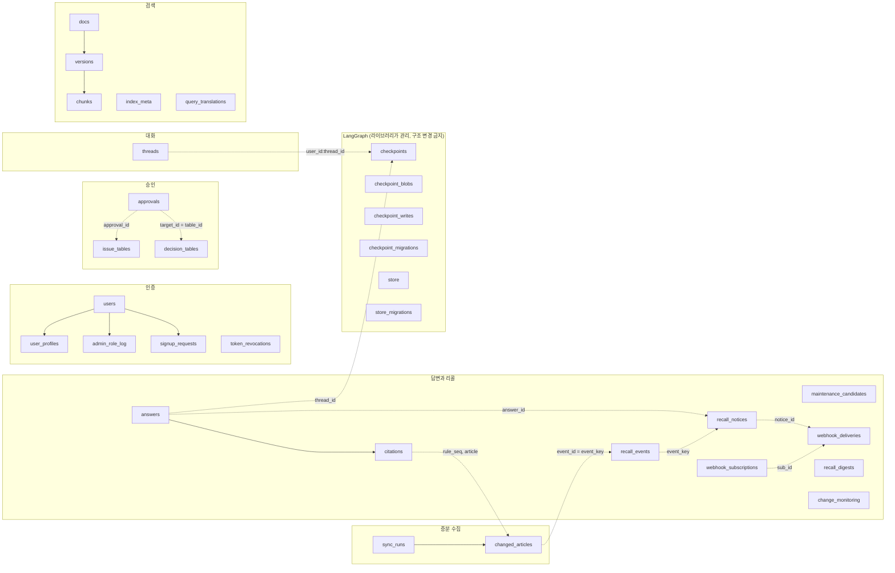
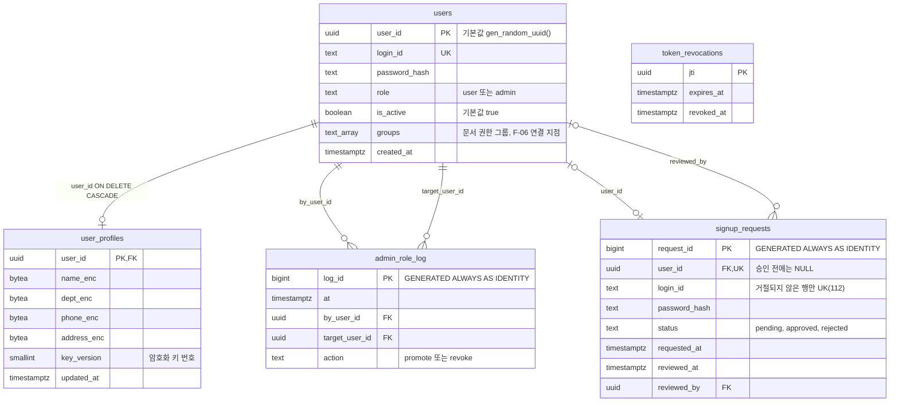
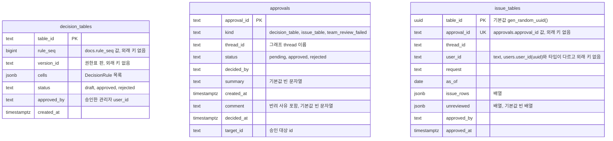
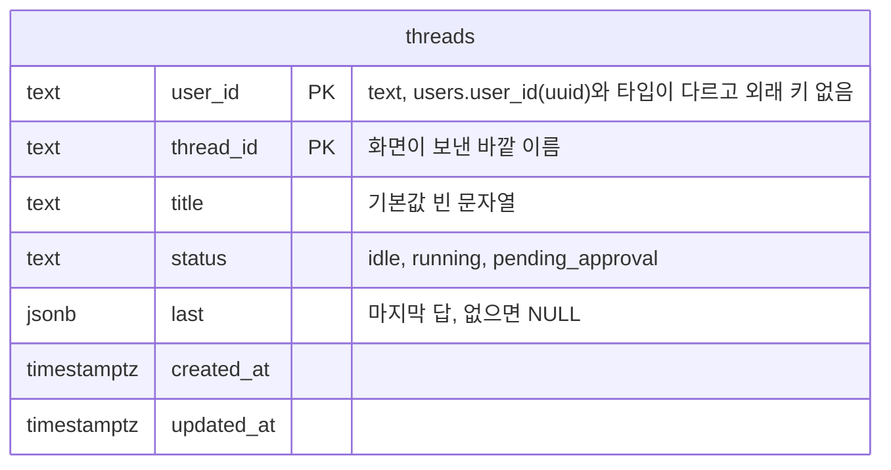
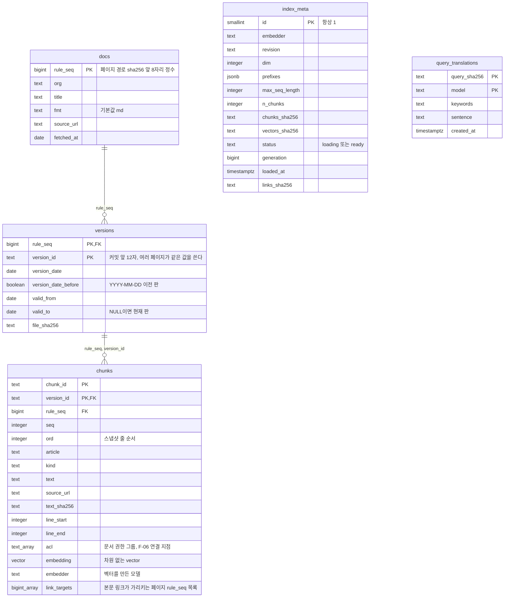
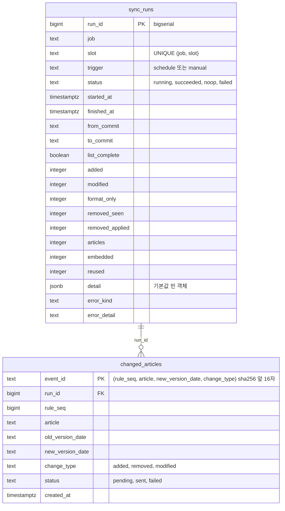
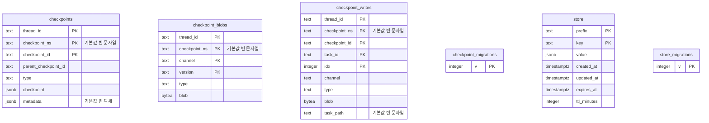

# Provena DB ERD (재정렬 후, 2026-11-10)

이 문서는 DB 재정렬(결정 0090) 뒤의 `public` 스키마 구조를 그림으로 보인다. 기준은 `db/*.sql`의 현재 내용이다. 칼럼 하나하나의 설명, 만든 파일, 쓰는 코드, 색인은 [TABLE_SPEC.md](TABLE_SPEC.md)에 있다.

- 앱 표 25개와 LangGraph 라이브러리 표 6개, 모두 31개다. 재정렬 전에는 34개(앱 표 28 + LangGraph 6)였다.
- `db/109_realign.sql`(1단계)을 적용한 DB에는 옛 표 3개(`answer_grounding`, `recall_feedback`, `issue_table_rejections`)가 원래 이름으로 남고, 2단계 `db/manual/109_retire_old.sql` 뒤에는 `_old_20261110`이 붙은 이름으로 `db/manual/109_purge_old.sql`을 실행하기 전까지 남는다. 이 표들은 그림에 넣지 않았다. 운영 DB에는 1단계(2026-11-10 밤), 2단계(2026-11-11 00:42, 이때 `public` 표 34개), 옛 표 삭제(2026-11-11)를 적용했고 삭제 뒤 `public` 표는 이 문서와 같은 31개다(적용 기록은 TABLE_SPEC.md 2-3).

## 1. 읽는 법

- 아래 그림은 모두 mermaid다. GitHub, VS Code(Markdown Preview Mermaid Support), Obsidian에서 그려진다.
- `erDiagram`에서 칼럼은 `타입 이름 키 "설명"` 순서로 적는다. 키는 `PK`(기본키), `FK`(외래 키), `UK`(고유 제약)이다. 키가 둘 이상이면 쉼표로 이었다.
- 타입 `text_array`는 PostgreSQL `text[]`, `float8`은 `double precision`이다. mermaid가 대괄호와 공백이 든 타입 이름을 그릴 때 실패하는 것을 피하려고 바꿔 적었다.
- 실선은 `db/*.sql`의 `REFERENCES`로 데이터베이스가 지키는 외래 키다. 선 끝 기호는 `||` 정확히 하나, `o|` 0 또는 1, `o{` 0 이상 여러 개다.
- 외래 키가 없고 코드가 문자열 값으로 맞추는 관계는 `erDiagram`에 선으로 그리지 않았다. 데이터베이스가 지키는 관계와 코드가 맞추는 관계가 한 그림에서 섞이지 않게 하려는 것이다. 이 관계들은 4장의 표 "논리 관계(외래 키 없음)"에 규칙과 근거를 적었다. 2장의 영역 도식에는 같은 관계 중 대표적인 것을 점선으로 함께 보였다.
- 외래 키가 없는 이유는 표마다 다르다. 예를 들어 `decision_tables.rule_seq`는 `db/102_decision_approvals.sql`이 `201_search.sql`보다 먼저 만들어져서 외래 키를 걸지 않았다고 적혀 있다(102:11). 다른 표는 이유가 파일에 적혀 있지 않다.
- 모든 앱 표는 RLS를 켜고 정책을 두지 않았다. 앱은 `DATABASE_URL`의 소유자 역할로 접속한다. 자세한 내용은 [TABLE_SPEC.md](TABLE_SPEC.md)의 "RLS와 권한" 항목에 있다.

## 2. 영역 도식

앱 표 25개를 영역으로 묶고 LangGraph 표 6개를 따로 두었다. 실선은 외래 키, 점선은 외래 키 없이 코드가 값으로 맞추는 관계(대표적인 것만)다. 점선의 전체 목록과 근거는 4장에 있다.

## 3. 영역별 ERD

### 3-1. 인증

파일: `db/101_auth_users.sql`, `103_auth_token_revocations.sql`, `104_user_profiles.sql`, `105_admin_role_log.sql`, `106_signup_approval.sql`.

`token_revocations`는 다른 표와 외래 키가 없다. `jti`는 로그인 토큰(JWT) 식별자다.

### 3-2. 승인

파일: `db/102_decision_approvals.sql`, `110_issue_tables.sql`. 이 영역의 세 표 사이에는 외래 키가 없다. 관계는 4장의 L1부터 L3이다.

### 3-3. 대화

파일: `db/111_threads.sql`. 대화 내용 전체는 이 표가 아니라 LangGraph 체크포인트 표에 있다.

### 3-4. 답변과 리콜

파일: `db/120_answers_recall.sql` 하나다. 외래 키는 `citations.answer_id`가 `answers.answer_id`를 가리키는 한 건뿐이다.

```mermaid
erDiagram
    answers ||--o{ citations : "answer_id ON DELETE CASCADE"

    answers {
        text answer_id PK
        text user_id "text, 외래 키 없음"
        text thread_id "그래프 thread 이름, 기본값 빈 문자열"
        text question
        text answer
        text as_of "질문 기준일, NULL이면 그때의 현재 판"
        timestamptz created_at
        jsonb grounding "인용 검사 결과, NULL이면 아직 기록 안 함 (옛 answer_grounding)"
        jsonb skills_used "NULL이면 아직 기록 안 함 (옛 answer_grounding)"
    }
    citations {
        text answer_id PK, FK
        text chunk_id PK
        text version_id PK
        bigint rule_seq
        text article
        text version_date
        text source_url
    }
    recall_events {
        text event_key PK "changed_articles.event_id와 같은 규칙"
        jsonb changed
        text status "running, done, failed"
        integer notices
        integer review
        integer judge_failures
        integer candidates
        text error_kind
        timestamptz started_at
        timestamptz finished_at
    }
    recall_notices {
        text notice_id PK
        text event_key
        text answer_id "answers.answer_id 값, 외래 키 없음"
        text user_id
        text thread_id
        text question
        text answer_excerpt
        jsonb changed
        boolean conclusion_changed
        text explanation
        text severity "high 또는 low"
        float8 confidence "0 이상 1 이하, NULL 허용"
        text change_pattern "기본값 빈 문자열"
        text review_status "pending, released, dismissed, NULL 허용"
        text review_reason
        text digest_status "pending, sent, NULL 허용"
        boolean judge_failed
        boolean acked
        timestamptz acked_at
        text source_url
        text old_text
        text new_text
        timestamptz created_at
        boolean feedback_useful "사용자 의견, NULL이면 의견 없음 (옛 recall_feedback)"
        text feedback_reason
        text feedback_by
        timestamptz feedback_at
    }
    maintenance_candidates {
        text candidate_id PK
        text event_key
        text upper_rule
        text upper_version_id
        bigint rule_seq
        text article
        text reason
        text status "pending, needed, not_needed"
        text decided_by
        timestamptz decided_at
        timestamptz created_at
    }
    webhook_subscriptions {
        text sub_id PK
        text url
        text secret_ref "비밀값이 든 환경변수 이름"
        boolean active
        text created_by
        timestamptz created_at
    }
    webhook_deliveries {
        text delivery_id PK
        text sub_id "webhook_subscriptions.sub_id 값, 외래 키 없음"
        text notice_id "kind가 digest이면 digest_id"
        text kind "notice 또는 digest"
        text status "pending, success, failed"
        integer tries
        integer last_status_code
        text last_error
        jsonb attempts
        timestamptz created_at
        timestamptz updated_at
    }
    recall_digests {
        text digest_id PK
        text user_id
        text day
        integer count
        jsonb notice_ids
        jsonb payload
        timestamptz created_at
    }
    change_monitoring {
        smallint id PK "항상 1"
        text status "active 또는 paused"
        text updated_by
        timestamptz updated_at
    }
```

`recall_notices`에는 `UNIQUE (answer_id, event_key)`도 있다. 이 제약은 칼럼 하나가 아니라 두 칼럼에 걸려 위 그림의 `UK` 표시로 나타내지 못했다.

### 3-5. 검색

파일: `db/201_search.sql`. 외래 키는 `versions.rule_seq`가 `docs`를, `chunks (rule_seq, version_id)`가 `versions`를 가리키는 두 건이다.

`bigint_array`는 PostgreSQL `bigint[]`다. `chunks`의 옛 판 행이 남는 이유와 검색 조건은 [TABLE_SPEC.md](TABLE_SPEC.md)의 `chunks` 절에 적었다.

### 3-6. 증분 수집

파일: `db/202_sync.sql`.

## 4. 논리 관계 (외래 키 없음)

아래 관계는 `db/*.sql`에 `REFERENCES`가 없다. 코드가 같은 값을 문자열이나 숫자로 맞춘다. 데이터베이스는 이 값이 맞는지 검사하지 않는다. "근거"는 이 저장소의 파일과 줄이다.

| 번호 | 한쪽 | 다른 쪽 | 맞추는 값과 규칙 | 근거 |
|---|---|---|---|---|
| L1 | `approvals.approval_id` | `issue_tables.approval_id` (UNIQUE) | 같은 문자열. 승인된 쟁점표 한 건이 승인 건 한 줄에 대응한다 | `db/110_issue_tables.sql:5`, `backend/graph/departments/store.py:67-69, 81-82` |
| L2 | `approvals.target_id` | `decision_tables.table_id` | `kind = 'decision_table'`이면 `target_id`가 결정표 `table_id`다 | `backend/graph/decision/repo.py:263-264, 279` |
| L3 | `approvals.target_id` | `issue_tables.table_id` | `kind = 'issue_table'`이면 승인 전에는 `approval_id` 자신, 승인 뒤에는 저장된 `table_id` 문자열이다 | `db/102_decision_approvals.sql:41`, `backend/graph/decision/repo.py:317-318` |
| L4 | `approvals.thread_id` | 체크포인트 `thread_id` | 그래프 thread 이름 `<user_id>:<thread_id>`. 승인 대기 조회가 이 이름으로 한다 | `backend/api/routes.py:86-87, 312` |
| L5 | `threads (user_id, thread_id)` | `checkpoints.thread_id`, `checkpoint_blobs.thread_id`, `checkpoint_writes.thread_id` | `threads`의 `thread_id`는 화면이 보낸 바깥 이름이고, 체크포인트에는 `"<user_id>:<thread_id>"`를 쓴다. 같은 `t1`도 사용자마다 따로다 | `db/111_threads.sql:3`, `backend/api/routes.py:86-87, 230-231` |
| L6 | `answers.thread_id`, `recall_notices.thread_id` | 체크포인트 `thread_id` | 그래프 이름 `<user_id>:<thread_id>` 그대로 저장한다. 화면용 바깥 이름은 앞 접두어를 떼어 얻는다 | `db/120_answers_recall.sql:6`, `backend/graph/recall/graph.py:43-48` |
| L7 | `answers.answer_id` | `recall_notices.answer_id` | 같은 문자열. 한 답과 한 개정에 알림은 한 줄이다(`UNIQUE (answer_id, event_key)`) | `db/120_answers_recall.sql:81`, `backend/graph/recall/store.py:328-333` |
| L8 | `citations (rule_seq, article)` | `changed_articles (rule_seq, article)` | 바뀐 섹션이 들어오면 같은 `(rule_seq, article)`을 인용한 답을 찾는다 | `backend/graph/answer_store.py:221-228`, `backend/graph/recall/graph.py:85` |
| L9 | `citations (chunk_id, version_id)` | `chunks (chunk_id, version_id)` | 같은 값이다. 인용 표는 `chunks`와 외래 키가 없고, 두 표를 이어 읽는 SQL은 코드에서 찾지 못했다 | `db/120_answers_recall.sql:24-33`, `db/201_search.sql:35-53` |
| L10 | `recall_events.event_key` | `recall_notices.event_key`, `maintenance_candidates.event_key`, `changed_articles.event_id` | 모두 같은 값이다. `event_id`는 `(rule_seq, article, new_version_date, change_type)`의 sha256 앞 16자리이고, 리콜 처리가 이를 `event_key`로 쓴다 | `backend/rag/ingest/schedule.py:66-68`, `backend/graph/recall/service.py:91`, `backend/graph/recall/process_pending.py:35` |
| L11 | `recall_notices.changed` (jsonb의 `rule_seq`, `article`) | `changed_articles (rule_seq, article)`, `docs.rule_seq` | `changed`는 변경 섹션(`ChangedArticle`)을 JSON으로 넣은 값이다. 의견 집계 색인이 이 두 값을 식으로 쓴다 | `backend/graph/recall/store.py:310, 359-360`, `db/120_answers_recall.sql:136-138` |
| L12 | `webhook_deliveries.sub_id` | `webhook_subscriptions.sub_id` | 같은 문자열 | `db/120_answers_recall.sql:110, 121` |
| L13 | `webhook_deliveries.notice_id` | `recall_notices.notice_id` 또는 `recall_digests.digest_id` | `kind = 'notice'`이면 알림 id, `kind = 'digest'`이면 요약 id다 | `db/120_answers_recall.sql:122-123` |
| L14 | `recall_digests.notice_ids` (jsonb 목록) | `recall_notices.notice_id` | 요약에 묶인 알림 id 목록 | `db/120_answers_recall.sql:146` |
| L15 | `users.user_id` (uuid) | `threads.user_id`, `answers.user_id`, `recall_notices.user_id`, `recall_digests.user_id`, `issue_tables.user_id` (모두 text) | 사용자 id의 문자열 표현이다. 타입이 다르고(`uuid`와 `text`) 외래 키가 없다 | `db/101_auth_users.sql:7`, `db/111_threads.sql:7`, `db/120_answers_recall.sql:9`, `db/110_issue_tables.sql:10` |
| L16 | `users.user_id` | `approvals.decided_by`, `decision_tables.approved_by`, `issue_tables.approved_by`, `maintenance_candidates.decided_by`, `change_monitoring.updated_by` (모두 text) | 결정한 관리자 `user_id` 문자열이다. 외래 키가 없다 | `db/102_decision_approvals.sql:15, 27`, `db/110_issue_tables.sql:15` |
| L17 | `docs.rule_seq` | `decision_tables.rule_seq`, `changed_articles.rule_seq`, `citations.rule_seq`, `maintenance_candidates.rule_seq` | 같은 페이지 id다. `decision_tables`는 `201_search.sql`보다 먼저 만들어져 외래 키를 걸지 않았다고 파일에 적혀 있다. 나머지 표가 외래 키를 걸지 않은 이유는 파일에서 찾지 못했다 | `db/102_decision_approvals.sql:11` |
| L18 | `versions.version_id` | `decision_tables.version_id`, `citations.version_id`, `maintenance_candidates.upper_version_id` | 같은 판 id(커밋 앞 12자)다 | `db/102_decision_approvals.sql:12`, `db/120_answers_recall.sql:27, 97` |
| L19 | `index_meta.embedder` | `chunks.embedder` | 색인 장부의 모델 이름과 청크 행의 벡터 모델 이름이 같아야 한다. 증분 수집이 실행 전에 대조한다 | `backend/rag/ingest/schedule.py:152-158` |
| L20 | LangGraph 체크포인트 표끼리 | `(thread_id, checkpoint_ns, checkpoint_id)` 등 | 라이브러리가 키 값으로 맞춘다. 외래 키는 없다(실제 생성된 구조에 외래 키 항목이 없음) | `docs/db/TABLE_SPEC.md` 5장, `backend/graph/checkpoint.py:119-139` |
| L21 | `store (prefix, key)` | 사용자 프로필 | 코드는 namespace `(user_id, "profile")`, 키 `"me"`로 읽고 쓴다. `prefix` 칼럼에 namespace가 어떤 문자열로 들어가는지는 라이브러리 구현이라 이 문서에서 확인하지 못했다 | `backend/memory/profile.py:14, 19-22, 25-47` |

## 5. LangGraph 표 6개

이 표들은 LangGraph 라이브러리(`langgraph-checkpoint-postgres`)가 앱 시작 때 `.setup()`으로 만들고 관리한다. 우리 SQL 파일(`db/*.sql`)에는 정의가 없다. **구조(칼럼, 색인, 제약)를 바꾸지 않는다.** 정리가 필요하면 행을 지우는 SQL만 쓴다. 칼럼 정의는 [TABLE_SPEC.md](TABLE_SPEC.md) 5장에 있다.

체크포인트 세 표(`checkpoints`, `checkpoint_blobs`, `checkpoint_writes`)는 `thread_id`로 같은 대화를 가리키지만 외래 키는 없다. `checkpoint_migrations`와 `store_migrations`는 라이브러리 마이그레이션 버전 기록이다. `store`는 `backend/memory/profile.py`가 사용자 프로필(소속과 직급)을 넣는 데 쓴다.

